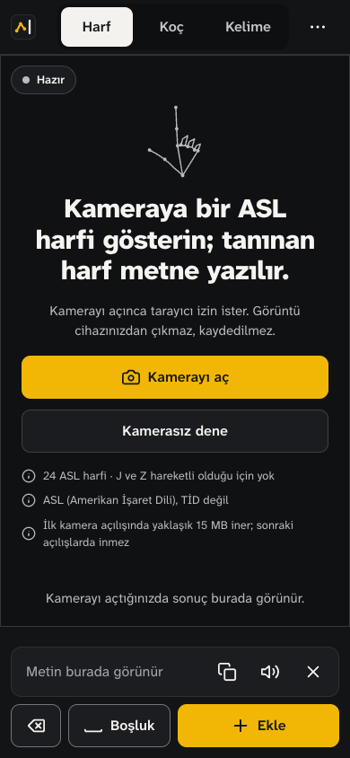
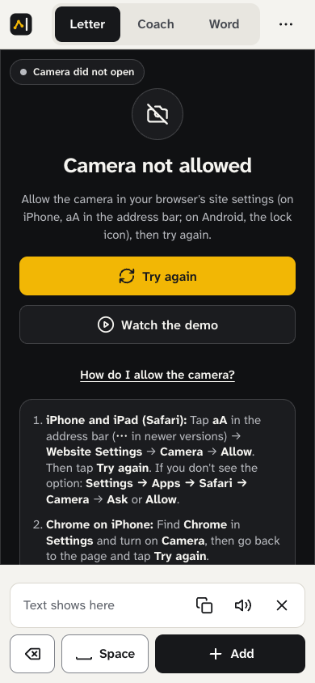
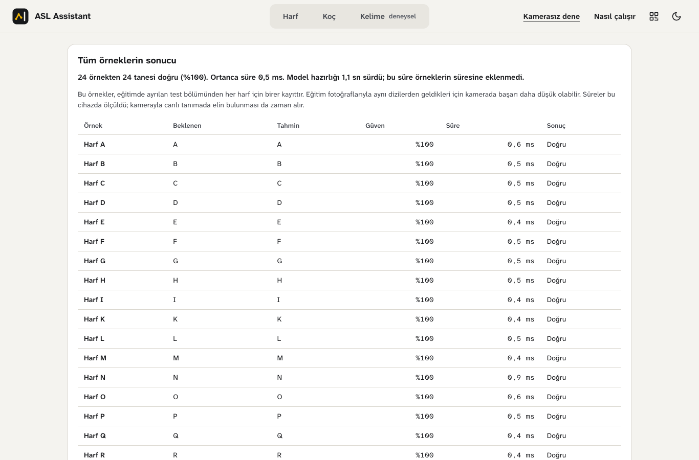

# ASL Assistant

[Live demo](https://asl-assistant.netlify.app/) · [Getting started](docs/getting-started.md) · [Documentation](docs/README.md) · [Technical report](TECHNICAL_REPORT.md) · [Türkçe](README.tr.md)

ASL Assistant is a sign-language assistant that runs in the browser. It reads
American Sign Language letters live from the camera and turns them into text,
and it has an experimental mode for 50 isolated ASL words. Hand, face and pose
landmarks are found with MediaPipe and classified with ONNX models, all inside
the page: there is no application server, and the camera image never leaves the
device. The interface is in Turkish.

> The live demo runs an older build than this repository and does not yet show
> the interface below.


<table>
  <tr>
    <td align="center" width="33%"><br><sub>Letter screen on a phone</sub></td>
    <td align="center" width="33%"><br><sub>Dark theme</sub></td>
    <td align="center" width="33%"><br><sub>Help after a refused camera permission</sub></td>
  </tr>
</table>

<table>
  <tr>
    <td align="center" width="50%"><br><sub>Word screen (experimental)</sub></td>
    <td align="center" width="50%"><br><sub>Model Test after a real run of the letter samples</sub></td>
  </tr>
</table>

The screenshots come from headless Chrome without a camera, so no screen shows
live recognition. The Model Test results are a real run of the bundled letter
samples through the published model; what they measure is explained under
[How it works](#how-it-works).

## What it does

| Mode (label in the app) | What it does |
|---|---|
| Letter (*Harf*) | Recognises 24 static ASL letters from the camera, live. Space adds the shown letter to the text, Enter adds a space, Backspace deletes. The text can be copied or read aloud. This is the main mode. |
| Word (*Kelime*, experimental) | Records one isolated sign and shows the three most likely of 50 words. Nothing reaches the text until you accept the result. |
| Coach (*Koç*, early) | Practice with a chosen letter or word. A letter counts when it is held steadily; progress is kept on the device. |
| Model Test (*Kamerasız dene*) | Runs bundled samples through the same models without a camera, one at a time or all together, and shows the prediction, confidence and time. |
| QR (*Telefonda aç*) | A QR code that opens the hosted letter, word or Model Test screen on a phone. |
| Project (*Nasıl çalışır*) | A short summary of the models and their limits. |

## How it works

```text
camera frame (stays in the page)
  -> MediaPipe Tasks Vision: hand, pose and face landmarks
  -> letter: 21 hand landmarks, left hand mirrored, smoothed  -> 93 features
             -> LightGBM exported to ONNX                     -> 24 letters
  -> word:   321-D frames (hands, face, pose) for up to 45 frames
             -> 45 x 168 features + a 45-value padding mask
             -> SignTransformer exported to ONNX              -> top 3 of 50 words
  -> ONNX Runtime Web (WebAssembly)
  -> the visitor adds the letter, or accepts the word
```

The app is plain HTML, CSS and JavaScript. The browser loads classic
`<script>` files in a fixed order; there is no framework, bundler, transpiler
or build step, and the files in `asl-web/` are the files that are deployed.
ONNX Runtime and the QR library come from jsDelivr with integrity hashes,
MediaPipe from jsDelivr and its landmark models from Google Cloud Storage. The
models in `asl-web/models/` download only when something needs them, so a
visitor who never opens the camera downloads none.

The recorded results, from [`asl-web/data/model-card.json`](asl-web/data/model-card.json):

| | Letter model | Word model |
|---|---|---|
| Model | LightGBM | SignTransformer encoder, 446,195 parameters |
| Classes | 24 static letters (J and Z need motion and are not included) | 50 isolated signs |
| Input | 93 engineered features | 45 × 168 features plus a mask |
| Recorded test result | 99.35% accuracy on 8,245 held-out rows | 71.92% accuracy, 0.714 macro-F1 on 3,918 recordings |
| Split | Random over landmark rows; **not** signer-independent | Signer-independent; the test set is 4 signers not seen in training |
| File | 13.2 MB ONNX, served gzipped at 2.2 MB | 1.9 MB ONNX |

Read the two figures with their caveats. The letter split was drawn at random
from merged image datasets, so near-identical frames of the same person can
sit on both sides of it; 99.35% probably overstates accuracy for a new signer.
The word figure is for isolated signs from held-out signers, not continuous
signing, and live confidence is often much lower. The 24 of 24 in the Model
Test screenshot is a regression check on one held-out row per letter, not an
evaluation. [Models and data](docs/models-and-data.md) has the feature order,
the ONNX contracts and the full evaluation scope.

## Technologies and tools

| Area | What is used |
|---|---|
| Browser runtime | [MediaPipe Tasks Vision](https://github.com/google-ai-edge/mediapipe) 0.10.18 (hand, pose and face landmarkers), [ONNX Runtime Web](https://github.com/microsoft/onnxruntime) 1.22.0 on WebAssembly, [kjua](https://github.com/lrsjng/kjua) 0.9.0 for QR codes, Web Speech for reading text aloud |
| Interface | HTML, CSS cascade layers and classic scripts, with no build step; [Atkinson Hyperlegible Next](https://github.com/googlefonts/atkinson-hyperlegible-next) and [Mono](https://github.com/googlefonts/atkinson-hyperlegible-next-mono), self-hosted; JSDoc types checked by TypeScript 5.9.3 without emitting files (development only) |
| Machine learning | Python 3.12, LightGBM, PyTorch, onnx and onnxruntime, MediaPipe for landmark extraction, scikit-learn; versions pinned in [`requirements.txt`](requirements.txt). The word model was trained in a Kaggle notebook on a single T4 GPU. |
| Testing | `node:test` with a `node:vm` harness that loads the real browser scripts, pytest, headless-Chrome checks over the DevTools Protocol with no npm dependency, Ruff |
| Hosting | Netlify, as a static site uploaded by hand; response headers live in `asl-web/_headers` |

## Engineering practices

- **Tests that are shown to fail.** The rules that matter most each have a
  behavioural test that was run against a deliberately broken copy and seen to
  fail: a word is never added without the visitor accepting it, the word mask
  is not inverted, frames reach the model in order, and leaving a camera screen
  releases the camera. The [headless-Chrome checks](tests/browser/README.md)
  were shown to fail on deliberate faults the same way.
  New tests assert behaviour rather than source text and mock only the system
  boundaries: camera, network, clock, MediaPipe and ONNX Runtime. Some older
  tests still match source text; each is retired once a replacement is shown
  to catch the same faults.
- **Python and the browser compute the same features.** Feature engineering
  lives in Python (`asl-features/`) for training and in JavaScript for the app. A
  vector in the wrong order still runs and quietly predicts nonsense, so
  `make parity` feeds the same deterministic inputs to both and requires them
  to agree within 1e-4, for letters and words. Every deployed model is also
  checked against its source by SHA-256 and against its expected ONNX inputs
  and outputs.
- **A deploy inventory.** The site is deployed by dragging `asl-web/` into the
  host, which uploads whatever is on disk. `make deploy-check` lists every file
  that upload would carry and fails on ignored or hidden files, unknown file
  types, and the local samples derived from data that may not be redistributed.
- **Privacy.** No backend, no account and no analytics. Video is
  processed in the page and is not recorded or sent anywhere. The browser keeps
  three things in `localStorage`: the theme, the text and the coach progress.
  CDN scripts are pinned to exact versions with integrity hashes.

## Quick start

To run the app, any static file server will do; nothing needs installing:

```bash
make web               # serves asl-web/ at http://localhost:8080
```

The camera works on `localhost` or HTTPS, not from a `file://` page. To check
the models without a camera, open **Kamerasız dene** (Model Test).

To work on the code (Python 3.12 and Node 24; the Conda file is one way to get
both):

```bash
conda env create -f environment.yml
conda activate asl-assistant
make setup             # pinned dependencies and the local packages
make check             # lint, tests, validation, parity, type check (run npm ci once first)
make browser-check     # checks in headless Chrome; needs Chrome
make deploy-check      # before every upload of asl-web/
```

[Getting started](docs/getting-started.md) covers `venv`, Windows, every `make`
target, deployment and troubleshooting.

## Project layout

```text
asl-web/       the app: index.html, css/, js/ (core, media, ml, services, ui), models/, data/
asl-features/  Python feature engineering for letters and words, the source of truth for both pipelines
asl-desktop/   an earlier desktop prototype in Python, kept working
scripts/       data preparation, training, fixture export, validation
tests/         browser units (tests/web), headless-Chrome checks, Python and repository tests
notebooks/     word-model training records and results
models/        curated model files and their metadata
docs/          architecture, getting started, models and data, project history
```

The [documentation index](docs/README.md) says which document answers which
question, from the browser architecture to the project's history.

## Limitations

- The app has not yet been tested on a real phone. Automated checks run in
  headless desktop Chrome with a simulated camera; iOS Safari and Android
  Chrome are untested.
- The word model is experimental. It recognises isolated signs, not continuous
  signing, and a result below a confidence threshold cannot be accepted.
- The letter model has 24 static letters, no J or Z, and no "no sign" class.
  Its 99.35% comes from a split that shares signers with training; on hands it
  has never seen it measured 69%, weakest on the fist letters (M, N, T, S, E,
  A). See [Models and data](docs/models-and-data.md).
- The word reference pictures in the app are being redrawn; until then, check a
  handshape against a standard ASL dictionary.
- The Content Security Policy is report-only. It will be enforced once it has
  been read on the deployed site in a real browser.
- The first visit needs a network connection: ONNX Runtime and MediaPipe come
  from public CDNs, about 17 MB for a first letter session.
- The command that converted the letter model to ONNX is not in the repository.

## Future work

- Test on real devices: iOS Safari and Android Chrome, with real hands and
  lighting.
- Evaluate the letter model on signers it has never seen.
- Add more words and move from isolated signs towards continuous signing.
- Translate at sentence level rather than word by word.
- Update models on the device without redeploying the site.
- Enforce the Content Security Policy.
- Work offline as a progressive web app.
- Review accessibility and usefulness with Deaf users.

## Licence

The source code and the trained model files are released under the
[PolyForm Noncommercial License 1.0.0](LICENSE). Personal, educational and
research use are allowed; commercial use needs the copyright holder's
permission.

The model files in `asl-web/models/` and `models/` are treated as part of the
software, and the terms of their training data, listed below, also apply. This
project makes no claim either way about whether a dataset's licence, such as
the GPL-2.0 label on the main letter source, carries over to weights trained on
it. If your use needs certainty, check the source terms or train your own model
with the scripts here. The `.pkl` and `.pt` files are Python pickles: load them
only from a copy you trust.

## Data and attribution

The raw datasets are not in this repository. Each source's role, split sizes
and exclusions are in
[Models and data](docs/models-and-data.md#training-data-and-environments), and
the [data workspace](data/README.md) lists what stays out of Git.

| Model | Source | Terms |
|---|---|---|
| Letters | [ASL Alphabet](https://www.kaggle.com/datasets/grassknoted/asl-alphabet), Akash Nagaraj, 2018, [doi:10.34740/KAGGLE/DSV/29550](https://doi.org/10.34740/KAGGLE/DSV/29550) | GPL-2.0, as labelled by the provider |
| Letters | [American Sign Language Dataset](https://www.kaggle.com/datasets/ayuraj/asl-dataset), Ayush Thakur | CC0 1.0 |
| Letters | A local `ASL_SemCom` image subset associated with [ASL-Fingerspelling](https://github.com/Mohammed-Shoaib/ASL-Fingerspelling) (1,580 of 54,961 landmark rows) | Not recorded; the images are not redistributed |
| Words | [Google - Isolated Sign Language Recognition](https://www.kaggle.com/competitions/asl-signs) competition data (Kaggle, 2023), provided by the Deaf Professional Arts Network and the Georgia Institute of Technology | [CC BY 4.0](https://creativecommons.org/licenses/by/4.0/), subject to the competition rules |

Changes made to the data: the letter images were reduced to MediaPipe hand
landmarks and then to 93 engineered features; for words, 50 of the 250 signs
were selected and each landmark sequence was resampled to 45 frames of 168
features. The published models contain learned parameters only, not the
images, recordings or landmark tables. The 24 Model Test letter samples are
single 93-feature vectors from held-out landmark rows: 23 from ASL Alphabet and
the K sample from the `ASL_SemCom` subset
([details](docs/models-and-data.md#model-test-fixture-contract)).

The competition rules allow the data to be used for any purpose (section 7.A)
but forbid redistributing it (section 7.B), and they prevail over its CC BY 4.0
licence where the two conflict. This repository therefore publishes the trained
word model and aggregate results, but no landmark data: the Model Test word
samples exported from the competition stay local, and the published word
sample is synthetic.

Third-party software:

| Component | Version | Licence | How it is used |
|---|---|---|---|
| [MediaPipe Tasks Vision](https://github.com/google-ai-edge/mediapipe), with Google's hand, pose and face landmarker models | 0.10.18 | Apache-2.0 | Code from jsDelivr, models from Google Cloud Storage; not redistributed |
| [ONNX Runtime Web](https://github.com/microsoft/onnxruntime) | 1.22.0 | MIT | Loaded from jsDelivr, not redistributed |
| [kjua](https://github.com/lrsjng/kjua) | 0.9.0 | MIT | Loaded from jsDelivr for the QR screen, not redistributed |
| [Atkinson Hyperlegible Next](https://github.com/googlefonts/atkinson-hyperlegible-next) and [Atkinson Hyperlegible Mono](https://github.com/googlefonts/atkinson-hyperlegible-next-mono) | Not pinned | SIL Open Font License 1.1 | Redistributed, subset to Latin and Turkish, in `asl-web/assets/fonts/` with the licence |
| [ASL alphabet chart](https://commons.wikimedia.org/wiki/File:Asl_alphabet_gallaudet.svg) by Ds13, from the Gallaudet font, vectorised by Marnanel | 2004 SVG, revised on Commons | Public domain, released by the author (the font itself is © 1991 David Rakowski) | Rendered and cropped to the 26 letters as `asl-web/assets/signs/letters.png`; the letter screen's reference |

The sign video links in `asl-web/data/asl_video_links.json` point to
third-party YouTube videos, which belong to their creators.
