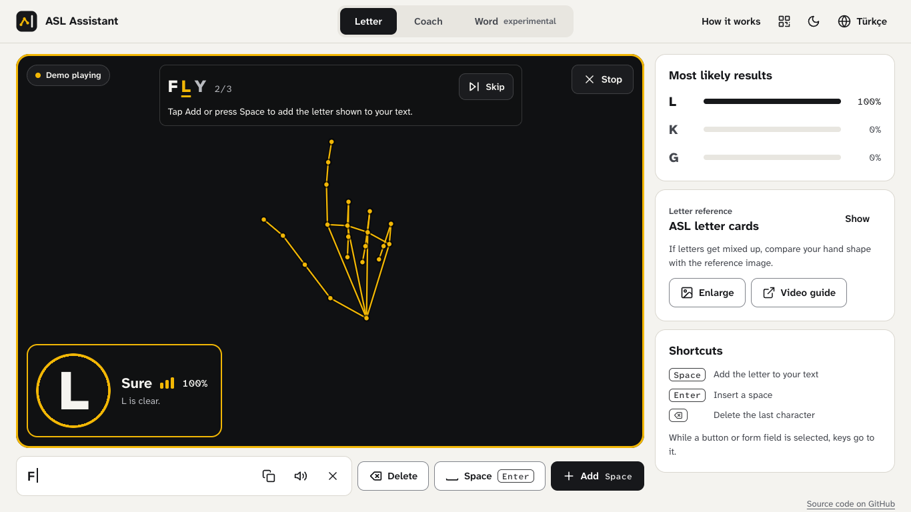
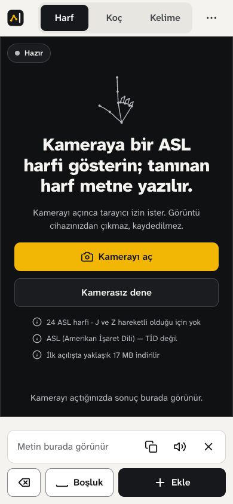
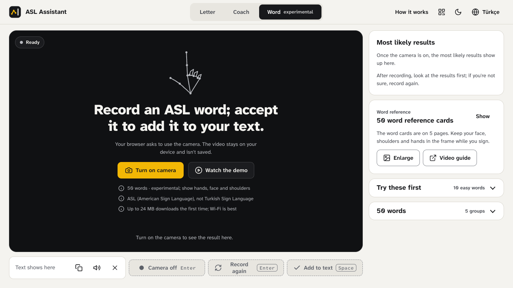

# ASL Assistant

[](https://github.com/alimustafaekmen/asl-assistant/actions/workflows/ci.yml)

**Live demo:** https://asl-assistant.pages.dev/ · [Technical report](docs/technical-report.md) · [Türkçe](README.tr.md)

ASL Assistant reads American Sign Language letters from the camera in real time and turns them into text, entirely in the browser. There is no server, so the video never leaves your device. An experimental word mode recognises 50 isolated signs, and the interface is in English and Turkish.



<p align="center">
  
  
</p>

## Results

| | Letters (24 static) | Words (50 isolated signs) |
|---|---|---|
| Model | LightGBM on 93 hand-shape features | Transformer on 45 frames × 168 features |
| Accuracy | 68.9% on a separate test set | 71.9% top-1, 0.71 macro-F1 on 4 signers never seen in training |

The letter model scores 99.35% on a random split, but that number is too high. The main dataset photographs each letter as long runs of near-identical frames, so a random split leaves near-copies of the test photos in training. I measured it again on a separate test set (68.9%) and by retraining with one whole dataset held out (about 40% to 80%). The [technical report](docs/technical-report.md#letter-model) has the details. The demo hand comes from the training photos, which is why the demo always reads it right.

## What I built

- The letter data pipeline: hand landmarks from three datasets, cleaning, 93 hand-shape features (distances, joint angles, finger flags) and a LightGBM model exported to ONNX.
- The word model, which I trained in a Kaggle notebook on a split by signer. I compared feature sets, sequence lengths and four architectures. The Transformer and a BiGRU tied on validation (0.792 and 0.791 macro-F1), and I kept the Transformer because it is smaller.
- The browser app: MediaPipe in video mode and ONNX Runtime Web, with the models loaded on first use, so opening the page costs about 0.35 MB.
- One feature definition in Python (`asl-features/`), re-implemented in JavaScript and checked to agree within 1e-4.
- The Turkish and English interface, the camera-free demo and a practice mode.
- Tests in Node and headless Chrome that boot the real app with the camera, MediaPipe and ONNX Runtime faked, and CI on GitHub Actions.

## How it works

```text
camera frame -> MediaPipe Tasks Vision (hand, pose, face landmarks)
  letter: 21 hand landmarks -> 93 features -> LightGBM (ONNX) -> 24 letters
  word:   45 frames x 168 features + mask -> SignTransformer (ONNX) -> top 3 of 50 words
  -> ONNX Runtime Web (WebAssembly) -> the user adds the letter or accepts the word
```

The app is plain HTML, CSS and JavaScript with no framework and no build step, so the `asl-web/` folder is the whole site.

## Key decisions

- **Everything runs in the browser.** There is no server to run or pay for, and the camera image stays private.
- **Landmarks instead of pixels.** MediaPipe turns each frame into points, so the models stay small and I can inspect the features.
- **Words are split by signer.** With a random split the model can learn the signers, so I tested on 4 people it never saw.
- **The user accepts every word.** Correct words often come with low confidence, so the app shows the top three and waits.

## Run it

Try it at https://asl-assistant.pages.dev/, or run it locally with `make web` (http://localhost:8080, needs only Python 3). For development (`make setup`, `npm ci`, `make check`) see [getting started](docs/getting-started.md).

## Limitations

- I have not trained a model for J and Z, because they need motion.
- The letter model needs training data from more signers to do better on new hands.
- The word model knows only 50 isolated signs, and I measured it on 4 test signers with one training seed.
- I have tested the app in desktop Chrome, but not yet on a real phone.

## Tech stack

- **Browser:** HTML, CSS and JavaScript, MediaPipe Tasks Vision 0.10.18, ONNX Runtime Web 1.22.0, Cloudflare Pages.
- **Machine learning:** Python 3.12, LightGBM, PyTorch, scikit-learn, ONNX.
- **Testing:** `node:test`, pytest, headless Chrome, TypeScript on JSDoc types, Ruff, GitHub Actions.

## Licence

The source code and the trained model files are released under the [PolyForm Noncommercial License 1.0.0](LICENSE): personal, educational and research use are allowed, commercial use needs my permission. The terms of the training data below also apply to the model files.

## Data and attribution

- Letters: [ASL Alphabet](https://www.kaggle.com/datasets/grassknoted/asl-alphabet), Akash Nagaraj, 2018, [doi:10.34740/KAGGLE/DSV/29550](https://doi.org/10.34740/KAGGLE/DSV/29550) (GPL-2.0, as labelled by the provider).
- Letters and the demo poses: [American Sign Language Dataset](https://www.kaggle.com/datasets/ayuraj/asl-dataset), Ayush Thakur (CC0 1.0).
- Letters: `ASL_SemCom` images associated with [ASL-Fingerspelling](https://github.com/Mohammed-Shoaib/ASL-Fingerspelling) (terms not recorded; the images are not redistributed).
- Words: [Google - Isolated Sign Language Recognition](https://www.kaggle.com/competitions/asl-signs) (Kaggle, 2023), Deaf Professional Arts Network and Georgia Institute of Technology ([CC BY 4.0](https://creativecommons.org/licenses/by/4.0/), subject to the competition rules).

Changes: I reduced the letter images to MediaPipe hand landmarks and 93 features. For words I kept 50 of the 250 signs and resampled each sequence to 45 frames of 168 features. The models hold learned parameters only. The competition rules forbid redistributing the data (section 7.B), so the repository publishes no landmark data from it and its word sample is synthetic. The 24 Model Test letter samples are the 93 features of held-out rows, 23 from ASL Alphabet and the K sample from the `ASL_SemCom` images. The demo poses in `asl-web/data/demo-letters.json` are landmarks found in three American Sign Language Dataset photographs.

Other components:

- [MediaPipe Tasks Vision](https://github.com/google-ai-edge/mediapipe) and Google's landmarker models (Apache-2.0), loaded from jsDelivr and Google Cloud Storage.
- [ONNX Runtime Web](https://github.com/microsoft/onnxruntime) and [kjua](https://github.com/lrsjng/kjua) (MIT), loaded from jsDelivr.
- [Atkinson Hyperlegible Next](https://github.com/googlefonts/atkinson-hyperlegible-next) and [Mono](https://github.com/googlefonts/atkinson-hyperlegible-next-mono) (SIL OFL 1.1), subset in `asl-web/assets/fonts/` with the licence.
- The [ASL alphabet chart](https://commons.wikimedia.org/wiki/File:Asl_alphabet_gallaudet.svg) by Ds13, from the Gallaudet font (© 1991 David Rakowski), vectorised by Marnanel (public domain), cropped as `asl-web/assets/signs/letters.png`.
- The video links in `asl-web/data/asl_video_links.json` point to YouTube videos owned by their creators.
