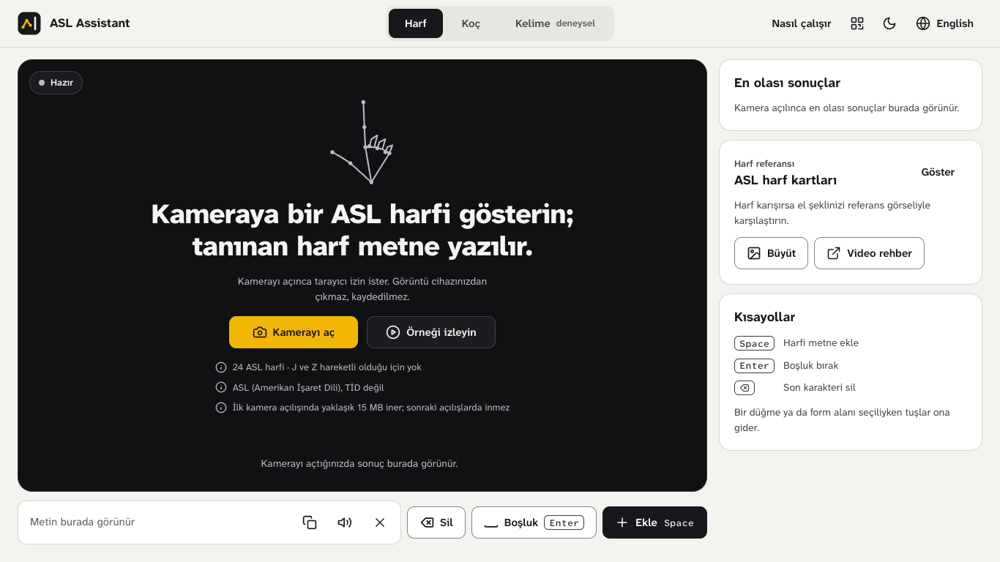
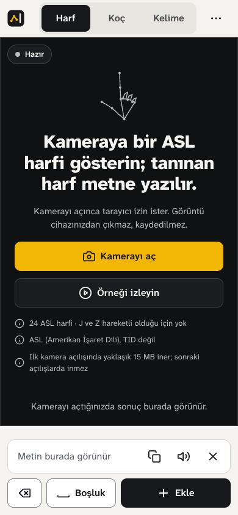
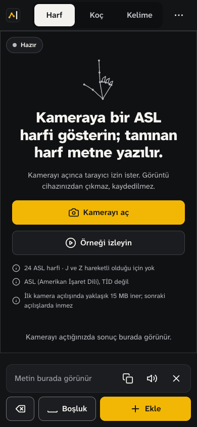
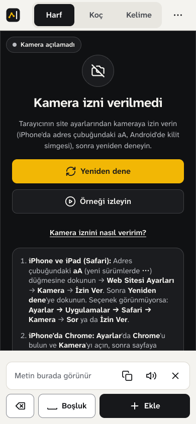
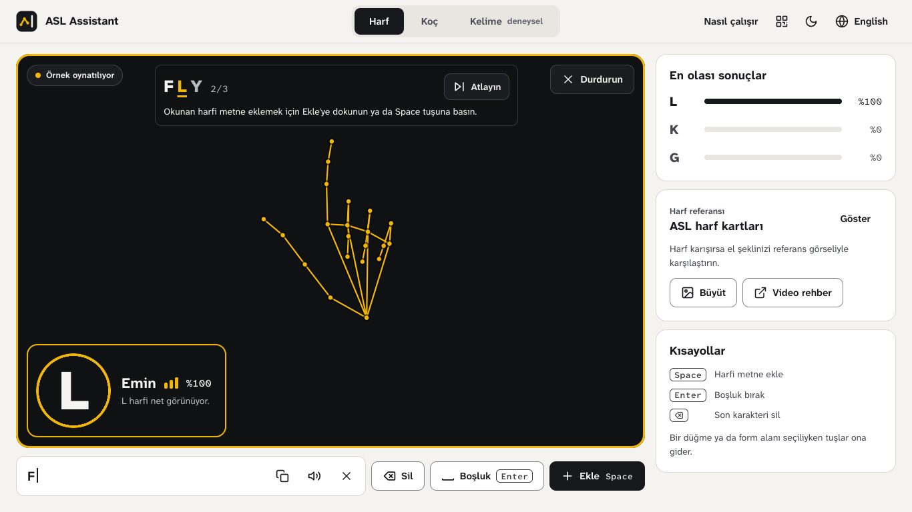
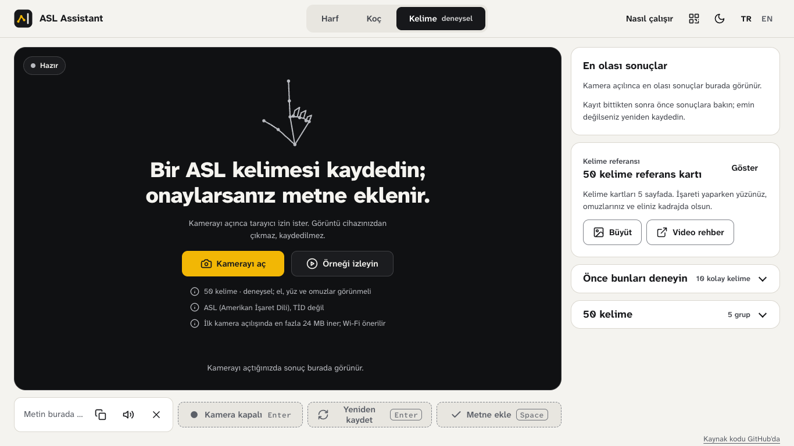

# ASL Assistant

[](https://github.com/alimustafaekmen/asl-assistant/actions/workflows/ci.yml)

**Canlı demo:** https://asl-assistant.pages.dev/ · [Teknik rapor](TECHNICAL_REPORT.tr.md) · [English](README.md)

ASL Assistant, Amerikan İşaret Dili (ASL) harflerini kameradan okuyup metne çeviren bir web uygulaması. Her şey tarayıcıda olur: MediaPipe el, yüz ve vücut noktalarını (landmark) bulur, iki küçük ONNX modeli de bu noktaları sayfanın içinde sınıflandırır. Sunucu yoktur, kamera görüntüsü cihazdan çıkmaz. Asıl mod harf tanıma; ayrıca 50 ASL kelimesini tek tek tanıyan deneysel bir mod var. Arayüz Türkçe ve İngilizce.



<table>
  <tr>
    <td align="center" width="33%"><br><sub>Telefonda harf ekranı</sub></td>
    <td align="center" width="33%"><br><sub>Koyu tema</sub></td>
    <td align="center" width="33%"><br><sub>Kamera izni verilmediğinde</sub></td>
  </tr>
  <tr>
    <td align="center" colspan="2"><br><sub>Kamerasız örnek</sub></td>
    <td align="center"><br><sub>Kelime ekranı (deneysel)</sub></td>
  </tr>
</table>

## Neler yapıyor?

- **Harf.** 24 statik ASL harfini kameradan canlı tanır. Space ekrandaki harfi ekler, Enter boşluk koyar, Backspace siler. Metin kopyalanabilir ya da sesli okunabilir.
- **Kamerasız örnek.** *Örneği izleyin*, FLY kelimesini heceleyen kayıtlı bir eli kameradaki elle aynı adımlardan geçirir. Harfler yine tek tek elle eklenir.
- **Kelime (deneysel).** Tek bir işareti kaydeder ve 50 kelime arasından en olası üç tanesini gösterir. Sonuç onaylanmadan metne eklenmez.
- **Koç.** Seçilen bir harf ya da kelimeyle alıştırma yapılır; ilerleme cihazda saklanır.
- **Ayrıca:** uygulamayı telefonda açmak için bir QR kodu, kısa bir proje sayfası ve hazır örnekleri modellerden geçiren Model Test (`#test`).

## Nasıl çalışıyor?

```text
kamera karesi -> MediaPipe Tasks Vision (el, vücut ve yüz noktaları)
  harf:   21 el noktası -> 93 özellik -> LightGBM (ONNX) -> 24 harf
  kelime: 45 kare x 168 özellik + maske -> SignTransformer (ONNX) -> 50 kelimeden ilk 3
  -> ONNX Runtime Web (WebAssembly) -> kullanıcı harfi ekler ya da kelimeyi onaylar
```

Uygulama düz HTML, CSS ve JavaScript ile yazıldı; framework ya da derleme adımı yok, script'ler klasik `<script>` etiketleriyle yükleniyor. Özellikler eğitim için Python'da (`asl-features/`) hesaplanıyor, tarayıcıda ise aynı hesap JavaScript ile yapılıyor; iki tarafın sonuçları testlerde 1e-4 farkla karşılaştırılıyor. Modeller ancak gerektiğinde indiriliyor, bu yüzden sayfayı açmak yaklaşık 0,35 MB tutuyor.

| | Harf modeli | Kelime modeli |
|---|---|---|
| Model | LightGBM, 93 özellik | SignTransformer, 45 × 168 özellik ve maske |
| Sınıf | 24 statik harf | 50 tekil işaret |
| Sonuç | Rastgele ayrılmış test verisinde %99,35; başka bir veri setinden gelen ellerde yaklaşık %70 | Eğitimde görülmemiş 4 kişide %71,92 doğruluk, 0,714 macro-F1 |

Örnekteki el pozları %100 okunuyor, çünkü fotoğrafları harf modelinin eğitim verisinde var. Yani örnek uygulamanın nasıl çalıştığını gösteriyor, ne kadar doğru olduğunu değil. Veri, deneyler ve tarayıcı tarafının ayrıntıları [teknik raporda](TECHNICAL_REPORT.tr.md).

## Hızlı başlangıç

```bash
make web    # asl-web/ klasörünü http://localhost:8080 adresinde açar; kurulum gerekmez
```

Kamera yalnızca `localhost` ya da HTTPS üzerinde çalışır. Kod üzerinde çalışmak için Python 3.12 ve Node 24 gerekiyor; `environment.yml` ikisini de kurar:

```bash
conda env create -f environment.yml && conda activate asl-assistant   # ya da Python 3.12 venv içinde: make setup
npm ci                 # tür denetimi için TypeScript
make check             # lint, biçim, tür denetimi, çalışma dosyaları, Python ve JS testleri, parite
make browser-check     # headless Chrome kontrolleri (Chrome gerekir)
```

`make help` bütün hedefleri listeler; ayrıntılar [başlangıç rehberinde](docs/getting-started.md) (İngilizce).

## Kullanılan teknolojiler

- **Tarayıcı:** MediaPipe Tasks Vision 0.10.18, ONNX Runtime Web 1.22.0, QR kodları için kjua, Web Speech; JSDoc tipleri TypeScript ile denetleniyor.
- **Makine öğrenmesi:** Python 3.12, LightGBM, PyTorch, scikit-learn, ONNX; kelime modeli bir Kaggle notebook'unda eğitildi.
- **Test:** gerçek tarayıcı script'leri üzerinde `node:test`, pytest, DevTools Protocol ile headless Chrome, Ruff.
- **Yayın:** Cloudflare Pages; derleme adımı olmayan statik bir klasör.

## Sınırlamalar

- Harf modeli 24 statik harfi tanıyor. J ve Z hareket gerektiriyor; bu ikisi için bir model eğitmedim.
- Harf modeli kendi eğitim verisinden rastgele ayrılan kısımda %99, başka bir veri setinden gelen ellerde ise yaklaşık %70 doğruluk veriyor. Eğitim fotoğrafları birbirine çok benzeyen uzun kare dizilerinden oluştuğu için rastgele ayırmada test satırlarının neredeyse aynısı eğitimde de kalıyor.
- Kelime modeli deneysel: 50 tekil işaret tanıyor, hiç görmediği 4 kişide %72 doğruluk veriyor. Kullanıcı onaylamadan metne hiçbir kelime eklemiyor.
- Şu ana kadar masaüstü Chrome'da test ettim.

## Lisans

Kaynak kod ve eğitilmiş model dosyaları [PolyForm Noncommercial License 1.0.0](LICENSE) ile yayımlandı: kişisel, eğitim ve araştırma amaçlı kullanım serbest, ticari kullanım için iznim gerekiyor. Model dosyalarına aşağıdaki eğitim verilerinin koşulları da uygulanır. `.pkl` ve `.pt` dosyaları Python pickle dosyalarıdır; yalnızca güvenilir bir kopyadan yüklenmeleri gerekir.

## Veri ve atıf

| Kullanım | Kaynak | Koşullar |
|---|---|---|
| Harfler | [ASL Alphabet](https://www.kaggle.com/datasets/grassknoted/asl-alphabet), Akash Nagaraj, 2018, [doi:10.34740/KAGGLE/DSV/29550](https://doi.org/10.34740/KAGGLE/DSV/29550) | GPL-2.0 (sağlayıcının belirttiği) |
| Harfler, örnek pozlar | [American Sign Language Dataset](https://www.kaggle.com/datasets/ayuraj/asl-dataset), Ayush Thakur | CC0 1.0 |
| Harfler | [ASL-Fingerspelling](https://github.com/Mohammed-Shoaib/ASL-Fingerspelling) ile ilişkili `ASL_SemCom` görselleri | Kayıtlı değil; dağıtılmıyor |
| Kelimeler | [Google - Isolated Sign Language Recognition](https://www.kaggle.com/competitions/asl-signs) (Kaggle, 2023), Deaf Professional Arts Network ve Georgia Institute of Technology | [CC BY 4.0](https://creativecommons.org/licenses/by/4.0/), yarışma kurallarıyla birlikte |

Yapılan değişiklikler: harf görsellerinden MediaPipe el noktaları, onlardan da 93 özellik çıkarıldı; kelimelerde 250 işaretten 50'si seçildi ve her dizi 168 özellikli 45 kareye yeniden örneklendi. Modeller yalnızca öğrenilmiş parametreleri içeriyor. Yarışma kuralları veriyi yeniden dağıtmayı yasakladığı için (madde 7.B) depoda bu veriden türetilmiş nokta verisi yok, kelime örneği de sentetik. Model Test'teki 24 harf örneği, test için ayrılmış satırların 93 özelliğinden oluşur: 23'ü ASL Alphabet'ten, K örneği `ASL_SemCom` görsellerinden. `asl-web/data/demo-letters.json` içindeki örnek pozlar, American Sign Language Dataset'teki üç fotoğraftan çıkarılan noktalardır.

| Bileşen | Lisans | Kullanım |
|---|---|---|
| [MediaPipe Tasks Vision](https://github.com/google-ai-edge/mediapipe) ve Google'ın landmark modelleri | Apache-2.0 | jsDelivr ve Google Cloud Storage'dan yükleniyor |
| [ONNX Runtime Web](https://github.com/microsoft/onnxruntime), [kjua](https://github.com/lrsjng/kjua) | MIT | jsDelivr'dan yükleniyor |
| [Atkinson Hyperlegible Next](https://github.com/googlefonts/atkinson-hyperlegible-next) ve [Mono](https://github.com/googlefonts/atkinson-hyperlegible-next-mono) | SIL OFL 1.1 | Alt küme olarak, lisansıyla birlikte `asl-web/assets/fonts/` içinde |
| [ASL alfabe tablosu](https://commons.wikimedia.org/wiki/File:Asl_alphabet_gallaudet.svg): Ds13, Gallaudet yazı tipinden (© 1991 David Rakowski), vektöre çeviren Marnanel | Kamu malı | Kırpılarak `asl-web/assets/signs/letters.png` olarak kullanılıyor |

`asl-web/data/asl_video_links.json` içindeki video bağlantıları YouTube'daki videolara gidiyor; videolar sahiplerine aittir.
