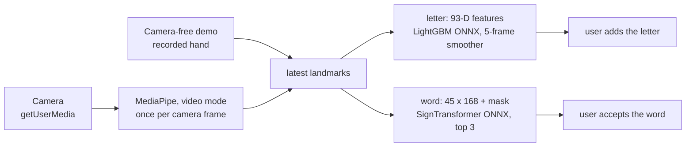

# ASL Assistant: Technical Report

ASL Assistant recognises American Sign Language (ASL) from a webcam, entirely in the browser. MediaPipe finds landmarks (3D points on the hands, face and body) in each camera frame, and two small ONNX models classify them. No camera frame leaves the device. The product is the static web app in [`asl-web/`](asl-web/), live at <https://asl-assistant.pages.dev/>. The repository also holds the Python feature package [`asl-features/`](asl-features/), shared by training and the checks, and an earlier desktop prototype, [`asl-desktop/`](asl-desktop/).

| Figure | Value | Scope |
|---|---|---|
| Letter model, random held-out split | 99.35% on 8,245 rows | Not signer-independent |
| Letter model, rows from an unseen source | 68.9% on 122 rows | 39.9% to 79.6% with a whole source held out |
| Letter model, live landmark path on unseen signers | 76% | 164 images, MediaPipe in video mode |
| Word model, 50 isolated signs | 71.92% accuracy, 0.714 macro-F1 | 3,918 recordings from 4 signers never seen in training |
| Download | 0.35 MB to open the page; about 15 MB at the first camera start | Nothing on a second visit |

## 1. Architecture

| Part | What it is |
|---|---|
| `asl-web/` | The product: HTML, CSS and classic `<script>` files, no build step, no server code. ONNX Runtime Web 1.22.0, MediaPipe Tasks Vision 0.10.18 and kjua 0.9.0 (QR codes) come from public CDNs. |
| `asl-features/` | The Python definition of the model input: hand normalisation, square units, the 93-D letter features and the 45 × 168 word features. NumPy only. |
| `models/`, `notebooks/` | The source copy of every model and the word training notebooks. The files in `asl-web/models/` and `asl-web/data/` are byte-for-byte copies, checked by SHA-256. |
| `scripts/`, `tests/` | Data preparation, letter training, fixture export, validators; Python, Node and headless-Chrome tests. |
| `asl-desktop/` | A CustomTkinter prototype with the same letter model and an older 25-word model. |

The browser never calls Python. JavaScript in `asl-web/js/ml/` reimplements the feature code of `asl-features`, and parity checks feed both the same landmarks and require them to agree within 1e-4.

**Load order.** `index.html` holds every screen and loads 32 classic scripts of its own in a fixed order; they share one global scope, so the order is a contract. `core/theme-boot.js` and `core/lang-boot.js` run in `<head>` so the first paint has the right theme and language; the `i18n/` string files and `core/i18n-boot.js` translate the page before the CDN scripts; `core/config.js` and `core/runtime.js` create the settings and the shared state once; the `ml/`, `media/`, `services/` and `ui/` files only declare functions; `core/app.js` comes last and is the only script with start-up side effects. [`asl-web/js/README.md`](asl-web/js/README.md) lists every module. Scripts find elements only by `id` or a `data-ui` hook, never by a styling class, and render functions start no listener, timer, fetch or model session.

**Screens.** `#letter` (the default and the main mode), `#word` (experimental), `#coach`, `#test` (Model Test, a developer tool that runs bundled fixtures without a camera), `#project` and `#qr`. Without a camera, *Watch the demo* on the letter screen plays a recorded hand spelling FLY through the live pipeline.

Two loops meet only at the latest MediaPipe result. The detection loop in `media/camera.js` runs while the camera is on; the render loop in `core/app.js` draws the overlay and calls the models. Letter inference runs at most every 120 ms, so the five-prediction smoother spans about 600 ms of signing; a word recording reads every frame. A frame that arrives during a model call is dropped, not queued. The camera-free demo, `media/demo-source.js`, is a second frame source: it publishes a recorded hand about 20 times a second, and everything from the landmark step on runs unchanged.

**Consent and lifecycle.** A word result reaches the text only through `appendWordResultToTranscript()`, after an explicit accept, and only if it belongs to the latest recording and its confidence is at least 0.15. Letters are also added only by the user (Space or *Add*, from a smoothed confidence of 0.60). Leaving a camera screen for `#test`, `#project` or `#qr` stops every track, cancels the frame callbacks and closes the MediaPipe tasks. A camera start waits several times (permission, first frame, MediaPipe, each model) and re-checks a start token after each wait, so a stop during start-up cancels it. Reopening leaves exactly one detection loop.

**Word recording.** `IDLE → COUNTDOWN → RECORDING → PROCESSING → RESULT`. A frame counts only with a hand, the face and both shoulders present. A recording that cannot fill ends after 6 s with no usable frame, 4 s without a new one, or 15 s in all. Each recording has a serial number, and a late model result for an older recording is discarded.

**Lazy loading.** `init()` loads no model. A model loads at its first need: a camera start in its mode, a demo start (letter model only), a word recording or a Model Test run.

| Step | Downloaded |
|---|---|
| Opening the page | about 0.35 MB |
| First camera start in letter mode | about 15 MB: MediaPipe hand model 7.8 MB, MediaPipe WebAssembly 2.6 MB, ONNX Runtime WebAssembly 2.4 MB, letter model 2.2 MB |
| First demo start | about 4.6 MB: ONNX Runtime and the letter model |
| Word mode as well | up to 24 MB in all |

`index.html` loads ONNX Runtime's WebAssembly-only bundle (`ort.wasm.min.js`), because the full bundle also fetched a 4.2 MB WebGPU build that neither model uses. The 13.2 MB letter model ships gzipped at 2.2 MB and is unpacked with `DecompressionStream`, with the raw file as fallback.

**Privacy and security.** No backend, account or analytics. `localStorage` holds the theme, the language, the text and the coach progress. ONNX Runtime and kjua load with Subresource Integrity; MediaPipe, a dynamic import, is pinned to an exact version. [`asl-web/_headers`](asl-web/_headers) sets the hardening headers and a Content Security Policy that is still report-only.

## 2. Data

| Source | Used for | Size used | Terms |
|---|---|---:|---|
| [ASL Alphabet](https://www.kaggle.com/datasets/grassknoted/asl-alphabet), Akash Nagaraj, 2018, [doi:10.34740/KAGGLE/DSV/29550](https://doi.org/10.34740/KAGGLE/DSV/29550) | Letters, main source | 52,419 landmark rows | GPL-2.0, as labelled by the provider |
| [American Sign Language Dataset](https://www.kaggle.com/datasets/ayuraj/asl-dataset), Ayush Thakur | Letters; the demo's hand poses | 962 rows | CC0 1.0 |
| `ASL_SemCom` subset, associated with [ASL-Fingerspelling](https://github.com/Mohammed-Shoaib/ASL-Fingerspelling) | Letters; its test rows serve as an unseen source | 1,580 training rows; 122 test rows not merged | Not recorded; the images are not redistributed |
| [Google - Isolated Sign Language Recognition](https://www.kaggle.com/competitions/asl-signs) (Kaggle, 2023), Deaf Professional Arts Network and Georgia Institute of Technology | Words | 94,477 recordings of 250 signs by 21 signers; 19,299 used | [CC BY 4.0](https://creativecommons.org/licenses/by/4.0/), subject to the competition rules |

Letter counts are rows where MediaPipe found a hand, not image counts. MediaPipe Processed ASL (no usable hands) and MS-ASL (download scripts only) were explored and not used. The competition rules allow any use of the data (7.A) but forbid redistributing it (7.B), so the repository publishes trained models and aggregate results only. Word fixtures exported from the competition data go to the ignored `asl-web/data/model-test-samples/local/` folder, and the one published word fixture is synthetic. Raw data never enters Git; [`data/README.md`](data/README.md) lists what stays local.

**Letters.** [`extract_static_letter_landmarks.py`](scripts/data_preparation/extract_static_letter_landmarks.py) runs MediaPipe's legacy Hands API in static-image mode and keeps the first hand of each image. [`merge_static_letter_datasets.py`](scripts/data_preparation/merge_static_letter_datasets.py) keeps the 24 static letters, drops duplicates, non-finite values and outliers, and makes a stratified 85/15 split with seed 42: 54,961 rows become 46,716 for training and 8,245 held out. The split is random over rows, because the CSVs carry no signer id. ASL Alphabet, 95.4% of the rows, photographs each letter as long runs of near-identical frames.

**Words.** The competition gives MediaPipe Holistic landmarks for every frame. [`word_50_training.ipynb`](notebooks/word_50_training.ipynb) keeps 107 of the 543 points, fills gaps by interpolation, drops recordings shorter than 5 frames and normalises each frame on the shoulders. Signs with at least 300 recordings were eligible; a hand-picked list of 50 everyday words gave 34, and the other 16 were filled by recording count. The 21 signers are shuffled with seed 42 into 14 for training (12,723 recordings), 3 for validation (2,658) and 4 for test (3,918); assertions check that no signer is in two partitions.

**Demo recording.** [`demo-letters.json`](asl-web/data/demo-letters.json) holds one right hand per letter of FLY. [`export_demo_letters.py`](scripts/evaluation/export_demo_letters.py) ran the browser's hand model in video mode on the CC0 dataset and kept, per letter, the pose the deployed model reads most surely. Those photographs are in the training split, so the model reads each pose at 1.0: the demo shows how the app works, not how accurate it is.

## 3. Features

**Square units.** MediaPipe gives x as a fraction of the frame's width and y of its height. The training photos are square, but a 1280 × 720 camera squeezes a hand sideways; on held-out photos placed in a 16:9 frame accuracy fell from 98.4% to 88.6%. Both apps multiply x and z by width over height before the features. A square frame is unchanged.

**Normalisation.** Subtract the wrist (landmark 0) and divide by the wrist to middle-knuckle distance (landmark 9): 63 values per hand.

**93-D letter vector** ([`letter.py`](asl-features/src/asl_features/letter.py), `ml/features.js`): normalised landmarks (0..62), 5 fingertip-to-wrist and 4 adjacent-fingertip distances (63..71), 14 joint angles (72..85), bounding-box aspect and area (86..87), and 5 finger-extended flags (88..92). A vector of the right length in the wrong order still runs and predicts nonsense, so the order is pinned by goldens and parity checks.

**321-D holistic frame** (word path): right hand 0..62, left hand 63..125, 40 face points 126..245, 25 pose points 246..320. A missing part stays zero, so later groups never shift.

**168-D word features per frame** ([`word.py`](asl-features/src/asl_features/word.py), a copy of the notebook's code, tested against it): the dominant hand's 63 landmarks, 30 hand-shape values, 12 hand-to-face relations and 63 values of frame-to-frame motion. The dominant hand is chosen once per recording. The model takes `float32 [1, 45, 168]` and a `bool [1, 45]` mask where `true` marks a real frame; the exported graph inverts the mask itself, so the browser must not.

## 4. Models

### Letter model

Augmentation runs on the training split only: each row gets 5 noisy, rotated and scaled copies. Recorded in [`letter_model_meta.json`](models/letter/letter_model_meta.json):

| Model | Accuracy |
|---|---:|
| Random Forest | 0.985 |
| XGBoost | 0.992 |
| LightGBM | 0.994 |

| Configuration | Accuracy |
|---|---:|
| 93-D features, augmentation | 0.994 |
| 93-D features, no augmentation | 0.988 |
| raw 63-D landmarks, augmentation | 0.332 |

Engineered hand geometry mattered far more than augmentation. The chosen LightGBM (300 trees) scores 0.9935 on the 8,245 held-out rows. OnnxMLTools exported it as one tree-ensemble node without ZipMap, whose list-of-maps output ONNX Runtime Web cannot read reliably.

**Why 99.35% overstates it.** The held-out rows come from the same runs of near-identical photos as the training rows, so the score measures hands the model has already seen. On sources it has not seen:

| Evaluation | Accuracy |
|---|---:|
| Published model, 122 unseen `ASL_SemCom` test rows | 68.9% |
| Retrained, American SL held out | 79.6% |
| Retrained, ASL Alphabet held out | 64.8% |
| Retrained, `ASL_SemCom` held out | 39.9% |

Errors cluster on fists that differ only by the thumb (M, N, T, S, E, A) and on near pairs such as R/U/V and G/K, and 89.5% of the wrong answers had a probability of at least 0.6, so a higher threshold would not filter them. More signers and a split grouped by signer would.

**Live landmarks.** Training used the legacy API on still images; the browser uses the Tasks HandLandmarker in video mode. On the 164 `ASL_SemCom` test images where all four pipelines found a hand:

| Landmarks from | Accuracy |
|---|---:|
| Legacy API, still images (how the training data was made) | 70% |
| Legacy API, tracking | 80% |
| Tasks HandLandmarker, image mode | 46% |
| Tasks HandLandmarker, video mode once tracking settles (the browser path) | 76% |

The hand model weights are the same in all of them; only the crop and the tracking differ. The live path is no worse than the one that made the training data, so no retraining was needed.

### Word model

All experiments share one recipe (focal loss with label smoothing, AdamW, seed 42) and pick by validation macro-F1; the test set is only reported. Test macro-F1 of each comparison, from [`all_experiment_results.json`](notebooks/word_50_results/all_experiment_results.json):

| Features (BiGRU, 30 frames) | F1 | Sequence (168-D, BiGRU) | F1 | Model (168-D, 45 + mask) | Params | F1 |
|---|---:|---|---:|---|---:|---:|
| raw 321-D | 0.581 | fixed 30 frames | 0.699 | SmallGRU | 104,627 | 0.682 |
| pairwise + dominant hand, 444-D | 0.671 | **45 frames + mask** | **0.700** | BiGRU | 602,739 | 0.700 |
| hand shape, 72-D | 0.613 | 30 highest-motion frames | 0.694 | ConvGRU | 338,259 | 0.702 |
| shape + motion, 132-D | 0.621 | | | **SignTransformer** | **446,195** | **0.719** |
| **compact, 168-D** | **0.699** | | | ensemble of two | 1,048,934 | 0.733 |
| full, 519-D | 0.639 | | | | | |

The largest feature set was not the best. The masked 45-frame input matches the ONNX contract. The ensemble scored higher but would ship two models, so the SignTransformer (2 encoder layers over a 128-D projection, attention pooling over real frames) was chosen. Its final long run gives **71.92% accuracy, 0.714 macro-F1** and 0.803 best validation F1. Temperature scaling (T = 0.9854) did not improve calibration (ECE 0.0235 before, 0.0252 after), so the app relies on the top three and the user's accept instead. The ONNX export (opset 17) matched PyTorch within 6e-7.

Per word, 9 have F1 of at least 0.85 (water 0.912, sad 0.910) and 3 fall below 0.50 (open, give, all). The most frequent confusions are listen → hear, can → yes, open → book and sleep → sleepy; the coach's hints come from them.

**Desktop 25-word model.** A BiGRU over 30 × 321 frames, trained on 7,723 recordings with a random 70/15/15 split, reached 86.7%. Its vocabulary, features and split differ, so it is not comparable with the web model.

## 5. Browser runtime

- **MediaPipe in video mode.** All three landmarkers run with `runningMode: "VIDEO"`, which tracks the hand between frames; pose and face start only in word contexts. The GPU delegate falls back to the CPU.
- **Frame pacing.** Detection runs once per camera frame the video presents, counted with `requestVideoFrameCallback`, with a 200 ms stall limit; browsers without the API detect on every animation frame. With Chrome's 20 fps fake camera this cut detection from 50 to 20 calls a second.
- **Both hands.** HandLandmarker tracks up to two hands. With both in view, the hand whose wrist is higher by more than a tenth of the frame height wins, else the right hand. A left hand is mirrored with `x → 1 − x`: on mirrored left hands the model scored 79.1% against 49.3% unmirrored. HandLandmarker labels a right hand "Right" on an unmirrored frame (141 of 146 photos), so no label swap is applied.
- **Smoothing and thresholds.** Landmarks are smoothed (weight 0.6 on the current frame); the plate shows the most frequent of the last 5 predictions, uncertain below 0.45 and confident from 0.65. A word is uncertain below 0.15, confident from 0.20, and asks for a check when the top two are within 0.08.
- **Languages.** Every screen is in Turkish and English. `core/lang-boot.js` picks the saved choice, else the browser's preferred language, else English, before the first paint; an English page stays hidden until it is translated, with a 3 s fail-safe. The header switch changes every string, `<html lang>` and the title without a reload, a camera restart or losing the text. Strings live per area in `asl-web/js/i18n/`.
- **Accessibility.** One `h1` per screen that takes focus on navigation, a skip link, a polite live region, reduced motion honoured, WCAG 2.2 AA text contrast in both themes, and no single-key shortcuts.

## 6. Testing

| Layer | Where | What it checks |
|---|---|---|
| Python units | `tests/asl_features`, `tests/asl_desktop` | Normalisation, features, goldens, the desktop detectors |
| Scripts | `tests/scripts` | Validators, parity and make targets run against broken copies of the tree |
| Browser code | `tests/web` | The real scripts and `index.html` in a `node:vm` context with a fake camera and a fake ONNX Runtime |
| Real browser | `tests/browser` | Headless Chrome under the real headers: cascade layers, layout at phone and laptop sizes, camera release, the demo, both languages |
| Parity | `tests/validation` | Python against JavaScript features: max difference 1.12e-5 for letters, 7.15e-7 for words |

Only system boundaries are faked: the network, the clock, storage, the camera, MediaPipe and ONNX Runtime. The rules that matter most each have a behavioural test that was seen to fail on a deliberately broken copy: no word without consent, mask polarity, frame order, camera release, detection pacing, the raised-hand choice and the demo poses. The deployed ONNX letter model gave the same top-1 label as the pickle on all 8,245 held-out rows. `make check` runs lint, the format check, the type check, the runtime file check, the Python and JavaScript tests and the parity checks; `make browser-check` runs the Chrome suite. No automated check covers lighting, permission prompts or a real signer.

## 7. Deployment

The site is static and has no build step: `asl-web/` is uploaded as it is, and the live copy runs on Cloudflare Pages. Before an upload, the deploy file check (`check_runtime_assets.py --deploy`) fails on hidden files, files Git ignores, unknown file types and competition-derived fixtures. The host reads response headers from `asl-web/_headers`, and `asl-web/404.html` makes an unknown path a real 404.

## 8. Design decisions

| Decision | Instead of | Why |
|---|---|---|
| All inference in the browser, static site | An inference server | No server to run; no camera frame leaves the device |
| Landmarks as model input | Raw video or an image CNN | Small models with features that can be inspected |
| Separate letter and word models, letters first | One joint model | A static handshape and a sign over time are different problems |
| 93-D engineered letter features | Raw 63-D landmarks | 0.994 against 0.332 in the ablation |
| Signer-independent word split | A random split | A random split lets the model memorise signers |
| One SignTransformer | The two-model ensemble | One model to ship, for about 1.5 F1 points |
| The user accepts every word | Adding the top word | Correct words often have low confidence |
| Classic scripts, no build step | ES modules and a bundler | The committed folder is what ships; any static server runs it |
| Models load on first need | Preloading | A visitor who only looks downloads no model |

## 9. Lessons

- **Same shape, wrong input.** A `[1, 45, 168]` tensor can be wrong in feature order, normalisation, hand choice, motion state or mask polarity and still run. Parity checks, goldens and behaviour tests guard each of these.
- **The dominant hand belongs to the recording.** Choosing a hand per frame would let the hand and the motion values switch mid-sign, so the browser builds the 168-D sequence once the recording ends, as training does.
- **A random split can hide the real error.** The letter model's 99.35% fell to about 70% on a new source.
- **A measurement proxy can mislead.** HandLandmarker in image mode scored 46% and suggested retraining; the browser's video mode scores 76%.
- **Uncertainty belongs in the product.** Calibration did not make weak word predictions trustworthy, so the app shows three candidates and waits for the user.

## 10. Limitations and next steps

- The letter model covers 24 static letters; J and Z need motion, and neither model has a "no sign" class.
- Letter accuracy for new signers is far below 99.35%. The held-out evaluation and the pickle-to-ONNX command are not in the repository; re-scoring the local held-out table gives 0.9930.
- The word model handles isolated signs only, with 4 test signers and one seed; 16 of its 50 words were chosen by data availability. The browser takes the first 45 usable frames while training clips (median 22 frames) were padded or subsampled; the effect is not measured.
- The app has been tested in desktop Chrome. The Content Security Policy is still report-only, the first visit needs the CDNs, and the word reference pictures have not been checked against an ASL dictionary.
- The model files are under PolyForm Noncommercial 1.0.0; whether a dataset's licence carries over to weights trained on it is left open.

Next: retrain the letter model with more signers and a split grouped by signer, and keep its evaluation and ONNX export as scripts; test on phones and tune the thresholds from that; enforce the CSP; repeat the word experiments with more seeds and more words; work offline as a progressive web app.
