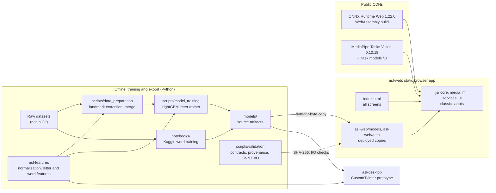
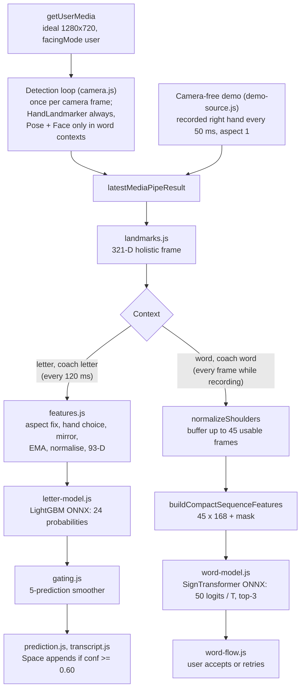
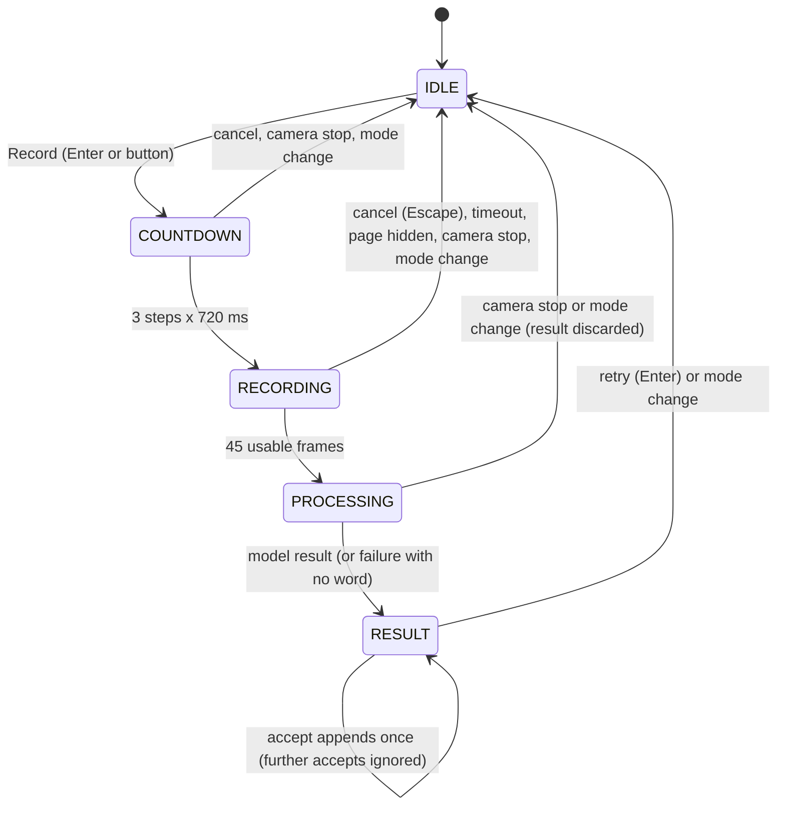
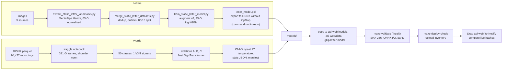

# ASL Assistant: Technical Report

Location: [`asl-assistant`](README.md) / `TECHNICAL_REPORT.md`

Related: [`docs/`](docs/README.md) · [`docs/architecture.md`](docs/architecture.md) · [`docs/models-and-data.md`](docs/models-and-data.md) · [Türkçe](TECHNICAL_REPORT.tr.md)

Every number in this report comes from the repository: the READMEs, the documents in [`docs/`](docs/), the notebooks, the model metadata, or measurements recorded in the commit history.

## Contents

1. [Summary](#1-summary)
2. [System architecture](#2-system-architecture)
3. [System design](#3-system-design)
4. [Technologies](#4-technologies)
5. [Data](#5-data)
6. [Pipeline](#6-pipeline)
7. [Models and experiments](#7-models-and-experiments)
8. [Decisions](#8-decisions)
9. [Quality and verification](#9-quality-and-verification)
10. [Results and limitations](#10-results-and-limitations)
11. [Future work](#11-future-work)
12. [Change history](#12-change-history)
13. [Where to read more](#13-where-to-read-more)

---

## 1. Summary

ASL Assistant recognises American Sign Language (ASL) from a webcam, entirely in the browser. MediaPipe, Google's on-device vision library, finds **landmarks** in each camera frame (3D points on the hands, face and body), and small **ONNX** models classify them; ONNX is an open model format that also runs in the browser. No camera frame leaves the device. The product is a static web app ([`asl-web/`](asl-web/)) hosted at <https://asl-assistant.netlify.app/>. The repository also holds an earlier Python desktop prototype ([`asl-desktop/`](asl-desktop/)) and a shared Python feature package ([`asl-features/`](asl-features/)).

| Mode | What it does | Status |
|---|---|---|
| Letter (`#letter`) | Reads 24 static fingerspelled letters (no J or Z) and builds text | Main mode |
| Word (`#word`) | Offers the top three of 50 words for one isolated sign; the user must accept | Experimental |
| Coach (`#coach`) | Asks for letters or words and scores them | Early |
| Camera-free demo (on `#letter`) | Plays a recorded hand spelling FLY through the live letter pipeline; the user adds each letter | For visitors without a camera |
| Model Test (`#test`) | Runs bundled fixtures through the models without a camera | Developer tool, linked from the project page |
| QR, Project | Share links, explain the project | Information screens |

| Figure | Value | Caveat |
|---|---|---|
| Letter model, held-out split | 99.35% on 8,245 rows | Random row split; not signer-independent |
| Letter model, unseen source | 68.9% on 122 rows | 39.9% to 79.6% with a whole source held out |
| Word model, 50 words | 71.92%, macro-F1 0.714 | 3,918 recordings from 4 signers never seen in training |
| Desktop 25-word model | 86.7% | Random split; not comparable with the web model |
| Download | 0.35 MB to open the page; about 15 MB at the first letter-mode camera start | 2.2 MB of it from the site, the rest from CDNs; nothing on a second visit |

Letter mode is the main feature because it solves a narrower problem: one hand pose, no alignment over time, no face or body in view. The word model handles isolated signs only, with low top-1 confidences, so it is an experiment that never writes to the transcript without the user's consent. The app has not yet run on a real phone, only in headless desktop Chrome with a simulated camera ([section 10](#10-results-and-limitations)).

---

## 2. System architecture

### 2.1 Components

- **`asl-web/`** uses only browser APIs and its own files. Its JavaScript re-implements the feature maths of `asl-features`, and **parity checks** compare the two implementations on the same input.
- **`asl-features/`** is the Python source of truth for that maths: hand normalisation, the conversion of a non-square frame into square units, the 93-D letter features and the 45 x 168 word features. Training, data preparation, the desktop app and the parity checks import it.
- **`models/`** and `notebooks/word_50_results/` hold the source artifacts. [`contracts.py`](scripts/validation/contracts.py) lists every source-to-deploy pair, and the validators check each deployed copy against its source by SHA-256.

### 2.2 Web runtime data flow

`media/camera.js` runs the detection loop and publishes the latest MediaPipe result; `core/app.js` runs a render loop that draws the overlay and calls the models. MediaPipe runs once per camera frame the video presents, counted with `requestVideoFrameCallback`. If no frame is reported for 200 ms it detects anyway, and browsers without the API detect on every animation frame. In Chrome with its fake 20 fps camera, detection went from 50 calls a second to 20.

Letter contexts run inference at most every 120 ms, so the five-prediction smoothing window spans about 600 ms of signing; word contexts run on every frame while recording. A frame that arrives during a model call is dropped, never queued.

The camera-free demo, `media/demo-source.js`, is a second frame source rather than a fake camera. It publishes the recorded hand to `latestMediaPipeResult` about 20 times a second with a small seeded wobble, and marks each frame as square (aspect 1), because the recording comes from square photographs. Neither the camera nor MediaPipe starts; everything from `landmarks.js` on runs unchanged.

### 2.3 Desktop prototype

The desktop app is a CustomTkinter window with a translation view and a coach, using the letter model's LightGBM pickle (with optional few-shot personalisation), the 25-word BiGRU of [section 7.3](#73-desktop-25-word-model) and offline text-to-speech. Like the web app, it detects on the camera frame as captured, mirrors only the preview, applies the camera-aspect correction and mirrors a left hand into the right-hand convention. Its legacy MediaPipe API assumes a selfie image, so on an unmirrored frame it labels the user's left hand "Right". Its J/Z data collector records through the same hand detector.

---

## 3. System design

### 3.1 No build step, classic scripts

The browser loads plain `<script>` files in a fixed order from [`asl-web/index.html`](asl-web/index.html). There is no bundler, transpiler, ES module graph or runtime npm dependency, so the files in `asl-web/` are the files deployed. ONNX Runtime Web and kjua (QR codes) load from jsDelivr; MediaPipe is imported dynamically at the first camera start. Only `core/app.js` has startup side effects, and the tests load the scripts in the browser's order. TypeScript checks the JSDoc types and emits nothing.

### 3.2 Module boundaries and DOM contract

The scripts sit in `core/` (state, routing, camera start and stop, render loop), `media/` (MediaPipe tasks, detection loop, the camera-free demo, overlay), `ml/` (features, ONNX sessions, smoothing), `i18n/` (the interface strings in Turkish and English), `services/` and `ui/`; [`asl-web/js/README.md`](asl-web/js/README.md) lists them in load order. Scripts find elements only by `id` or a `data-ui` hook, never by a styling class, so a redesign can change classes freely while renaming an id is a behaviour change the tests notice. Render functions rebuild the view from state and start no listener, timer, fetch or model session.

### 3.3 Word recording state machine

A frame counts only with hand, pose and face present. A recording that cannot fill ends itself after 6 s with no usable frame, 4 s without a new one, or 15 s in all. Each recording gets a serial number, and a model result is shown only if no newer recording has started.

### 3.4 Lifecycle and consent invariants

**Consent.** A word result is never added to the transcript without an explicit accept. `appendWordResultToTranscript()` is the only path from a word prediction to the transcript, and it re-checks the mode and state, that the result belongs to the latest recording and was not accepted before, and that its confidence is at least 0.15. Below 0.15 the result reads "Emin olunamadı" (not sure) and cannot be accepted; a top-two margin below 0.08 reads "Kontrol ederek ekleyin" (check before adding). An accepted word can be undone. Letters, too, are added only by the user, in the demo as well: Space adds the current letter if its smoothed confidence is at least 0.60. There are no single-letter shortcuts (WCAG 2.1.4).

**Lifecycle.** Leaving a camera screen releases the camera: the brand link and the `#test`, `#project` and `#qr` screens stop every track, cancel the frame callbacks, close the MediaPipe tasks and abandon any recording. A camera start waits several times (permission, first frame, MediaPipe, each model), and a stop can arrive during any wait. The start re-checks a start token and a generation counter after each one, so the stop cancels it and closes what it created. Reopening the camera leaves exactly one detection loop and one set of tasks. The camera-free demo never runs beside the camera: its start stops the camera, and a camera start, any mode or route change and a hidden page stop the demo and end its one frame timer.

**Routes.** `#letter`, `#word`, `#coach`, `#test`, `#project`, `#qr`; any other hash opens letter mode, which also serves as the start screen.

### 3.5 Lazy loading and sizes

`init()` loads no model. A model loads the first time something needs it: a camera start in its mode, a demo start (the letter model only), a word recording or a Model Test run. Live frames never start a load, and a failed load is retried at the next need. Loading waits because the host's bandwidth allowance is limited, and preloading both models had cost every visitor about 15 MB, camera or not.

| Step | Downloaded |
|---|---|
| Opening the page | about 0.35 MB |
| First camera start in letter mode | about 15 MB: MediaPipe hand model 7.8 MB, MediaPipe WebAssembly 2.6 MB, ONNX Runtime WebAssembly 2.4 MB, letter model 2.2 MB |
| First demo start, with no camera | about 4.6 MB: ONNX Runtime WebAssembly 2.4 MB, letter model 2.2 MB; nothing from MediaPipe |
| Word mode as well | up to 24 MB in all |
| A second visit | nothing; everything is cached |

Of the camera downloads, the site serves only the models (2.2 MB letter, 1.85 MB word) and a few small JSON files. `index.html` loads ONNX Runtime's WebAssembly-only bundle, `ort.wasm.min.js`, because both models use only the `wasm` provider and the full bundle fetched a 4.2 MB WebGPU/WebNN build. The host serves `.onnx` files uncompressed, so the 13.2 MB letter model ships gzipped and is decompressed with `DecompressionStream`, falling back to the raw file; a validator checks that the `.gz` holds exactly the raw bytes.

### 3.6 Privacy and security

- No analytics, account or backend; the video is never stored or sent. `localStorage` holds only the theme, the transcript and coach progress.
- The scripts reach only `cdn.jsdelivr.net` and `storage.googleapis.com`. ONNX Runtime Web and kjua load with Subresource Integrity (SRI); MediaPipe, a dynamic import that cannot carry SRI, is pinned to 0.10.18 and its models to `/1/`.
- [`asl-web/_headers`](asl-web/_headers) sets the usual hardening headers and a Content Security Policy (CSP), report-only until a real browser has run every mode on the deployed site without a violation.

### 3.7 Accessibility

Each screen has one visually hidden `h1` that is also the document title and takes focus on navigation; there is a skip link and a polite live region, and reduced motion is honoured. The landmark overlay draws a dark halo under a light core, because single-colour strokes fell below 3:1 contrast on some video, and text contrast meets WCAG 2.2 AA in both themes. The interface is in plain Turkish, addressing the user as "siz", and in plain English. It opens in the visitor's saved choice, else the browser's preferred language, else English, and the switch in the top bar changes every visible string, `<html lang>` and the document title without a reload or a camera restart. Code, comments and developer terminal output are English.

### 3.8 Styling system

CSS **cascade layers** (`@layer`) decide which group of rules wins, whatever the selector specificity. [`asl-web/css/style.css`](asl-web/css/style.css) declares `legacy, tokens, base, components, layout, screens, utilities` and keeps the original stylesheet in the lowest layer. Layers were chosen so the redesign could replace the old sheet gradually: new rules win without specificity fights or `!important`, and legacy rules are deleted screen by screen. `tokens.css` alone holds raw colours and sizes, and `theme-boot.js` applies the theme before the first paint, as an external file because the CSP allows no inline script.

---

## 4. Technologies

| Component | Technology | Licence |
|---|---|---|
| Browser landmarks | MediaPipe Tasks Vision 0.10.18 (hand, pose lite and face landmarkers) | Apache-2.0 |
| Browser inference | ONNX Runtime Web 1.22.0, WebAssembly | MIT |
| QR codes | kjua 0.9.0 | MIT |
| Fonts | Atkinson Hyperlegible Next and Mono, self-hosted | SIL OFL |
| Languages | JavaScript (JSDoc checked by TypeScript 5.9.3), Python 3.12, Node 24 for tooling | |
| Letter pipeline | mediapipe 0.10.21 (legacy Solutions API), scikit-learn 1.8.0, LightGBM 4.6.0, XGBoost 3.0.1, OnnxMLTools 1.16.0 | |
| Word pipeline | PyTorch 2.10.0 on Kaggle, onnx, onnxruntime | |
| Desktop | customtkinter 6.0.0, OpenCV 4.11, pyttsx3 | |
| Tests and lint | pytest, `node:test` with `node:vm`, headless Chrome, Ruff | |
| Project | PolyForm Noncommercial 1.0.0 for code and models | Data terms in [section 5.1](#51-sources) |

The [README](README.md#data-and-attribution) lists the third-party licences; [`requirements.txt`](requirements.txt) and [`environment.yml`](environment.yml) pin the versions.

---

## 5. Data

### 5.1 Sources

| Source | Used for | Rows or recordings used | Terms |
|---|---|---:|---|
| [ASL Alphabet](https://www.kaggle.com/datasets/grassknoted/asl-alphabet) (Akash Nagaraj, 2018, doi:10.34740/KAGGLE/DSV/29550) | Letters, main source | 52,419 landmark rows | GPL-2.0 as labelled by the provider |
| [American Sign Language Dataset](https://www.kaggle.com/datasets/ayuraj/asl-dataset) (Ayush Thakur) | Letters, more signers; the demo's three hand poses | 962 rows | CC0 1.0 |
| `ASL_SemCom` subset, associated with [ASL-Fingerspelling](https://github.com/Mohammed-Shoaib/ASL-Fingerspelling) | Letters; its test rows serve as an unseen source | 1,580 rows (train); 122 rows (test, not merged) | Not recorded; images stay local |
| [Google Isolated Sign Language Recognition](https://www.kaggle.com/competitions/asl-signs) (Deaf Professional Arts Network, Georgia Institute of Technology) | Words, both published word models | 94,477 recordings of 250 signs by 21 signers; 19,299 used for the 50-word model | CC BY 4.0, subject to the competition rules |

Letter counts are landmark rows that were extracted successfully, not image counts. MediaPipe Processed ASL (no usable hands found) and MS-ASL (download scripts only) were explored and not used.

**Redistribution.** The competition rules allow any use of the data (7.A), including training and publishing models, but forbid redistributing it (7.B), which prevails over CC BY 4.0. The repository therefore publishes trained models and aggregate results, but no landmark data and no fixture exported from it. Raw data, generated CSVs and credentials never enter Git.

### 5.2 Letter extraction

[`extract_static_letter_landmarks.py`](scripts/data_preparation/extract_static_letter_landmarks.py) runs MediaPipe's legacy Solutions API in static-image mode and keeps the first detected hand of each image; handedness is not read and nothing is mirrored. Normalisation subtracts the wrist (landmark 0) and divides by the wrist-to-middle-knuckle distance (landmark 9), giving 63 values. The browser repeats the same step.

### 5.3 Letter cleaning, merging and split

[`merge_static_letter_datasets.py`](scripts/data_preparation/merge_static_letter_datasets.py) keeps the 24 static letters, drops duplicates, non-finite values and outliers, and makes a stratified 85/15 split with seed 42. The cleaning removed no rows in this merge.

| Table | Rows |
|---|---:|
| ASL Alphabet + American SL + ASL_SemCom train | 52,419 + 962 + 1,580 = 54,961 |
| Training split | 46,716 |
| Held-out split | 8,245 |

ASL Alphabet provides 95.4% of the rows, and the classes range from 1,048 rows (N) to 2,867 (F). The split is random over rows, not grouped by signer (the CSVs carry no signer id). ASL Alphabet photographs each letter as long runs of near-identical frames, so close neighbours of a held-out row can sit in training, and the 99.35% held-out figure measures hands the model has already seen. The raw-data layout is not recorded well enough to promise a one-command rebuild.

### 5.4 Word data preparation

Google Isolated Sign Language Recognition (GISLR) gives MediaPipe Holistic landmarks for every frame; the notebook keeps 107 of the 543 points (21 per hand, 40 face, 25 pose), 321 values per frame. [`word_50_training.ipynb`](notebooks/word_50_training.ipynb) fills gaps by interpolation, drops recordings shorter than 5 frames, and shoulder-normalises each frame: centred on the shoulder midpoint and divided by shoulder width when both shoulders are present, min-max scaled otherwise. The browser reproduces both paths.

**Class selection.** Signs with at least 300 recordings are eligible. A hand-written list of 50 everyday words gave 34; the other 16 were filled by recording count (bird, brown, cow, donkey, duck, fireman, hear, lips, listen, mouse, pretend, shhh, sleepy, toothbrush, uncle, who). Wanted words such as eat, want, help and friend are missing.

**Signer-independent split.** The 21 signers are shuffled with seed 42, and assertions check that no signer is in two partitions and every class is in each:

| Partition | Signers | Recordings loaded |
|---|---:|---:|
| Train | 14 | 12,723 |
| Validation | 3 | 2,658 |
| Test | 4 | 3,918 |

Recordings are 5 to 453 frames long, median 22.

### 5.5 Data structures

**321-D holistic frame** (web word model): right hand at 0..62, left hand at 63..125, 40 face points at 126..245 and 25 pose points at 246..320. A missing part stays zero-filled, so later groups never shift. The desktop 25-word model selects different face and pose points, so the two 321-D frames are not interchangeable.

**93-D letter vector** (fixed order, [`letter.py`](asl-features/src/asl_features/letter.py)):

| Offset | Content |
|---|---|
| 0..62 | normalised hand landmarks |
| 63..71 | 5 fingertip-to-wrist and 4 adjacent-fingertip distances |
| 72..85 | 14 joint angles |
| 86..87 | bounding-box aspect ratio and area |
| 88..92 | 5 finger-extended flags |

A vector of the right length in the wrong order still runs and silently predicts nonsense, which is why the order is a contract.

**168-D word features per frame** (`build_compact_features` in Python, `buildCompactSequenceFeatures` in JavaScript): the dominant hand's 63 landmarks (0..62), 30 hand-shape values (63..92), 12 relations of each hand to the nose, mouth and forehead (93..104), and 63 values of frame-to-frame motion (105..167). The dominant hand is chosen once per recording, right on ties. A left dominant hand is mirrored by negating x, which works because the frames are centred on the shoulders; the letter path mirrors with `x -> 1 - x`, because its coordinates are fractions of the image.

**Word model input:** `Float32Array(45 x 168)`, frame by frame, plus a `boolean[45]` mask where `true` marks a real frame. The exported graph inverts the mask itself, so the browser must not invert it first.

The runtime JSON files in [`asl-web/data/`](asl-web/data/) are listed with their schemas in [`docs/models-and-data.md`](docs/models-and-data.md).

### 5.6 Fixtures and redistribution constraints

A fixture is a saved model input with its expected label, which the Model Test screen runs without a camera.

- **24 letter fixtures**, one per letter, each the 93 features of one held-out row; none comes from competition data.
- **One synthetic word sample**: 30 frames of seeded random numbers, padded to 45. Its expected word is the model's own earlier answer ("give" at 0.076, where uniform would be 0.02). The Model Test shows it as a pipeline check ("Çalışma kontrolü") in single runs and in run-all, with no reference label and a note that it measures no accuracy.
- **Real word fixtures are local only.** [`export_model_test_word_samples.py`](scripts/evaluation/export_model_test_word_samples.py) writes them to the ignored `asl-web/data/model-test-samples/local/` folder. `make deploy-check` fails while that folder exists, because a drag-and-drop upload would publish it.

**The demo recording.** [`demo-letters.json`](asl-web/data/demo-letters.json) (`asl-demo-letters-v1`) holds one right hand of 21 landmarks for each letter of FLY. [`export_demo_letters.py`](scripts/evaluation/export_demo_letters.py) ran MediaPipe Hand Landmarker, the browser's hand model, in video mode on the CC0 American Sign Language Dataset, scored each pose with the deployed letter model under seeded jitter, and kept the best pose per letter, among the letters outside the model's known confusion groups. The three photographs are in the letter model's training split (each pose matches a training row to within 1e-6 when extracted the way the training data was), and the model reads each pose at 1.0, so the demo shows how the app works, not how accurate it is. [`test_demo_letters.py`](tests/scripts/test_demo_letters.py) fails if the deployed model reads a pose below 0.9 or as another letter, so a new letter model needs a new export.

[`feature-golden.json`](tests/web/fixtures/feature-golden.json) holds expected features for synthetic hands built from formulas, with no dataset values.

---

## 6. Pipeline

Deployment is manual: run `make check`, `make browser-check`, a hand check and `make deploy-check`, drag `asl-web/` onto the Netlify deploy page, then compare the SHA-256 of a few live files with the checkout. Headers live in `asl-web/_headers`, because the root `netlify.toml` is not part of a drag-and-drop upload. [`docs/getting-started.md`](docs/getting-started.md) has the steps.

---

## 7. Models and experiments

### 7.1 Letter model

**Training.** Augmentation runs on the training split only: each row gets 5 noisy, rotated and scaled variants (46,716 rows become 280,296), with no mirroring and no seed. The model comparison and the ablation (one part removed to measure what it contributes) are recorded in [`letter_model_meta.json`](models/letter/letter_model_meta.json):

| Model | Accuracy |
|---|---:|
| Random Forest | 0.985 |
| XGBoost | 0.992 |
| LightGBM | 0.994 |

| Configuration | Accuracy |
|---|---:|
| 93-D features, augmentation | 0.994 |
| 93-D features, no augmentation | 0.988 |
| Raw 63-D landmarks, augmentation | 0.332 |

Engineered hand geometry mattered far more than augmentation. Which test set the two tables used is not recorded.

**Selected model.** LightGBM with 300 trees, 0.9935 on the 8,245 held-out rows, returning a label and 24 probabilities. OnnxMLTools converted it to one ONNX tree-ensemble node without ZipMap, an output format of maps that ONNX Runtime Web could not read reliably.

**Generalisation.** The published model was scored on the 122 ASL_SemCom test rows that neither split contains, and retrained with each whole source held out in turn:

| Evaluation | Accuracy |
|---|---:|
| Published model on 122 unseen ASL_SemCom test rows | 68.9% |
| Retrained, American SL held out | 79.6% |
| Retrained, ASL_SemCom held out | 39.9% |
| Retrained, ASL Alphabet held out | 64.8% |

Unseen hands fail most on fists that differ only by the thumb (M, N, T, S, E, A) and on near pairs such as R/U/V and G/K, and 89.5% of the wrong answers had a probability of at least 0.6, which the display threshold does not filter. The remedy is more signers and a split grouped by signer.

**Camera-aspect finding and fix.** The training photographs are square, but MediaPipe gives x as a fraction of frame width and y of frame height, so a 1280x720 camera squeezed hands sideways and a portrait phone stretched them. On held-out photographs placed in a 16:9 frame, accuracy fell from 98.4% to 88.6%, with the wrong answers still confident. The fix scales hand x and z by the frame's width over height before the features. Square input is unchanged, so parity holds, and [`letter-aspect.test.js`](tests/web/letter-aspect.test.js) fails on the code before the fix.

**Live letter path in the browser.**

1. HandLandmarker tracks up to 2 hands, and the aspect correction runs.
2. The hand with more visible landmarks wins. MediaPipe reports all 21 landmarks for any hand it finds, so with both hands in view that is a tie: the hand whose wrist is higher by more than a tenth of the frame height wins it, and otherwise the right hand does. A left hand is mirrored with `x -> 1 - x`.
3. The landmarks are smoothed (exponential moving average, weight 0.6 on the current frame) and normalised, and the 93 features go to the model.
4. A smoother shows the most frequent label of the last 5 predictions. The letter is uncertain below 0.45, confident from 0.65, and can be appended from 0.60.

**Live landmarks and both hands.** The training landmarks come from MediaPipe's legacy API in static-image mode; the browser uses the Tasks HandLandmarker in video mode. A measurement on 2026-10-17 checked whether that matters, on the 164 of the 1,800 ASL_SemCom test images in which all four pipelines found a hand, from signers the model never saw:

| Landmarks from | Published model accuracy |
|---|---:|
| Legacy API, static images (how the training data was made) | 70% |
| Legacy API, tracking | 80% |
| Tasks HandLandmarker, image mode | 46% |
| Tasks HandLandmarker, video mode after tracking settles (the webcam path) | 76% |

The hand model weights are identical in the legacy API, the Tasks `.task` file and the legacy JavaScript package; only the crop and the tracking differ. The live path is no worse than the one that made the training data, so no retraining was needed. On the 146 ASL Alphabet photographs of right hands that both APIs detected, HandLandmarker labels the hand "Right" in 141 where the legacy API says "Left" in 139, so the web app rightly does not swap the labels. In video mode, right hands scored 70.3%, and left hands (the images mirrored) 79.1% when mirrored back by the rule above but 49.3% when not. Scoring both orientations and keeping the more confident answer was not better.

**J and Z** need motion, which a single-frame classifier cannot see. An experimental trainer exists, but no J/Z data was recorded and no model ships.

### 7.2 Word model

All 50-word experiments share one recipe (Focal Loss with label smoothing, AdamW, seed 42 with deterministic cuDNN) and keep the checkpoint with the best validation macro-F1. Every choice is made on validation; the test set is only reported. Each experiment changes one variable: features (A), sequence strategy (B), architecture (C), then a long final run (D).

**A. Feature-set ablation** (BiGRU, 30 frames, no mask):

| Feature set | Dim | Val F1 | Test acc | Test macro-F1 |
|---|---:|---:|---:|---:|
| 1A raw landmarks | 321 | 0.6696 | 0.5898 | 0.5813 |
| 1B raw + pairwise + dominant hand | 444 | 0.7704 | 0.6774 | 0.6714 |
| 1C hand shape + relations | 72 | 0.7146 | 0.6197 | 0.6125 |
| 1D shape + motion | 132 | 0.7141 | 0.6269 | 0.6205 |
| **1E compact** | **168** | **0.7878** | **0.7034** | **0.6992** |
| 1F full | 519 | 0.7397 | 0.6447 | 0.6391 |

The compact set won on both validation and test, beating raw coordinates by 0.118 test F1 and the largest vector by 0.060.

**B. Sequence strategy** (168-D, BiGRU):

| Strategy | Val F1 | Test acc | Test macro-F1 |
|---|---:|---:|---:|
| fixed30: linspace or pad to 30 | 0.7878 | 0.7034 | 0.6992 |
| **padmask45: 45 frames + mask** | **0.7911** | **0.7052** | **0.7004** |
| motion: 30 highest-motion frames | 0.7861 | 0.6988 | 0.6940 |

The differences are small. padmask45 won on validation, and its mask states the valid length, which matches the ONNX contract. Longer recordings are subsampled evenly to 45 frames and shorter ones zero-padded.

**C. Architecture comparison** (168-D, padmask45):

| Model | Parameters | Val F1 | Test acc | Test macro-F1 |
|---|---:|---:|---:|---:|
| BiGRU (2 layers) | 602,739 | 0.7911 | 0.7052 | 0.7004 |
| **SignTransformer** | **446,195** | **0.7917** | **0.7256** | **0.7188** |
| SmallGRU (1 layer) | 104,627 | 0.7651 | 0.6858 | 0.6817 |
| ConvGRU | 338,259 | 0.7809 | 0.7062 | 0.7016 |
| Ensemble SignTransformer + BiGRU | 1,048,934 | not recorded | 0.7384 | 0.7333 |

The SignTransformer (2 Transformer encoder layers over a 128-dimensional projection, with attention pooling over the real frames) was chosen as the best single model. The ensemble scored higher on test but needs two models in the browser, and SignTransformer and BiGRU differ by only 0.0006 validation F1 on one seed.

**D. Final training** (the exported model): SignTransformer, cosine schedule with warm restarts, light feature augmentation from epoch 30, early stop at epoch 63.

| Metric | Value |
|---|---:|
| Test accuracy | 0.7192 |
| Test macro-F1 | 0.7140 |
| Best validation F1 | 0.8029 |
| Test samples, signers | 3,918, 4 |

Its test F1 is slightly below the quick run's (0.7140 against 0.7188) despite a higher validation F1; with four test signers and one seed, that is within plausible noise. The published figures are the final run's.

**Calibration and export.** Temperature scaling divides the logits by one number, T, so that confidences better match how often the model is right, which ECE (expected calibration error) measures. T came out at 0.9854 and ECE went from 0.0235 to 0.0252, so no calibration gain is claimed; the product relies on the top three and acceptance instead. The ONNX export (opset 17) takes `input float32 [batch, 45, 168]` and `mask bool [batch, 45]`, matched PyTorch within 5.96e-07, and inverts the mask with a `Not` node inside the graph.

**Per-word analysis** (test split): 9 words have F1 of at least 0.85 (water 0.912, sad 0.910), 22 fall in 0.70 to 0.85, 16 in 0.50 to 0.70, and 3 below 0.50 (open 0.427, give 0.458, all 0.474). The most frequent confusions:

| True | Predicted | Count |
|---|---|---:|
| listen | hear | 23 |
| can | yes | 22 |
| open | book | 20 |
| sleep | sleepy | 19 |
| who | bird | 17 |
| fireman | hello | 16 |

The coach's difficulty tags and confusion hints are computed from these predictions.

**Browser word path.** The browser buffers the first 45 usable frames and builds the features for the whole sequence, so the dominant hand is chosen once, as in training; unlike training, it does not subsample a long recording. A word is uncertain below 0.15, confident from 0.20 and can be accepted from 0.15, because the model often gives a low top-1 confidence even when it is right.

### 7.3 Desktop 25-word model

A bidirectional 2-layer GRU with attention pooling over 30 frames x 321, built from 7,723 GISLR recordings of 25 everyday words with a random stratified 70/15/15 split, reached 0.8671 test accuracy. Vocabulary, features, sequence length and split all differ from the web model, so the 86.7% is not comparable with the web model's 71.92%, and neither model is a fallback for the other.

### 7.4 Earlier stages

[`docs/project-journey.md`](docs/project-journey.md) describes the models that came before, from a 15-word recurrent baseline to a raw-video classifier; most left no recorded numbers.

---

## 8. Decisions

| Decision | Instead of | Reason | Consequence |
|---|---|---|---|
| All inference in the browser; static site | An inference server | No server to run; no camera frame leaves the device | Preprocessing is reproduced in JavaScript, hence parity checks |
| Landmarks as model input | Raw video (tried); image CNN | Small models, inspectable features | Feature order and normalisation are part of the model contract |
| Separate letter and word models, letters first | One joint model | Static handshapes and signs over time are different problems | The word model stays experimental |
| 93-D engineered letter features | Raw 63-D landmarks | Ablation: 0.994 against 0.332 | The order is repeated in Python, JS, goldens and parity checks |
| Random row split for letters, unseen-source figures beside it | A signer split | The data has no signer ids | 99.35% overstates accuracy for new signers |
| Signer-independent word split | A random split | A random split lets the model memorise signers | A figure that holds for new signers, from only 4 test signers |
| 168-D features, 45 masked frames, one SignTransformer | Other features and strategies; the ensemble | Best validation F1; one model instead of two | About 1.5 test-F1 points given up |
| No word appended without consent; accept from 0.15 | Auto-append | Low top-1 confidence even when correct; calibration did not help | Guarded invariant; the threshold awaits real-device data |
| Lazy loading, gzip letter model, runtimes on CDNs | Preloading; self-hosted runtimes | Hosting bandwidth is limited | No download for visitors who start neither the camera nor the demo |
| Classic scripts, no build | ES modules, a bundler | Drag-and-drop deploy; any static server runs it | Script order is a tested contract |
| Release the camera on information screens; cancellable starts | Hiding a running camera | Privacy; a stop during start-up used to be undone | One detection loop after reopening |
| A recorded hand played through the live letter pipeline for visitors without a camera | Model Test as their way in | Visitors do not understand a screen of fixture results; the demo shows the real path, the user's add included | Its 100% says nothing about accuracy; Model Test stays at `#test` for developers |
| Manual deploy, report-only CSP, competition fixtures kept out | Git-linked deploy; enforced CSP now | Only `_headers` reaches the host; the CSP needs a real-browser run; rule 7.B | `make deploy-check` guards the upload |

---

## 9. Quality and verification

### 9.1 Test layers

| Layer | Location | What it checks |
|---|---|---|
| Python units and integration | `tests/asl_features`, `tests/asl_desktop` | Normalisation, features, goldens, desktop detectors |
| Scripts and repository | `tests/scripts`, `tests/project` | Validators and make targets run against broken copies; repository rules |
| Browser code | `tests/web` | The real scripts and `index.html` in a `node:vm` context |
| Real browser | `tests/browser` | Headless Chrome with a fake camera, under the real headers |
| Parity | `tests/validation` | Python against JavaScript features; pickle against ONNX |

The node and Python suites each hold several hundred tests. The web tests load the real scripts and build the document from the real markup. Only system boundaries are faked: the network, the frame clocks, `localStorage`, the camera, MediaPipe and ONNX Runtime. The fakes can be held back to reproduce races, and no internal module is mocked. The real-browser checks assert what Chrome computed (styles, layout, camera release), never source text; a missing Chrome exits with code 2, never as a pass.

### 9.2 Tests shown to fail

A test that has never failed is treated as unproven. New guards are written test-first or proven with a **mutation test**: a deliberate fault is planted, the test must fail, and the fault is removed. The commit message names the faults. Examples:

- **Mask polarity and frame order:** fails when the mask is inverted, frames are reversed or dimensions are swapped.
- **Camera-start races:** removing any one cancellation check in the MediaPipe start fails a test.
- **Feature goldens:** a reordered feature group keeps its shape, so shape tests pass; the goldens fail on swapped blocks, inverted flags or a wrong mirror.
- **Camera aspect:** fails on the code before the fix.
- **Detection pacing and hand choice:** fails when the 200 ms stall limit is removed, or when the lower hand is read instead of the raised one.
- **Demo poses:** fails when a pose is relabelled (L as B) or a letter is given another letter's pose.

The behavioural tests that guard the invariants (consent, mask polarity, frame order, timeouts, camera stop and lifecycle) are in [`tests/web/`](tests/web/). New tests may not match source text with regular expressions, because such tests broke on harmless edits and missed real faults; the older ones are retired as replacements are shown to catch the same faults.

### 9.3 Parity

| Check | Fixtures | Tolerance | Result |
|---|---|---|---|
| Letter features, Python vs JS | right hand, left hand (JS mirror), zero hand | 1e-4 | max diff 1.12e-05 |
| Word features, Python vs JS | 6 sequences, including a left hand, missing shoulders and a dominant-hand switch | 1e-4 | max diff up to 7.15e-07 |
| Letter model, pickle vs ONNX | 3 synthetic hands | same top-1 | all predict W; shows format agreement only |
| Feature goldens | synthetic letter cases, 4 word sequences | 1e-5 | checked from Python and JS |

The deployed ONNX model also gave the same top-1 label as the pickle on all 8,245 local held-out rows, which is stronger evidence than the three-hand check.

### 9.4 Validators

All validators and parity commands share one exit-code contract:

- **0:** every check ran and held.
- **1:** a check ran and failed. This outranks 2.
- **2:** bad usage or a missing tool, so nothing was verified. A missing tool is never reported as success.

[`check_runtime_assets.py`](scripts/validation/check_runtime_assets.py) checks the deployed files, schemas, fixtures, SHA-256 provenance and ONNX inputs and outputs; with `--deploy` it also fails on any file the site must not ship.

### 9.5 Gates

| Command | Runs | Needs |
|---|---|---|
| `make health` | lint and format, JS syntax and tests, asset and provenance checks, feature parity, fast pytest | Python environment only |
| `make check` | `health` plus the JSDoc type check | `npm ci` once |
| `make browser-check` | the headless-Chrome checks (`OFFLINE=1` skips the two that need the CDNs, `camera` and `demo-model`) | Chrome |
| `make deploy-check` | JS syntax, the runtime asset check and the upload inventory | before every upload |
| `make test-full` | every pytest test, desktop integration included | MediaPipe, models |

None of them covers lighting, permission prompts, device speed or live signing.

---

## 10. Results and limitations

**What works.** Letter mode recognises 24 static letters in the browser with no server, after a first download of about 15 MB, and builds text only on the user's command; live landmarks score no worse than the training ones ([section 7.1](#71-letter-model)). The word model reaches 71.92% on signers it has never seen. The deployed artifacts match their sources byte for byte, the browser features match Python within 1e-4, and the gates in [section 9.5](#95-gates) pass.

**Limitations.**

- **No real-device test.** iOS Safari, Android Chrome, real hands and real lighting are untested, and every live threshold and timeout is a starting value for that test.
- **Letter accuracy for new people is far below 99.35%:** 68.9% on an unseen source, 39.9% to 79.6% with a whole source held out. The classes are unbalanced, and no analysis separates that from genuine handshape similarity.
- **The letter result is not fully reproducible.** The held-out evaluation and the pickle-to-ONNX command are not in the repository. Re-scoring the local held-out table gives 0.9930 against the recorded 0.9935.
- **Word model limits.** Isolated signs only; 4 test signers and one seed; no top-k accuracy recorded. The browser takes the first 45 usable frames, while training clips (median 22 frames) were padded or subsampled; the effect is unmeasured. 16 of the 50 words were chosen by data availability.
- **No "no sign" class** in either model, and the desktop's 86.7% comes from a random split.
- **Fixture tooling.** The Model Test exporter shuffles signers differently from the notebook, so local word fixtures may come from training signers; nothing published depends on them.
- **Deployment.** The CSP is report-only, the first visit needs the CDNs, and MediaPipe's dynamic import has no integrity hash.
- **Licensing of model files.** The models derive from data under GPL-2.0, CC0, CC BY 4.0 with competition terms, and one source with unrecorded terms; the model card states PolyForm Noncommercial 1.0.0, and nothing says whether a dataset licence carries over to weights.
- **Reference images.** The word reference pages have not yet been checked against an ASL dictionary.

---

## 11. Future work

- Test on real devices with real hands and lighting, tune the thresholds from that run, then enforce the CSP.
- Retrain the letter model with more signers and a signer-grouped split; keep its evaluation and ONNX export as scripts.
- Measure how live word sequences differ from training ones, and repeat the word experiments with more seeds.
- Add more words and move towards continuous signing and sentence-level translation.
- Work offline as a progressive web app, and review accessibility and usefulness with Deaf users.

---

## 12. Change history

The project has no tagged releases; the commit history is the detailed record. The first version (0.1.0) was a static page with letter translation, a coach, experimental word practice, a Model Test and a QR demo, running both models through ONNX Runtime Web. Since then:

- **Interface:** rebuilt screen by screen, with light and dark themes, phone and laptop layouts, plain Turkish and an English translation with a language switch, undo, camera-problem help and the accessibility work of [section 3.7](#37-accessibility).
- **Runtime:** models load on first use, the letter model travels gzipped, and leaving a camera screen releases the camera, even mid-start.
- **Letters:** the camera-aspect correction and the public-domain Gallaudet alphabet chart as the reference.
- **Verification and deployment:** tests rebuilt around behaviour and shown to fail on planted faults, headless-Chrome checks, feature goldens, one exit-code contract, SRI, response headers and `make deploy-check`.
- **Previous round:** detection once per camera frame, the raised hand chosen when both are in view, ONNX Runtime's WebAssembly-only bundle (about 2 MB less on a first camera start), the synthetic Model Test sample shown as a pipeline check, and a desktop app that detects on the unmirrored frame. The landmark measurement in [section 7.1](#71-letter-model) was made in the same round.
- **Latest round:** a camera-free letter demo, which plays recorded hand poses for FLY through the live pipeline and replaces Model Test as the visitor's way in without a camera; Model Test stays at `#test` for developers.

---

## 13. Where to read more

| Document | Contents |
|---|---|
| [README.md](README.md) ([Türkçe](README.tr.md)) | Overview, quick start, limitations, licence, data attribution |
| [docs/architecture.md](docs/architecture.md) | Components, scripts and styles, live path, contracts, checks |
| [docs/models-and-data.md](docs/models-and-data.md) | Data sources, splits, features, model contracts, provenance, fixtures |
| [docs/project-journey.md](docs/project-journey.md) | Phases, lessons and approaches not used |
| [docs/getting-started.md](docs/getting-started.md) | Setup, commands and deployment |
| [asl-web/README.md](asl-web/README.md), [asl-web/js/README.md](asl-web/js/README.md) | Web app modes, configuration, module rules |
| [asl-features/README.md](asl-features/README.md), [asl-desktop/README.md](asl-desktop/README.md) | Shared ML package and desktop prototype |
| [models/letter/README.md](models/letter/README.md), [models/word/README.md](models/word/README.md), [notebooks/README.md](notebooks/README.md) | Model artifacts, metadata and training notebooks |
| [data/README.md](data/README.md) | Data workspace and what may be committed |
| [scripts/README.md](scripts/README.md), [scripts/validation/README.md](scripts/validation/README.md) | Script usage, exit codes, safe model updates |
| [tests/README.md](tests/README.md), [tests/browser/README.md](tests/browser/README.md) | Test layers, gates and browser checks |
