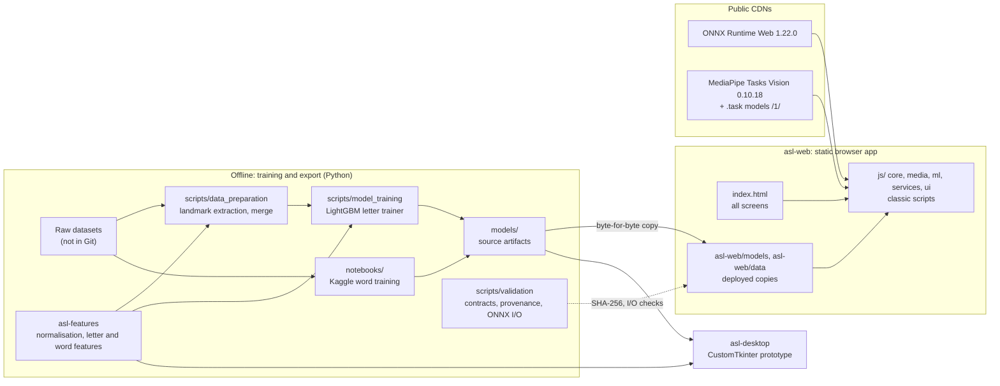
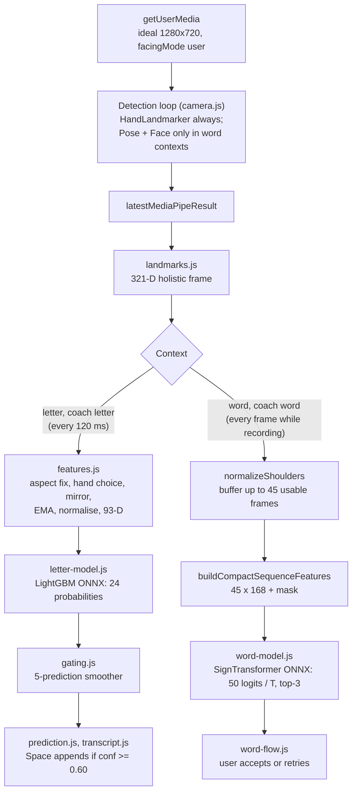
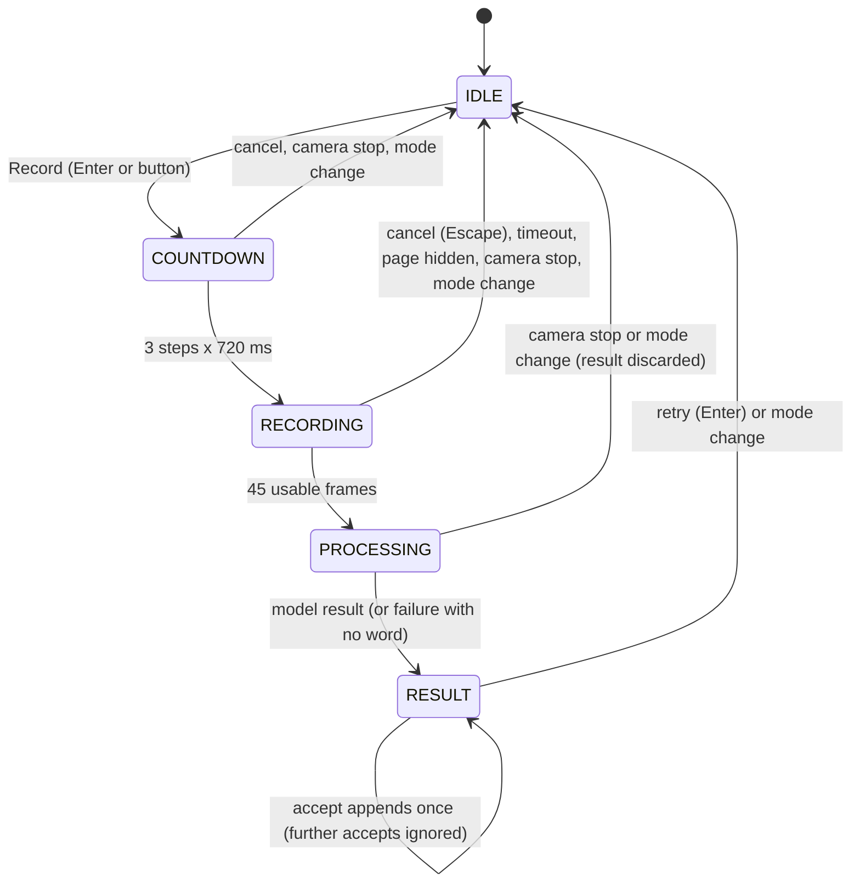
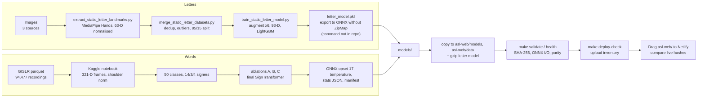

# ASL Assistant: Technical Report

Location: [`asl-assistant`](README.md) / `TECHNICAL_REPORT.md`

Related: [`docs/`](docs/README.md) · [`docs/architecture.md`](docs/architecture.md) · [`docs/models-and-data.md`](docs/models-and-data.md) · [Türkçe](TECHNICAL_REPORT.tr.md)

Every number in this report comes from the repository: the READMEs, the documents in [`docs/`](docs/), the notebooks, the model metadata or the commit history. Where two sources disagree, the text says which one the published artifact uses.

## Contents

1. [Summary](#1-summary)
2. [System architecture](#2-system-architecture)
3. [System design](#3-system-design)
4. [Technologies](#4-technologies)
5. [Data](#5-data)
6. [Pipeline](#6-pipeline)
7. [Models and experiments](#7-models-and-experiments)
8. [Decisions](#8-decisions)
9. [Quality and verification](#9-quality-and-verification)
10. [Results and limitations](#10-results-and-limitations)
11. [Future work](#11-future-work)
12. [Change history](#12-change-history)
13. [Where to read more](#13-where-to-read-more)

---

## 1. Summary

ASL Assistant recognises American Sign Language (ASL) from a webcam, entirely in the browser. MediaPipe, Google's on-device vision library, finds **landmarks** in each camera frame: 3D points on the hands, face and body. Small **ONNX** models then classify those landmarks; ONNX is an open file format for trained models that also runs in the browser. Nothing leaves the device. The live product is a static web app ([`asl-web/`](asl-web/)) hosted at <https://asl-assistant.netlify.app/>. The repository also holds an earlier Python desktop prototype ([`asl-desktop/`](asl-desktop/)) and a shared Python feature package ([`asl-features/`](asl-features/)).

The app has three camera modes and three information screens:

| Mode | What it does | Status |
|---|---|---|
| Letter (`#letter`) | Recognises 24 static fingerspelled letters (A to Y without J and Z) and builds text | Main mode |
| Word (`#word`) | Records one isolated sign and offers the top three of 50 words; the user must accept a word | Experimental |
| Coach (`#coach`) | Asks for letters or words and scores them | Early |
| Model Test, QR, Project | Runs bundled fixtures through the models; shares links; explains the project | Information screens |

Headline numbers and what they mean:

| Figure | Value | Caveat |
|---|---|---|
| Letter model accuracy on a held-out split | 99.35% on 8,245 rows | Random row split of the same image collections; not signer-independent |
| Letter model on an unseen source | 68.9% on 122 rows | Leave-one-source-out retraining gives 39.9% to 79.6% |
| Word model accuracy (50 words) | 71.92%, macro-F1 0.714 | 3,918 recordings from 4 signers never seen in training |
| Desktop 25-word model accuracy | 86.7% | Random recording-level split; not comparable with the web model |
| Model download on first letter session | about 2.2 MB from the site (2,161,191 bytes) | ONNX Runtime and MediaPipe come from public CDNs (about 17 MB in total for a first letter session) |

Letter mode is the main feature because it solves a narrower problem. It needs one hand pose, no alignment over time, no padding, and no face or body in view. The word model works on isolated signs only and gives low top-1 confidences. It is presented as an experiment, and it never writes to the transcript without the user's consent.

The app has not yet been tested on a real phone. Only headless desktop Chrome with a simulated camera has run it (see [section 10](#10-results-and-limitations)).

---

## 2. System architecture

### 2.1 Components

How the components depend on each other:

- **`asl-web/`** depends only on browser APIs and its own files. It reads nothing from the top-level `data/` folder and imports no Python. Its JavaScript re-implements the feature maths of `asl-features`. **Parity checks** feed the same input to both implementations and compare the outputs.
- **`asl-features/`** is the Python source of truth for the feature maths. It covers hand-landmark normalisation, the conversion of a non-square camera frame into square units, the 93-value letter features and the 45 x 168 word features. The word features are the training notebook's own code, and a test pins them to it. Training, data preparation, the desktop app, the golden exporter and the parity checks all import this package.
- **`asl-desktop/`** depends on `asl-features` and on `models/word/desktop-25/`. It is kept working; the web app is the product.
- **`models/`** and `notebooks/word_50_results/` hold the source artifacts. [`scripts/validation/contracts.py`](scripts/validation/contracts.py) is the single list of source-to-deploy pairs. Validators check each deployed copy against its source by SHA-256.

Each component owns its configuration: `asl_features.config` (landmark counts, the 24 letters, augmentation), `asl_desktop.config` (paths, camera, thresholds, the 25-word model) and [`asl-web/js/core/config.js`](asl-web/js/core/config.js) (browser thresholds, labels and timing).

The web path has no Python service, account system, database or application API. Camera frames are processed in the page.

### 2.2 Web runtime data flow

Two loops cooperate. `media/camera.js` runs one detection loop on `requestAnimationFrame`. It calls the MediaPipe tasks and publishes the latest result. `core/app.js` runs a render loop that draws the overlay and calls `realInference()` in `ml/live-inference.js`.

Letter contexts run inference at most every 120 ms, so the five-prediction smoothing window covers about 600 ms of signing. Word contexts run on every render frame, because a recording collects frames. Only one model call runs at a time. A frame that arrives during a call is dropped, never queued.

### 2.3 Desktop prototype

The desktop app is a CustomTkinter window (1360x900, minimum 1280x800) with a translation view and a learning-coach view. OpenCV captures frames from camera 0 at a 1280x720 target, polled from the Tk main loop at a 30 FPS target. It uses:

- the LightGBM pickle (`models/letter/letter_model.pkl`), with optional few-shot personalisation: a nearest-neighbour match against up to 50 recorded templates (cosine similarity, threshold 0.94);
- a 25-word BiGRU with attention pooling over 30 frames of 321 holistic values;
- an optional J/Z LSTM loader (no such model exists; see [section 7.1](#71-letter-model));
- offline text-to-speech with `pyttsx3` on its own thread.

Unlike the web app, the desktop letter path does not mirror left hands. It does apply the same camera-aspect correction as the web ([section 7.1](#71-letter-model)).

---

## 3. System design

### 3.1 No build step, classic scripts

The browser loads plain `<script>` files in a fixed order from [`asl-web/index.html`](asl-web/index.html). There is no bundler, transpiler, ES module graph or runtime npm dependency, so the files in `asl-web/` are the files deployed. ONNX Runtime Web and kjua (a QR library) load from jsDelivr. MediaPipe is not a script tag: `media/camera.js` imports it dynamically on the first camera start. The full order is listed in [`asl-web/js/README.md`](asl-web/js/README.md).

Rules that keep this manageable:

- Only `core/app.js` has startup side effects: it calls `init()` and binds events. `core/runtime.js` creates the shared state, the DOM element registry and the recording buffers, once.
- The script order is a runtime contract. Tests load the scripts in the same order as the browser does.
- TypeScript 5.9.3 checks the JSDoc types and emits nothing. `strictNullChecks` is off on purpose: most of its diagnostics concern optional DOM elements, and making them required is a separate design decision.

The app is 23 JavaScript files (11,659 lines), 8 CSS files (4,294 lines) and one `index.html` (777 lines).

### 3.2 Module boundaries and DOM contract

| Folder | Responsibility |
|---|---|
| `core/` | configuration, shared state and element registry, bootstrap, routing, camera start and stop, render loop, theme boot |
| `media/` | MediaPipe task lifecycle, GPU-to-CPU fallback, detection loop, landmark overlay |
| `ml/` | 321-D frame assembly, shoulder normalisation, letter and word features, ONNX sessions, smoothing and gating, hold detection |
| `services/` | latency measurement |
| `ui/` | prediction display, transcript, word recording flow, coach, reference images, QR, Model Test, toasts |

Scripts find elements only by `id` or by a `data-ui` hook, never by a styling class. A required element that is missing makes the script fail at load and name the id; an optional one resolves to `null`, and every reader checks for that. Classes can therefore change freely in a redesign, while renaming an id or hook is a behaviour change that tests notice. Render functions rebuild the view from state and start no listener, timer, fetch or model session. Dynamic text is set through `textContent`.

### 3.3 Word recording state machine

A frame counts only if hand, pose and face are all present, and each MediaPipe result counts once. A recording that cannot fill ends itself: after 6,000 ms with no usable frame (`WORD_FIRST_FRAME_TIMEOUT_MS`), after 4,000 ms without a new usable frame (`WORD_NO_HAND_TIMEOUT_MS`), or when it is still not full after 15,000 ms (`WORD_MAX_RECORDING_MS`).

Each recording gets a new serial number. A model result is shown only if no newer recording has started and the state is still `PROCESSING`.

### 3.4 Lifecycle and consent invariants

**Consent.** A word result is never added to the transcript without an explicit accept. `appendWordResultToTranscript()` is the only path from a word prediction to the transcript. Before it adds anything, it checks again that the mode is `word`, the state is `RESULT`, the result belongs to the latest recording and has not been accepted already, and the label is a real word with a confidence of at least 0.15 (`WORD_ACCEPT_THRESHOLD`).

An accepted word shows a toast with "Geri al" (undo). A separate function, `assessWordResult()`, decides only what is offered:

| Case | Label shown |
|---|---|
| No word | none offered |
| Confidence below 0.15 | "Emin olunamadı" (not sure), accept disabled |
| Top-two margin below 0.08, or a framing warning | "Kontrol ederek ekleyin" (check before adding) |
| Otherwise | "Sonuç kullanılabilir" (result usable) |

Letters are also added only by the user. In letter mode, Space adds the current letter if its smoothed confidence is at least 0.60, Enter adds a space and Backspace deletes. In word mode, Enter records or retries, Space accepts a result and Escape cancels a countdown or recording. These keys do nothing while focus is in an editable field, except Escape during a recording. They are left to the browser when Ctrl, Cmd or Alt is held. There are no single-letter shortcuts (WCAG 2.1.4).

**Lifecycle.** Leaving a camera screen releases the camera. Opening the brand link or switching to `#test`, `#project` or `#qr` stops every camera track, cancels the pending animation frame, closes the three MediaPipe tasks, abandons any recording and resets state. Switching among letter, word and coach keeps the camera on.

A camera start waits on the network several times: the permission prompt, the first video frame (with a 2.5 s fallback), the MediaPipe bundle, its WebAssembly and each model. A stop can arrive during any of those waits. The start re-checks a start token and a generation counter after every wait, so such a stop cancels the start and closes whatever it had created. A track that the browser ends is handled like a stop. Reopening the camera leaves exactly one detection loop and one set of tasks.

**Routes.** `#letter`, `#word`, `#coach`, `#test`, `#project`, `#qr`. Any other hash opens letter mode. There is no separate home screen: the brand link stops the camera and opens the letter screen, whose empty stage explains the app and its privacy.

### 3.5 Lazy loading and sizes

`init()` loads no model. A model is requested the first time it is needed: a camera start in a mode that runs it, entering a live mode with the camera on, a word recording, or a Model Test run. A coach session asks for the word model only for a word target. Live frames never start a load; they are dropped until the model is ready. A failed load is forgotten, so the next need retries.

| Asset | Bytes | Delivery |
|---|---:|---|
| `letter_model.onnx` | 13,195,070 | fallback only |
| `letter_model.onnx.gz` | 2,161,191 | default; decompressed with `DecompressionStream('gzip')` |
| `word_model.onnx` | 1,852,835 | raw |
| Atkinson Hyperlegible Next (WOFF2) | 31,388 | self-hosted |
| Atkinson Hyperlegible Mono (WOFF2) | 15,740 | self-hosted |

The host serves `.onnx` files uncompressed, so the letter model ships gzipped. The page checks the first two bytes to see whether the host has already decoded the file. It falls back to the raw file if `DecompressionStream` is missing or anything fails. A validator fails unless the `.gz` decompresses to exactly the raw bytes.

Before lazy loading, every visitor downloaded 14.4 MiB (15.0 MB) of models. After the change, a headless Chrome check saw no `.onnx` request on `/`, `#qr` or `#project`. Other documents quote the model sizes in MiB or MB, so their figures differ slightly; the byte counts above are the files.

### 3.6 Privacy and security

- No analytics, no account, no backend. The video is not stored or sent, and the camera stage says so.
- Exactly three `localStorage` keys: `asl-theme`, `asl-web-transcript` and `asl-coach-v1`. If storage is blocked, the app still works.
- The scripts request only two external hosts: `cdn.jsdelivr.net` and `storage.googleapis.com`.
- ONNX Runtime Web and kjua load with Subresource Integrity (SRI, a hash the browser checks before running a file). MediaPipe Tasks Vision is pinned to 0.10.18 and its three `.task` models to version `/1/` instead of `/latest/`; a test rejects any `/latest/` URL. The dynamic MediaPipe import cannot carry an SRI hash, so it relies on the version pin.
- [`asl-web/_headers`](asl-web/_headers) sets `X-Content-Type-Options`, `Referrer-Policy`, `Permissions-Policy` (camera for this site only; microphone and geolocation off), `X-Frame-Options: DENY` and a Content Security Policy (CSP), a header that lists which sources the page may load. The CSP is report-only for now: the browser reports violations but does not block them. It stays that way until a real browser has run every mode on the deployed site without a violation.

### 3.7 Accessibility

- `lang="tr"`, a skip link, and one visually hidden `h1` per screen. Its text is also the document title, and it receives focus on navigation.
- A polite live region announces state changes. `aria-current` marks the active mode and `aria-pressed` the theme toggle.
- Phones get a popover "Diğer" (more) menu, with a fallback where the Popover API is missing. Focus is released after pointer clicks.
- `prefers-reduced-motion` is honoured.
- The landmark overlay draws every stroke twice, a dark halo under a light core, because single-colour strokes fell below 3:1 contrast on some video.
- Contrast was measured against WCAG 2.2 AA: body text 16.0:1 (light) and 16.5:1 (dark), secondary text 8.3:1 and 10.8:1, tertiary text 5.7:1 and 7.6:1, control borders at least 3.4:1. The saffron accent is never used as text on a light surface (1.6:1).
- Interface copy is plain Turkish addressing the user as "siz", with a decimal comma. Code and comments are in English.

### 3.8 Styling system

CSS **cascade layers** (`@layer`) let a stylesheet declare which group of rules wins, whatever their selector specificity. [`asl-web/css/style.css`](asl-web/css/style.css) declares the order `legacy, tokens, base, components, layout, screens, utilities` and keeps the original stylesheet in the lowest layer, `legacy`. The other files (`tokens.css`, `base.css`, `components.css`, `layout.css` and three `screens-*.css`) therefore win without specificity fights, and rules in `legacy` are deleted screen by screen once nothing depends on them. Moving the old sheet into the layer was checked with 24 screenshots across six viewports, both themes and every mode; they were pixel-identical before and after.

`tokens.css` is the only file with raw colour and size values. Its name prefixes differ from the legacy names on purpose, so a shared name cannot silently restyle old rules. The camera stage is always dark. A small blocking script, `theme-boot.js`, applies the saved theme or the system preference before the first paint. It is an external file because the CSP allows no inline script.

---

## 4. Technologies

| Component | Technology and version | Role | Licence or terms |
|---|---|---|---|
| Browser landmarks | MediaPipe Tasks Vision 0.10.18 (Hand, Pose lite, Face landmarkers, float16 models `/1/`) | Hand, face and body landmarks in the page | Apache-2.0 (MediaPipe) |
| Browser inference | ONNX Runtime Web 1.22.0, WebAssembly provider, `graphOptimizationLevel: 'all'` | Runs both models | MIT |
| QR codes | kjua 0.9.0 | Deep-link QR codes | MIT |
| Fonts | Atkinson Hyperlegible Next and Mono, WOFF2 subset to Latin and Turkish | Interface type | SIL OFL |
| Type checking | TypeScript 5.9.3 (development only) | JSDoc contracts, no emit | |
| Python | Python 3.12 | Training, desktop, validators, tests | |
| JavaScript tooling | Node 24 | Web tests, parity commands | |
| Data | numpy 1.26.4, pandas 2.3.1, pyarrow 25.0.1 | Tables, parquet | |
| Landmark extraction | mediapipe 0.10.21 (Python, legacy Solutions API) | Letter landmarks from images | Apache-2.0 |
| Classical ML | scikit-learn 1.8.0, LightGBM 4.6.0, XGBoost 3.0.1 | Letter models and splits | |
| Deep learning | torch 2.2.2 (local pin); the word model was trained on Kaggle with PyTorch 2.10.0 | Word models | |
| Export | onnx 1.22.0, onnxruntime 1.23.2 (local pins); onnx 1.20.1 and onnxruntime 1.25.0 in the Kaggle export; OnnxMLTools 1.16.0 produced the letter ONNX | Export and validation | |
| Desktop | customtkinter 6.0.0, opencv-contrib-python 4.11.0.86, pyttsx3 2.99 | Prototype GUI, camera, speech | |
| Tests and lint | pytest 9.1.1, `node:test` with `node:vm`, headless Chrome over the DevTools Protocol, Ruff | Verification | |
| Hosting | Netlify static hosting, manual drag-and-drop | Serves `asl-web/` | |
| Project | PolyForm Noncommercial 1.0.0 | Source code and model files | See [section 5.1](#51-sources) for data terms |

The [README](README.md#data-and-attribution) lists the third-party licences. Python versions are pinned in [`requirements.txt`](requirements.txt) and the environment in [`environment.yml`](environment.yml).

---

## 5. Data

### 5.1 Sources

| Source | Used for | Rows or recordings used | Terms | How it was used |
|---|---|---:|---|---|
| [ASL Alphabet](https://www.kaggle.com/datasets/grassknoted/asl-alphabet) (Akash Nagaraj, 2018, doi:10.34740/KAGGLE/DSV/29550) | Letters | 52,419 landmark rows | GPL-2.0 as labelled by the provider | Main letter source; up to 3,000 images per letter extracted |
| [American Sign Language Dataset](https://www.kaggle.com/datasets/ayuraj/asl-dataset) (Ayush Thakur) | Letters | 962 rows | CC0 1.0 | Extra signer and capture variation |
| `ASL_SemCom` subset, associated with [ASL-Fingerspelling](https://github.com/Mohammed-Shoaib/ASL-Fingerspelling) | Letters | 1,580 rows (train); 122 rows (test, left out of the merge) | Not recorded; images stay local | Extra variation; its test rows later served as an unseen source |
| [Google Isolated Sign Language Recognition](https://www.kaggle.com/competitions/asl-signs) (Deaf Professional Arts Network, Georgia Institute of Technology) | Words (web and desktop) | 94,477 recordings, 250 signs, 21 signers in `train.csv`; 19,299 used for the 50-word model | CC BY 4.0, subject to the competition rules | Only word source of both published word models |
| MediaPipe Processed ASL (Kaggle) | Explored for letters | 0 | | The preserved extraction run detected no usable hands; not in the merge |
| MS-ASL (Microsoft) | Explored for words | 0 | Computational Use of Data Agreement | Download and extraction scripts exist; neither published model used it |

The letter row counts are landmark rows that were extracted successfully, not the providers' image counts. The word count comes from the executed notebook. [`docs/models-and-data.md`](docs/models-and-data.md) rounds it to "roughly 100,000 recordings"; the notebook's 94,477 is the figure the trained model was built from.

**Redistribution.** The competition rules allow any use of the data (section 7.A), which covers training and publishing models, but forbid redistributing the data (section 7.B), which prevails over CC BY 4.0. The repository therefore publishes trained models and aggregate results but no landmark data and no fixture exported from it. Raw images, videos, parquet files, generated CSVs, Kaggle subsets and credentials never enter Git; `data/` is ignored except for [`data/README.md`](data/README.md).

### 5.2 Letter extraction

[`extract_static_letter_landmarks.py`](scripts/data_preparation/extract_static_letter_landmarks.py) runs MediaPipe's legacy Solutions API in static-image mode, with one hand and a detection confidence of 0.5. It goes through the 24 letter folders in sorted filename order. For each image it takes the first detected hand, flattens its 21 landmarks of `(x, y, z)`, normalises them, rejects vectors with NaN, and writes a CSV row `label, f0..f62`. An image without a detected hand produces no row. Handedness is not read, and nothing is mirrored.

**Normalisation (63 values).** `asl_features.landmarks.normalize_landmarks` subtracts the wrist (landmark 0) from every point. It then divides by the distance from the wrist to the base of the middle finger (landmark 9). If that distance is at most 1e-6, it returns 63 zeros. The browser re-implements the same step.

### 5.3 Letter cleaning, merging and split

[`merge_static_letter_datasets.py`](scripts/data_preparation/merge_static_letter_datasets.py):

1. Load every `*_landmarks.csv` (or the `--inputs` files).
2. Keep the 24 static letters (J and Z dropped unless `--include-jz`).
3. Drop exact duplicate feature rows (keep the first).
4. Coerce to numbers; drop rows with NaN or infinite values; drop any row with a feature more than 10 standard deviations from its column mean.
5. Optionally undersample every class to the smallest one (`random_state=42`); the published tables were built with `--no-balance`.
6. Stratified `train_test_split`, test ratio 0.15, `random_state=42`.

| Table | Rows |
|---|---:|
| ASL Alphabet + American SL + ASL_SemCom train | 52,419 + 962 + 1,580 = 54,961 |
| Training split | 46,716 |
| Held-out split | 8,245 (15.0%) |

The source tables sum exactly to the merged table, so the duplicate and outlier steps removed no rows in this merge. ASL Alphabet provides 95.4% of the rows. The classes are not balanced: in the local merged table they range from 1,048 rows (N) to 2,867 (F), a 2.7x spread, with M also low (1,196). Stratification keeps these proportions on both sides of the split; it does not balance them.

The split is random over landmark rows. It is not grouped by signer (the CSVs carry no signer id) or by source image sequence, and only exact duplicates are removed. ASL Alphabet photographs each letter as long runs of near-identical frames, so close neighbours of a held-out row can sit in training. This is why the 99.35% held-out figure measures hands and capture conditions the model has already seen ([section 7.1](#71-letter-model)).

The shell runner [`run_static_letter_extraction.sh`](scripts/data_preparation/run_static_letter_extraction.sh) reproduces only the ASL Alphabet path, and it balances classes by default. It does not rebuild the published table without `--no-balance`. The local raw-data layout and the ASL_SemCom terms are not recorded well enough to promise a one-command rebuild.

### 5.4 Word data preparation

Each recording in the Google Isolated Sign Language Recognition (GISLR) set is a parquet file in long format: one row per landmark per frame, with columns `frame`, `row_id`, `type` (face, pose, right_hand or left_hand), `landmark_index`, `x`, `y` and `z`. MediaPipe Holistic gives 543 landmarks per frame. The notebook keeps 107 of them (21 right hand, 21 left hand, 40 face, 25 pose), which gives 321 values per frame.

For each recording, `load_single_parquet` in [`word_50_training.ipynb`](notebooks/word_50_training.ipynb):

1. pivots the rows into a `(T, 321)` matrix, one row per frame;
2. fills missing coordinates by linear interpolation in both directions, then forward and backward fill; any remaining gap becomes 0;
3. removes all-zero frames and drops recordings with fewer than 5 frames;
4. shoulder-normalises each frame. If both shoulders (pose points 11 and 12) are present and more than 1e-6 apart, it centres every non-zero landmark on the shoulder midpoint and divides by shoulder width. Otherwise it falls back to min-max scaling over the non-zero values.

The browser reproduces both normalisation paths, and the word parity fixtures cover both: shoulders present and shoulders missing ([section 9.3](#93-parity)).

**Class selection (50 of 250).** Signs with at least 300 recordings are eligible. A hand-written list of 50 everyday words is intersected with the eligible set, and the rest is filled with eligible signs in descending order of count. The final 50 are sorted alphabetically, which fixes the label indices (`all` = 0 to `yes` = 49).

| Group | Words |
|---|---|
| 34 from the preferred list | all, before, book, brother, bye, can, child, dad, dog, drink, finish, food, give, go, happy, have, hello, home, hot, hungry, like, look, mom, no, open, please, sad, sick, sleep, talk, thankyou, wait, water, yes |
| 16 filled by count | bird, brown, cow, donkey, duck, fireman, hear, lips, listen, mouse, pretend, shhh, sleepy, toothbrush, uncle, who |
| 16 preferred but absent | eat, cold, want, need, help, friend, good, big, different, new, more, name, work, come, day, again |

The selected words have 337 (have) to 415 (listen) recordings each, mean 387. The word list of the MS-ASL downloader contains 15 of the 16 absent words, but MS-ASL was never used for a published model.

**Signer-independent split.** The 21 participant ids are shuffled with seed 42. 14 signers go to training, 3 to validation and 4 to test. Assertions check that no signer is in two partitions and that every class appears in each.

| Partition | Signers | Recordings listed | Loaded |
|---|---:|---:|---:|
| Train | 14 | 12,776 | 12,723 |
| Validation | 3 | 2,658 | 2,658 |
| Test | 4 | 3,923 | 3,918 |

19,299 of 19,357 recordings loaded. Their lengths range from 5 to 453 frames, median 22, mean 38.

### 5.5 Data structures

**321-D holistic frame** (web word model):

| Offset | Content |
|---|---|
| 0..62 | right hand, 21 x (x, y, z) |
| 63..125 | left hand |
| 126..245 | 40 face points: outer lips 10, inner lips 6, eyes 8, eyebrows 8, nose and forehead 8 |
| 246..320 | 25 pose points: indices 0 to 16 and 23 to 30 |

A missing body part stays zero-filled, so later groups never shift. The same index constants appear in the notebook, in [`asl-web/js/ml/landmarks.js`](asl-web/js/ml/landmarks.js) and in the fixture exporter. The desktop 25-word model uses a different face selection and pose indices 0 to 24, so the two 321-D frames are not interchangeable.

**93-D letter vector** (fixed order, [`letter.py`](asl-features/src/asl_features/letter.py)):

| Offset | Count | Content |
|---|---:|---|
| 0..62 | 63 | normalised hand landmarks |
| 63..67 | 5 | fingertip-to-wrist distances (landmarks 4, 8, 12, 16, 20) |
| 68..71 | 4 | adjacent fingertip distances (4-8, 8-12, 12-16, 16-20) |
| 72..85 | 14 | joint angles in radians (thumb 2, other fingers 3 each) |
| 86..87 | 2 | bounding-box aspect ratio and area (over x and y) |
| 88..92 | 5 | finger-extended flags (tip farther from the wrist than its knuckle) |

Degenerate angles and NaN or infinite values become 0. A vector of the right length in the wrong order still runs and silently predicts nonsense, which is why the order is a contract.

**168-D word features per frame** (`build_compact_features` in Python, `buildCompactSequenceFeatures` in JavaScript):

| Offset | Count | Content |
|---|---:|---|
| 0..62 | 63 | dominant-hand landmarks |
| 63..92 | 30 | hand shape: 5 tip-wrist, 4 adjacent-tip, 10 pairwise tip distances, 5 extension flags, 3 PIP-DIP angles, 2 bounding-box values, 1 mean tip distance |
| 93..104 | 12 | hand-to-face and body relations, 6 per hand (index tip to nose, mouth, forehead; wrist to nose; index-tip y minus nose y; index tip to wrist) |
| 105..167 | 63 | frame-to-frame dominant-hand motion (first frame zero) |

The dominant hand is chosen once per recording: the side with fewer zero coordinates, right on ties. A left dominant hand is mirrored by negating x, which works because the frames are centred on the shoulders. The letter path mirrors with `x -> 1 - x` instead, because its coordinates are fractions of the image. Both conventions are documented in [`features.js`](asl-web/js/ml/features.js).

**Word model input:** `Float32Array(45 x 168)`, frame by frame, plus a `boolean[45]` mask where `true` marks a real frame. The exported graph inverts the mask itself, so the browser must not invert it first.

**Runtime JSON.** [`asl-web/data/`](asl-web/data/) holds the label maps, the word temperature, per-word statistics, the coach curriculum, the 30 most frequent word confusion pairs (count >= 3), hand-curated letter teaching data and look-alike groups, word reference positions, the model card and two smoke fixtures. The per-word files come from the word test split; the letter teaching files are hand-curated, not model output. [`docs/models-and-data.md`](docs/models-and-data.md) lists each file and its schema.

### 5.6 Fixtures and redistribution constraints

A fixture is a saved model input with its expected label, which the Model Test screen runs through the model without a camera. Each fixture states its input contract: 93 finite values for letters, or 7,560 values plus 45 booleans for words. A manifest must list every bundled fixture exactly once.

- **24 letter fixtures**, one per letter. Each holds the 93 features of one row of the 8,245-row held-out table. 23 come from ASL Alphabet and the K fixture from ASL_SemCom; none come from competition data.
- **One synthetic word fixture**, `word-give-smoke`: 30 random frames (NumPy seed 42, standard normal times 0.1), padded to 45. The deployed model answers "give" at 0.0760 confidence, where uniform would be 0.02. It checks the pipeline, not accuracy.
- **Real word fixtures are local only.** [`export_model_test_word_samples.py`](scripts/evaluation/export_model_test_word_samples.py) rebuilds the 168-D input from competition parquet files and writes the fixtures to the ignored `asl-web/data/model-test-samples/local/` folder. The panel lists them when they are present. `make validate` warns and `make deploy-check` fails, because a drag-and-drop upload would publish them. Model Test accuracy summaries exclude synthetic and local samples.

[`tests/web/fixtures/feature-golden.json`](tests/web/fixtures/feature-golden.json) holds "golden" expected features for synthetic hands built from formulas (9 letter cases) and four short word sequences, with tolerance 1e-5. It contains no dataset values.

---

## 6. Pipeline

| Stage | Letter | Word |
|---|---|---|
| Extraction | `extract_static_letter_landmarks.py`, MediaPipe 0.10.21 Solutions Hands | Provided by the competition (MediaPipe Holistic) |
| Merge and clean | `merge_static_letter_datasets.py` | `load_single_parquet` in the notebook |
| Split | Stratified random rows, 85/15, seed 42 | By signer, 14/3/4, seed 42 |
| Augmentation | On 63-D landmarks of training rows | On 168-D features, final run only, from epoch 30 |
| Features | 93-D (`asl_features.letter`) | 168-D compact, sequence-level |
| Training | Local, LightGBM | Kaggle, two Tesla T4 visible, one used |
| Export | OnnxMLTools, no ZipMap (command not preserved) | `torch.onnx.export`, opset 17, checked against ONNX Runtime |
| Artifacts | `models/letter/` | `models/word/web-50/`, `notebooks/word_50_results/` (manifest with 20 files and SHA-256) |
| Deployment copy | `asl-web/models/letter_model.onnx` and `.gz`, `letter_labels.json` | `asl-web/models/word_model.onnx`, labels, temperature, stats JSON |
| Validation | Feature parity, model parity (3 hands), provenance, I/O | Feature parity (6 fixtures), provenance, I/O, deterministic inference |

The Kaggle export names the files `final_model.pt` and `word_to_idx.json`; the repository stores them as `word_model.pt` and `word_labels.json`, and the manifest links each pair by hash. The deployed word model is byte-identical to its source (1,852,835 bytes).

Deployment is manual. Run `make check`, `make browser-check`, a hand check and `make deploy-check`; drag `asl-web/` onto the Netlify deploy page; then compare the SHA-256 of a few files between the live site and the checkout. Cache tags in script URLs rarely change, so they do not prove which build is live. The root [`netlify.toml`](netlify.toml) is not part of a drag-and-drop upload, which is why the headers live in `asl-web/_headers`. See [`docs/getting-started.md`](docs/getting-started.md).

---

## 7. Models and experiments

### 7.1 Letter model

**Training setup.** Augmentation runs on the 63-D normalised training landmarks only: after the held-out split, before feature engineering. Each row is kept and gets 5 variants with Gaussian noise (std 0.02), rotation in the image plane (uniform in +/-45 degrees) and scale (uniform in 0.8 to 1.2). There is no horizontal mirroring and no NumPy seed, so a rerun is not byte-identical. 46,716 rows become 280,296.

The trainer then makes a second stratified 85/15 split of the augmented table (238,251 / 42,045); this is what `accuracy_augmented_split` measures. Augmented copies of one source row can fall on both sides, so that figure is not independent.

**Model comparison** (recorded in [`letter_model_meta.json`](models/letter/letter_model_meta.json)):

| Model | Accuracy |
|---|---:|
| Random Forest | 0.985 |
| XGBoost | 0.992 |
| LightGBM | 0.994 |

The trainer can also run an MLP, a small 1D CNN and an SVM fallback with 5-fold cross-validation, but no tracked file preserves a result for them.

**Feature and augmentation ablation** (an ablation removes one part to measure what it contributes):

| Configuration | Accuracy |
|---|---:|
| 93-D features, augmentation | 0.994 |
| 93-D features, no augmentation | 0.988 |
| Raw 63-D landmarks, augmentation | 0.332 |

Engineered hand geometry contributed far more than augmentation. Which test set the comparison and the ablation used is not recorded.

**Selected model.** LightGBM with 300 trees, `random_state=42` and library defaults otherwise (learning rate 0.1, 31 leaves). Training took 80.8 s; inference takes 0.05 ms per sample. The input is `float32 (N, 93)`. The outputs are `label` `int64 (N)` and `probabilities` `float32 (N, 24)`, with labels in alphabetical order, 0 to 23. OnnxMLTools 1.16.0 converted it to a single ONNX tree-ensemble node. The deployed export leaves out ZipMap, an output format of maps that ONNX Runtime Web could not read reliably.

| Evaluation | Accuracy |
|---|---:|
| Augmented internal split (42,045 rows) | 0.9944 |
| Pre-augmentation held-out split (8,245 rows) | 0.9935 |

**Generalisation check.** The published ONNX model was scored on the 122 ASL_SemCom test rows that neither split contains. The model was also retrained with the same settings, each time holding out one whole source:

| Evaluation | Accuracy |
|---|---:|
| Published model on 122 unseen ASL_SemCom test rows | 68.9% |
| Retrained, American SL held out | 79.6% |
| Retrained, ASL_SemCom held out | 39.9% |
| Retrained, ASL Alphabet held out | 64.8% |

For unseen hands, the weakest letters are closed fists that differ only by the thumb (M, N, T, S, E, A) and the near pairs R/U/V/H, G/K, X/D and O/C. Wrong answers are usually confident: on the 122 rows, 89.5% of wrong predictions had a probability of at least 0.6, so the 0.6 display threshold does not filter them. The remedy lies in the data: more signers and a split grouped by signer.

**Camera-aspect finding and fix.** The training photographs are square, so one unit of x equals one unit of y. MediaPipe reports x as a fraction of frame width and y as a fraction of frame height. The app requests a 1280x720 camera, so hands reached the model squeezed sideways, and stretched on a portrait phone. With real MediaPipe output on held-out photographs placed in a 16:9 frame, accuracy fell from 98.4% to 88.6%, and the wrong answers stayed confident enough to pass 0.6. On the desktop path, a 4:3 frame measured 98.1% against 99.3% square.

The fix scales hand x and z by the video's width over height before the letter features. z is scaled with x because MediaPipe gives z on x's scale. Square input is unchanged, so Python parity still holds. [`tests/web/letter-aspect.test.js`](tests/web/letter-aspect.test.js) checks that 16:9, portrait and 4:3 frames give the square-frame features for both hands. On the code before the fix, every case except the square controls fails. The desktop app applies the same step through `asl_features.landmarks.to_square_units`, guarded by [`tests/asl_desktop/unit/test_hand_detector.py`](tests/asl_desktop/unit/test_hand_detector.py).

**Live letter path in the browser.**

1. HandLandmarker tracks up to 2 hands (detection, presence and tracking thresholds 0.5). A hand whose handedness score is below 0.5 is dropped.
2. The aspect correction runs.
3. The hand with more visible landmarks is chosen (right on ties). A left hand is mirrored with `x -> 1 - x`.
4. The landmarks are smoothed with an exponential moving average: weight 0.6 on the current frame, reset when the hand is lost, the camera stops or the mode changes.
5. Normalisation and the 30 geometry values follow, then the model.
6. A label smoother keeps the last 5 predictions and shows the most frequent label. Its confidence is the label's share of the window times its mean raw confidence.

Thresholds: uncertain below 0.45, confident from 0.65, append from 0.60.

**J and Z.** Both letters need motion, which a single-frame classifier cannot see. They are excluded from data, model and labels. An experimental trainer ([`train_dynamic_jz_model.py`](scripts/model_training/train_dynamic_jz_model.py), a 2-layer LSTM over 30 frames of 63 landmarks) and a desktop loader exist, but no data was recorded and no J/Z model ships.

### 7.2 Word model

All 50-word experiments share one recipe: Focal Loss (gamma 2.0, label smoothing 0.1), AdamW (weight decay 1e-4), batch 64, gradient clip 1.0, mixed precision, seed 42 with deterministic cuDNN, and the checkpoint with the best validation macro-F1. Quick runs use 25 epochs with patience 10 and no augmentation. Every choice is made on validation macro-F1; the test set is only reported. The experiments change one variable at a time: features (A), then sequence strategy (B), then architecture (C), then a long final run (D).

**A. Feature-set ablation** (BiGRU, 30 frames, no mask):

| Feature set | Dim | Val F1 | Test acc | Test macro-F1 |
|---|---:|---:|---:|---:|
| 1A raw landmarks | 321 | 0.6696 | 0.5898 | 0.5813 |
| 1B raw + pairwise + dominant hand | 444 | 0.7704 | 0.6774 | 0.6714 |
| 1C hand shape + relations | 72 | 0.7146 | 0.6197 | 0.6125 |
| 1D shape + motion | 132 | 0.7141 | 0.6269 | 0.6205 |
| **1E compact** | **168** | **0.7878** | **0.7034** | **0.6992** |
| 1F full | 519 | 0.7397 | 0.6447 | 0.6391 |

The compact 168-D set won on both validation and test. It beat raw coordinates by 0.118 test F1 and the largest vector by 0.060. The notebook cites a 34-word study in which the compact set scored F1 0.720; that study is not in the repository, and the 50-word notebook ran the ablation from scratch.

**B. Sequence strategy** (168-D, BiGRU, 602,739 parameters):

| Strategy | Val F1 | Test acc | Test macro-F1 |
|---|---:|---:|---:|
| fixed30: linspace or pad to 30 | 0.7878 | 0.7034 | 0.6992 |
| **padmask45: 45 frames + mask** | **0.7911** | **0.7052** | **0.7004** |
| motion: 30 highest-motion frames | 0.7861 | 0.6988 | 0.6940 |

The differences are small. padmask45 was chosen for its validation margin and because the mask states the valid length explicitly, which matches the ONNX contract. In training, longer recordings are subsampled evenly to 45 frames and shorter ones are zero-padded at the end. The mask marks the first `min(len, 45)` frames.

**C. Architecture comparison** (168-D, padmask45):

| Model | Parameters | Val F1 | Test acc | Test macro-F1 |
|---|---:|---:|---:|---:|
| BiGRU (2 layers, hidden 128) | 602,739 | 0.7911 | 0.7052 | 0.7004 |
| **SignTransformer** | **446,195** | **0.7917** | **0.7256** | **0.7188** |
| SmallGRU (1 layer, hidden 64) | 104,627 | 0.7651 | 0.6858 | 0.6817 |
| ConvGRU (Conv1d k3 + k5, GRU) | 338,259 | 0.7809 | 0.7062 | 0.7016 |
| Ensemble SignTransformer + BiGRU | 1,048,934 | see note | 0.7384 | 0.7333 |

Note: in `all_experiment_results.json` the ensemble's "best validation" fields contain its test values (0.7333 / 0.7384). No validation score exists for it.

The SignTransformer projects the 168 inputs to 128 and adds a learned position embedding. It then runs 2 pre-norm Transformer encoder layers (4 heads, feed-forward 512, GELU, dropout 0.3), pools over the real frames with attention, and ends in a 128-64-50 head. It was chosen as the best single model. The ensemble scored higher on test but needs two models in the browser and more than twice the parameters. SignTransformer and BiGRU differ by only 0.0006 validation F1 on one seed.

**D. Final training** (the exported model): SignTransformer, learning rate 5e-4, cosine schedule with warm restarts (`T_0=10, T_mult=2`), up to 100 epochs with patience 20. Augmentation runs on the 168-D features from epoch 30 only: noise std 0.01 (p 0.5), a time mask of up to 4 frames (p 0.3), scale 0.95 to 1.05 (p 0.3), and a time shift of up to 3 frames (p 0.3). Training stopped at epoch 63 after 3.1 minutes; the best validation F1 came at epoch 43.

| Metric | Value |
|---|---:|
| Test accuracy | 0.7192 |
| Test macro-F1 | 0.7140 |
| Best validation F1 | 0.8029 |
| Test samples, signers | 3,918, 4 |
| Temperature T | 0.9854 |
| ECE before / after temperature | 0.0235 / 0.0252 |
| ONNX size | 1,852,835 bytes (1.767 MiB) |

The final run has a higher validation F1 than the quick run of the same architecture (0.8029 against 0.7917) but slightly lower test scores (0.7140 against 0.7188 F1). With four test signers and one seed, that difference is within plausible noise. The published figures (README, model card) are the final run's, not the comparison table's.

**Calibration.** Temperature scaling divides the model's raw scores (logits) by one number, T, so that confidences better match how often the model is right. ECE (expected calibration error) measures that match; lower is better. T was fitted on validation logits, starting at 1.5. It came out close to 1, and the 15-bin ECE got slightly worse. The browser still divides logits by T, but no calibration gain is claimed for it. The product handles ambiguity differently: it shows the top three, hints at known look-alike pairs and requires acceptance, with an accept threshold of 0.15.

**Export.** `torch.onnx.export`, opset 17, legacy exporter. Inputs are `input` `float32 [batch, 45, 168]` and `mask` `bool [batch, 45]`; the output is `float32 [batch, 50]`. ONNX Runtime matched PyTorch within 5.96e-07 on a random input with an all-true mask. The shipped graph contains a `Not` node on the mask: the polarity inversion lives inside the graph.

**Per-word analysis** (test split): 9 words have F1 of at least 0.85 (including water 0.912, sad 0.910, uncle 0.909, cow 0.908), 22 fall in 0.70 to 0.85, 16 in 0.50 to 0.70, and 3 below 0.50 (open 0.427, give 0.458, all 0.474). The most frequent confusions:

| True | Predicted | Count |
|---|---|---:|
| listen | hear | 23 |
| can | yes | 22 |
| open | book | 20 |
| sleep | sleepy | 19 |
| who | bird | 17 |
| fireman | hello | 16 |

The coach's difficulty tags (easy if accuracy > 0.8, medium if > 0.6, else hard: 22 / 16 / 12), the curriculum and the confusion pairs are computed from these test-split predictions.

**Browser word path.** Each accepted frame is stored as a normalised 321-D frame. When 45 are in, the 168-D features are built for the whole sequence, so the dominant hand is chosen once, as in training. The browser takes the first 45 usable frames; unlike training, it does not subsample a long recording. Thresholds: uncertain below 0.15, confident from 0.20, accept from 0.15. The configuration notes that the 50-class model often gives a low top-1 confidence even when it is right.

### 7.3 Desktop 25-word model

| Item | Value |
|---|---|
| Vocabulary | hello, bye, yes, no, please, thankyou, finish, go, drink, give, look, wait, sleep, open, talk, mom, dad, child, happy, sad, hungry, sick, home, food, water |
| Data | 9,526 matching GISLR recordings, 7,723 loaded (81.1%) |
| Input | 30 frames x 321 (linspace or zero padding) |
| Split | Random stratified 70/15/15 over recordings: 5,406 / 1,158 / 1,159; not signer-independent |
| Model | Bidirectional 2-layer GRU, hidden 128, attention pooling, dropout 0.4, 711,962 parameters |
| Recipe | Focal loss, label smoothing 0.15, class weights, mixup 0.2, warm restarts, checkpoint on validation loss |
| Result | Test accuracy 0.8671, macro-F1 0.86; early stop at epoch 75 |

Version 4 added focal loss, mixup, attention pooling and more regularisation to reduce the overconfident live predictions of version 3, whose numbers are not preserved. Vocabulary, landmark selection, sequence length, features and split all differ from the web model. The 86.7% is therefore not comparable with the web model's 71.92%, and neither model is a fallback for the other.

### 7.4 Earlier stages

[`docs/project-journey.md`](docs/project-journey.md) describes the models that came before these, from a 15-word recurrent baseline to a raw-video classifier that did not produce the deployed model. Most of them left no recorded numbers, so the published record starts with the 25-word version 4 and the 50-word notebooks.

---

## 8. Decisions

| Decision | Alternatives considered | Reason | Consequence |
|---|---|---|---|
| Run all inference in the browser; static site, no server | Python inference service; desktop app as product | No server to run, no camera frames leave the device | Download size, browser and device limits, and preprocessing must be reproduced exactly in JavaScript (hence parity checks) |
| Landmarks as model input | Raw-video classifier (tried); image CNN | Small models, inspectable features, a contract Python and JS share | Feature order and normalisation become part of the model contract; MediaPipe errors become system errors |
| Two separate models for letters and words | One joint model; continuous translation | Static handshape and temporal signs are different problems | Metrics are not comparable; letter mode became the main feature |
| 24 letters, J and Z excluded | Static J/Z frames; a dynamic model | J and Z need motion | Experimental J/Z trainer ships no model; UI shows 24 letters |
| Three letter sources; drop MediaPipe Processed ASL | Use it as a main source | It yielded no usable hands | ASL Alphabet is 95.4% of rows, which limits signer diversity |
| 93-D engineered features, fixed order | Raw 63-D | Ablation 0.994 against 0.332 | Order mirrored in Python, JS, goldens and parity checks |
| Augment training rows only, after the split; no mirroring | Augment before splitting; mirror augmentation; none (0.988) | Simulates jitter, rotation and distance cheaply while keeping the hold-out clean | Internal split leaks augmented copies; unseeded; left hands are mirrored at runtime instead |
| Random stratified row split for letters | Group by signer or source | No signer ids in the data | 99.35% overstates new-signer accuracy; unseen-source numbers are published beside it |
| LightGBM, 300 trees | Random Forest, XGBoost, MLP, 1D CNN | Highest recorded accuracy | 13.2 MB tree ensemble ONNX, hence gzip delivery |
| No-ZipMap ONNX export | ZipMap export | ONNX Runtime Web could not read sequence-of-maps reliably | Plain `(N, 24)` tensor; a per-call label-only fallback remains |
| Fix camera aspect at inference | Retrain with non-square augmentation; square camera | Cheap and exact for square input; removed a 98.4% to 88.6% loss | The desktop app applies the same step |
| Signer-independent word split (14/3/4) | Random split (as in the desktop notebook) | A random split lets the model memorise signers | A lower figure that holds for new signers; only 4 test signers |
| 50 words with at least 300 recordings, preferred list first | All 250; 25 words; frequency only | Enough data per class for a signer split | 16 fillers chosen by data, 16 wanted words missing |
| Shoulder normalisation with a min-max fallback | No normalisation; wrist-only | Removes person height and camera distance | Shoulders must be in view; fallback must match in JS |
| 168-D compact features | 321, 444, 72, 132, 519-D | Best validation and test F1 | Exact JS port; dominant hand chosen per recording |
| 45 frames with mask | fixed30, motion-30 | Best validation F1, explicit length | 7,560-value input plus 45 booleans |
| Single SignTransformer | BiGRU, ConvGRU, SmallGRU, ensemble | Best single model; ensemble twice the size and two models | About 1.5 test-F1 points given up for deployability |
| Ship T = 0.9854 but claim no calibration gain | No calibration; other calibration | Standard step; ECE did not improve | Confidence shown as a model score; product relies on top-3 and consent |
| Never append a word without consent; accept from 0.15 | Auto-append; higher threshold | Low top-1 confidence even when correct | Guarded invariant; threshold awaits real-device data |
| Lazy model loading; gzip letter model | Preload in `init()`; serve raw | Preloading cost 14.4 MiB per visit; hosting bandwidth is limited | No model for visitors who never start the camera |
| Keep ORT and MediaPipe on public CDNs with exact versions and SRI where possible | Self-host; bundle | Saves site bandwidth; reproducible runtime | Offline and first-load depend on CDNs |
| Classic scripts, no build | ES modules, bundler, framework | Drag-and-drop deploy; clone and run with any static server | Script order is a tested contract |
| `@layer legacy` migration | Full CSS rewrite; `!important` | New styles win without specificity fights | Old rules removed screen by screen |
| Release the camera on information screens; cancellable starts | Hide the camera and keep it running | Privacy; stops that landed during an await were undone | One detection loop and one task set after reopening |
| Manual drag-and-drop deploy with `_headers` and a report-only CSP | Git-linked deploy; enforced CSP now | Only `_headers` reaches the host; WASM and two CDNs need a real-browser check first | `make deploy-check` guards the upload; live site can drift |
| Keep competition-derived word fixtures out of the repository | Publish them | Rule 7.B forbids redistribution | Clones have no real word samples |
| Hand-curate letter teaching data; hide unreviewed glosses | Derive from model margins | No per-letter analysis yet; glosses not yet reviewed | Teaching references, not model outputs |
| Keep MS-ASL out of the published models | Use it to fill missing words | C-UDA terms; scripts remained experimental | No provenance claim rests on MS-ASL |

---

## 9. Quality and verification

### 9.1 Test layers

| Layer | Location | What it checks | Size |
|---|---|---|---|
| Python units and integration | `tests/asl_features`, `tests/asl_desktop` | Normalisation, features, goldens, desktop classifiers | part of 391 pytest tests (378 in the fast set) |
| Scripts and repository contracts | `tests/scripts`, `tests/project` | Validators, parity commands and make targets run against broken copies; repository rules | included above |
| Browser code | `tests/web` (96 files) | Real scripts and real `index.html` in a `node:vm` context | 696 tests, all passing |
| Real browser | `tests/browser` | 16 headless-Chrome checks over the DevTools Protocol | 15 pass offline, camera check needs the CDNs |
| Parity | `tests/validation` | Python against JavaScript features; pickle against ONNX | commands, not pytest |

The web tests load the real scripts in `index.html` order and build the document from the real markup. Only system boundaries are faked: the network, the animation frame clock, `localStorage`, `matchMedia`, the camera, MediaPipe and ONNX Runtime. The fakes can be held back, so tests can reproduce races. No internal module is mocked.

The real-browser checks run headless Chrome with a fake camera against a small local server. The server sends the headers from `_headers`, so the page runs under the real CSP. The checks assert what the browser computed (styles, layout boxes, cascade layers, dark theme, no horizontal scroll, landscape layout, camera release), never source text. A missing Chrome exits with code 2, never as a pass. [`tests/README.md`](tests/README.md) has the details.

### 9.2 Tests shown to fail

The project treats a test that has never failed as unproven. New guards are written test-first, or proven with a **mutation test**: a deliberate fault is planted in the code, the test must fail, and the fault is removed. The commit message names the faults.

Examples:

- **Mask polarity and frame order.** The test fails when the mask is inverted, when the live mask marks frames as false, when frames are reversed, or when the dimensions are swapped.
- **Camera-start races.** Removing any one of the cancellation checks in the MediaPipe start fails a test.
- **Feature goldens.** A reordered feature group keeps its shape, so shape tests pass on it. With the goldens, swapping feature blocks, inverting extension flags or mirroring the wrong way fails the node suite or the Python unit suite.
- **Camera aspect.** The aspect test fails on the code before the fix ([section 7.1](#71-letter-model)).

The behavioural tests that guard the invariants (consent, mask polarity, frame order, timeouts, camera stop and lifecycle) are in [`tests/web/`](tests/web/). New tests may not match source text with regular expressions, because such tests broke on harmless edits and missed real faults. Some older tests in `tests/project` still match source text; each is retired once a replacement is shown to catch the same faults.

### 9.3 Parity

| Check | Fixtures | Tolerance | Result |
|---|---|---|---|
| Letter features, Python vs JS | right hand, left hand (JS mirror), zero hand | 1e-4 | max diff 1.12e-05, pass |
| Word features, Python vs JS | 6 (right only, left mirrored, shoulders present, shoulders missing, dominant switch, two hands) | 1e-4 | max diff 2.38e-07 to 7.15e-07, pass |
| Letter model, pickle vs ONNX | 3 synthetic hands | top-1 equal | all predict W in both; shows format agreement only |
| Feature goldens | 9 letter cases, 4 word sequences | 1e-5 | checked from both Python and JS |

The deployed ONNX model was also re-scored against the pickle on the local 8,245-row held-out table. Both gave the same top-1 label on all 8,245 rows, which is stronger evidence than the three-hand check.

### 9.4 Validators

All validators and parity commands share one exit-code contract:

- **0:** every check ran and held.
- **1:** a check ran and failed. This outranks 2.
- **2:** bad usage or a required tool is missing, so nothing was verified. A missing tool is never reported as success.

[`check_runtime_assets.py`](scripts/validation/check_runtime_assets.py) checks, in order:

1. file existence and sizes;
2. the JSON schemas and the Model Test fixtures;
3. source-to-deploy SHA-256 provenance, including the gzip copy;
4. the notebook export manifest (20 files);
5. ONNX inputs, outputs and tensor types, with a deterministic offline inference ("give" at 0.0760, matching the fixture);
6. with `--deploy`, the upload inventory. It fails on the local fixture folder, Git-ignored files, hidden files such as `.DS_Store` or `.env`, and any file type outside the allowlist in [`contracts.py`](scripts/validation/contracts.py).

### 9.5 Gates

| Command | Runs | Needs |
|---|---|---|
| `make health` | Ruff lint and format, JS syntax, web tests, Git hygiene, runtime asset check, project asset audit, notebook check, feature parity, fast pytest | Python environment only |
| `make check` | `health` plus the JSDoc type check | `npm ci` once |
| `make browser-check` | headless-Chrome checks (`OFFLINE=1` skips the camera check) | Chrome |
| `make deploy-check` | JS syntax and the upload inventory | before every upload |
| `make test-full` | every pytest test, desktop integration included | MediaPipe, models |

None of them covers lighting, camera permission prompts, handedness metadata, device speed or live signing.

---

## 10. Results and limitations

**What works.** Letter mode recognises 24 static letters in the browser with no server. It loads about 2.2 MB of model on first use and builds text only on the user's command. The word model recognises 50 isolated signs at 71.92% accuracy (0.714 macro-F1) for signers it has never seen. The deployed artifacts are byte-identical to their sources, their input and output contracts are checked, and the browser features match Python within 1e-4. The automated gates in [section 9.5](#95-gates) pass.

**Limitations.**

- **No real-device test.** Only headless desktop Chrome with a simulated camera has run the app. iOS Safari, Android Chrome, real hands and real lighting are untested. Every live threshold (letter 0.45 / 0.65 / 0.60; word 0.15 / 0.20 / 0.15; coach hold 1,000 ms at 0.65; recording timeouts) is a starting value for that test.
- **Letter accuracy for new people is far below 99.35%.** The headline figure comes from a random row split. Unseen-source accuracy is 68.9%, and 39.9% to 79.6% when a whole source is held out. Letter classes are unbalanced (N has 1,048 rows, F 2,867), and N and M are also the weakest held-out classes. No analysis separates the imbalance from genuine handshape similarity.
- **The letter result is not fully reproducible.** The current trainer does not write the published metadata keys (held-out accuracy, comparison, ablation). The held-out evaluation step and the pickle-to-ONNX conversion command are not in the repository. Re-scoring the local held-out table gives 8,187 of 8,245 correct (0.9930) against the recorded 0.9935, about 4 rows apart.
- **Possible domain shift in letter landmarks.** Training landmarks come from the legacy Solutions API in static-image mode with the first hand only. The browser uses the Tasks HandLandmarker in video mode with handedness gating. No measurement shows the two agree.
- **Word model limits.** Isolated signs only; 4 test signers and one seed; no top-k accuracy recorded, although the UI shows the top three; temperature scaling made ECE slightly worse. Live sequences differ from training: the browser takes the first 45 usable frames at camera rate, while training clips (median 22 frames) were padded or subsampled to 45. The effect of that difference is unmeasured. 16 of the 50 words were chosen by data availability, not usefulness.
- **No "no sign" class** in either model.
- **Desktop.** The desktop letter path does not mirror left hands. Its 86.7% word figure comes from a random split.
- **Fixture tooling.** The Model Test downloader shuffles signers with `np.random.default_rng(42)`, while the notebook used `np.random.seed(42)` with `np.random.shuffle`. For 21 signers the two choose different test signers. Local word fixtures it selects may therefore come from training signers. Nothing published depends on them.
- **Deployment.** The live site is an older build than the repository; the CSP is report-only; the first visit needs network access for the CDNs; MediaPipe's dynamic import has no integrity hash.
- **Licensing of model files.** The models derive from data under GPL-2.0, CC0, CC BY 4.0 with competition terms, and one source with unrecorded terms. The model card states PolyForm Noncommercial 1.0.0 for code and models; the README makes no claim about whether a dataset licence carries over to weights.
- **Reference images** for words are being redrawn.

---

## 11. Future work

- Test on real devices (iOS Safari, Android Chrome) with real hands and lighting, and use that run to tune the thresholds and read the CSP report.
- Enforce the Content Security Policy after that run.
- Evaluate and retrain the letter model with more signers and a split grouped by signer; add letter model parity fixtures that cover different classes.
- Preserve the letter evaluation and ONNX export as scripts.
- Measure the gap between live and training sequences for words; repeat the word experiments with more seeds.
- Add more words, including the missing everyday ones, and move from isolated signs towards continuous signing and sentence-level translation.
- Update models on the device without redeploying; work offline as a progressive web app.
- Review accessibility and usefulness with Deaf users.

---

## 12. Change history

The project has no tagged releases; the commit history is the detailed record. The first version, and the main changes since, are:

**First version (0.1.0).** Letter translation, a learning coach, experimental word practice, a Model Test and a QR demo, as a static page. LightGBM and SignTransformer models run through ONNX Runtime Web, with the 93-D letter input and the 45 x 168 word input whose mask is `true` for a real frame. The letter export returns probabilities as a plain tensor without ZipMap, and the deployed files come with deterministic fixtures and provenance hashes.

**Since then:**

- **Interface:** rebuilt screen by screen, with light and dark themes applied before the first paint, layouts for phone (portrait and landscape) and laptop, plain Turkish in the formal "siz" form, an undo ("Geri al") after clearing the text, and help for each kind of camera problem.
- **Accessibility:** one `h1` per screen, page landmarks, a skip link, a document title per screen and live-region announcements.
- **Loading:** models download on first use, and the letter model travels compressed (about 2.2 MB instead of 13.2 MB).
- **Camera:** leaving a camera screen stops the camera, a stop during start-up cancels the start, and a camera the browser ends is released.
- **Word mode:** a recording that cannot fill ends on its own, and a result from an abandoned recording cannot be accepted.
- **Letter accuracy:** the camera aspect correction ([section 7.1](#71-letter-model)), and the public-domain Gallaudet alphabet chart as the letter reference.
- **Security and deployment:** pinned MediaPipe models, Subresource Integrity, response headers with a report-only Content Security Policy, and `make deploy-check`, which refuses an upload that contains the competition-derived fixtures.
- **Verification:** tests rebuilt around behaviour and shown to fail on deliberate faults, a headless-Chrome check suite, Python goldens for both feature contracts, and one exit-code contract for the validators and parity commands.
- **Repository:** flat documentation under `docs/`; Turkish versions of the README, the getting-started guide and this report; the PolyForm Noncommercial licence; and the shared Python feature package, `asl-features`.

---

## 13. Where to read more

| Document | Contents |
|---|---|
| [README.md](README.md) ([Türkçe](README.tr.md)) | Overview, quick start, limitations, licence, data attribution |
| [docs/architecture.md](docs/architecture.md) | Components, scripts and styles, live path, contracts, checks |
| [docs/models-and-data.md](docs/models-and-data.md) | Data sources, splits, features, model contracts, provenance, fixtures |
| [docs/project-journey.md](docs/project-journey.md) | Phases, lessons and approaches not used |
| [docs/getting-started.md](docs/getting-started.md) | Setup, commands and deployment |
| [asl-web/README.md](asl-web/README.md), [asl-web/js/README.md](asl-web/js/README.md) | Web app modes, configuration, module rules |
| [asl-features/README.md](asl-features/README.md), [asl-desktop/README.md](asl-desktop/README.md) | Shared ML package and desktop prototype |
| [models/letter/README.md](models/letter/README.md), [models/word/README.md](models/word/README.md) | Model artifacts and metadata |
| [notebooks/README.md](notebooks/README.md) | Training notebooks and the exported results |
| [data/README.md](data/README.md) | Data workspace and what may be committed |
| [scripts/README.md](scripts/README.md), [scripts/validation/README.md](scripts/validation/README.md) | Script usage, exit codes, safe model updates |
| [tests/README.md](tests/README.md), [tests/browser/README.md](tests/browser/README.md) | Test layers, gates and browser checks |
