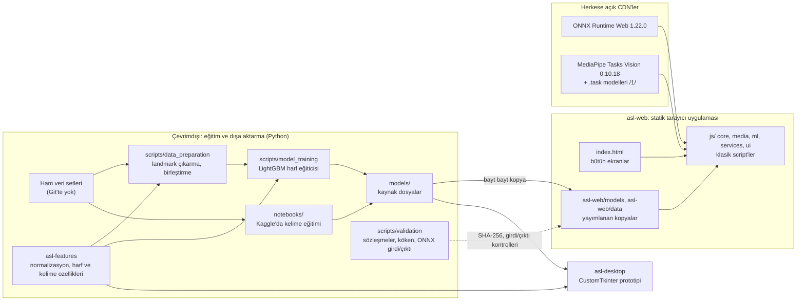
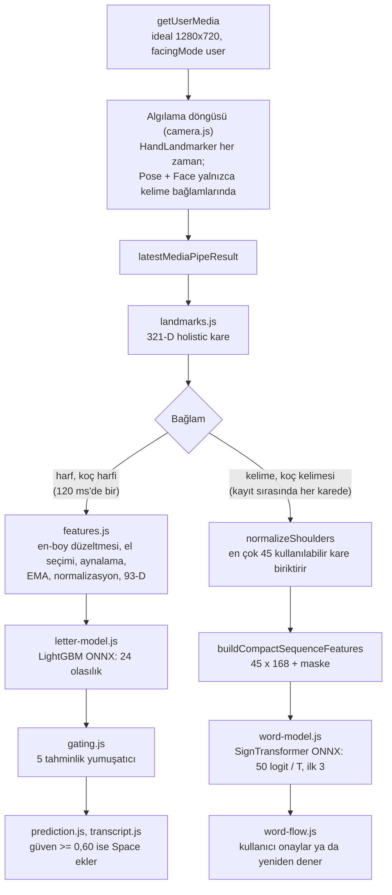
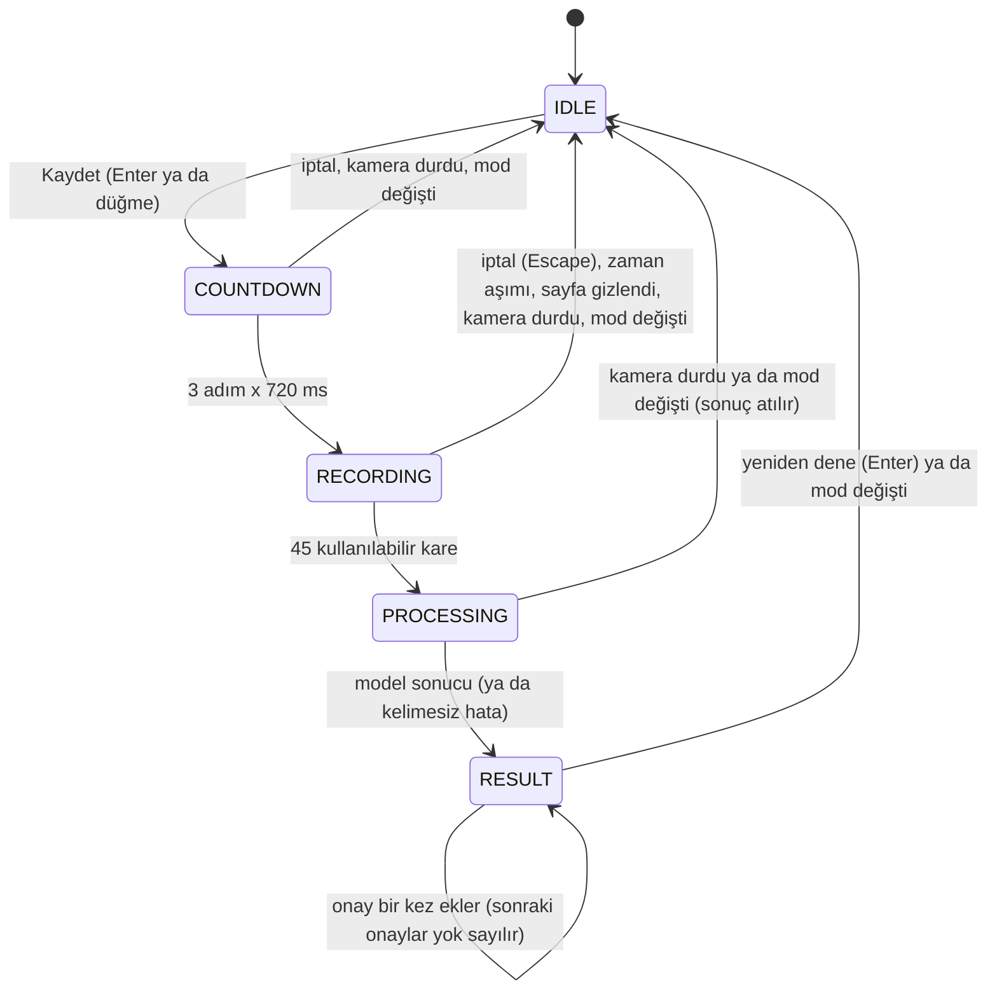
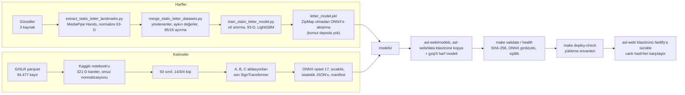

# ASL Assistant: Teknik Rapor

Konum: [`asl-assistant`](README.tr.md) / `TECHNICAL_REPORT.tr.md`

İlgili: [`docs/`](docs/README.md) · [`docs/architecture.md`](docs/architecture.md) · [`docs/models-and-data.md`](docs/models-and-data.md) · [English](TECHNICAL_REPORT.md)

Bu rapordaki her sayı depodan gelir: README'lerden, [`docs/`](docs/) içindeki belgelerden, notebook'lardan, model meta verilerinden ya da commit geçmişinden. İki kaynak çeliştiğinde metin, yayımlanan dosyanın hangisini kullandığını belirtir.

## İçindekiler

1. [Özet](#1-özet)
2. [Sistem mimarisi](#2-sistem-mimarisi)
3. [Sistem tasarımı](#3-sistem-tasarımı)
4. [Teknolojiler](#4-teknolojiler)
5. [Veri](#5-veri)
6. [Pipeline](#6-pipeline)
7. [Modeller ve deneyler](#7-modeller-ve-deneyler)
8. [Kararlar](#8-kararlar)
9. [Kalite ve doğrulama](#9-kalite-ve-doğrulama)
10. [Sonuçlar ve sınırlamalar](#10-sonuçlar-ve-sınırlamalar)
11. [Gelecek çalışmalar](#11-gelecek-çalışmalar)
12. [Değişiklik geçmişi](#12-değişiklik-geçmişi)
13. [Ek belgeler](#13-ek-belgeler)

---

## 1. Özet

ASL Assistant, Amerikan İşaret Dili'ni (ASL) bir web kamerasından, tamamen tarayıcıda tanır. Google'ın cihaz üzerinde çalışan görüntü işleme kütüphanesi MediaPipe, her kamera karesinde **landmark**'ları bulur: eller, yüz ve gövde üzerindeki 3B noktalar. Ardından küçük **ONNX** modelleri bu landmark'ları sınıflandırır; ONNX, eğitilmiş modeller için tarayıcıda da çalışan açık bir dosya biçimidir. Hiçbir veri cihazdan çıkmaz. Yayındaki ürün, <https://asl-assistant.netlify.app/> adresinde barındırılan statik bir web uygulamasıdır ([`asl-web/`](asl-web/)). Depoda ayrıca daha eski bir Python masaüstü prototipi ([`asl-desktop/`](asl-desktop/)) ve ortak bir Python özellik paketi ([`asl-features/`](asl-features/)) bulunur.

Uygulamada üç kamera modu ve üç bilgi ekranı vardır:

| Mod | Ne yapar | Durum |
|---|---|---|
| Harf (`#letter`) | 24 statik parmak alfabesi harfini (J ve Z hariç A'dan Y'ye) tanır ve metin oluşturur | Ana mod |
| Kelime (`#word`) | Tek bir izole işareti kaydeder ve 50 kelime içinden en olası üçünü sunar; kelimeyi kullanıcının onaylaması gerekir | Deneysel |
| Koç (`#coach`) | Harf ya da kelime ister ve puanlar | Erken aşamada |
| Model Test, QR, Proje | Paketle gelen fixture'ları modellerden geçirir; bağlantı paylaşır; projeyi anlatır | Bilgi ekranları |

Öne çıkan rakamlar ve anlamları:

| Ölçüt | Değer | Not |
|---|---|---|
| Ayrılmış kümede harf modeli doğruluğu | 8.245 satırda %99,35 | Aynı görsel koleksiyonlarının rastgele satır ayırması; kişiden bağımsız değil |
| Görülmemiş bir kaynakta harf modeli | 122 satırda %68,9 | Bir kaynağı tümüyle dışarıda bırakıp yeniden eğitmek %39,9 ile %79,6 arası verir |
| Kelime modeli doğruluğu (50 kelime) | %71,92, macro-F1 0,714 | Eğitimde hiç görülmemiş 4 kişiden 3.918 kayıt |
| Masaüstü 25 kelimelik model doğruluğu | %86,7 | Kayıt düzeyinde rastgele ayırma; web modeliyle karşılaştırılamaz |
| İlk harf oturumunda model indirmesi | siteden yaklaşık 2,2 MB (2.161.191 bayt) | ONNX Runtime ve MediaPipe herkese açık CDN'lerden gelir (ilk harf oturumunda toplam yaklaşık 17 MB) |

Harf modu ana özelliktir, çünkü daha dar bir sorunu çözer. Tek bir el pozu yeterlidir; zaman içinde hizalama, dolgu ya da kadrajda yüz ve gövde gerekmez. Kelime modeli yalnızca izole işaretlerde çalışır ve düşük top-1 güven değerleri verir. Bir deney olarak sunulur ve kullanıcının onayı olmadan metne hiçbir şey yazmaz.

Uygulama henüz gerçek bir telefonda denenmedi. Yalnızca sanal kameralı headless masaüstü Chrome'da çalıştırıldı (bkz. [bölüm 10](#10-sonuçlar-ve-sınırlamalar)).

---

## 2. Sistem mimarisi

### 2.1 Bileşenler

Bileşenlerin birbirine bağımlılıkları:

- **`asl-web/`** yalnızca tarayıcı API'lerine ve kendi dosyalarına dayanır. Üst düzeydeki `data/` klasöründen hiçbir şey okumaz ve Python import etmez. JavaScript kodu `asl-features` içindeki özellik hesaplarını yeniden uygular. **Eşitlik (parity) kontrolleri** iki uygulamaya aynı girdiyi verip çıktıları karşılaştırır.
- **`asl-features/`**, özellik hesapları için Python tarafındaki doğruluk kaynağıdır. El landmark'larının normalizasyonunu, kare biçimli olmayan bir kamera karesinin kare birimlere dönüştürülmesini, 93 değerli harf özelliklerini ve 45 x 168'lik kelime özelliklerini kapsar. Kelime özellikleri eğitim notebook'unun kendi kodudur ve bir test onları bu koda sabitler. Eğitim, veri hazırlama, masaüstü uygulaması, golden dışa aktarıcı ve eşitlik kontrollerinin hepsi bu paketi import eder.
- **`asl-desktop/`**, `asl-features` paketine ve `models/word/desktop-25/` klasörüne dayanır. Çalışır durumda tutulur; ürün web uygulamasıdır.
- **`models/`** ve `notebooks/word_50_results/` kaynak dosyaları tutar. [`scripts/validation/contracts.py`](scripts/validation/contracts.py), kaynak ile yayın kopyası çiftlerinin tek listesidir. Doğrulayıcılar yayımlanan her kopyayı SHA-256 ile kaynağına karşı denetler.

Her bileşen kendi yapılandırmasının sahibidir: `asl_features.config` (landmark sayıları, 24 harf, veri artırma), `asl_desktop.config` (yollar, kamera, eşikler, 25 kelimelik model) ve [`asl-web/js/core/config.js`](asl-web/js/core/config.js) (tarayıcı eşikleri, etiketler ve zamanlama).

Web yolunda Python servisi, hesap sistemi, veritabanı ya da uygulama API'si yoktur. Kamera kareleri sayfada işlenir.

### 2.2 Web çalışma zamanında veri akışı

İki döngü birlikte çalışır. `media/camera.js`, `requestAnimationFrame` üzerinde tek bir algılama döngüsü çalıştırır; MediaPipe görevlerini çağırır ve en son sonucu yayımlar. `core/app.js` ise overlay'i çizen ve `ml/live-inference.js` içindeki `realInference()` fonksiyonunu çağıran bir çizim döngüsü çalıştırır.

Harf bağlamları çıkarımı en fazla 120 ms'de bir çalıştırır; böylece beş tahminlik yumuşatma penceresi yaklaşık 600 ms'lik işaretlemeyi kapsar. Kelime bağlamları her çizim karesinde çalışır, çünkü bir kayıt kare toplar. Aynı anda yalnızca bir model çağrısı çalışır. Bir çağrı sürerken gelen kare kuyruğa alınmaz, atılır.

### 2.3 Masaüstü prototipi

Masaüstü uygulaması, çeviri görünümü ve öğrenme koçu görünümü olan bir CustomTkinter penceresidir (1360x900, en küçük 1280x800). OpenCV, 0 numaralı kameradan 1280x720 hedefiyle kare yakalar; kareler Tk ana döngüsünden 30 FPS hedefiyle okunur. Uygulama şunları kullanır:

- LightGBM pickle dosyası (`models/letter/letter_model.pkl`), isteğe bağlı az örnekli (few-shot) kişiselleştirmeyle: en çok 50 kayıtlı şablona karşı en yakın komşu eşleşmesi (kosinüs benzerliği, eşik 0,94);
- 321 holistic değerli 30 kare üzerinde dikkat havuzlamalı (attention pooling) 25 kelimelik bir BiGRU;
- isteğe bağlı bir J/Z LSTM yükleyicisi (böyle bir model yok; bkz. [bölüm 7.1](#71-harf-modeli));
- kendi thread'inde `pyttsx3` ile çevrimdışı metin okuma.

Web uygulamasından farklı olarak masaüstü harf yolu sol elleri aynalamaz. Kamera en-boy düzeltmesini ise web ile aynı biçimde uygular ([bölüm 7.1](#71-harf-modeli)).

---

## 3. Sistem tasarımı

### 3.1 Derleme adımı yok, klasik script'ler

Tarayıcı, düz `<script>` dosyalarını [`asl-web/index.html`](asl-web/index.html) içinden sabit bir sırayla yükler. Bundler, transpiler, ES modül grafiği ya da çalışma zamanında npm bağımlılığı yoktur; bu yüzden `asl-web/` içindeki dosyalar yayımlanan dosyaların kendisidir. ONNX Runtime Web ve kjua (bir QR kütüphanesi) jsDelivr'dan yüklenir. MediaPipe bir script etiketi değildir: `media/camera.js` onu ilk kamera başlatmasında dinamik olarak import eder. Tam sıra [`asl-web/js/README.md`](asl-web/js/README.md) dosyasında listelenir.

Bu düzeni yönetilebilir tutan kurallar:

- Başlangıçta yan etkisi olan tek dosya `core/app.js` dosyasıdır: `init()` fonksiyonunu çağırır ve olayları bağlar. `core/runtime.js` paylaşılan durumu, DOM öğe kaydını ve kayıt tamponlarını bir kez oluşturur.
- Script sırası bir çalışma zamanı sözleşmesidir. Testler script'leri tarayıcıyla aynı sırada yükler.
- TypeScript 5.9.3 JSDoc türlerini denetler ve dosya üretmez. `strictNullChecks` bilerek kapalıdır: uyarılarının çoğu isteğe bağlı DOM öğeleriyle ilgilidir ve bunları zorunlu kılmak ayrı bir tasarım kararıdır.

Uygulama 23 JavaScript dosyasından (11.659 satır), 8 CSS dosyasından (4.294 satır) ve bir `index.html` dosyasından (777 satır) oluşur.

### 3.2 Modül sınırları ve DOM sözleşmesi

| Klasör | Sorumluluk |
|---|---|
| `core/` | yapılandırma, paylaşılan durum ve öğe kaydı, açılış, yönlendirme, kamerayı başlatma ve durdurma, çizim döngüsü, tema açılışı |
| `media/` | MediaPipe görev yaşam döngüsü, GPU'dan CPU'ya geri dönüş, algılama döngüsü, landmark overlay'i |
| `ml/` | 321-D kare oluşturma, omuz normalizasyonu, harf ve kelime özellikleri, ONNX oturumları, yumuşatma ve eşikleme (gating), sabit tutma algılama |
| `services/` | gecikme ölçümü |
| `ui/` | tahmin gösterimi, metin, kelime kayıt akışı, koç, referans görselleri, QR, Model Test, toast'lar |

Script'ler öğeleri yalnızca `id` ya da bir `data-ui` kancasıyla bulur, hiçbir zaman bir stil sınıfıyla bulmaz. Eksik olan zorunlu bir öğe, script'in yüklenirken o id'yi söyleyerek hata vermesine yol açar; isteğe bağlı bir öğe `null` olur ve onu okuyan her yer bunu denetler. Bu yüzden bir yeniden tasarımda sınıflar serbestçe değişebilir; bir id'yi ya da kancayı yeniden adlandırmak ise testlerin fark ettiği bir davranış değişikliğidir. Çizim fonksiyonları görünümü durumdan yeniden kurar; dinleyici, zamanlayıcı, fetch ya da model oturumu başlatmaz. Dinamik metin `textContent` ile yazılır.

### 3.3 Kelime kayıt durum makinesi

Bir kare yalnızca el, gövde ve yüzün üçü de varsa sayılır ve her MediaPipe sonucu bir kez sayılır. Dolmayan bir kayıt kendini bitirir: hiç kullanılabilir kare gelmeden 6.000 ms geçince (`WORD_FIRST_FRAME_TIMEOUT_MS`), yeni bir kullanılabilir kare gelmeden 4.000 ms geçince (`WORD_NO_HAND_TIMEOUT_MS`) ya da kayıt 15.000 ms sonra hâlâ dolmamışsa (`WORD_MAX_RECORDING_MS`).

Her kayıt yeni bir sıra numarası alır. Bir model sonucu yalnızca daha yeni bir kayıt başlamamışsa ve durum hâlâ `PROCESSING` ise gösterilir.

### 3.4 Yaşam döngüsü ve onay değişmezleri

**Onay.** Bir kelime sonucu açık bir onay olmadan metne asla eklenmez. Bir kelime tahmininden metne giden tek yol `appendWordResultToTranscript()` fonksiyonudur. Bu fonksiyon bir şey eklemeden önce şunları yeniden denetler: mod `word`, durum `RESULT`; sonuç en son kayda ait ve daha önce onaylanmamış; etiket gerçek bir kelime ve güveni en az 0,15 (`WORD_ACCEPT_THRESHOLD`).

Onaylanan bir kelime "Geri al" düğmeli bir toast gösterir. Ayrı bir fonksiyon, `assessWordResult()`, yalnızca neyin sunulacağına karar verir:

| Durum | Gösterilen etiket |
|---|---|
| Kelime yok | hiçbir şey sunulmaz |
| Güven 0,15'in altında | "Emin olunamadı", onay devre dışı |
| İlk iki sonuç arasındaki fark 0,08'in altında ya da kadraj uyarısı var | "Kontrol ederek ekleyin" |
| Diğer durumlar | "Sonuç kullanılabilir" |

Harfler de yalnızca kullanıcı tarafından eklenir. Harf modunda Space, yumuşatılmış güveni en az 0,60 ise o anki harfi ekler; Enter boşluk ekler, Backspace siler. Kelime modunda Enter kaydeder ya da yeniden dener, Space sonucu onaylar, Escape geri sayımı ya da kaydı iptal eder. Odak düzenlenebilir bir alandayken bu tuşlar, kayıt sırasındaki Escape dışında, hiçbir şey yapmaz. Ctrl, Cmd ya da Alt basılıyken tarayıcıya bırakılır. Tek harfli kısayol yoktur (WCAG 2.1.4).

**Yaşam döngüsü.** Bir kamera ekranından çıkmak kamerayı serbest bırakır. Marka bağlantısını açmak ya da `#test`, `#project` veya `#qr` ekranına geçmek her kamera izini (track) durdurur, bekleyen animasyon karesini iptal eder, üç MediaPipe görevini kapatır, süren kaydı bırakır ve durumu sıfırlar. Harf, kelime ve koç arasında geçişte kamera açık kalır.

Bir kamera başlatması ağı birkaç kez bekler: izin istemi, ilk video karesi (2,5 sn'lik bir yedekle), MediaPipe paketi, onun WebAssembly dosyası ve her model. Bu beklemelerin herhangi birinde bir durdurma gelebilir. Başlatma her beklemeden sonra bir başlatma belirtecini (start token) ve bir nesil sayacını (generation counter) yeniden denetler; böylece böyle bir durdurma başlatmayı iptal eder ve o ana kadar oluşturulanı kapatır. Tarayıcının sonlandırdığı bir iz, durdurma gibi ele alınır. Kamera yeniden açıldığında tek bir algılama döngüsü ve tek bir MediaPipe görev takımı çalışır.

**Rotalar.** `#letter`, `#word`, `#coach`, `#test`, `#project`, `#qr`. Başka herhangi bir hash harf modunu açar. Ayrı bir ana ekran yoktur: marka bağlantısı kamerayı durdurur ve harf ekranını açar; bu ekranın boş sahnesi uygulamayı ve gizliliği anlatır.

### 3.5 İhtiyaç anında yükleme ve boyutlar

`init()` hiçbir model yüklemez. Bir model ilk gerektiğinde istenir: onu çalıştıran bir modda kamera başlatıldığında, kamera açıkken canlı bir moda girildiğinde, bir kelime kaydında ya da bir Model Test çalıştırmasında. Bir koç oturumu kelime modelini yalnızca kelime hedefi için ister. Canlı kareler hiçbir zaman yükleme başlatmaz; model hazır olana kadar atılır. Başarısız bir yükleme unutulur, böylece bir sonraki ihtiyaç yeniden dener.

| Dosya | Bayt | Sunuluş |
|---|---:|---|
| `letter_model.onnx` | 13.195.070 | yalnızca yedek |
| `letter_model.onnx.gz` | 2.161.191 | varsayılan; `DecompressionStream('gzip')` ile açılır |
| `word_model.onnx` | 1.852.835 | sıkıştırılmadan |
| Atkinson Hyperlegible Next (WOFF2) | 31.388 | kendi sunucusundan |
| Atkinson Hyperlegible Mono (WOFF2) | 15.740 | kendi sunucusundan |

Barındırma hizmeti `.onnx` dosyalarını sıkıştırmadan sunar; bu yüzden harf modeli gzip'li gönderilir. Sayfa, barındırma hizmetinin dosyayı zaten açıp açmadığını görmek için ilk iki bayta bakar. `DecompressionStream` yoksa ya da herhangi bir adım başarısız olursa sıkıştırılmamış dosyaya döner. Bir doğrulayıcı, `.gz` dosyası açıldığında sıkıştırılmamış dosyanın baytlarının birebir aynısı çıkmazsa başarısız olur.

İhtiyaç anında yüklemeden önce her ziyaretçi 14,4 MiB (15,0 MB) model indiriyordu. Değişiklikten sonra bir headless Chrome kontrolü `/`, `#qr` ya da `#project` üzerinde hiçbir `.onnx` isteği görmedi. Diğer belgeler model boyutlarını MiB ya da MB olarak verdiği için rakamları biraz farklıdır; yukarıdaki bayt sayıları dosyaların kendisidir.

### 3.6 Gizlilik ve güvenlik

- Analiz aracı, hesap ya da arka uç yoktur. Görüntü kaydedilmez ve gönderilmez; kamera sahnesi de bunu söyler.
- Tam olarak üç `localStorage` anahtarı vardır: `asl-theme`, `asl-web-transcript` ve `asl-coach-v1`. Depolama engellenirse uygulama yine çalışır.
- Script'ler yalnızca iki dış sunucuya istek atar: `cdn.jsdelivr.net` ve `storage.googleapis.com`.
- ONNX Runtime Web ve kjua, Subresource Integrity ile yüklenir (SRI: tarayıcının bir dosyayı çalıştırmadan önce denetlediği bir hash). MediaPipe Tasks Vision 0.10.18 sürümüne, üç `.task` modeli de `/latest/` yerine `/1/` sürümüne sabitlenmiştir; bir test her `/latest/` URL'sini reddeder. Dinamik MediaPipe import'u SRI hash'i taşıyamaz, bu yüzden sürüm sabitlemesine dayanır.
- [`asl-web/_headers`](asl-web/_headers) şunları ayarlar: `X-Content-Type-Options`, `Referrer-Policy`, `Permissions-Policy` (kamera yalnızca bu site için; mikrofon ve konum kapalı), `X-Frame-Options: DENY` ve İçerik Güvenliği Politikası (CSP), yani sayfanın hangi kaynaklardan yükleme yapabileceğini listeleyen başlık. CSP şimdilik yalnızca raporlama modundadır: tarayıcı ihlalleri bildirir ama engellemez. Gerçek bir tarayıcı yayındaki sitede her modu ihlalsiz çalıştırana kadar böyle kalır.

### 3.7 Erişilebilirlik

- `lang="tr"`, bir atlama bağlantısı (skip link) ve her ekranda görsel olarak gizli tek bir `h1`. Bu başlığın metni aynı zamanda belge başlığıdır ve gezinmede odağı alır.
- `polite` öncelikli bir canlı bölge (live region) durum değişikliklerini duyurur. `aria-current` etkin modu, `aria-pressed` tema düğmesini işaretler.
- Telefonlarda popover bir "Diğer" menüsü vardır; Popover API'nin olmadığı tarayıcılar için bir yedeği de vardır. İşaretçi tıklamalarından sonra odak bırakılır.
- `prefers-reduced-motion` dikkate alınır.
- Landmark overlay'i her çizgiyi iki kez çizer: açık bir çekirdeğin altında koyu bir hale. Tek renkli çizgiler bazı videolarda 3:1 kontrastın altına düşüyordu.
- Kontrast WCAG 2.2 AA'ya göre ölçüldü: gövde metni 16,0:1 (açık) ve 16,5:1 (koyu), ikincil metin 8,3:1 ve 10,8:1, üçüncül metin 5,7:1 ve 7,6:1, kontrol kenarlıkları en az 3,4:1. Safran vurgu rengi açık bir yüzeyde hiçbir zaman metin olarak kullanılmaz (1,6:1).
- Arayüz metni, kullanıcıya "siz" diye seslenen sade Türkçedir ve ondalık virgül kullanır. Kod ve yorumlar İngilizcedir.

### 3.8 Stil sistemi

CSS **cascade layer**'ları (`@layer`), seçici özgüllüğünden bağımsız olarak hangi kural grubunun kazanacağını stil dosyasının bildirmesini sağlar. [`asl-web/css/style.css`](asl-web/css/style.css), `legacy, tokens, base, components, layout, screens, utilities` sırasını bildirir ve ilk stil dosyasını en alttaki `legacy` katmanında tutar. Bu yüzden diğer dosyalar (`tokens.css`, `base.css`, `components.css`, `layout.css` ve üç `screens-*.css`) özgüllük çekişmesi olmadan kazanır; `legacy` içindeki kurallar da, onlara bağlı bir şey kalmadığında ekran ekran silinir. Eski dosyanın katmana taşınması altı görüntü alanı (viewport), iki tema ve her mod üzerinde 24 ekran görüntüsüyle denetlendi; öncesi ve sonrası piksel piksel aynıydı.

Ham renk ve boyut değerleri içeren tek dosya `tokens.css` dosyasıdır. Ad önekleri eski adlardan bilerek farklıdır; böylece ortak bir ad eski kuralların stilini sessizce değiştiremez. Kamera sahnesi her zaman koyudur. Küçük ve engelleyici bir script olan `theme-boot.js`, kayıtlı temayı ya da sistem tercihini ilk boyamadan önce uygular. CSP satır içi script'e izin vermediği için ayrı bir dosyadır.

---

## 4. Teknolojiler

| Bileşen | Teknoloji ve sürüm | Rol | Lisans ya da koşullar |
|---|---|---|---|
| Tarayıcıda landmark | MediaPipe Tasks Vision 0.10.18 (Hand, Pose lite ve Face landmarker'ları, float16 modeller `/1/`) | Sayfada el, yüz ve gövde landmark'ları | Apache-2.0 (MediaPipe) |
| Tarayıcıda çıkarım | ONNX Runtime Web 1.22.0, WebAssembly sağlayıcısı, `graphOptimizationLevel: 'all'` | İki modeli de çalıştırır | MIT |
| QR kodları | kjua 0.9.0 | Belirli bir ekranı açan bağlantılar için QR kodları | MIT |
| Yazı tipleri | Atkinson Hyperlegible Next ve Mono, Latin ve Türkçe karakterlere indirgenmiş WOFF2 | Arayüz yazı tipi | SIL OFL |
| Tür denetimi | TypeScript 5.9.3 (yalnızca geliştirmede) | JSDoc sözleşmeleri, dosya üretmeden | |
| Python | Python 3.12 | Eğitim, masaüstü, doğrulayıcılar, testler | |
| JavaScript araçları | Node 24 | Web testleri, eşitlik komutları | |
| Veri | numpy 1.26.4, pandas 2.3.1, pyarrow 25.0.1 | Tablolar, parquet | |
| Landmark çıkarma | mediapipe 0.10.21 (Python, eski Solutions API) | Görsellerden harf landmark'ları | Apache-2.0 |
| Klasik ML | scikit-learn 1.8.0, LightGBM 4.6.0, XGBoost 3.0.1 | Harf modelleri ve ayırmalar | |
| Derin öğrenme | torch 2.2.2 (yerel sabitleme); kelime modeli Kaggle'da PyTorch 2.10.0 ile eğitildi | Kelime modelleri | |
| Dışa aktarma | onnx 1.22.0, onnxruntime 1.23.2 (yerel sabitlemeler); Kaggle dışa aktarımında onnx 1.20.1 ve onnxruntime 1.25.0; harf ONNX dosyasını OnnxMLTools 1.16.0 üretti | Dışa aktarma ve doğrulama | |
| Masaüstü | customtkinter 6.0.0, opencv-contrib-python 4.11.0.86, pyttsx3 2.99 | Prototip arayüzü, kamera, ses | |
| Test ve lint | pytest 9.1.1, `node:test` ve `node:vm`, DevTools Protocol üzerinden headless Chrome, Ruff | Doğrulama | |
| Barındırma | Netlify statik barındırma, elle sürükle-bırak | `asl-web/` klasörünü sunar | |
| Proje | PolyForm Noncommercial 1.0.0 | Kaynak kod ve model dosyaları | Veri koşulları için bkz. [bölüm 5.1](#51-kaynaklar) |

Üçüncü taraf lisansları [README](README.tr.md#data-and-attribution) içinde listelenir. Python sürümleri [`requirements.txt`](requirements.txt) içinde, ortam [`environment.yml`](environment.yml) içinde sabitlenmiştir.

---

## 5. Veri

### 5.1 Kaynaklar

| Kaynak | Kullanım | Kullanılan satır ya da kayıt | Koşullar | Nasıl kullanıldı |
|---|---|---:|---|---|
| [ASL Alphabet](https://www.kaggle.com/datasets/grassknoted/asl-alphabet) (Akash Nagaraj, 2018, doi:10.34740/KAGGLE/DSV/29550) | Harfler | 52.419 landmark satırı | Sağlayıcının etiketine göre GPL-2.0 | Ana harf kaynağı; harf başına en çok 3.000 görsel işlendi |
| [American Sign Language Dataset](https://www.kaggle.com/datasets/ayuraj/asl-dataset) (Ayush Thakur) | Harfler | 962 satır | CC0 1.0 | Ek kişi ve çekim çeşitliliği |
| [ASL-Fingerspelling](https://github.com/Mohammed-Shoaib/ASL-Fingerspelling) ile ilişkili `ASL_SemCom` alt kümesi | Harfler | 1.580 satır (eğitim); 122 satır (test, birleştirmeye alınmadı) | Kaydedilmemiş; görseller yerelde kalır | Ek çeşitlilik; test satırları sonradan görülmemiş kaynak olarak kullanıldı |
| [Google Isolated Sign Language Recognition](https://www.kaggle.com/competitions/asl-signs) (Deaf Professional Arts Network, Georgia Institute of Technology) | Kelimeler (web ve masaüstü) | `train.csv` içinde 94.477 kayıt, 250 işaret, 21 kişi; 50 kelimelik model için 19.299 kayıt | CC BY 4.0, yarışma kurallarına tabi | Yayımlanan iki kelime modelinin de tek kelime kaynağı |
| MediaPipe Processed ASL (Kaggle) | Harfler için incelendi | 0 | | Saklanan çıkarma çalıştırması kullanılabilir el bulmadı; birleştirmede yok |
| MS-ASL (Microsoft) | Kelimeler için incelendi | 0 | Computational Use of Data Agreement | İndirme ve çıkarma script'leri var; yayımlanan modellerin hiçbiri kullanmadı |

Harf satır sayıları, sağlayıcıların görsel sayıları değil, başarıyla çıkarılmış landmark satırlarıdır. Kelime sayısı çalıştırılmış notebook'tan gelir. [`docs/models-and-data.md`](docs/models-and-data.md) bunu "yaklaşık 100.000 kayıt" diye yuvarlar; eğitilen modelin dayandığı rakam notebook'taki 94.477'dir.

**Yeniden dağıtım.** Yarışma kuralları verinin her amaçla kullanılmasına izin verir (madde 7.A); model eğitmek ve yayımlamak da buna girer. Ama verinin yeniden dağıtılmasını yasaklar (madde 7.B) ve bu madde CC BY 4.0'dan önce gelir. Bu yüzden depo eğitilmiş modelleri ve toplu sonuçları yayımlar; landmark verisi ve ondan dışa aktarılmış fixture yayımlamaz. Ham görseller, videolar, parquet dosyaları, üretilmiş CSV'ler, Kaggle alt kümeleri ve kimlik bilgileri Git'e hiç girmez; `data/` klasörü, [`data/README.md`](data/README.md) dışında yok sayılır.

### 5.2 Harf landmark'larını çıkarma

[`extract_static_letter_landmarks.py`](scripts/data_preparation/extract_static_letter_landmarks.py), MediaPipe'ın eski Solutions API'sini statik görsel modunda, tek el ve 0,5 algılama güveniyle çalıştırır. 24 harf klasörünü dosya adına göre sıralı olarak dolaşır. Her görselde algılanan ilk eli alır, 21 `(x, y, z)` landmark'ını düzleştirir, normalize eder, NaN içeren vektörleri reddeder ve `label, f0..f62` biçiminde bir CSV satırı yazar. El algılanmayan görsel satır üretmez. Hangi elin göründüğü (handedness) okunmaz ve hiçbir şey aynalanmaz.

**Normalizasyon (63 değer).** `asl_features.landmarks.normalize_landmarks` her noktadan bileği (landmark 0) çıkarır. Sonra bilekten orta parmağın köküne (landmark 9) olan uzaklığa böler. Bu uzaklık en fazla 1e-6 ise 63 sıfır döndürür. Tarayıcı aynı adımı yeniden uygular.

### 5.3 Harf verisini temizleme, birleştirme ve ayırma

[`merge_static_letter_datasets.py`](scripts/data_preparation/merge_static_letter_datasets.py):

1. Her `*_landmarks.csv` dosyasını (ya da `--inputs` ile verilen dosyaları) yükler.
2. 24 statik harfi tutar (`--include-jz` verilmedikçe J ve Z atılır).
3. Birebir aynı özellik satırlarını atar (ilkini tutar).
4. Değerleri sayıya dönüştürür; NaN ya da sonsuz değer içeren satırları atar; bir özelliği sütun ortalamasından 10 standart sapmadan daha uzak olan her satırı atar.
5. İsteğe bağlı olarak her sınıfı en küçük sınıfın boyutuna indirir (`random_state=42`); yayımlanan tablolar `--no-balance` ile üretildi.
6. Katmanlı (stratified) `train_test_split` yapar: test oranı 0,15, `random_state=42`.

| Tablo | Satır |
|---|---:|
| ASL Alphabet + American SL + ASL_SemCom eğitim | 52.419 + 962 + 1.580 = 54.961 |
| Eğitim kümesi | 46.716 |
| Ayrılmış küme | 8.245 (%15,0) |

Kaynak tabloların toplamı birleşik tabloya tam olarak eşittir; yani bu birleştirmede yineleme ve aykırı değer adımları hiç satır silmedi. Satırların %95,4'ü ASL Alphabet'ten gelir. Sınıflar dengeli değildir: yerel birleşik tabloda 1.048 satırdan (N) 2.867 satıra (F) kadar uzanırlar, yani aralarında 2,7 katlık bir fark vardır; M de düşüktür (1.196). Katmanlı ayırma bu oranları ayırmanın iki tarafında da korur; sınıfları dengelemez.

Ayırma, landmark satırları üzerinden rastgeledir. Kişiye (CSV'lerde kişi kimliği yoktur) ya da kaynak görsel dizisine göre gruplanmaz ve yalnızca birebir aynı satırlar silinir. ASL Alphabet her harfi neredeyse aynı karelerden oluşan uzun seriler hâlinde fotoğraflar; bu yüzden ayrılmış bir satırın yakın komşuları eğitim kümesinde olabilir. Ayrılmış kümedeki %99,35'in modelin zaten gördüğü elleri ve çekim koşullarını ölçmesinin nedeni budur ([bölüm 7.1](#71-harf-modeli)).

Kabuk betiği [`run_static_letter_extraction.sh`](scripts/data_preparation/run_static_letter_extraction.sh) yalnızca ASL Alphabet yolunu yeniden üretir ve varsayılan olarak sınıfları dengeler. `--no-balance` olmadan yayımlanan tabloyu yeniden kurmaz. Yerel ham veri düzeni ve ASL_SemCom koşulları, tek komutla yeniden kurulum vaat edecek kadar iyi kaydedilmemiştir.

### 5.4 Kelime verisini hazırlama

Google Isolated Sign Language Recognition (GISLR) setindeki her kayıt, uzun biçimli (long format) bir parquet dosyasıdır: her karedeki her landmark için bir satır; sütunlar `frame`, `row_id`, `type` (face, pose, right_hand ya da left_hand), `landmark_index`, `x`, `y` ve `z`. MediaPipe Holistic kare başına 543 landmark verir. Notebook bunların 107'sini tutar (21 sağ el, 21 sol el, 40 yüz, 25 gövde); bu da kare başına 321 değer eder.

Her kayıt için [`word_50_training.ipynb`](notebooks/word_50_training.ipynb) içindeki `load_single_parquet`:

1. satırları her kareye bir satır düşecek şekilde `(T, 321)` boyutlu bir matrise çevirir;
2. eksik koordinatları iki yönde doğrusal interpolasyonla, ardından ileri ve geri doldurmayla tamamlar; kalan boşluk 0 olur;
3. tamamen sıfır olan kareleri siler ve 5'ten az karesi olan kayıtları atar;
4. her kareyi omuzlara göre normalize eder. İki omuz da (gövde noktaları 11 ve 12) varsa ve aralarındaki uzaklık 1e-6'dan büyükse, sıfır olmayan her landmark'ı omuzların orta noktasına göre ortalar ve omuz genişliğine böler. Aksi hâlde sıfır olmayan değerler üzerinde min-max ölçeklemeye döner.

Tarayıcı iki normalizasyon yolunu da yeniden üretir ve kelime eşitlik fixture'ları ikisini de kapsar: omuzların göründüğü ve görünmediği durumlar ([bölüm 9.3](#93-eşitlik)).

**Sınıf seçimi (250 işaretten 50'si).** En az 300 kaydı olan işaretler seçilebilir. Elle yazılmış, 50 gündelik kelimeden oluşan bir liste seçilebilir kümeyle kesiştirilir; kalan yerler seçilebilir işaretlerle, kayıt sayısına göre azalan sırada doldurulur. Son 50 kelime alfabetik sıralanır; bu, etiket indekslerini sabitler (`all` = 0'dan `yes` = 49'a).

| Grup | Kelimeler |
|---|---|
| Tercih listesinden 34 | all, before, book, brother, bye, can, child, dad, dog, drink, finish, food, give, go, happy, have, hello, home, hot, hungry, like, look, mom, no, open, please, sad, sick, sleep, talk, thankyou, wait, water, yes |
| Kayıt sayısına göre eklenen 16 | bird, brown, cow, donkey, duck, fireman, hear, lips, listen, mouse, pretend, shhh, sleepy, toothbrush, uncle, who |
| Tercih edilen ama veride olmayan 16 | eat, cold, want, need, help, friend, good, big, different, new, more, name, work, come, day, again |

Seçilen kelimelerin her birinin 337 (have) ile 415 (listen) arasında kaydı vardır, ortalama 387. MS-ASL indiricisinin kelime listesi eksik 16 kelimenin 15'ini içerir, ama MS-ASL yayımlanan hiçbir modelde kullanılmadı.

**Kişiden bağımsız ayırma.** 21 katılımcı kimliği 42 tohumuyla (seed) karıştırılır. 14 kişi eğitime, 3 kişi doğrulamaya, 4 kişi teste gider. Assertion'lar hiçbir kişinin iki bölümde birden bulunmadığını ve her sınıfın her bölümde yer aldığını denetler.

| Bölüm | Kişi | Listelenen kayıt | Yüklenen |
|---|---:|---:|---:|
| Eğitim | 14 | 12.776 | 12.723 |
| Doğrulama | 3 | 2.658 | 2.658 |
| Test | 4 | 3.923 | 3.918 |

19.357 kaydın 19.299'u yüklendi. Uzunlukları 5 ile 453 kare arasındadır; medyan 22, ortalama 38.

### 5.5 Veri yapıları

**321-D holistic kare** (web kelime modeli):

| Konum | İçerik |
|---|---|
| 0..62 | sağ el, 21 x (x, y, z) |
| 63..125 | sol el |
| 126..245 | 40 yüz noktası: dış dudaklar 10, iç dudaklar 6, gözler 8, kaşlar 8, burun ve alın 8 |
| 246..320 | 25 gövde noktası: 0 ile 16 ve 23 ile 30 arasındaki indeksler |

Eksik bir vücut bölümü sıfırla dolu kalır; böylece sonraki gruplar hiç kaymaz. Aynı indeks sabitleri notebook'ta, [`asl-web/js/ml/landmarks.js`](asl-web/js/ml/landmarks.js) içinde ve fixture dışa aktarıcısında yer alır. Masaüstü 25 kelimelik model farklı bir yüz seçimi ve 0 ile 24 arasındaki gövde indekslerini kullanır; bu yüzden iki 321-D kare birbirinin yerine kullanılamaz.

**93-D harf vektörü** (sabit sıra, [`letter.py`](asl-features/src/asl_features/letter.py)):

| Konum | Sayı | İçerik |
|---|---:|---|
| 0..62 | 63 | normalize edilmiş el landmark'ları |
| 63..67 | 5 | parmak ucu ile bilek arası uzaklıklar (landmark 4, 8, 12, 16, 20) |
| 68..71 | 4 | komşu parmak uçları arası uzaklıklar (4-8, 8-12, 12-16, 16-20) |
| 72..85 | 14 | radyan cinsinden eklem açıları (başparmak 2, diğer parmaklar 3'er) |
| 86..87 | 2 | sınırlayıcı kutunun en-boy oranı ve alanı (x ve y üzerinden) |
| 88..92 | 5 | parmak açık bayrakları (uç, bileğe boğumundan daha uzak) |

Dejenere açılar ve NaN ya da sonsuz değerler 0 olur. Doğru uzunlukta ama yanlış sıradaki bir vektör de çalışır ve sessizce anlamsız tahminler üretir; sıranın bir sözleşme olmasının nedeni budur.

**Kare başına 168-D kelime özellikleri** (Python'da `build_compact_features`, JavaScript'te `buildCompactSequenceFeatures`):

| Konum | Sayı | İçerik |
|---|---:|---|
| 0..62 | 63 | baskın el landmark'ları |
| 63..92 | 30 | el şekli: 5 uç-bilek, 4 komşu uç, 10 ikili uç uzaklığı, 5 açıklık bayrağı, 3 PIP-DIP açısı, 2 sınırlayıcı kutu değeri, 1 ortalama uç uzaklığı |
| 93..104 | 12 | elin yüz ve gövdeyle ilişkileri, el başına 6 (işaret parmağı ucundan buruna, ağıza, alna; bilekten buruna; işaret parmağı ucunun y'si eksi burnun y'si; işaret parmağı ucundan bileğe) |
| 105..167 | 63 | baskın elin kareden kareye hareketi (ilk karede sıfır) |

Baskın el her kayıt için bir kez seçilir: daha az sıfır koordinatı olan taraf, eşitlikte sağ. Sol baskın el, x'in işareti değiştirilerek aynalanır; kareler omuzlara göre ortalandığı için bu çalışır. Harf yolu ise `x -> 1 - x` ile aynalar, çünkü oradaki koordinatlar görsel boyutunun kesirleridir. İki kural da [`features.js`](asl-web/js/ml/features.js) içinde belgelenmiştir.

**Kelime modeli girdisi:** kare kare dizilmiş `Float32Array(45 x 168)` ve gerçek bir kareyi `true` ile işaretleyen bir `boolean[45]` maskesi. Dışa aktarılan graf maskeyi kendisi ters çevirir; bu yüzden tarayıcı onu önceden ters çevirmemelidir.

**Çalışma zamanı JSON dosyaları.** [`asl-web/data/`](asl-web/data/) şunları tutar: etiket eşlemeleri, kelime sıcaklık değeri, kelime başına istatistikler, koç müfredatı, en sık 30 kelime karışıklık çifti (sayı >= 3), elle hazırlanmış harf öğretim verisi ve birbirine benzeyen harf grupları, kelime referans konumları, model kartı ve iki smoke test fixture'ı. Kelime başına dosyalar kelime test kümesinden gelir; harf öğretim dosyaları elle hazırlanmıştır, model çıktısı değildir. [`docs/models-and-data.md`](docs/models-and-data.md) her dosyayı ve şemasını listeler.

### 5.6 Fixture'lar ve yeniden dağıtım kısıtları

Fixture, Model Test ekranının kamera olmadan modelden geçirdiği, beklenen etiketiyle birlikte kaydedilmiş bir model girdisidir. Her fixture kendi girdi sözleşmesini belirtir: harfler için 93 sonlu değer, kelimeler için 7.560 değer ve 45 boolean. Bir manifest, paketle gelen her fixture'ı tam bir kez listelemelidir.

- **24 harf fixture'ı**, her harf için bir tane. Her biri, 8.245 satırlık ayrılmış tablonun bir satırının 93 özelliğini tutar. 23'ü ASL Alphabet'ten, K fixture'ı ASL_SemCom'dan gelir; hiçbiri yarışma verisinden gelmez.
- **Bir sentetik kelime fixture'ı**, `word-give-smoke`: 30 rastgele kare (NumPy tohumu 42, standart normal çarpı 0,1), 45'e kadar dolgulu. Yayımlanan model buna 0,0760 güvenle "give" yanıtını verir; düzgün dağılımda bu değer 0,02 olurdu. Doğruluğu değil, pipeline'ı denetler.
- **Gerçek kelime fixture'ları yalnızca yereldedir.** [`export_model_test_word_samples.py`](scripts/evaluation/export_model_test_word_samples.py), 168-D girdiyi yarışmanın parquet dosyalarından yeniden kurar ve fixture'ları Git'in yok saydığı `asl-web/data/model-test-samples/local/` klasörüne yazar. Panel, varsa onları listeler. `make validate` uyarır, `make deploy-check` başarısız olur; çünkü sürükle-bırak bir yükleme onları yayımlar. Model Test doğruluk özetleri sentetik ve yerel örnekleri dışarıda bırakır.

[`tests/web/fixtures/feature-golden.json`](tests/web/fixtures/feature-golden.json), formüllerle kurulmuş sentetik eller (9 harf durumu) ve dört kısa kelime dizisi için "golden" beklenen özellikleri 1e-5 toleransla tutar. Hiçbir veri seti değeri içermez.

---

## 6. Pipeline

| Aşama | Harf | Kelime |
|---|---|---|
| Çıkarma | `extract_static_letter_landmarks.py`, MediaPipe 0.10.21 Solutions Hands | Yarışma tarafından sağlandı (MediaPipe Holistic) |
| Birleştirme ve temizleme | `merge_static_letter_datasets.py` | Notebook'taki `load_single_parquet` |
| Ayırma | Katmanlı rastgele satırlar, 85/15, tohum 42 | Kişiye göre, 14/3/4, tohum 42 |
| Veri artırma | Eğitim satırlarının 63-D landmark'ları üzerinde | 168-D özellikler üzerinde, yalnızca son çalıştırmada, 30. epoch'tan itibaren |
| Özellikler | 93-D (`asl_features.letter`) | 168-D compact, dizi düzeyinde |
| Eğitim | Yerelde, LightGBM | Kaggle, iki Tesla T4 görünür, biri kullanıldı |
| Dışa aktarma | OnnxMLTools, ZipMap yok (komut saklanmadı) | `torch.onnx.export`, opset 17, ONNX Runtime'a karşı denetlendi |
| Dosyalar | `models/letter/` | `models/word/web-50/`, `notebooks/word_50_results/` (20 dosyayı ve SHA-256 değerlerini içeren manifest) |
| Yayın kopyası | `asl-web/models/letter_model.onnx` ve `.gz`, `letter_labels.json` | `asl-web/models/word_model.onnx`, etiketler, sıcaklık, istatistik JSON'u |
| Doğrulama | Özellik eşitliği, model eşitliği (3 el), köken, girdi/çıktı | Özellik eşitliği (6 fixture), köken, girdi/çıktı, deterministik çıkarım |

Kaggle dışa aktarımı dosyaları `final_model.pt` ve `word_to_idx.json` diye adlandırır; depo onları `word_model.pt` ve `word_labels.json` olarak saklar ve manifest her çifti hash ile eşler. Yayımlanan kelime modeli kaynağıyla bayt bayt aynıdır (1.852.835 bayt).

Yayın elle yapılır. `make check`, `make browser-check`, elle bir kontrol ve `make deploy-check` çalıştırılır; `asl-web/` Netlify yayın sayfasına sürüklenir; ardından birkaç dosyanın SHA-256 değeri canlı site ile çalışma kopyası arasında karşılaştırılır. Script URL'lerindeki önbellek etiketleri nadiren değişir; bu yüzden hangi derlemenin yayında olduğunu kanıtlamaz. Kökteki [`netlify.toml`](netlify.toml) sürükle-bırak yüklemesine dahil değildir; başlıkların `asl-web/_headers` içinde durmasının nedeni budur. Bkz. [`docs/getting-started.tr.md`](docs/getting-started.tr.md).

---

## 7. Modeller ve deneyler

### 7.1 Harf modeli

**Eğitim düzeni.** Veri artırma yalnızca 63-D normalize edilmiş eğitim landmark'ları üzerinde çalışır: ayrılmış küme ayrıldıktan sonra, özellik mühendisliğinden önce. Her satır korunur ve 5 varyant alır: Gauss gürültüsü (std 0,02), görüntü düzleminde döndürme (+/-45 derece içinde düzgün dağılımlı) ve ölçekleme (0,8 ile 1,2 arasında düzgün dağılımlı). Yatay aynalama ve NumPy tohumu yoktur; bu yüzden yeniden çalıştırma bayt bayt aynı sonucu vermez. 46.716 satır 280.296 olur.

Eğitici ardından artırılmış tablodan ikinci bir katmanlı 85/15 ayırma yapar (238.251 / 42.045); `accuracy_augmented_split` bunu ölçer. Tek bir kaynak satırın artırılmış kopyaları iki tarafa da düşebilir; bu yüzden bu rakam bağımsız değildir.

**Model karşılaştırması** ([`letter_model_meta.json`](models/letter/letter_model_meta.json) içinde kayıtlı):

| Model | Doğruluk |
|---|---:|
| Random Forest | 0,985 |
| XGBoost | 0,992 |
| LightGBM | 0,994 |

Eğitici ayrıca 5 katlı çapraz doğrulamayla bir MLP, küçük bir 1D CNN ve yedek olarak bir SVM de çalıştırabilir, ama izlenen hiçbir dosya onlar için sonuç saklamaz.

**Özellik ve veri artırma ablasyonu** (ablasyon, bir parçanın katkısını ölçmek için o parçayı çıkarır):

| Yapılandırma | Doğruluk |
|---|---:|
| 93-D özellikler, artırmalı | 0,994 |
| 93-D özellikler, artırmasız | 0,988 |
| Ham 63-D landmark'lar, artırmalı | 0,332 |

Tasarlanmış el geometrisi, veri artırmadan çok daha fazla katkı sağladı. Karşılaştırmanın ve ablasyonun hangi test kümesini kullandığı kaydedilmemiştir.

**Seçilen model.** 300 ağaçlı, `random_state=42` ve geri kalanında kütüphane varsayılanlarıyla (öğrenme oranı 0,1, 31 yaprak) LightGBM. Eğitim 80,8 sn sürdü; çıkarım örnek başına 0,05 ms sürer. Girdi `float32 (N, 93)`. Çıktılar `label` `int64 (N)` ve `probabilities` `float32 (N, 24)`; etiketler alfabetik sıradadır, 0'dan 23'e. OnnxMLTools 1.16.0 modeli tek bir ONNX ağaç topluluğu (tree ensemble) düğümüne dönüştürdü. Yayımlanan dışa aktarım ZipMap içermez; ZipMap, eşlemelerden (map) oluşan ve ONNX Runtime Web'in güvenilir biçimde okuyamadığı bir çıktı biçimidir.

| Değerlendirme | Doğruluk |
|---|---:|
| Artırılmış iç ayırma (42.045 satır) | 0,9944 |
| Artırma öncesi ayrılmış küme (8.245 satır) | 0,9935 |

**Genelleme kontrolü.** Yayımlanan ONNX modeli, iki ayırmada da bulunmayan 122 ASL_SemCom test satırında puanlandı. Model ayrıca aynı ayarlarla, her seferinde bir kaynağı tümüyle dışarıda bırakarak yeniden eğitildi:

| Değerlendirme | Doğruluk |
|---|---:|
| Görülmemiş 122 ASL_SemCom test satırında yayımlanan model | %68,9 |
| Yeniden eğitim, American SL dışarıda | %79,6 |
| Yeniden eğitim, ASL_SemCom dışarıda | %39,9 |
| Yeniden eğitim, ASL Alphabet dışarıda | %64,8 |

Görülmemiş ellerde en zayıf harfler, yalnızca başparmakla ayrılan kapalı yumruklar (M, N, T, S, E, A) ve birbirine yakın R/U/V/H, G/K, X/D ve O/C gruplarıdır. Yanlış yanıtlar genellikle kendinden emindir: 122 satırda yanlış tahminlerin %89,5'inin olasılığı en az 0,6 idi; yani 0,6 gösterim eşiği onları süzmez. Çözüm veridedir: daha çok kişi ve kişiye göre gruplanmış bir ayırma.

**Kamera en-boy oranı bulgusu ve düzeltmesi.** Eğitim fotoğrafları kare biçimlidir; bu yüzden bir x birimi bir y birimine eşittir. MediaPipe x'i kare genişliğinin, y'yi kare yüksekliğinin kesri olarak verir. Uygulama 1280x720 bir kamera ister; bu yüzden eller modele yatayda sıkışmış, dikey tutulan bir telefonda ise uzamış olarak ulaşıyordu. 16:9 bir kareye yerleştirilmiş ayrılmış fotoğraflar üzerinde gerçek MediaPipe çıktısıyla doğruluk %98,4'ten %88,6'ya düştü ve yanlış yanıtlar 0,6'yı geçecek kadar emin kaldı. Masaüstü yolunda 4:3 bir kare %98,1, kare biçimli girdi %99,3 ölçtü.

Düzeltme, harf özelliklerinden önce elin x ve z değerlerini videonun genişlik/yükseklik oranıyla ölçekler. z, x ile birlikte ölçeklenir, çünkü MediaPipe z'yi x'in ölçeğinde verir. Kare biçimli girdi değişmez; bu yüzden Python eşitliği korunur. [`tests/web/letter-aspect.test.js`](tests/web/letter-aspect.test.js), 16:9, dikey ve 4:3 karelerin iki el için de kare biçimli karedeki özellikleri verdiğini denetler. Düzeltme öncesindeki kodda kare biçimli kontrol durumları dışındaki her durum başarısız olur. Masaüstü uygulaması aynı adımı `asl_features.landmarks.to_square_units` üzerinden uygular; bunu [`tests/asl_desktop/unit/test_hand_detector.py`](tests/asl_desktop/unit/test_hand_detector.py) korur.

**Tarayıcıda canlı harf yolu.**

1. HandLandmarker en çok 2 eli izler (algılama, varlık ve izleme eşikleri 0,5). Handedness puanı 0,5'in altındaki el atılır.
2. En-boy düzeltmesi çalışır.
3. Daha çok görünür landmark'ı olan el seçilir (eşitlikte sağ). Sol el `x -> 1 - x` ile aynalanır.
4. Landmark'lar üstel hareketli ortalamayla yumuşatılır: o anki kareye 0,6 ağırlık verilir; el kaybolunca, kamera durunca ya da mod değişince ortalama sıfırlanır.
5. Ardından normalizasyon ve 30 geometri değeri, sonra model gelir.
6. Bir etiket yumuşatıcısı son 5 tahmini tutar ve en sık etiketi gösterir. Güveni, etiketin penceredeki payı çarpı etiketin ortalama ham güvenidir.

Eşikler: 0,45'in altında belirsiz, 0,65'ten itibaren emin, 0,60'tan itibaren eklenebilir.

**J ve Z.** İki harf de hareket gerektirir ve tek kareye bakan bir sınıflandırıcı hareketi göremez. Veriden, modelden ve etiketlerden çıkarılmışlardır. Deneysel bir eğitici ([`train_dynamic_jz_model.py`](scripts/model_training/train_dynamic_jz_model.py), 63 landmark'lı 30 kare üzerinde 2 katmanlı bir LSTM) ve bir masaüstü yükleyicisi vardır, ama hiç veri kaydedilmedi ve hiçbir J/Z modeli yayımlanmaz.

### 7.2 Kelime modeli

50 kelimelik deneylerin hepsi aynı tarifi paylaşır: Focal Loss (gamma 2,0, label smoothing 0,1), AdamW (weight decay 1e-4), batch 64, gradyan kırpma 1,0, karışık hassasiyet (mixed precision), deterministik cuDNN ile tohum 42 ve en iyi doğrulama macro-F1 değerini veren checkpoint. Hızlı çalıştırmalar 25 epoch, sabır (patience) 10 kullanır ve veri artırmaz. Her seçim doğrulama macro-F1'ine göre yapılır; test kümesi yalnızca raporlanır. Deneyler her seferinde bir değişkeni değiştirir: önce özellikler (A), sonra dizi stratejisi (B), sonra mimari (C), en son uzun bir son çalıştırma (D).

**A. Özellik kümesi ablasyonu** (BiGRU, 30 kare, maskesiz):

| Özellik kümesi | Boyut | Doğrulama F1 | Test doğruluğu | Test macro-F1 |
|---|---:|---:|---:|---:|
| 1A ham landmark'lar | 321 | 0,6696 | 0,5898 | 0,5813 |
| 1B ham + ikili uzaklıklar + baskın el | 444 | 0,7704 | 0,6774 | 0,6714 |
| 1C el şekli + ilişkiler | 72 | 0,7146 | 0,6197 | 0,6125 |
| 1D şekil + hareket | 132 | 0,7141 | 0,6269 | 0,6205 |
| **1E compact** | **168** | **0,7878** | **0,7034** | **0,6992** |
| 1F tam | 519 | 0,7397 | 0,6447 | 0,6391 |

Compact 168-D küme hem doğrulamada hem testte kazandı. Ham koordinatları 0,118, en büyük vektörü 0,060 test F1 farkıyla geçti. Notebook, compact kümenin F1 0,720 aldığı 34 kelimelik bir çalışmaya atıf yapar; o çalışma depoda yoktur ve 50 kelimelik notebook ablasyonu baştan çalıştırdı.

**B. Dizi stratejisi** (168-D, BiGRU, 602.739 parametre):

| Strateji | Doğrulama F1 | Test doğruluğu | Test macro-F1 |
|---|---:|---:|---:|
| fixed30: linspace ile seçme ya da 30'a dolgu | 0,7878 | 0,7034 | 0,6992 |
| **padmask45: 45 kare + maske** | **0,7911** | **0,7052** | **0,7004** |
| motion: hareketi en yüksek 30 kare | 0,7861 | 0,6988 | 0,6940 |

Farklar küçüktür. padmask45, doğrulamadaki üstünlüğü nedeniyle ve maske geçerli uzunluğu açıkça belirttiği için seçildi; bu da ONNX sözleşmesiyle örtüşür. Eğitimde uzun kayıtlar eşit aralıklarla 45 kareye seyreltilir, kısa olanlar sonda sıfırla doldurulur. Maske ilk `min(len, 45)` kareyi işaretler.

**C. Mimari karşılaştırması** (168-D, padmask45):

| Model | Parametre | Doğrulama F1 | Test doğruluğu | Test macro-F1 |
|---|---:|---:|---:|---:|
| BiGRU (2 katman, gizli boyut 128) | 602.739 | 0,7911 | 0,7052 | 0,7004 |
| **SignTransformer** | **446.195** | **0,7917** | **0,7256** | **0,7188** |
| SmallGRU (1 katman, gizli boyut 64) | 104.627 | 0,7651 | 0,6858 | 0,6817 |
| ConvGRU (Conv1d k3 + k5, GRU) | 338.259 | 0,7809 | 0,7062 | 0,7016 |
| SignTransformer + BiGRU topluluğu (ensemble) | 1.048.934 | nota bakın | 0,7384 | 0,7333 |

Not: `all_experiment_results.json` içinde topluluğun "en iyi doğrulama" alanları onun test değerlerini içerir (0,7333 / 0,7384). Topluluk için doğrulama puanı yoktur.

SignTransformer 168 girdiyi 128 boyuta izdüşürür ve öğrenilmiş bir konum gömmesi (position embedding) ekler. Ardından 2 pre-norm Transformer encoder katmanı çalıştırır (4 head, feed-forward 512, GELU, dropout 0,3), gerçek kareler üzerinde dikkatle havuzlar ve 128-64-50'lik bir çıkış katmanıyla biter. En iyi tekil model olduğu için seçildi. Topluluk testte daha yüksek puan aldı, ama tarayıcıda iki model ve iki katından fazla parametre gerektirir. SignTransformer ile BiGRU arasında, tek bir tohumda, doğrulama F1'inde yalnızca 0,0006 fark vardır.

**D. Son eğitim** (dışa aktarılan model): SignTransformer, öğrenme oranı 5e-4, warm restart'lı kosinüs takvimi (`T_0=10, T_mult=2`), sabır 20 ile en çok 100 epoch. Veri artırma 168-D özellikler üzerinde yalnızca 30. epoch'tan itibaren çalışır: gürültü std 0,01 (p 0,5), en çok 4 karelik zaman maskesi (p 0,3), 0,95 ile 1,05 arası ölçek (p 0,3) ve en çok 3 karelik zaman kaydırma (p 0,3). Eğitim 3,1 dakika sonra 63. epoch'ta durdu; en iyi doğrulama F1'i 43. epoch'ta geldi.

| Ölçüt | Değer |
|---|---:|
| Test doğruluğu | 0,7192 |
| Test macro-F1 | 0,7140 |
| En iyi doğrulama F1 | 0,8029 |
| Test örnekleri, kişiler | 3.918, 4 |
| Sıcaklık T | 0,9854 |
| Sıcaklıktan önce / sonra ECE | 0,0235 / 0,0252 |
| ONNX boyutu | 1.852.835 bayt (1,767 MiB) |

Son çalıştırmanın doğrulama F1'i aynı mimarinin hızlı çalıştırmasından yüksektir (0,7917'ye karşı 0,8029), ama test puanları biraz düşüktür (F1'de 0,7188'e karşı 0,7140). Dört test kişisi ve tek tohumla bu fark olası gürültü sınırları içindedir. Yayımlanan rakamlar (README, model kartı) karşılaştırma tablosunun değil, son çalıştırmanındır.

**Kalibrasyon.** Sıcaklık ölçekleme (temperature scaling), güven değerleri modelin ne sıklıkla doğru olduğuyla daha iyi örtüşsün diye modelin ham puanlarını (logit'leri) tek bir sayıya, T'ye böler. ECE (expected calibration error, beklenen kalibrasyon hatası) bu örtüşmeyi ölçer; düşük olması daha iyidir. T, 1,5'ten başlayarak doğrulama logit'leri üzerinde uyduruldu. 1'e yakın çıktı ve 15 aralıklı ECE biraz kötüleşti. Tarayıcı logit'leri yine de T'ye böler, ama bunun için bir kalibrasyon kazancı iddia edilmez. Ürün belirsizliği başka yolla ele alır: ilk üçü gösterir, bilinen benzer çiftler için ipucu verir ve 0,15 onay eşiğiyle kullanıcı onayı ister.

**Dışa aktarma.** `torch.onnx.export`, opset 17, eski (legacy) dışa aktarıcı. Girdiler `input` `float32 [batch, 45, 168]` ve `mask` `bool [batch, 45]`; çıktı `float32 [batch, 50]`. ONNX Runtime, maskesi tamamen true olan rastgele bir girdide PyTorch ile 5,96e-07 içinde eşleşti. Yayımlanan graf, maske üzerinde bir `Not` düğümü içerir: maskenin ters çevrilmesi grafın içindedir.

**Kelime bazında analiz** (test kümesi): 9 kelimenin F1 değeri en az 0,85'tir (aralarında water 0,912, sad 0,910, uncle 0,909, cow 0,908), 22'si 0,70 ile 0,85, 16'sı 0,50 ile 0,70 arasındadır ve 3'ü 0,50'nin altındadır (open 0,427, give 0,458, all 0,474). En sık karışıklıklar:

| Gerçek | Tahmin | Sayı |
|---|---|---:|
| listen | hear | 23 |
| can | yes | 22 |
| open | book | 20 |
| sleep | sleepy | 19 |
| who | bird | 17 |
| fireman | hello | 16 |

Koçun zorluk etiketleri (doğruluk > 0,8 ise kolay, > 0,6 ise orta, değilse zor: 22 / 16 / 12), müfredat ve karışıklık çiftleri bu test kümesi tahminlerinden hesaplanır.

**Tarayıcıda kelime yolu.** Kabul edilen her kare normalize edilmiş 321-D bir kare olarak saklanır. 45 kare dolunca 168-D özellikler dizinin tamamı için kurulur; böylece baskın el, eğitimdeki gibi bir kez seçilir. Tarayıcı ilk 45 kullanılabilir kareyi alır; eğitimden farklı olarak uzun bir kaydı seyreltmez. Eşikler: 0,15'in altında belirsiz, 0,20'den itibaren emin, 0,15'ten itibaren onaylanabilir. Yapılandırma, 50 sınıflı modelin doğru olduğunda bile çoğu zaman düşük top-1 güven verdiğini not eder.

### 7.3 Masaüstü 25 kelimelik model

| Öğe | Değer |
|---|---|
| Kelime dağarcığı | hello, bye, yes, no, please, thankyou, finish, go, drink, give, look, wait, sleep, open, talk, mom, dad, child, happy, sad, hungry, sick, home, food, water |
| Veri | Eşleşen 9.526 GISLR kaydı, 7.723'ü yüklendi (%81,1) |
| Girdi | 30 kare x 321 (linspace ile seçme ya da sıfır dolgu) |
| Ayırma | Kayıtlar üzerinden rastgele katmanlı 70/15/15: 5.406 / 1.158 / 1.159; kişiden bağımsız değil |
| Model | Çift yönlü 2 katmanlı GRU, gizli boyut 128, dikkat havuzlama, dropout 0,4, 711.962 parametre |
| Tarif | Focal loss, label smoothing 0,15, sınıf ağırlıkları, mixup 0,2, warm restart'lar, doğrulama kaybına göre checkpoint |
| Sonuç | Test doğruluğu 0,8671, macro-F1 0,86; 75. epoch'ta erken durdurma |

Sürüm 4, sürüm 3'ün canlıda aşırı emin tahminlerini azaltmak için focal loss, mixup, dikkat havuzlama ve daha fazla düzenlileştirme ekledi; sürüm 3'ün rakamları saklanmadı. Kelime dağarcığı, landmark seçimi, dizi uzunluğu, özellikler ve ayırmanın hepsi web modelinden farklıdır. Bu yüzden %86,7, web modelinin %71,92'siyle karşılaştırılamaz ve iki model birbirinin yedeği değildir.

### 7.4 Önceki aşamalar

[`docs/project-journey.md`](docs/project-journey.md), 15 kelimelik recurrent bir temel modelden yayımlanan modeli üretmeyen bir ham video sınıflandırıcısına kadar bu modellerden önce gelenleri anlatır. Çoğunun kayıtlı rakamı kalmadı; bu yüzden yayımlanan kayıt 25 kelimelik sürüm 4 ve 50 kelimelik notebook'larla başlar.

---

## 8. Kararlar

| Karar | Değerlendirilen alternatifler | Neden | Sonuç |
|---|---|---|---|
| Bütün çıkarımı tarayıcıda yapmak; statik site, sunucu yok | Python çıkarım servisi; ürün olarak masaüstü uygulaması | Çalıştırılacak sunucu yok, kamera kareleri cihazdan çıkmıyor | İndirme boyutu, tarayıcı ve cihaz sınırları; ön işleme JavaScript'te birebir yeniden üretilmeli (eşitlik kontrollerinin nedeni) |
| Model girdisi olarak landmark'lar | Ham video sınıflandırıcısı (denendi); görsel CNN'i | Küçük modeller, incelenebilir özellikler, Python ve JS'in paylaştığı bir sözleşme | Özellik sırası ve normalizasyon model sözleşmesinin parçası olur; MediaPipe hataları sistem hatası olur |
| Harfler ve kelimeler için iki ayrı model | Tek ortak model; sürekli çeviri | Statik el şekli ile zamana yayılan işaretler farklı sorunlardır | Ölçütler karşılaştırılamaz; harf modu ana özellik oldu |
| 24 harf, J ve Z hariç | Statik J/Z kareleri; dinamik bir model | J ve Z hareket gerektirir | Deneysel J/Z eğiticisi model üretmiyor; arayüz 24 harf gösteriyor |
| Üç harf kaynağı; MediaPipe Processed ASL çıkarıldı | Onu ana kaynak yapmak | Kullanılabilir el vermedi | Satırların %95,4'ü ASL Alphabet'ten; bu da kişi çeşitliliğini sınırlıyor |
| 93-D tasarlanmış özellikler, sabit sıra | Ham 63-D | Ablasyon: 0,332'ye karşı 0,994 | Sıra Python'da, JS'te, golden'larda ve eşitlik kontrollerinde aynen tekrarlanıyor |
| Yalnızca eğitim satırlarını, ayırmadan sonra artırmak; aynalama yok | Ayırmadan önce artırmak; aynalamalı artırma; artırmasız (0,988) | Titremeyi, dönmeyi ve uzaklığı ucuza taklit eder, ayrılmış küme temiz kalır | İç ayırmaya artırılmış kopyalar sızar; tohum yok; sol eller bunun yerine çalışma zamanında aynalanır |
| Harfler için katmanlı rastgele satır ayırma | Kişiye ya da kaynağa göre gruplama | Veride kişi kimliği yok | %99,35 yeni kişilerdeki doğruluğu olduğundan yüksek gösterir; görülmemiş kaynak rakamları yanında yayımlanıyor |
| LightGBM, 300 ağaç | Random Forest, XGBoost, MLP, 1D CNN | Kayıtlı en yüksek doğruluk | 13,2 MB'lık ağaç topluluğu ONNX dosyası, bu yüzden gzip ile sunuluyor |
| ZipMap'siz ONNX dışa aktarımı | ZipMap'li dışa aktarım | ONNX Runtime Web eşleme dizilerini güvenilir biçimde okuyamadı | Düz `(N, 24)` tensörü; çağrı başına yalnızca etiket döndüren bir yedek yol duruyor |
| Kamera en-boy oranını çıkarım sırasında düzeltmek | Kare biçimli olmayan artırmayla yeniden eğitmek; kare biçimli kamera | Ucuz ve kare biçimli girdi için kesin; %98,4'ten %88,6'ya düşüşü giderdi | Masaüstü uygulaması da aynı adımı uyguluyor |
| Kişiden bağımsız kelime ayırma (14/3/4) | Rastgele ayırma (masaüstü notebook'undaki gibi) | Rastgele ayırma modelin kişileri ezberlemesine izin verir | Yeni kişiler için geçerli, daha düşük bir rakam; yalnızca 4 test kişisi |
| En az 300 kaydı olan 50 kelime, önce tercih listesi | 250'nin tamamı; 25 kelime; yalnızca sıklık | Kişiye göre ayırma için sınıf başına yeterli veri | 16 tamamlayıcı kelime veriye göre seçildi, istenen 16 kelime eksik |
| Min-max yedekli omuz normalizasyonu | Normalizasyon yok; yalnızca bilek | Kişinin boyunu ve kameraya uzaklığını ortadan kaldırır | Omuzlar kadrajda olmalı; yedek yol JS'te birebir aynı olmalı |
| 168-D compact özellikler | 321, 444, 72, 132, 519-D | En iyi doğrulama ve test F1 | Birebir JS uyarlaması; baskın el kayıt başına seçiliyor |
| Maskeli 45 kare | fixed30, motion-30 | En iyi doğrulama F1, açık uzunluk | 7.560 değerli girdi ve 45 boolean |
| Tek SignTransformer | BiGRU, ConvGRU, SmallGRU, topluluk | En iyi tekil model; topluluk iki kat büyük ve iki model | Yayına alınabilirlik için yaklaşık 1,5 puanlık test F1'inden vazgeçildi |
| T = 0,9854'ü yayımlamak ama kalibrasyon kazancı iddia etmemek | Kalibrasyon yok; başka bir kalibrasyon | Standart adım; ECE iyileşmedi | Güven bir model puanı olarak gösteriliyor; ürün ilk üçe ve onaya dayanıyor |
| Onaysız asla kelime eklememek; 0,15'ten itibaren onay | Otomatik ekleme; daha yüksek eşik | Doğruyken bile düşük top-1 güven | Testle korunan değişmez; eşik gerçek cihaz verisini bekliyor |
| İhtiyaç anında model yükleme; gzip'li harf modeli | `init()` içinde önceden yükleme; sıkıştırmadan sunma | Önceden yükleme ziyaret başına 14,4 MiB tutuyordu; barındırma bant genişliği sınırlı | Kamerayı hiç başlatmayan ziyaretçiye model inmiyor |
| ORT ve MediaPipe'ı tam sürümlerle ve mümkün olan yerde SRI ile herkese açık CDN'lerde tutmak | Kendi sunucusundan sunmak; paketlemek | Site bant genişliğinden tasarruf; yeniden üretilebilir çalışma zamanı | Çevrimdışı kullanım ve ilk yükleme CDN'lere bağlı |
| Klasik script'ler, derleme yok | ES modülleri, bundler, framework | Sürükle-bırak yayın; klonlayıp herhangi bir statik sunucuyla çalıştırma | Script sırası test edilen bir sözleşme |
| `@layer legacy` geçişi | Bütün CSS'i yeniden yazmak; `!important` | Yeni stiller özgüllük çekişmesi olmadan kazanır | Eski kurallar ekran ekran kaldırılıyor |
| Bilgi ekranlarında kamerayı serbest bırakmak; iptal edilebilir başlatmalar | Kamerayı gizleyip çalışır bırakmak | Gizlilik; bir await sırasında gelen durdurmalar geri alınıyordu | Yeniden açtıktan sonra tek algılama döngüsü ve tek görev takımı |
| `_headers` ve yalnızca raporlayan CSP ile elle sürükle-bırak yayın | Git bağlantılı yayın; CSP'yi şimdi zorunlu kılmak | Barındırmaya yalnızca `_headers` ulaşır; WASM ve iki CDN önce gerçek bir tarayıcıda kontrol gerektirir | `make deploy-check` yüklemeyi korur; canlı site depodan geri kalabilir |
| Yarışma verisinden türetilen kelime fixture'larını depo dışında tutmak | Onları yayımlamak | Kural 7.B yeniden dağıtımı yasaklar | Klonlarda gerçek kelime örneği yok |
| Harf öğretim verisini elle hazırlamak; gözden geçirilmemiş açıklamaları (gloss) gizlemek | Model farklarından türetmek | Henüz harf bazında analiz yok; açıklamalar gözden geçirilmedi | Model çıktısı değil, öğretim referansları |
| MS-ASL'i yayımlanan modellerin dışında tutmak | Eksik kelimeleri onunla doldurmak | C-UDA koşulları; script'ler deneysel kaldı | Hiçbir köken iddiası MS-ASL'e dayanmıyor |

---

## 9. Kalite ve doğrulama

### 9.1 Test katmanları

| Katman | Konum | Neyi denetler | Boyut |
|---|---|---|---|
| Python birim ve entegrasyon testleri | `tests/asl_features`, `tests/asl_desktop` | Normalizasyon, özellikler, golden'lar, masaüstü sınıflandırıcıları | 391 pytest testinin parçası (hızlı kümede 378) |
| Script ve depo sözleşmeleri | `tests/scripts`, `tests/project` | Bozuk kopyalara karşı çalıştırılan doğrulayıcılar, eşitlik komutları ve make hedefleri; depo kuralları | yukarıdakine dahil |
| Tarayıcı kodu | `tests/web` (96 dosya) | `node:vm` bağlamında gerçek script'ler ve gerçek `index.html` | 696 test, hepsi geçiyor |
| Gerçek tarayıcı | `tests/browser` | DevTools Protocol üzerinden 16 headless Chrome kontrolü | 15'i çevrimdışı geçer, kamera kontrolü CDN'lere ihtiyaç duyar |
| Eşitlik | `tests/validation` | JavaScript özelliklerine karşı Python; ONNX'e karşı pickle | pytest değil, komut |

Web testleri gerçek script'leri `index.html` sırasıyla yükler ve belgeyi gerçek HTML'den kurar. Yalnızca sistem sınırları taklit edilir: ağ, animasyon karesi saati, `localStorage`, `matchMedia`, kamera, MediaPipe ve ONNX Runtime. Taklitler bekletilebilir; böylece testler yarış durumlarını yeniden üretebilir. Hiçbir iç modül taklit edilmez.

Gerçek tarayıcı kontrolleri, küçük bir yerel sunucuya karşı sahte kameralı headless Chrome çalıştırır. Sunucu `_headers` içindeki başlıkları gönderir; böylece sayfa gerçek CSP altında çalışır. Kontroller kaynak metni değil, tarayıcının hesapladığını doğrular: stiller, yerleşim kutuları, cascade layer'lar, koyu tema, yatay kaydırma olmaması, yatay ekran yerleşimi, kameranın serbest bırakılması. Chrome yoksa komut başarıyla değil, 2 koduyla çıkar. Ayrıntılar [`tests/README.md`](tests/README.md) içindedir.

### 9.2 Başarısız olduğu gösterilmiş testler

Proje, hiç başarısız olmamış bir testi kanıtlanmamış sayar. Yeni korumalar önce test yazılarak ya da bir **mutasyon testiyle** kanıtlanır: koda bilerek bir hata yerleştirilir, test başarısız olmalıdır, sonra hata kaldırılır. Commit mesajı bu hataları adlandırır.

Örnekler:

- **Maskenin yönü ve kare sırası.** Test, maske ters çevrildiğinde, canlı maske kareleri false olarak işaretlediğinde, kareler ters sırada verildiğinde ya da boyutlar yer değiştirdiğinde başarısız olur.
- **Kamera başlatma yarışları.** MediaPipe başlatmasındaki iptal denetimlerinden herhangi birini kaldırmak bir testi başarısız kılar.
- **Özellik golden'ları.** Sırası değiştirilmiş bir özellik grubunun boyutu aynı kalır, bu yüzden boyut testleri geçer. Golden'lar sayesinde özellik bloklarının yerini değiştirmek, açıklık bayraklarını ters çevirmek ya da yanlış yönde aynalamak node test takımını ya da Python birim testlerini başarısız kılar.
- **Kamera en-boy oranı.** En-boy testi düzeltme öncesindeki kodda başarısız olur ([bölüm 7.1](#71-harf-modeli)).

Değişmezleri koruyan davranış testleri (onay, maskenin yönü, kare sırası, zaman aşımları, kamera durdurma ve yaşam döngüsü) [`tests/web/`](tests/web/) içindedir. Yeni testler kaynak metni düzenli ifadelerle eşleyemez, çünkü bu tür testler zararsız düzenlemelerde bozuluyor ve gerçek hataları kaçırıyordu. `tests/project` içindeki bazı eski testler hâlâ kaynak metni eşler; her biri, yerine gelen testin aynı hataları yakaladığı gösterildiğinde kaldırılır.

### 9.3 Eşitlik

| Kontrol | Fixture'lar | Tolerans | Sonuç |
|---|---|---|---|
| Harf özellikleri, Python ve JS | sağ el, sol el (JS aynalaması), sıfır el | 1e-4 | en büyük fark 1,12e-05, geçti |
| Kelime özellikleri, Python ve JS | 6 (yalnızca sağ el, aynalanmış sol el, omuzlar var, omuzlar yok, baskın el değişimi, iki el) | 1e-4 | en büyük fark 2,38e-07 ile 7,15e-07 arası, geçti |
| Harf modeli, pickle ve ONNX | 3 sentetik el | top-1 aynı | ikisinde de hepsi W tahmin ediliyor; yalnızca biçim uyumunu gösterir |
| Özellik golden'ları | 9 harf durumu, 4 kelime dizisi | 1e-5 | hem Python'dan hem JS'ten denetlenir |

Yayımlanan ONNX modeli, yerel 8.245 satırlık ayrılmış tabloda pickle'a karşı da yeniden puanlandı. İkisi 8.245 satırın hepsinde aynı top-1 etiketi verdi; bu, üç ellik kontrolden daha güçlü bir kanıttır.

### 9.4 Doğrulayıcılar

Bütün doğrulayıcılar ve eşitlik komutları aynı çıkış kodu sözleşmesini paylaşır:

- **0:** her kontrol çalıştı ve sağlandı.
- **1:** bir kontrol çalıştı ve başarısız oldu. Bu, 2'den önce gelir.
- **2:** hatalı kullanım ya da gerekli bir araç eksik; bu yüzden hiçbir şey doğrulanmadı. Eksik bir araç hiçbir zaman başarı olarak bildirilmez.

[`check_runtime_assets.py`](scripts/validation/check_runtime_assets.py) sırasıyla şunları denetler:

1. dosyaların varlığını ve boyutlarını;
2. JSON şemalarını ve Model Test fixture'larını;
3. gzip kopyası dahil, kaynaktan yayına SHA-256 kökenini;
4. notebook dışa aktarım manifest'ini (20 dosya);
5. ONNX girdi, çıktı ve tensör türlerini, deterministik bir çevrimdışı çıkarımla birlikte (fixture ile örtüşen 0,0760 güvenle "give");
6. `--deploy` ile yükleme envanterini. Yerel fixture klasöründe, Git'in yok saydığı dosyalarda, `.DS_Store` ya da `.env` gibi gizli dosyalarda ve [`contracts.py`](scripts/validation/contracts.py) içindeki izin listesi dışında kalan her dosya türünde başarısız olur.

### 9.5 Kapılar

| Komut | Çalıştırdıkları | Gereken |
|---|---|---|
| `make health` | Ruff lint ve biçim, JS sözdizimi, web testleri, Git hijyeni, runtime dosya kontrolü, proje dosya denetimi, notebook kontrolü, özellik eşitliği, hızlı pytest | Yalnızca Python ortamı |
| `make check` | `health` ve JSDoc tür denetimi | Bir kez `npm ci` |
| `make browser-check` | Headless Chrome kontrolleri (`OFFLINE=1` kamera kontrolünü atlar) | Chrome |
| `make deploy-check` | JS sözdizimi ve yükleme envanteri | Her yüklemeden önce |
| `make test-full` | Masaüstü entegrasyonu dahil bütün pytest testleri | MediaPipe, modeller |

Bunların hiçbiri ışığı, kamera izin istemlerini, handedness meta verisini, cihaz hızını ya da canlı işaretlemeyi kapsamaz.

---

## 10. Sonuçlar ve sınırlamalar

**Çalışanlar.** Harf modu 24 statik harfi tarayıcıda, sunucu olmadan tanır. İlk kullanımda yaklaşık 2,2 MB model yükler ve metni yalnızca kullanıcının komutuyla oluşturur. Kelime modeli, hiç görmediği kişiler için 50 izole işareti %71,92 doğrulukla (0,714 macro-F1) tanır. Yayımlanan dosyalar kaynaklarıyla bayt bayt aynıdır, girdi ve çıktı sözleşmeleri denetlenir ve tarayıcıdaki özellikler Python ile 1e-4 içinde örtüşür. [Bölüm 9.5](#95-kapılar) içindeki otomatik kapılar geçer.

**Sınırlamalar.**

- **Gerçek cihaz testi yok.** Uygulamayı yalnızca sanal kameralı headless masaüstü Chrome çalıştırdı. iOS Safari, Android Chrome, gerçek eller ve gerçek ışık denenmedi. Her canlı eşik (harf 0,45 / 0,65 / 0,60; kelime 0,15 / 0,20 / 0,15; koçta 0,65 güvenle 1.000 ms sabit tutma; kayıt zaman aşımları) bu test için bir başlangıç değeridir.
- **Yeni kişiler için harf doğruluğu %99,35'in çok altındadır.** Öne çıkan rakam rastgele bir satır ayırmasından gelir. Görülmemiş kaynakta doğruluk %68,9; bir kaynak tümüyle dışarıda bırakıldığında %39,9 ile %79,6 arasıdır. Harf sınıfları dengesizdir (N'de 1.048, F'de 2.867 satır) ve ayrılmış kümedeki en zayıf sınıflar da N ve M'dir. Dengesizliği gerçek el şekli benzerliğinden ayıran bir analiz yoktur.
- **Harf sonucu tam olarak yeniden üretilemez.** Mevcut eğitici, yayımlanan meta veri anahtarlarını (ayrılmış küme doğruluğu, karşılaştırma, ablasyon) yazmaz. Ayrılmış küme değerlendirme adımı ve pickle'dan ONNX'e dönüştürme komutu depoda yoktur. Yerel ayrılmış tabloyu yeniden puanlamak, kayıtlı 0,9935'e karşı 8.245'te 8.187 doğru (0,9930) verir; aradaki fark yaklaşık 4 satırdır.
- **Harf landmark'larında olası alan kayması (domain shift).** Eğitim landmark'ları statik görsel modunda, yalnızca ilk eli alan eski Solutions API'den gelir. Tarayıcı ise video modunda, handedness eşiğiyle çalışan Tasks HandLandmarker kullanır. İkisinin örtüştüğünü gösteren bir ölçüm yoktur.
- **Kelime modelinin sınırları.** Yalnızca izole işaretler; 4 test kişisi ve tek tohum; arayüz ilk üçü gösterse de top-k doğruluğu kaydedilmedi; sıcaklık ölçekleme ECE'yi biraz kötüleştirdi. Canlı diziler eğitimdekilerden farklıdır: tarayıcı kamera hızında ilk 45 kullanılabilir kareyi alır, eğitim klipleri (medyan 22 kare) ise 45'e dolduruldu ya da seyreltildi. Bu farkın etkisi ölçülmedi. 50 kelimenin 16'sı kullanışlılığa göre değil, veri varlığına göre seçildi.
- **"İşaret yok" sınıfı** iki modelde de yok.
- **Masaüstü.** Masaüstü harf yolu sol elleri aynalamaz. %86,7'lik kelime rakamı rastgele bir ayırmadan gelir.
- **Fixture araçları.** Model Test indiricisi kişileri `np.random.default_rng(42)` ile karıştırır; notebook ise `np.random.seed(42)` ile `np.random.shuffle` kullandı. 21 kişi için ikisi farklı test kişileri seçer. Bu yüzden indiricinin seçtiği yerel kelime fixture'ları eğitim kişilerinden gelebilir. Yayımlanan hiçbir şey onlara dayanmaz.
- **Yayın.** Canlı site depodan daha eski bir derlemedir; CSP yalnızca raporlama modundadır; ilk ziyaret CDN'ler için ağ erişimi ister; MediaPipe'ın dinamik import'unun bütünlük hash'i yoktur.
- **Model dosyalarının lisansı.** Modeller GPL-2.0, CC0, yarışma koşullarıyla birlikte CC BY 4.0 ve koşulları kaydedilmemiş bir kaynak altındaki veriden türetilir. Model kartı kod ve modeller için PolyForm Noncommercial 1.0.0 belirtir; README bir veri seti lisansının ağırlıklara geçip geçmediği konusunda bir iddiada bulunmaz.
- Kelimeler için **referans görselleri** yeniden çiziliyor.

---

## 11. Gelecek çalışmalar

- Gerçek cihazlarda (iOS Safari, Android Chrome) gerçek eller ve ışıkla test etmek; bu çalıştırmayı eşikleri ayarlamak ve CSP raporunu okumak için kullanmak.
- Bu çalıştırmadan sonra İçerik Güvenliği Politikasını zorunlu kılmak.
- Harf modelini daha çok kişiyle ve kişiye göre gruplanmış bir ayırmayla değerlendirmek ve yeniden eğitmek; farklı sınıfları kapsayan harf modeli eşitlik fixture'ları eklemek.
- Harf değerlendirmesini ve ONNX dışa aktarımını script olarak saklamak.
- Kelimelerde canlı diziler ile eğitim dizileri arasındaki farkı ölçmek; kelime deneylerini daha çok tohumla tekrarlamak.
- Eksik gündelik kelimeler dahil daha çok kelime eklemek; izole işaretlerden sürekli işaretleşmeye ve cümle düzeyinde çeviriye ilerlemek.
- Modelleri siteyi yeniden yayımlamadan cihazda güncellemek; progressive web app olarak çevrimdışı çalışmak.
- Erişilebilirliği ve faydayı Sağır kullanıcılarla birlikte gözden geçirmek.

---

## 12. Değişiklik geçmişi

Projenin etiketlenmiş bir sürümü yoktur; ayrıntılı kayıt commit geçmişidir. İlk sürüm ve o zamandan bu yana yapılan başlıca değişiklikler şunlardır:

**İlk sürüm (0.1.0).** Statik bir sayfa olarak harf çevirisi, bir öğrenme koçu, deneysel kelime pratiği, bir Model Test ve bir QR demosu. LightGBM ve SignTransformer modelleri ONNX Runtime Web üzerinden çalışır. Harf girdisi 93-D'dir; kelime girdisi 45 x 168'liktir ve maskesi gerçek bir kare için `true` değerini alır. Harf dışa aktarımı olasılıkları ZipMap olmadan düz bir tensör olarak verir; yayımlanan dosyalar deterministik fixture'lar ve köken hash'leriyle gelir.

**O zamandan bu yana:**

- **Arayüz:** ekran ekran yeniden kuruldu. İlk boyamadan önce uygulanan açık ve koyu temalar, telefon (dikey ve yatay) ve dizüstü için yerleşimler, kullanıcıya "siz" diye seslenen sade Türkçe, metin temizlendikten sonra bir "Geri al" seçeneği ve her kamera sorunu türü için yardım eklendi.
- **Erişilebilirlik:** her ekranda tek bir `h1`, sayfa bölgeleri (ARIA landmark'ları), bir atlama bağlantısı, her ekran için bir belge başlığı ve canlı bölge duyuruları.
- **Yükleme:** modeller ilk kullanımda iner; harf modeli sıkıştırılmış olarak gönderilir (13,2 MB yerine yaklaşık 2,2 MB).
- **Kamera:** bir kamera ekranından çıkmak kamerayı durdurur, başlatma sırasında gelen bir durdurma başlatmayı iptal eder ve tarayıcının sonlandırdığı bir kamera serbest bırakılır.
- **Kelime modu:** dolmayan bir kayıt kendiliğinden biter ve yarıda bırakılmış bir kaydın sonucu onaylanamaz.
- **Harf doğruluğu:** kamera en-boy düzeltmesi ([bölüm 7.1](#71-harf-modeli)) ve harf referansı olarak kamu malı Gallaudet alfabe kartı.
- **Güvenlik ve yayın:** sabitlenmiş MediaPipe modelleri, Subresource Integrity, yalnızca raporlama modundaki bir İçerik Güvenliği Politikasıyla birlikte yanıt başlıkları ve yarışma verisinden türetilmiş fixture'ları içeren bir yüklemeyi reddeden `make deploy-check`.
- **Doğrulama:** davranış üzerine yeniden kurulan ve bilerek yerleştirilen hatalarda başarısız olduğu gösterilen testler, bir headless Chrome kontrol takımı, iki özellik sözleşmesi için Python golden'ları ve doğrulayıcılarla eşitlik komutları için tek bir çıkış kodu sözleşmesi.
- **Depo:** `docs/` altında düz bir belge yapısı; README'nin, başlangıç kılavuzunun ve bu raporun Türkçe sürümleri; PolyForm Noncommercial lisansı; ortak Python özellik paketi `asl-features`.

---

## 13. Ek belgeler

| Belge | İçerik |
|---|---|
| [README.tr.md](README.tr.md) ([English](README.md)) | Genel bakış, hızlı başlangıç, sınırlamalar, lisans, veri atfı |
| [docs/architecture.md](docs/architecture.md) | Bileşenler, script'ler ve stiller, canlı yol, sözleşmeler, kontroller |
| [docs/models-and-data.md](docs/models-and-data.md) | Veri kaynakları, ayırmalar, özellikler, model sözleşmeleri, köken, fixture'lar |
| [docs/project-journey.md](docs/project-journey.md) | Aşamalar, alınan dersler ve kullanılmayan yaklaşımlar |
| [docs/getting-started.tr.md](docs/getting-started.tr.md) ([English](docs/getting-started.md)) | Kurulum, komutlar ve yayın |
| [asl-web/README.md](asl-web/README.md), [asl-web/js/README.md](asl-web/js/README.md) | Web uygulamasının modları, yapılandırma, modül kuralları |
| [asl-features/README.md](asl-features/README.md), [asl-desktop/README.md](asl-desktop/README.md) | Ortak ML paketi ve masaüstü prototipi |
| [models/letter/README.md](models/letter/README.md), [models/word/README.md](models/word/README.md) | Model dosyaları ve meta verileri |
| [notebooks/README.md](notebooks/README.md) | Eğitim notebook'ları ve dışa aktarılan sonuçlar |
| [data/README.md](data/README.md) | Veri çalışma alanı ve neyin commit edilebileceği |
| [scripts/README.md](scripts/README.md), [scripts/validation/README.md](scripts/validation/README.md) | Script kullanımı, çıkış kodları, güvenli model güncellemeleri |
| [tests/README.md](tests/README.md), [tests/browser/README.md](tests/browser/README.md) | Test katmanları, kapılar ve tarayıcı kontrolleri |
