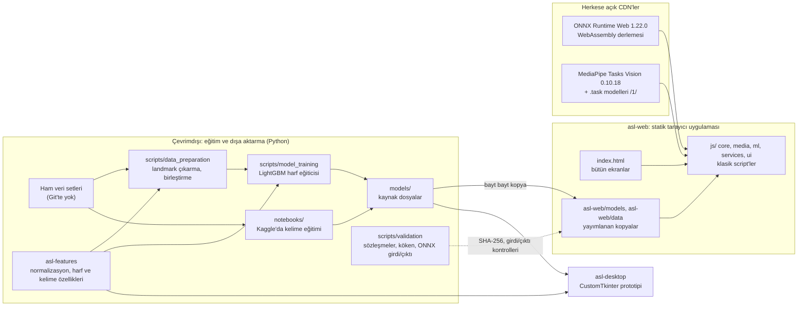
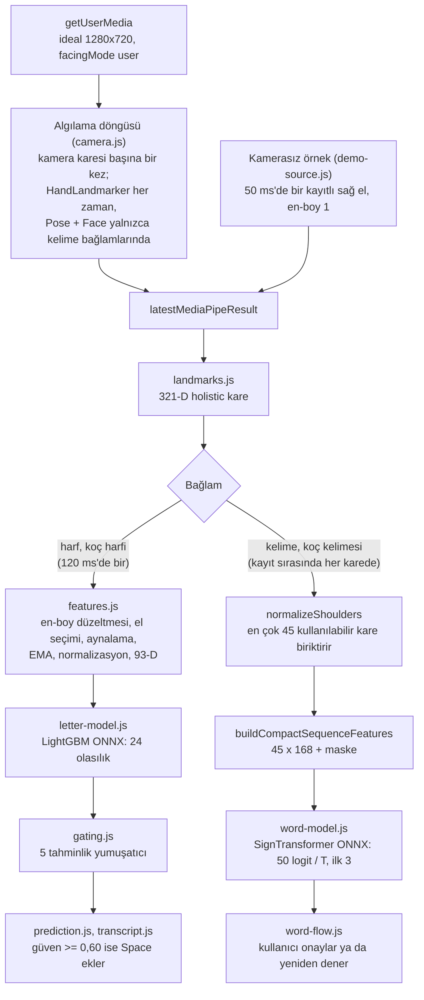
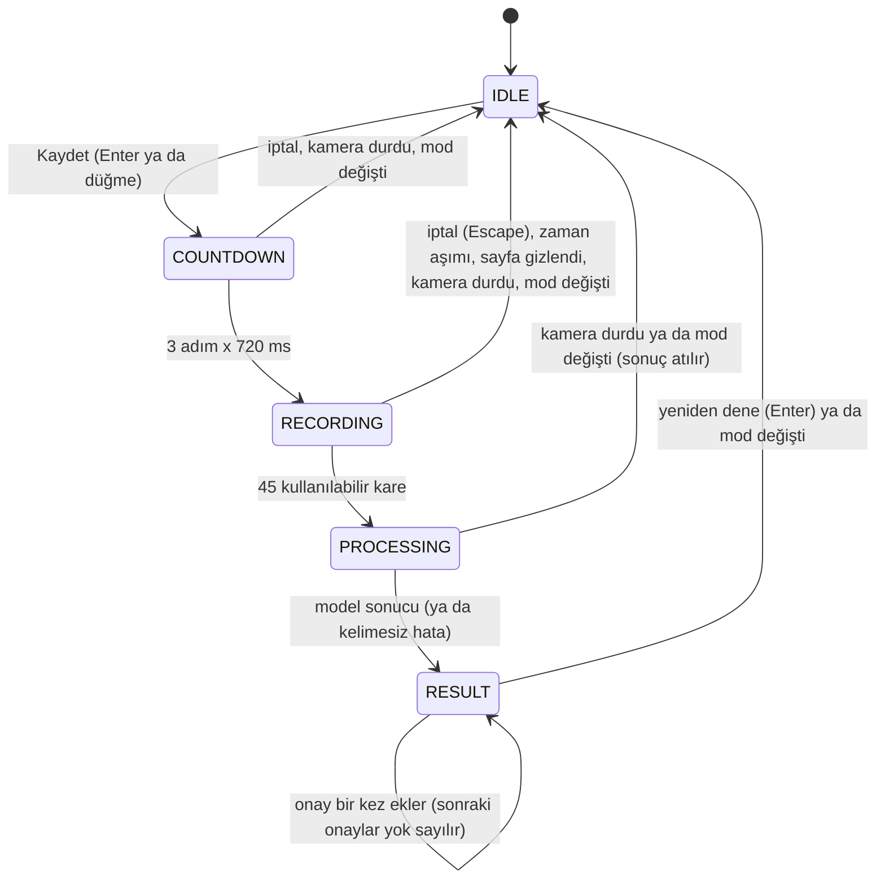
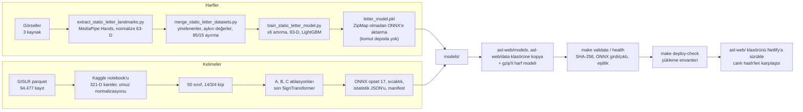

# ASL Assistant: Teknik Rapor

Konum: [`asl-assistant`](README.tr.md) / `TECHNICAL_REPORT.tr.md`

İlgili: [`docs/`](docs/README.md) · [`docs/architecture.md`](docs/architecture.md) · [`docs/models-and-data.md`](docs/models-and-data.md) · [English](TECHNICAL_REPORT.md)

Bu rapordaki her sayı depodan gelir: README'lerden, [`docs/`](docs/) içindeki belgelerden, notebook'lardan, model meta verilerinden ya da commit geçmişinde kayıtlı ölçümlerden.

## İçindekiler

1. [Özet](#1-özet)
2. [Sistem mimarisi](#2-sistem-mimarisi)
3. [Sistem tasarımı](#3-sistem-tasarımı)
4. [Teknolojiler](#4-teknolojiler)
5. [Veri](#5-veri)
6. [Pipeline](#6-pipeline)
7. [Modeller ve deneyler](#7-modeller-ve-deneyler)
8. [Kararlar](#8-kararlar)
9. [Kalite ve doğrulama](#9-kalite-ve-doğrulama)
10. [Sonuçlar ve sınırlamalar](#10-sonuçlar-ve-sınırlamalar)
11. [Gelecek çalışmalar](#11-gelecek-çalışmalar)
12. [Değişiklik geçmişi](#12-değişiklik-geçmişi)
13. [Ek belgeler](#13-ek-belgeler)

---

## 1. Özet

ASL Assistant, Amerikan İşaret Dili'ni (ASL) bir web kamerasından, tamamen tarayıcıda tanır. Google'ın cihaz üzerinde çalışan görüntü işleme kütüphanesi MediaPipe, her kamera karesinde **landmark**'ları (eller, yüz ve gövde üzerindeki 3B noktalar) bulur; küçük **ONNX** modelleri de bunları sınıflandırır. ONNX, tarayıcıda da çalışan açık bir model biçimidir. Hiçbir kamera karesi cihazdan çıkmaz. Ürün, <https://asl-assistant.netlify.app/> adresinde barındırılan statik bir web uygulamasıdır ([`asl-web/`](asl-web/)). Depoda ayrıca daha eski bir Python masaüstü prototipi ([`asl-desktop/`](asl-desktop/)) ve ortak bir Python özellik paketi ([`asl-features/`](asl-features/)) bulunur.

| Mod | Ne yapar | Durum |
|---|---|---|
| Harf (`#letter`) | 24 statik parmak alfabesi harfini (J ve Z hariç) okur ve metin oluşturur | Ana mod |
| Kelime (`#word`) | Tek bir izole işaret için 50 kelime içinden en olası üçünü sunar; kullanıcının onaylaması gerekir | Deneysel |
| Koç (`#coach`) | Harf ya da kelime ister ve puanlar | Erken aşamada |
| Kamerasız örnek (`#letter` üzerinde) | FLY kelimesini heceleyen kayıtlı bir eli canlı harf pipeline'ından geçirir; her harfi kullanıcı ekler | Kamerası olmayan ziyaretçiler için |
| Model Test (`#test`) | Paketle gelen fixture'ları kamera olmadan modellerden geçirir | Geliştirici aracı; proje sayfasından bağlantı verilir |
| QR, Proje | Bağlantı paylaşır, projeyi anlatır | Bilgi ekranları |

| Ölçüt | Değer | Not |
|---|---|---|
| Harf modeli, ayrılmış küme | 8.245 satırda %99,35 | Rastgele satır ayırması; kişiden bağımsız değil |
| Harf modeli, görülmemiş kaynak | 122 satırda %68,9 | Bir kaynak tümüyle dışarıda bırakılınca %39,9 ile %79,6 arası |
| Kelime modeli, 50 kelime | %71,92, macro-F1 0,714 | Eğitimde hiç görülmemiş 4 kişiden 3.918 kayıt |
| Masaüstü 25 kelimelik model | %86,7 | Rastgele ayırma; web modeliyle karşılaştırılamaz |
| İndirme | sayfayı açmak için 0,35 MB; harf modunda ilk kamera başlatmada yaklaşık 15 MB | Bunun 2,2 MB'ı siteden, kalanı CDN'lerden; ikinci ziyarette hiçbir şey |

Harf modu ana özelliktir, çünkü daha dar bir sorunu çözer: tek bir el pozu yeterlidir; zaman içinde hizalama ya da kadrajda yüz ve gövde gerekmez. Kelime modeli yalnızca izole işaretlerle ve düşük top-1 güven değerleriyle çalışır; bu yüzden kullanıcının onayı olmadan metne hiçbir şey yazmayan bir deneydir. Uygulama henüz gerçek bir telefonda çalıştırılmadı, yalnızca sanal kameralı headless masaüstü Chrome'da çalıştı ([bölüm 10](#10-sonuçlar-ve-sınırlamalar)).

---

## 2. Sistem mimarisi

### 2.1 Bileşenler

- **`asl-web/`** yalnızca tarayıcı API'lerini ve kendi dosyalarını kullanır. JavaScript kodu `asl-features` içindeki özellik hesaplarını yeniden uygular; **eşitlik (parity) kontrolleri** iki uygulamayı aynı girdiyle karşılaştırır.
- **`asl-features/`** bu hesapların Python'daki doğruluk kaynağıdır: el normalizasyonu, kare biçimli olmayan bir karenin kare birimlere dönüştürülmesi, 93-D harf özellikleri ve 45 x 168'lik kelime özellikleri. Eğitim, veri hazırlama, masaüstü uygulaması ve eşitlik kontrolleri bu paketi import eder.
- **`models/`** ve `notebooks/word_50_results/` kaynak dosyaları tutar. [`contracts.py`](scripts/validation/contracts.py) kaynak ile yayın kopyası çiftlerinin listesidir; doğrulayıcılar yayımlanan her kopyayı SHA-256 ile kaynağına karşı denetler.

### 2.2 Web çalışma zamanında veri akışı

`media/camera.js` algılama döngüsünü çalıştırır ve en son MediaPipe sonucunu yayımlar; `core/app.js` ise overlay'i çizen ve modelleri çağıran çizim döngüsünü çalıştırır. MediaPipe, videonun sunduğu her kamera karesi için bir kez çalışır; kareler `requestVideoFrameCallback` ile sayılır. 200 ms boyunca hiç kare bildirilmezse yine de algılama yapılır; bu API'si olmayan tarayıcılar her animasyon karesinde algılar. Chrome'un 20 fps'lik sahte kamerasıyla algılama saniyede 50 çağrıdan 20'ye indi.

Harf bağlamları çıkarımı en fazla 120 ms'de bir çalıştırır; böylece beş tahminlik yumuşatma penceresi yaklaşık 600 ms'lik işaretlemeyi kapsar. Kelime bağlamları kayıt sırasında her karede çalışır. Bir model çağrısı sürerken gelen kare kuyruğa alınmaz, atılır.

Kamerasız örnek, `media/demo-source.js`, sahte bir kamera değil, ikinci bir kare kaynağıdır. Kayıtlı eli, tohumlu küçük bir titremeyle saniyede yaklaşık 20 kez `latestMediaPipeResult` içine yayımlar ve her kareyi kare biçimli (en-boy 1) olarak işaretler, çünkü kayıt kare fotoğraflardan gelir. Ne kamera ne de MediaPipe başlatılır; `landmarks.js` ve sonrası değişmeden çalışır.

### 2.3 Masaüstü prototipi

Masaüstü uygulaması, çeviri görünümü ve koçu olan bir CustomTkinter penceresidir. Harf modelinin LightGBM pickle dosyasını (isteğe bağlı az örnekli kişiselleştirmeyle), [bölüm 7.3](#73-masaüstü-25-kelimelik-model) içindeki 25 kelimelik BiGRU'yu ve çevrimdışı metin okumayı kullanır. Web uygulaması gibi el algılamayı kameranın çektiği haliyle karede yapar, yalnızca önizlemeyi aynalar, kamera en-boy düzeltmesini uygular ve sol eli sağ el kuralına göre aynalar. Kullandığı eski MediaPipe API'si aynalanmış bir selfie görüntüsü varsayar; bu yüzden aynalanmamış bir karede kullanıcının sol elini "Right" diye etiketler. J/Z veri toplayıcısı da aynı el algılayıcıdan geçerek kaydeder.

---

## 3. Sistem tasarımı

### 3.1 Derleme adımı yok, klasik script'ler

Tarayıcı, düz `<script>` dosyalarını [`asl-web/index.html`](asl-web/index.html) içinden sabit bir sırayla yükler. Bundler, transpiler, ES modül grafiği ya da çalışma zamanında npm bağımlılığı yoktur; bu yüzden `asl-web/` içindeki dosyalar yayımlanan dosyaların kendisidir. ONNX Runtime Web ve kjua (QR kodları) jsDelivr'dan yüklenir; MediaPipe ilk kamera başlatmasında dinamik olarak import edilir. Başlangıçta yan etkisi olan tek dosya `core/app.js` dosyasıdır ve testler script'leri tarayıcının sırasıyla yükler. TypeScript JSDoc türlerini denetler ve dosya üretmez.

### 3.2 Modül sınırları ve DOM sözleşmesi

Script'ler `core/` (durum, yönlendirme, kamerayı başlatma ve durdurma, çizim döngüsü), `media/` (MediaPipe görevleri, algılama döngüsü, kamerasız örnek, overlay), `ml/` (özellikler, ONNX oturumları, yumuşatma), `i18n/` (Türkçe ve İngilizce arayüz metinleri), `services/` ve `ui/` klasörlerindedir; [`asl-web/js/README.md`](asl-web/js/README.md) onları yükleme sırasıyla listeler. Script'ler öğeleri yalnızca `id` ya da bir `data-ui` kancasıyla bulur, hiçbir zaman bir stil sınıfıyla bulmaz; böylece bir yeniden tasarımda sınıflar serbestçe değişebilir, bir id'yi yeniden adlandırmak ise testlerin fark ettiği bir davranış değişikliğidir. Çizim fonksiyonları görünümü durumdan yeniden kurar; dinleyici, zamanlayıcı, fetch ya da model oturumu başlatmaz.

### 3.3 Kelime kayıt durum makinesi

Bir kare yalnızca el, gövde ve yüz görünürken sayılır. Dolmayan bir kayıt kendini bitirir: hiç kullanılabilir kare gelmeden 6 sn, yeni bir kare gelmeden 4 sn ya da toplam 15 sn geçince. Her kayıt bir sıra numarası alır; bir model sonucu yalnızca daha yeni bir kayıt başlamamışsa gösterilir.

### 3.4 Yaşam döngüsü ve onay değişmezleri

**Onay.** Bir kelime sonucu açık bir onay olmadan metne asla eklenmez. Bir kelime tahmininden metne giden tek yol `appendWordResultToTranscript()` fonksiyonudur; bu fonksiyon modu ve durumu, sonucun en son kayda ait olduğunu ve daha önce onaylanmadığını, güveninin de en az 0,15 olduğunu yeniden denetler. 0,15'in altındaki sonuç "Emin olunamadı" diye görünür ve onaylanamaz; ilk iki sonuç arasındaki fark 0,08'in altındaysa "Kontrol ederek ekleyin" yazar. Onaylanan bir kelime geri alınabilir. Harfler de yalnızca kullanıcı tarafından eklenir, kamerasız örnekte de: Space, yumuşatılmış güveni en az 0,60 olan o anki harfi ekler. Tek harfli kısayol yoktur (WCAG 2.1.4).

**Yaşam döngüsü.** Bir kamera ekranından çıkmak kamerayı serbest bırakır: marka bağlantısı ile `#test`, `#project` ve `#qr` ekranları her kamera izini (track) durdurur, kare geri çağrılarını iptal eder, MediaPipe görevlerini kapatır ve süren kaydı bırakır. Bir kamera başlatması birkaç kez bekler (izin, ilk kare, MediaPipe, her model) ve bu beklemelerin herhangi birinde bir durdurma gelebilir. Başlatma her beklemeden sonra bir başlatma belirtecini (start token) ve bir nesil sayacını (generation counter) yeniden denetler; böylece durdurma başlatmayı iptal eder ve o ana kadar oluşturulanı kapatır. Kamera yeniden açıldığında tam olarak bir algılama döngüsü ve bir görev takımı çalışır. Kamerasız örnek hiçbir zaman kamerayla birlikte çalışmaz: başlaması kamerayı durdurur; bir kamera başlatması, herhangi bir mod ya da rota değişikliği ve sayfanın gizlenmesi de örneği durdurur ve kareleri yayımlayan tek zamanlayıcısını bitirir.

**Rotalar.** `#letter`, `#word`, `#coach`, `#test`, `#project`, `#qr`; başka herhangi bir hash, başlangıç ekranı işini de gören harf modunu açar.

### 3.5 İhtiyaç anında yükleme ve boyutlar

`init()` hiçbir model yüklemez. Bir model ona ilk ihtiyaç duyulduğunda yüklenir: onu çalıştıran modda kamera başlatıldığında, kamerasız örnek başlatıldığında (yalnızca harf modeli), bir kelime kaydında ya da bir Model Test çalıştırmasında. Canlı kareler hiçbir zaman yükleme başlatmaz; başarısız bir yükleme bir sonraki ihtiyaçta yeniden denenir. Yüklemenin beklemesinin nedeni barındırma hizmetinin bant genişliği kotasının sınırlı olmasıdır; iki modeli önceden yüklemek, kamerayı açsın açmasın her ziyaretçiye yaklaşık 15 MB'a mal oluyordu.

| Adım | İndirilen |
|---|---|
| Sayfayı açmak | yaklaşık 0,35 MB |
| Harf modunda ilk kamera başlatma | yaklaşık 15 MB: MediaPipe el modeli 7,8 MB, MediaPipe WebAssembly 2,6 MB, ONNX Runtime WebAssembly 2,4 MB, harf modeli 2,2 MB |
| Kamera açılmadan ilk örnek başlatma | yaklaşık 4,6 MB: ONNX Runtime WebAssembly 2,4 MB, harf modeli 2,2 MB; MediaPipe'tan hiçbir şey |
| Kelime modu da açılınca | toplam en çok 24 MB |
| İkinci ziyaret | hiçbir şey; her şey önbellekte |

Kamera indirmelerinden site yalnızca modelleri (harf 2,2 MB, kelime 1,85 MB) ve birkaç küçük JSON dosyasını sunar. `index.html`, ONNX Runtime'ın yalnızca WebAssembly içeren paketini, `ort.wasm.min.js` dosyasını yükler; çünkü iki model de yalnızca `wasm` sağlayıcısını kullanır ve tam paket 4,2 MB'lık bir WebGPU/WebNN derlemesi indiriyordu. Barındırma hizmeti `.onnx` dosyalarını sıkıştırmadan sunar; bu yüzden 13,2 MB'lık harf modeli gzip'li gönderilir, `DecompressionStream` ile açılır ve bir sorun olursa sıkıştırılmamış dosyaya dönülür. Bir doğrulayıcı, `.gz` dosyasının tam olarak sıkıştırılmamış baytları içerdiğini denetler.

### 3.6 Gizlilik ve güvenlik

- Analiz aracı, hesap ya da arka uç yoktur; görüntü hiçbir zaman kaydedilmez ya da gönderilmez. `localStorage` yalnızca temayı, metni ve koç ilerlemesini tutar.
- Script'ler yalnızca `cdn.jsdelivr.net` ve `storage.googleapis.com` sunucularına gider. ONNX Runtime Web ve kjua, Subresource Integrity (SRI) ile yüklenir; SRI taşıyamayan dinamik bir import olan MediaPipe ise 0.10.18 sürümüne, modelleri de `/1/` sürümüne sabitlenmiştir.
- [`asl-web/_headers`](asl-web/_headers) olağan güvenlik başlıklarını ve bir İçerik Güvenliği Politikası (CSP) ayarlar. CSP, gerçek bir tarayıcı yayındaki sitede her modu ihlalsiz çalıştırana kadar yalnızca raporlama modundadır.

### 3.7 Erişilebilirlik

Her ekranda, aynı zamanda belge başlığı olan ve gezinmede odağı alan, görsel olarak gizli tek bir `h1` vardır; bir atlama bağlantısı (skip link) ve `polite` öncelikli bir canlı bölge (live region) bulunur, azaltılmış hareket tercihi dikkate alınır. Landmark overlay'i açık bir çekirdeğin altına koyu bir hale çizer, çünkü tek renkli çizgiler bazı videolarda 3:1 kontrastın altına düşüyordu; metin kontrastı iki temada da WCAG 2.2 AA'yı karşılar. Arayüz, kullanıcıya "siz" diye seslenen sade bir Türkçe ve sade bir İngilizceyle yazılmıştır. Sayfa ziyaretçinin kaydettiği seçimle, yoksa tarayıcının tercih ettiği dille, o da yoksa İngilizceyle açılır; üst çubuktaki düğme görünen her metni, `<html lang>` değerini ve belge başlığını sayfayı yeniden yüklemeden ve kamerayı yeniden başlatmadan değiştirir. Kod, yorumlar ve geliştirici terminal çıktısı İngilizcedir.

### 3.8 Stil sistemi

CSS **cascade layer**'ları (`@layer`), seçici özgüllüğünden bağımsız olarak hangi kural grubunun kazanacağını belirler. [`asl-web/css/style.css`](asl-web/css/style.css), `legacy, tokens, base, components, layout, screens, utilities` sırasını bildirir ve ilk stil dosyasını en alttaki katmanda tutar. Katmanlar, yeniden tasarımın eski dosyayı adım adım değiştirebilmesi için seçildi: yeni kurallar özgüllük çekişmesi ya da `!important` olmadan kazanır, `legacy` içindeki kurallar da ekran ekran silinir. Ham renk ve boyut değerlerini yalnızca `tokens.css` tutar; `theme-boot.js` temayı ilk boyamadan önce uygular ve CSP satır içi script'e izin vermediği için ayrı bir dosyadır.

---

## 4. Teknolojiler

| Bileşen | Teknoloji | Lisans |
|---|---|---|
| Tarayıcıda landmark | MediaPipe Tasks Vision 0.10.18 (el, pose lite ve yüz landmarker'ları) | Apache-2.0 |
| Tarayıcıda çıkarım | ONNX Runtime Web 1.22.0, WebAssembly | MIT |
| QR kodları | kjua 0.9.0 | MIT |
| Yazı tipleri | Atkinson Hyperlegible Next ve Mono, kendi sunucusundan | SIL OFL |
| Diller | JavaScript (JSDoc türleri TypeScript 5.9.3 ile denetlenir), Python 3.12, araçlar için Node 24 | |
| Harf pipeline'ı | mediapipe 0.10.21 (eski Solutions API), scikit-learn 1.8.0, LightGBM 4.6.0, XGBoost 3.0.1, OnnxMLTools 1.16.0 | |
| Kelime pipeline'ı | Kaggle'da PyTorch 2.10.0, onnx, onnxruntime | |
| Masaüstü | customtkinter 6.0.0, OpenCV 4.11, pyttsx3 | |
| Test ve lint | pytest, `node:test` ve `node:vm`, headless Chrome, Ruff | |
| Proje | Kod ve modeller için PolyForm Noncommercial 1.0.0 | Veri koşulları için [bölüm 5.1](#51-kaynaklar) |

Üçüncü taraf lisanslarını [README](README.tr.md#veri-ve-atıf) listeler; sürümleri [`requirements.txt`](requirements.txt) ve [`environment.yml`](environment.yml) sabitler.

---

## 5. Veri

### 5.1 Kaynaklar

| Kaynak | Kullanım | Kullanılan satır ya da kayıt | Koşullar |
|---|---|---:|---|
| [ASL Alphabet](https://www.kaggle.com/datasets/grassknoted/asl-alphabet) (Akash Nagaraj, 2018, doi:10.34740/KAGGLE/DSV/29550) | Harfler, ana kaynak | 52.419 landmark satırı | Sağlayıcının etiketine göre GPL-2.0 |
| [American Sign Language Dataset](https://www.kaggle.com/datasets/ayuraj/asl-dataset) (Ayush Thakur) | Harfler, daha çok kişi; kamerasız örneğin üç el duruşu | 962 satır | CC0 1.0 |
| [ASL-Fingerspelling](https://github.com/Mohammed-Shoaib/ASL-Fingerspelling) ile ilişkili `ASL_SemCom` alt kümesi | Harfler; test satırları görülmemiş kaynak olarak kullanılır | 1.580 satır (eğitim); 122 satır (test, birleştirmeye alınmadı) | Kaydedilmemiş; görseller yerelde kalır |
| [Google Isolated Sign Language Recognition](https://www.kaggle.com/competitions/asl-signs) (Deaf Professional Arts Network, Georgia Institute of Technology) | Kelimeler, yayımlanan iki kelime modeli | 21 kişinin 250 işaretlik 94.477 kaydı; 50 kelimelik model için 19.299 | CC BY 4.0, yarışma kurallarına tabi |

Harf sayıları görsel sayıları değil, başarıyla çıkarılmış landmark satırlarıdır. MediaPipe Processed ASL (kullanılabilir el bulunamadı) ve MS-ASL (yalnızca indirme script'leri) incelendi ama kullanılmadı.

**Yeniden dağıtım.** Yarışma kuralları verinin her amaçla kullanılmasına izin verir (7.A); model eğitmek ve yayımlamak da buna girer. Ama verinin yeniden dağıtılmasını yasaklar (7.B) ve bu madde CC BY 4.0'dan önce gelir. Bu yüzden depo eğitilmiş modelleri ve toplu sonuçları yayımlar; landmark verisi ve ondan dışa aktarılmış fixture yayımlamaz. Ham veri, üretilmiş CSV'ler ve kimlik bilgileri Git'e hiç girmez.

### 5.2 Harf landmark'larını çıkarma

[`extract_static_letter_landmarks.py`](scripts/data_preparation/extract_static_letter_landmarks.py), MediaPipe'ın eski Solutions API'sini statik görsel modunda çalıştırır ve her görselde algılanan ilk eli tutar; hangi elin göründüğü (handedness) okunmaz ve hiçbir şey aynalanmaz. Normalizasyon bileği (landmark 0) çıkarır ve bilekten orta parmağın köküne (landmark 9) olan uzaklığa böler; sonuç 63 değerdir. Tarayıcı aynı adımı tekrarlar.

### 5.3 Harf verisini temizleme, birleştirme ve ayırma

[`merge_static_letter_datasets.py`](scripts/data_preparation/merge_static_letter_datasets.py) 24 statik harfi tutar; yinelenen satırları, sonlu olmayan değerleri ve aykırı değerleri atar ve 42 tohumuyla katmanlı bir 85/15 ayırma yapar. Bu birleştirmede temizlik hiç satır silmedi.

| Tablo | Satır |
|---|---:|
| ASL Alphabet + American SL + ASL_SemCom eğitim | 52.419 + 962 + 1.580 = 54.961 |
| Eğitim kümesi | 46.716 |
| Ayrılmış küme | 8.245 |

Satırların %95,4'ü ASL Alphabet'ten gelir; sınıflar 1.048 satırdan (N) 2.867 satıra (F) kadar uzanır. Ayırma satırlar üzerinden rastgeledir, kişiye göre gruplanmaz (CSV'lerde kişi kimliği yoktur). ASL Alphabet her harfi neredeyse aynı karelerden oluşan uzun seriler hâlinde fotoğraflar; bu yüzden ayrılmış bir satırın yakın komşuları eğitim kümesinde olabilir ve ayrılmış kümedeki %99,35 modelin zaten gördüğü elleri ölçer. Ham veri düzeni, tek komutla yeniden kurulum vaat edecek kadar iyi kaydedilmemiştir.

### 5.4 Kelime verisini hazırlama

Google Isolated Sign Language Recognition (GISLR) her kare için MediaPipe Holistic landmark'larını verir; notebook 543 noktanın 107'sini tutar (el başına 21, yüz 40, gövde 25), kare başına 321 değer. [`word_50_training.ipynb`](notebooks/word_50_training.ipynb) boşlukları interpolasyonla doldurur, 5 kareden kısa kayıtları atar ve her kareyi omuzlara göre normalize eder: iki omuz da görünüyorsa omuzların orta noktasına göre ortalar ve omuz genişliğine böler, görünmüyorsa min-max ölçeklemeye döner. Tarayıcı iki yolu da yeniden üretir.

**Sınıf seçimi.** En az 300 kaydı olan işaretler seçilebilir. Elle yazılmış, 50 gündelik kelimelik bir liste bunların 34'ünü verdi; kalan 16 yer kayıt sayısına göre dolduruldu (bird, brown, cow, donkey, duck, fireman, hear, lips, listen, mouse, pretend, shhh, sleepy, toothbrush, uncle, who). eat, want, help ve friend gibi istenen kelimeler eksiktir.

**Kişiden bağımsız ayırma.** 21 kişi 42 tohumuyla karıştırılır; assertion'lar hiçbir kişinin iki bölümde birden bulunmadığını ve her sınıfın her bölümde yer aldığını denetler:

| Bölüm | Kişi | Yüklenen kayıt |
|---|---:|---:|
| Eğitim | 14 | 12.723 |
| Doğrulama | 3 | 2.658 |
| Test | 4 | 3.918 |

Kayıtlar 5 ile 453 kare arasındadır; medyan 22.

### 5.5 Veri yapıları

**321-D holistic kare** (web kelime modeli): sağ el 0..62, sol el 63..125, 40 yüz noktası 126..245 ve 25 gövde noktası 246..320 konumundadır. Eksik bir bölüm sıfırla dolu kalır; böylece sonraki gruplar hiç kaymaz. Masaüstü 25 kelimelik model farklı yüz ve gövde noktaları seçer; bu yüzden iki 321-D kare birbirinin yerine kullanılamaz.

**93-D harf vektörü** (sabit sıra, [`letter.py`](asl-features/src/asl_features/letter.py)):

| Konum | İçerik |
|---|---|
| 0..62 | normalize edilmiş el landmark'ları |
| 63..71 | 5 parmak ucu-bilek ve 4 komşu parmak ucu uzaklığı |
| 72..85 | 14 eklem açısı |
| 86..87 | sınırlayıcı kutunun en-boy oranı ve alanı |
| 88..92 | 5 parmak açık bayrağı |

Doğru uzunlukta ama yanlış sıradaki bir vektör de çalışır ve sessizce anlamsız tahminler üretir; sıranın bir sözleşme olmasının nedeni budur.

**Kare başına 168-D kelime özellikleri** (Python'da `build_compact_features`, JavaScript'te `buildCompactSequenceFeatures`): baskın elin 63 landmark'ı (0..62), 30 el şekli değeri (63..92), her elin burun, ağız ve alınla 12 ilişkisi (93..104) ve kareden kareye 63 hareket değeri (105..167). Baskın el her kayıt için bir kez seçilir, eşitlikte sağ. Sol baskın el, x'in işareti değiştirilerek aynalanır; kareler omuzlara göre ortalandığı için bu çalışır. Harf yolu ise `x -> 1 - x` ile aynalar, çünkü oradaki koordinatlar görsel boyutunun kesirleridir.

**Kelime modeli girdisi:** kare kare dizilmiş `Float32Array(45 x 168)` ve gerçek bir kareyi `true` ile işaretleyen bir `boolean[45]` maskesi. Dışa aktarılan graf maskeyi kendisi ters çevirir; bu yüzden tarayıcı onu önceden ters çevirmemelidir.

[`asl-web/data/`](asl-web/data/) içindeki çalışma zamanı JSON dosyaları, şemalarıyla birlikte [`docs/models-and-data.md`](docs/models-and-data.md) içinde listelenir.

### 5.6 Fixture'lar ve yeniden dağıtım kısıtları

Fixture, Model Test ekranının kamera olmadan çalıştırdığı, beklenen etiketiyle birlikte kaydedilmiş bir model girdisidir.

- **24 harf fixture'ı**, her harf için bir tane; her biri ayrılmış kümeden bir satırın 93 özelliğidir ve hiçbiri yarışma verisinden gelmez.
- **Bir sentetik kelime örneği**: tohumlu rastgele sayılardan oluşan 30 kare, 45'e kadar dolgulu. Beklenen kelimesi, modelin ona daha önce verdiği yanıttır (0,076 güvenle "give"; düzgün dağılımda bu değer 0,02 olurdu). Model Test onu hem tekli çalıştırmada hem toplu çalıştırmada bir çalışma kontrolü ("Çalışma kontrolü") olarak gösterir: referans etiketi yoktur ve doğruluk ölçmediğini söyleyen bir not eşlik eder.
- **Gerçek kelime fixture'ları yalnızca yereldedir.** [`export_model_test_word_samples.py`](scripts/evaluation/export_model_test_word_samples.py) onları Git'in yok saydığı `asl-web/data/model-test-samples/local/` klasörüne yazar. Bu klasör varken `make deploy-check` başarısız olur, çünkü sürükle-bırak bir yükleme onu yayımlar.

**Örnek kaydı.** [`demo-letters.json`](asl-web/data/demo-letters.json) (`asl-demo-letters-v1`), FLY kelimesinin her harfi için 21 landmark'lık bir sağ el tutar. [`export_demo_letters.py`](scripts/evaluation/export_demo_letters.py), tarayıcının el modeli MediaPipe Hand Landmarker'ı video modunda CC0 lisanslı American Sign Language Dataset üzerinde çalıştırdı, her duruşu yayımlanan harf modeliyle tohumlu titreme altında puanladı ve modelin bilinen karışma gruplarının dışındaki harfler arasından her harf için en iyi duruşu seçti. Üç fotoğraf da harf modelinin eğitim bölümündedir (eğitim verisinin çıkarıldığı yolla işlendiğinde her duruş bir eğitim satırıyla 1e-6 içinde eşleşir) ve model her duruşu 1,0 ile okur; bu yüzden örnek, uygulamanın nasıl çalıştığını gösterir, ne kadar doğru olduğunu değil. [`test_demo_letters.py`](tests/scripts/test_demo_letters.py), yayımlanan model bir duruşu 0,9'un altında ya da başka bir harf olarak okursa başarısız olur; yeni bir harf modeli bu yüzden yeni bir dışa aktarma gerektirir.

[`feature-golden.json`](tests/web/fixtures/feature-golden.json), formüllerle kurulmuş sentetik eller için beklenen özellikleri tutar; hiçbir veri seti değeri içermez.

---

## 6. Pipeline

Yayın elle yapılır: `make check`, `make browser-check`, elle bir kontrol ve `make deploy-check` çalıştırılır, `asl-web/` Netlify yayın sayfasına sürüklenir, ardından birkaç canlı dosyanın SHA-256 değeri çalışma kopyasıyla karşılaştırılır. Başlıklar `asl-web/_headers` içinde durur, çünkü kökteki `netlify.toml` sürükle-bırak yüklemesine dahil değildir. Adımlar [`docs/getting-started.tr.md`](docs/getting-started.tr.md) içindedir.

---

## 7. Modeller ve deneyler

### 7.1 Harf modeli

**Eğitim.** Veri artırma yalnızca eğitim kümesinde çalışır: her satır gürültü, döndürme ve ölçekleme uygulanmış 5 varyant alır (46.716 satır 280.296 olur); aynalama ve tohum yoktur. Model karşılaştırması ve ablasyon (bir parçanın katkısını ölçmek için o parçayı çıkarmak) [`letter_model_meta.json`](models/letter/letter_model_meta.json) içinde kayıtlıdır:

| Model | Doğruluk |
|---|---:|
| Random Forest | 0,985 |
| XGBoost | 0,992 |
| LightGBM | 0,994 |

| Yapılandırma | Doğruluk |
|---|---:|
| 93-D özellikler, artırmalı | 0,994 |
| 93-D özellikler, artırmasız | 0,988 |
| Ham 63-D landmark'lar, artırmalı | 0,332 |

Tasarlanmış el geometrisi veri artırmadan çok daha önemliydi. İki tablonun hangi test kümesini kullandığı kaydedilmemiştir.

**Seçilen model.** 300 ağaçlı LightGBM; 8.245 satırlık ayrılmış kümede 0,9935; bir etiket ve 24 olasılık döndürür. OnnxMLTools modeli ZipMap olmadan tek bir ONNX ağaç topluluğu (tree ensemble) düğümüne dönüştürdü; ZipMap, ONNX Runtime Web'in güvenilir biçimde okuyamadığı, eşlemelerden (map) oluşan bir çıktı biçimidir.

**Genelleme.** Yayımlanan model, iki ayırmada da bulunmayan 122 ASL_SemCom test satırında puanlandı; ayrıca her seferinde bir kaynak tümüyle dışarıda bırakılarak yeniden eğitildi:

| Değerlendirme | Doğruluk |
|---|---:|
| Görülmemiş 122 ASL_SemCom test satırında yayımlanan model | %68,9 |
| Yeniden eğitim, American SL dışarıda | %79,6 |
| Yeniden eğitim, ASL_SemCom dışarıda | %39,9 |
| Yeniden eğitim, ASL Alphabet dışarıda | %64,8 |

Görülmemiş ellerde en çok, yalnızca başparmakla ayrılan yumruklar (M, N, T, S, E, A) ve R/U/V ile G/K gibi birbirine yakın gruplar karışır; yanlış yanıtların %89,5'inin olasılığı en az 0,6 idi ve gösterim eşiği bunları süzmez. Çözüm daha çok kişi ve kişiye göre gruplanmış bir ayırmadır.

**Kamera en-boy oranı bulgusu ve düzeltmesi.** Eğitim fotoğrafları kare biçimlidir, ama MediaPipe x'i kare genişliğinin, y'yi kare yüksekliğinin kesri olarak verir; bu yüzden 1280x720 bir kamera elleri yatayda sıkıştırıyor, dikey tutulan bir telefon ise uzatıyordu. 16:9 bir kareye yerleştirilmiş ayrılmış fotoğraflarda doğruluk %98,4'ten %88,6'ya düştü ve yanlış yanıtlar yine emin kaldı. Düzeltme, özelliklerden önce elin x ve z değerlerini karenin genişlik/yükseklik oranıyla ölçekler. Kare biçimli girdi değişmez, bu yüzden eşitlik korunur; [`letter-aspect.test.js`](tests/web/letter-aspect.test.js) düzeltme öncesindeki kodda başarısız olur.

**Tarayıcıda canlı harf yolu.**

1. HandLandmarker en çok 2 eli izler ve en-boy düzeltmesi çalışır.
2. Daha çok görünür landmark'ı olan el kazanır. MediaPipe bulduğu her el için 21 landmark'ın hepsini verir; bu yüzden iki el de kadrajdayken sonuç eşitliktir: bileği kare yüksekliğinin onda birinden daha fazla yukarıda olan el eşitliği bozar, aksi hâlde sağ el kazanır. Sol el `x -> 1 - x` ile aynalanır.
3. Landmark'lar yumuşatılır (üstel hareketli ortalama, o anki kareye 0,6 ağırlık) ve normalize edilir; 93 özellik modele gider.
4. Bir yumuşatıcı son 5 tahminin en sık etiketini gösterir. Harf 0,45'in altında belirsiz, 0,65'ten itibaren emindir ve 0,60'tan itibaren eklenebilir.

**Canlı landmark'lar ve iki el.** Eğitim landmark'ları MediaPipe'ın eski API'sinden, statik görsel modunda gelir; tarayıcı ise video modunda Tasks HandLandmarker kullanır. 2026-10-17 tarihli bir ölçüm, bu farkın önemli olup olmadığını modelin hiç görmediği kişilere ait 1.800 ASL_SemCom test görselinden dört yöntemin de el bulduğu 164 görselde denetledi:

| Landmark kaynağı | Yayımlanan modelin doğruluğu |
|---|---:|
| Eski API, statik görseller (eğitim verisinin üretildiği yol) | %70 |
| Eski API, izleme (tracking) | %80 |
| Tasks HandLandmarker, görsel modu | %46 |
| Tasks HandLandmarker, izleme oturduktan sonra video modu (web kamerası yolu) | %76 |

El modelinin ağırlıkları eski API'de, Tasks `.task` dosyasında ve eski JavaScript paketinde aynıdır; yalnızca kırpma ve izleme farklıdır. Canlı yol, eğitim verisini üreten yoldan kötü değildir; bu yüzden yeniden eğitime gerek olmadı. İki API'nin de el bulduğu 146 ASL Alphabet sağ el fotoğrafında HandLandmarker eli 141 görselde "Right" diye etiketler, eski API ise 139 görselde "Left" der; bu yüzden web uygulamasının etiketlerin yerini değiştirmemesi doğrudur. Video modunda sağ eller %70,3 aldı; sol eller (görseller aynalanarak üretildi) yukarıdaki kuralla geri aynalanınca %79,1, aynalanmayınca %49,3 aldı. İki yönü de puanlayıp daha emin olanı seçmek daha iyi sonuç vermedi.

**J ve Z** hareket gerektirir ve tek kareye bakan bir sınıflandırıcı hareketi göremez. Deneysel bir eğitici vardır, ama J/Z verisi kaydedilmedi ve hiçbir model yayımlanmaz.

### 7.2 Kelime modeli

50 kelimelik deneylerin hepsi aynı tarifi paylaşır (label smoothing'li Focal Loss, AdamW, deterministik cuDNN ile tohum 42) ve en iyi doğrulama macro-F1 değerini veren checkpoint'i tutar. Her seçim doğrulamaya göre yapılır; test kümesi yalnızca raporlanır. Her deney tek bir değişkeni değiştirir: özellikler (A), dizi stratejisi (B), mimari (C), en son uzun bir son çalıştırma (D).

**A. Özellik kümesi ablasyonu** (BiGRU, 30 kare, maskesiz):

| Özellik kümesi | Boyut | Doğrulama F1 | Test doğruluğu | Test macro-F1 |
|---|---:|---:|---:|---:|
| 1A ham landmark'lar | 321 | 0,6696 | 0,5898 | 0,5813 |
| 1B ham + ikili uzaklıklar + baskın el | 444 | 0,7704 | 0,6774 | 0,6714 |
| 1C el şekli + ilişkiler | 72 | 0,7146 | 0,6197 | 0,6125 |
| 1D şekil + hareket | 132 | 0,7141 | 0,6269 | 0,6205 |
| **1E compact** | **168** | **0,7878** | **0,7034** | **0,6992** |
| 1F tam | 519 | 0,7397 | 0,6447 | 0,6391 |

Compact küme hem doğrulamada hem testte kazandı; ham koordinatları 0,118, en büyük vektörü 0,060 test F1 farkıyla geçti.

**B. Dizi stratejisi** (168-D, BiGRU):

| Strateji | Doğrulama F1 | Test doğruluğu | Test macro-F1 |
|---|---:|---:|---:|
| fixed30: linspace ile seçme ya da 30'a dolgu | 0,7878 | 0,7034 | 0,6992 |
| **padmask45: 45 kare + maske** | **0,7911** | **0,7052** | **0,7004** |
| motion: hareketi en yüksek 30 kare | 0,7861 | 0,6988 | 0,6940 |

Farklar küçüktür. padmask45 doğrulamada kazandı ve maskesi geçerli uzunluğu belirtir; bu da ONNX sözleşmesiyle örtüşür. Uzun kayıtlar eşit aralıklarla 45 kareye seyreltilir, kısa olanlar sıfırla doldurulur.

**C. Mimari karşılaştırması** (168-D, padmask45):

| Model | Parametre | Doğrulama F1 | Test doğruluğu | Test macro-F1 |
|---|---:|---:|---:|---:|
| BiGRU (2 katman) | 602.739 | 0,7911 | 0,7052 | 0,7004 |
| **SignTransformer** | **446.195** | **0,7917** | **0,7256** | **0,7188** |
| SmallGRU (1 katman) | 104.627 | 0,7651 | 0,6858 | 0,6817 |
| ConvGRU | 338.259 | 0,7809 | 0,7062 | 0,7016 |
| SignTransformer + BiGRU topluluğu (ensemble) | 1.048.934 | kaydedilmedi | 0,7384 | 0,7333 |

SignTransformer (128 boyutlu bir izdüşüm üzerinde 2 Transformer encoder katmanı ve gerçek kareler üzerinde dikkat havuzlama) en iyi tekil model olduğu için seçildi. Topluluk testte daha yüksek puan aldı ama tarayıcıda iki model gerektirir; SignTransformer ile BiGRU arasında da tek bir tohumda, doğrulama F1'inde yalnızca 0,0006 fark vardır.

**D. Son eğitim** (dışa aktarılan model): SignTransformer, warm restart'lı kosinüs takvimi, 30. epoch'tan itibaren hafif özellik artırma, 63. epoch'ta erken durdurma.

| Ölçüt | Değer |
|---|---:|
| Test doğruluğu | 0,7192 |
| Test macro-F1 | 0,7140 |
| En iyi doğrulama F1 | 0,8029 |
| Test örnekleri, kişiler | 3.918, 4 |

Test F1'i, daha yüksek doğrulama F1'ine rağmen hızlı çalıştırmanınkinden biraz düşüktür (0,7188'e karşı 0,7140); dört test kişisi ve tek tohumla bu fark olası gürültü sınırları içindedir. Yayımlanan rakamlar son çalıştırmanındır.

**Kalibrasyon ve dışa aktarma.** Sıcaklık ölçekleme (temperature scaling), güven değerleri modelin ne sıklıkla doğru olduğuyla daha iyi örtüşsün diye logit'leri tek bir sayıya, T'ye böler; ECE (beklenen kalibrasyon hatası) bu örtüşmeyi ölçer. T 0,9854 çıktı ve ECE 0,0235'ten 0,0252'ye yükseldi; bu yüzden kalibrasyon kazancı iddia edilmez, ürün bunun yerine ilk üçe ve onaya dayanır. ONNX dışa aktarımı (opset 17) `input float32 [batch, 45, 168]` ve `mask bool [batch, 45]` alır, PyTorch ile 5,96e-07 içinde eşleşti ve maskeyi grafın içindeki bir `Not` düğümüyle ters çevirir.

**Kelime bazında analiz** (test kümesi): 9 kelimenin F1 değeri en az 0,85'tir (water 0,912, sad 0,910), 22'si 0,70 ile 0,85, 16'sı 0,50 ile 0,70 arasındadır ve 3'ü 0,50'nin altındadır (open 0,427, give 0,458, all 0,474). En sık karışıklıklar:

| Gerçek | Tahmin | Sayı |
|---|---|---:|
| listen | hear | 23 |
| can | yes | 22 |
| open | book | 20 |
| sleep | sleepy | 19 |
| who | bird | 17 |
| fireman | hello | 16 |

Koçun zorluk etiketleri ve karışıklık ipuçları bu tahminlerden hesaplanır.

**Tarayıcıda kelime yolu.** Tarayıcı ilk 45 kullanılabilir kareyi biriktirir ve özellikleri dizinin tamamı için kurar; böylece baskın el, eğitimdeki gibi bir kez seçilir. Eğitimden farklı olarak uzun bir kaydı seyreltmez. Kelime 0,15'in altında belirsiz, 0,20'den itibaren emindir ve 0,15'ten itibaren onaylanabilir; çünkü model doğru olduğunda bile çoğu zaman düşük top-1 güven verir.

### 7.3 Masaüstü 25 kelimelik model

30 kare x 321 üzerinde dikkat havuzlamalı, çift yönlü 2 katmanlı bir GRU; 25 gündelik kelimenin 7.723 GISLR kaydından, rastgele katmanlı 70/15/15 ayırmayla kuruldu ve 0,8671 test doğruluğuna ulaştı. Kelime dağarcığı, özellikler, dizi uzunluğu ve ayırma web modelinden farklıdır; bu yüzden %86,7, web modelinin %71,92'siyle karşılaştırılamaz ve iki model birbirinin yedeği değildir.

### 7.4 Önceki aşamalar

[`docs/project-journey.md`](docs/project-journey.md), 15 kelimelik recurrent bir temel modelden ham video sınıflandırıcısına kadar daha önceki modelleri anlatır; çoğunun kayıtlı rakamı kalmadı.

---

## 8. Kararlar

| Karar | Bunun yerine | Neden | Sonuç |
|---|---|---|---|
| Bütün çıkarım tarayıcıda; statik site | Bir çıkarım sunucusu | Çalıştırılacak sunucu yok; hiçbir kamera karesi cihazdan çıkmıyor | Ön işleme JavaScript'te yeniden üretiliyor; eşitlik kontrollerinin nedeni bu |
| Model girdisi olarak landmark'lar | Ham video (denendi); görsel CNN'i | Küçük modeller, incelenebilir özellikler | Özellik sırası ve normalizasyon model sözleşmesinin parçası |
| Ayrı harf ve kelime modelleri, önce harfler | Tek ortak model | Statik el şekli ile zamana yayılan işaretler farklı sorunlardır | Kelime modeli deneysel kalıyor |
| 93-D tasarlanmış harf özellikleri | Ham 63-D landmark'lar | Ablasyon: 0,332'ye karşı 0,994 | Sıra Python'da, JS'te, golden'larda ve eşitlik kontrollerinde tekrarlanıyor |
| Harfler için rastgele satır ayırma, yanında görülmemiş kaynak rakamları | Kişiye göre ayırma | Veride kişi kimliği yok | %99,35 yeni kişilerdeki doğruluğu olduğundan yüksek gösterir |
| Kişiden bağımsız kelime ayırma | Rastgele ayırma | Rastgele ayırma modelin kişileri ezberlemesine izin verir | Yeni kişiler için geçerli, ama yalnızca 4 test kişisine dayanan bir rakam |
| 168-D özellikler, maskeli 45 kare, tek SignTransformer | Diğer özellikler ve stratejiler; topluluk | En iyi doğrulama F1; iki yerine tek model | Yaklaşık 1,5 puanlık test F1'inden vazgeçildi |
| Onaysız kelime eklenmez; 0,15'ten itibaren onay | Otomatik ekleme | Doğruyken bile düşük top-1 güven; kalibrasyon yardımcı olmadı | Testle korunan değişmez; eşik gerçek cihaz verisini bekliyor |
| İhtiyaç anında yükleme, gzip'li harf modeli, çalışma zamanları CDN'lerde | Önceden yükleme; çalışma zamanlarını kendi sunucusundan sunmak | Barındırma bant genişliği sınırlı | Ne kamerayı ne de örneği başlatan ziyaretçiye model inmiyor |
| Klasik script'ler, derleme yok | ES modülleri, bundler | Sürükle-bırak yayın; herhangi bir statik sunucuda çalışır | Script sırası test edilen bir sözleşme |
| Bilgi ekranlarında kamerayı serbest bırakmak; iptal edilebilir başlatmalar | Çalışan kamerayı gizlemek | Gizlilik; başlatma sırasında gelen bir durdurma eskiden geri alınıyordu | Yeniden açtıktan sonra tek algılama döngüsü |
| Kamerası olmayan ziyaretçiler için canlı harf pipeline'ından geçen kayıtlı bir el | Onların giriş yolu olarak Model Test | Ziyaretçiler fixture sonuçlarından oluşan bir ekranı anlamıyor; örnek, kullanıcının eklemesi de dahil gerçek yolu gösterir | %100'ü doğruluk hakkında bir şey söylemez; Model Test geliştiriciler için `#test` adresinde kalır |
| Elle yayın, yalnızca raporlayan CSP, yarışma fixture'ları depo dışında | Git bağlantılı yayın; CSP'yi şimdi zorunlu kılmak | Barındırmaya yalnızca `_headers` ulaşır; CSP önce gerçek bir tarayıcıda denenmeli; kural 7.B | `make deploy-check` yüklemeyi korur |

---

## 9. Kalite ve doğrulama

### 9.1 Test katmanları

| Katman | Konum | Neyi denetler |
|---|---|---|
| Python birim ve entegrasyon testleri | `tests/asl_features`, `tests/asl_desktop` | Normalizasyon, özellikler, golden'lar, masaüstü algılayıcıları |
| Script'ler ve depo | `tests/scripts`, `tests/project` | Bozuk kopyalara karşı çalıştırılan doğrulayıcılar ve make hedefleri; depo kuralları |
| Tarayıcı kodu | `tests/web` | `node:vm` bağlamında gerçek script'ler ve `index.html` |
| Gerçek tarayıcı | `tests/browser` | Gerçek başlıklar altında, sahte kameralı headless Chrome |
| Eşitlik | `tests/validation` | JavaScript özelliklerine karşı Python; ONNX'e karşı pickle |

Node ve Python test takımlarının her biri birkaç yüz test içerir. Web testleri gerçek script'leri yükler ve belgeyi gerçek HTML'den kurar. Yalnızca sistem sınırları taklit edilir: ağ, kare saatleri, `localStorage`, kamera, MediaPipe ve ONNX Runtime. Taklitler yarış durumlarını yeniden üretmek için bekletilebilir; hiçbir iç modül taklit edilmez. Gerçek tarayıcı kontrolleri kaynak metni değil, Chrome'un hesapladığını (stiller, yerleşim, kameranın serbest bırakılması) doğrular; Chrome yoksa komut başarıyla değil, 2 koduyla çıkar.

### 9.2 Başarısız olduğu gösterilmiş testler

Hiç başarısız olmamış bir test kanıtlanmamış sayılır. Yeni korumalar önce test yazılarak ya da bir **mutasyon testiyle** kanıtlanır: koda bilerek bir hata yerleştirilir, test başarısız olmalıdır, sonra hata kaldırılır. Commit mesajı bu hataları adlandırır. Örnekler:

- **Maskenin yönü ve kare sırası:** maske ters çevrildiğinde, kareler ters sırada verildiğinde ya da boyutlar yer değiştirdiğinde başarısız olur.
- **Kamera başlatma yarışları:** MediaPipe başlatmasındaki iptal denetimlerinden herhangi birini kaldırmak bir testi başarısız kılar.
- **Özellik golden'ları:** sırası değiştirilmiş bir özellik grubunun boyutu aynı kalır, bu yüzden boyut testleri geçer; golden'lar ise yer değiştirmiş bloklarda, ters çevrilmiş bayraklarda ya da yanlış aynalamada başarısız olur.
- **Kamera en-boy oranı:** düzeltme öncesindeki kodda başarısız olur.
- **Algılama hızı ve el seçimi:** 200 ms'lik bekleme sınırı kaldırıldığında ya da kalkık el yerine alttaki el okunduğunda başarısız olur.
- **Örnek duruşları:** bir duruşun etiketi değiştirildiğinde (L yerine B) ya da bir harfe başka bir harfin duruşu verildiğinde başarısız olur.

Değişmezleri koruyan davranış testleri (onay, maskenin yönü, kare sırası, zaman aşımları, kamera durdurma ve yaşam döngüsü) [`tests/web/`](tests/web/) içindedir. Yeni testler kaynak metni düzenli ifadelerle eşleyemez, çünkü bu tür testler zararsız düzenlemelerde bozuluyor ve gerçek hataları kaçırıyordu; eski olanlar, yerine gelen testlerin aynı hataları yakaladığı gösterildikçe kaldırılır.

### 9.3 Eşitlik

| Kontrol | Fixture'lar | Tolerans | Sonuç |
|---|---|---|---|
| Harf özellikleri, Python ve JS | sağ el, sol el (JS aynalaması), sıfır el | 1e-4 | en büyük fark 1,12e-05 |
| Kelime özellikleri, Python ve JS | sol el, eksik omuzlar ve baskın el değişimi dahil 6 dizi | 1e-4 | en büyük fark en çok 7,15e-07 |
| Harf modeli, pickle ve ONNX | 3 sentetik el | aynı top-1 | hepsi W tahmin ediyor; yalnızca biçim uyumunu gösterir |
| Özellik golden'ları | sentetik harf durumları, 4 kelime dizisi | 1e-5 | Python'dan ve JS'ten denetlenir |

Yayımlanan ONNX modeli, 8.245 satırlık yerel ayrılmış kümenin her satırında pickle ile aynı top-1 etiketi de verdi; bu, üç ellik kontrolden daha güçlü bir kanıttır.

### 9.4 Doğrulayıcılar

Bütün doğrulayıcılar ve eşitlik komutları aynı çıkış kodu sözleşmesini paylaşır:

- **0:** her kontrol çalıştı ve sağlandı.
- **1:** bir kontrol çalıştı ve başarısız oldu. Bu, 2'den önce gelir.
- **2:** hatalı kullanım ya da eksik bir araç; bu yüzden hiçbir şey doğrulanmadı. Eksik bir araç hiçbir zaman başarı olarak bildirilmez.

[`check_runtime_assets.py`](scripts/validation/check_runtime_assets.py) yayımlanan dosyaları, şemaları, fixture'ları, SHA-256 kökenini ve ONNX girdi ve çıktılarını denetler; `--deploy` ile sitenin yayımlamaması gereken her dosyada da başarısız olur.

### 9.5 Kapılar

| Komut | Çalıştırdıkları | Gereken |
|---|---|---|
| `make health` | lint ve biçim, JS sözdizimi ve testleri, dosya ve köken kontrolleri, özellik eşitliği, hızlı pytest | Yalnızca Python ortamı |
| `make check` | `health` ve JSDoc tür denetimi | Bir kez `npm ci` |
| `make browser-check` | headless Chrome kontrolleri (`OFFLINE=1`, CDN gerektiren iki kontrolü, `camera` ve `demo-model`'i atlar) | Chrome |
| `make deploy-check` | JS sözdizimi, runtime dosya kontrolü ve yükleme envanteri | Her yüklemeden önce |
| `make test-full` | masaüstü entegrasyonu dahil bütün pytest testleri | MediaPipe, modeller |

Bunların hiçbiri ışığı, izin istemlerini, cihaz hızını ya da canlı işaretlemeyi kapsamaz.

---

## 10. Sonuçlar ve sınırlamalar

**Çalışanlar.** Harf modu 24 statik harfi tarayıcıda, sunucu olmadan, yaklaşık 15 MB'lık ilk indirmeden sonra tanır ve metni yalnızca kullanıcının komutuyla oluşturur; canlı landmark'lar eğitimdekilerden kötü sonuç vermez ([bölüm 7.1](#71-harf-modeli)). Kelime modeli hiç görmediği kişilerde %71,92'ye ulaşır. Yayımlanan dosyalar kaynaklarıyla bayt bayt aynıdır, tarayıcıdaki özellikler Python ile 1e-4 içinde örtüşür ve [bölüm 9.5](#95-kapılar) içindeki kapılar geçer.

**Sınırlamalar.**

- **Gerçek cihaz testi yok.** iOS Safari, Android Chrome, gerçek eller ve gerçek ışık denenmedi; her canlı eşik ve zaman aşımı bu test için bir başlangıç değeridir.
- **Yeni kişiler için harf doğruluğu %99,35'in çok altındadır:** görülmemiş kaynakta %68,9, bir kaynak tümüyle dışarıda bırakılınca %39,9 ile %79,6 arası. Sınıflar dengesizdir ve bunu gerçek el şekli benzerliğinden ayıran bir analiz yoktur.
- **Harf sonucu tam olarak yeniden üretilemez.** Ayrılmış küme değerlendirmesi ve pickle'dan ONNX'e dönüştürme komutu depoda yoktur. Yerel ayrılmış tabloyu yeniden puanlamak, kayıtlı 0,9935'e karşı 0,9930 verir.
- **Kelime modelinin sınırları.** Yalnızca izole işaretler; 4 test kişisi ve tek tohum; top-k doğruluğu kaydedilmedi. Tarayıcı ilk 45 kullanılabilir kareyi alır, eğitim klipleri (medyan 22 kare) ise dolduruldu ya da seyreltildi; bunun etkisi ölçülmedi. 50 kelimenin 16'sı veri varlığına göre seçildi.
- İki modelde de **"işaret yok" sınıfı** yoktur ve masaüstünün %86,7'si rastgele bir ayırmadan gelir.
- **Fixture araçları.** Model Test dışa aktarıcısı kişileri notebook'tan farklı biçimde karıştırır; bu yüzden yerel kelime fixture'ları eğitim kişilerinden gelebilir. Yayımlanan hiçbir şey onlara dayanmaz.
- **Yayın.** CSP yalnızca raporlama modundadır, ilk ziyaret CDN'lere ihtiyaç duyar ve MediaPipe'ın dinamik import'unun bütünlük hash'i yoktur.
- **Model dosyalarının lisansı.** Modeller GPL-2.0, CC0, yarışma koşullarıyla birlikte CC BY 4.0 ve koşulları kaydedilmemiş bir kaynak altındaki veriden türetilir; model kartı PolyForm Noncommercial 1.0.0 belirtir ve bir veri seti lisansının ağırlıklara geçip geçmediği hiçbir yerde söylenmez.
- **Referans görselleri.** Kelime referans sayfaları henüz bir ASL sözlüğüne karşı denetlenmedi.

---

## 11. Gelecek çalışmalar

- Gerçek cihazlarda gerçek eller ve ışıkla test etmek, eşikleri bu çalıştırmaya göre ayarlamak, ardından CSP'yi zorunlu kılmak.
- Harf modelini daha çok kişiyle ve kişiye göre gruplanmış bir ayırmayla yeniden eğitmek; değerlendirmesini ve ONNX dışa aktarımını script olarak saklamak.
- Canlı kelime dizilerinin eğitimdekilerden ne kadar farklı olduğunu ölçmek ve kelime deneylerini daha çok tohumla tekrarlamak.
- Daha çok kelime eklemek; sürekli işaretleşmeye ve cümle düzeyinde çeviriye ilerlemek.
- Progressive web app olarak çevrimdışı çalışmak; erişilebilirliği ve faydayı Sağır kullanıcılarla birlikte gözden geçirmek.

---

## 12. Değişiklik geçmişi

Projenin etiketlenmiş bir sürümü yoktur; ayrıntılı kayıt commit geçmişidir. İlk sürüm (0.1.0), iki modeli ONNX Runtime Web üzerinden çalıştıran ve harf çevirisi, bir koç, deneysel kelime pratiği, bir Model Test ve bir QR demosu içeren statik bir sayfaydı. O zamandan bu yana:

- **Arayüz:** ekran ekran yeniden kuruldu: açık ve koyu temalar, telefon ve dizüstü yerleşimleri, sade Türkçe ve dil düğmesiyle bir İngilizce çeviri, geri alma, kamera sorunları için yardım ve [bölüm 3.7](#37-erişilebilirlik) içindeki erişilebilirlik çalışması.
- **Çalışma zamanı:** modeller ilk kullanımda yüklenir, harf modeli gzip'li gönderilir ve bir kamera ekranından çıkmak, başlatma sürerken bile kamerayı serbest bırakır.
- **Harfler:** kamera en-boy düzeltmesi ve referans olarak kamu malı Gallaudet alfabe kartı.
- **Doğrulama ve yayın:** davranış üzerine yeniden kurulan ve yerleştirilen hatalarda başarısız olduğu gösterilen testler, headless Chrome kontrolleri, özellik golden'ları, tek çıkış kodu sözleşmesi, SRI, yanıt başlıkları ve `make deploy-check`.
- **Önceki tur:** kamera karesi başına bir kez algılama, iki el de kadrajdayken kalkık elin seçilmesi, ONNX Runtime'ın yalnızca WebAssembly içeren paketi (ilk kamera başlatmada yaklaşık 2 MB daha az), sentetik Model Test örneğinin eşleşme yerine çalışma kontrolü olarak gösterilmesi ve aynalanmamış karede algılama yapan bir masaüstü uygulaması. [Bölüm 7.1](#71-harf-modeli) içindeki landmark ölçümü de bu turda yapıldı.
- **Son tur:** kayıtlı el duruşlarıyla FLY kelimesini canlı pipeline'dan geçiren ve kamerasız giriş yolu olarak ziyaretçiler için Model Test'in yerini alan kamerasız bir harf örneği; Model Test geliştiriciler için `#test` adresinde kalır.

---

## 13. Ek belgeler

| Belge | İçerik |
|---|---|
| [README.tr.md](README.tr.md) ([English](README.md)) | Genel bakış, hızlı başlangıç, sınırlamalar, lisans, veri atfı |
| [docs/architecture.md](docs/architecture.md) | Bileşenler, script'ler ve stiller, canlı yol, sözleşmeler, kontroller |
| [docs/models-and-data.md](docs/models-and-data.md) | Veri kaynakları, ayırmalar, özellikler, model sözleşmeleri, köken, fixture'lar |
| [docs/project-journey.md](docs/project-journey.md) | Aşamalar, alınan dersler ve kullanılmayan yaklaşımlar |
| [docs/getting-started.tr.md](docs/getting-started.tr.md) ([English](docs/getting-started.md)) | Kurulum, komutlar ve yayın |
| [asl-web/README.md](asl-web/README.md), [asl-web/js/README.md](asl-web/js/README.md) | Web uygulamasının modları, yapılandırma, modül kuralları |
| [asl-features/README.md](asl-features/README.md), [asl-desktop/README.md](asl-desktop/README.md) | Ortak ML paketi ve masaüstü prototipi |
| [models/letter/README.md](models/letter/README.md), [models/word/README.md](models/word/README.md), [notebooks/README.md](notebooks/README.md) | Model dosyaları, meta veriler ve eğitim notebook'ları |
| [data/README.md](data/README.md) | Veri çalışma alanı ve neyin commit edilebileceği |
| [scripts/README.md](scripts/README.md), [scripts/validation/README.md](scripts/validation/README.md) | Script kullanımı, çıkış kodları, güvenli model güncellemeleri |
| [tests/README.md](tests/README.md), [tests/browser/README.md](tests/browser/README.md) | Test katmanları, kapılar ve tarayıcı kontrolleri |
