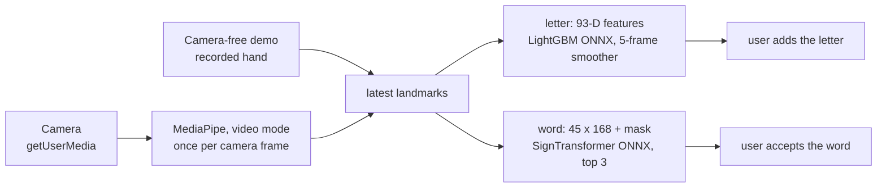

# ASL Assistant: Technical Report

[Türkçe](technical-report.tr.md)

ASL Assistant recognises American Sign Language (ASL) from a webcam, entirely in the browser. MediaPipe finds landmarks (3D points on the hands, face and body) in each camera frame, and two small ONNX models classify them. No camera frame leaves the device. The product is the static web app in [`asl-web/`](../asl-web/), live at <https://asl-assistant.pages.dev/>. The repository also holds the Python feature package [`asl-features/`](../asl-features/), shared by training and the checks, and an earlier desktop prototype, [`asl-desktop/`](../asl-desktop/).

| Figure | Value | Scope |
|---|---|---|
| Letter model, random held-out split | 99.35% on 8,245 rows | Near-copies of the test photos are in training |
| Letter model, separate `ASL_SemCom` test set | 68.9% on 122 rows | These rows were not merged into training, but other `ASL_SemCom` rows were |
| Letter model, one whole source left out of training | 39.9% to 79.6% | Three retrains, one per source |
| Word model, 50 isolated signs | 71.92% accuracy, 0.714 macro-F1 | 3,918 recordings from 4 signers never seen in training |
| Download | 0.35 MB to open the page; about 15 MB at the first camera start | Nothing on a second visit |

## 1. Architecture

| Part | What it is |
|---|---|
| `asl-web/` | The product: HTML, CSS and classic `<script>` files, no build step, no server code. ONNX Runtime Web 1.22.0, MediaPipe Tasks Vision 0.10.18 and kjua 0.9.0 (QR codes) come from public CDNs. |
| `asl-features/` | The Python definition of the model input: hand normalisation, square units, the 93-D letter features and the 45 × 168 word features. NumPy only. |
| `models/`, `notebooks/` | The source copy of every model and the word training notebooks. The files in `asl-web/models/` and `asl-web/data/` are byte-for-byte copies, checked by SHA-256. |
| `scripts/`, `tests/` | Data preparation, letter training, fixture export, validators; Python, Node and headless-Chrome tests. |
| `asl-desktop/` | A CustomTkinter prototype with the same letter model and an older 25-word model. |

The live site on Cloudflare Pages is the committed `asl-web/` folder, uploaded as it is; [Getting started](getting-started.md#hosting-a-copy) shows how to host a copy.

The browser does not run Python. JavaScript in `asl-web/js/ml/` reimplements the feature code of `asl-features`, and parity checks feed both the same landmarks and require them to agree within 1e-4.

**Load order.** `index.html` holds every screen and loads 32 plain `<script>` files of its own. They share one global scope, so each file can use only what the files before it have defined, and they load in a fixed order. Two small scripts in `<head>` set the theme and the language before the first paint, the string files translate the page before the CDN scripts load, and `core/app.js` comes last and starts the app. The files in between only define functions. [`asl-web/js/README.md`](../asl-web/js/README.md) describes every module.

**Screens.** `#letter` (the default and the main mode), `#word` (experimental), `#coach`, `#test` (Model Test, a developer tool that runs bundled fixtures without a camera), `#project` and `#qr`. Without a camera, *Watch the demo* on the letter screen plays a recorded hand spelling FLY through the live pipeline.

Two loops meet only at the latest MediaPipe result. The detection loop in `media/camera.js` runs while the camera is on, and the render loop in `core/app.js` draws the overlay and calls the models. Letter inference runs at most every 120 ms, so the five-prediction smoother spans about 600 ms of signing. A word recording reads every frame. A frame that arrives during a model call is dropped. The camera-free demo, `media/demo-source.js`, is a second frame source. It sends a recorded hand about 20 times a second, and from the landmark step on everything works as it does with the camera.

**Adding text.** Nothing is added to the text automatically. A letter is added when the user presses Space or *Add*, once its smoothed confidence reaches 0.60. A word is added only after the user accepts it, and only if it comes from the latest recording and its confidence is at least 0.15. Leaving a camera screen turns the camera off and closes MediaPipe. Pressing stop while the camera is still starting cancels the start.

**Word recording.** `IDLE → COUNTDOWN → RECORDING → PROCESSING → RESULT`. A frame counts only with a hand, the face and both shoulders present. If the recording cannot collect its 45 frames, it ends after 6 s with no usable frame, 4 s without a new one, or 15 s in all. Each recording has a serial number, and a late model result for an older recording is discarded.

**Lazy loading.** `init()` loads no model. A model loads at its first need: a camera start in its mode, a demo start (letter model only), a word recording or a Model Test run.

| Step | Downloaded |
|---|---|
| Opening the page | about 0.35 MB |
| First camera start in letter mode | about 15 MB: MediaPipe hand model 7.8 MB, MediaPipe WebAssembly 2.6 MB, ONNX Runtime WebAssembly 2.4 MB, letter model 2.2 MB |
| First demo start | about 4.6 MB: ONNX Runtime and the letter model |
| Word mode as well | up to 24 MB in all |

`index.html` loads ONNX Runtime's WebAssembly-only bundle (`ort.wasm.min.js`), because the full bundle also fetched a 4.2 MB WebGPU build that neither model uses. The 13.2 MB letter model ships gzipped at 2.2 MB and is unpacked with `DecompressionStream`, with the raw file as fallback.

**Privacy and security.** No backend, account or analytics. `localStorage` holds the theme, the language, the text and the coach progress. ONNX Runtime and kjua load with Subresource Integrity, and MediaPipe, a dynamic import, is pinned to an exact version. [`asl-web/_headers`](../asl-web/_headers) sets the hardening headers and a Content Security Policy that is still report-only.

## 2. Data

| Source | Used for | Size used | Terms |
|---|---|---:|---|
| [ASL Alphabet](https://www.kaggle.com/datasets/grassknoted/asl-alphabet), Akash Nagaraj, 2018, [doi:10.34740/KAGGLE/DSV/29550](https://doi.org/10.34740/KAGGLE/DSV/29550) | Letters, main source | 52,419 landmark rows | GPL-2.0, as labelled by the provider |
| [American Sign Language Dataset](https://www.kaggle.com/datasets/ayuraj/asl-dataset), Ayush Thakur | Letters; the demo's hand poses | 962 rows | CC0 1.0 |
| `ASL_SemCom` subset, associated with [ASL-Fingerspelling](https://github.com/Mohammed-Shoaib/ASL-Fingerspelling) | Letters; its separate test set is used for evaluation | 1,580 training rows; 122 test rows not merged | Not recorded; the images are not redistributed |
| [Google - Isolated Sign Language Recognition](https://www.kaggle.com/competitions/asl-signs) (Kaggle, 2023), Deaf Professional Arts Network and Georgia Institute of Technology | Words | 94,477 recordings of 250 signs by 21 signers; 19,299 used | [CC BY 4.0](https://creativecommons.org/licenses/by/4.0/), subject to the competition rules |

The letter counts are rows where MediaPipe found a hand, so images without a hand are not counted. I also looked at MediaPipe Processed ASL (no usable hands) and MS-ASL (download scripts only) and did not use them. The competition rules allow any use of the data (7.A) but forbid redistributing it (7.B), so the repository publishes trained models and aggregate results only. Word fixtures exported from the competition data go to the ignored `asl-web/data/model-test-samples/local/` folder, and the one published word fixture is synthetic. Raw data stays out of Git; [Getting started](getting-started.md#training-and-data) lists what stays local.

**Letters.** [`extract_static_letter_landmarks.py`](../scripts/data_preparation/extract_static_letter_landmarks.py) runs MediaPipe's legacy Hands API in static-image mode and keeps the first hand of each image. [`merge_static_letter_datasets.py`](../scripts/data_preparation/merge_static_letter_datasets.py) keeps the 24 static letters, drops duplicates, non-finite values and outliers, and makes a stratified 85/15 split with seed 42: 54,961 rows become 46,716 for training and 8,245 held out. The split is random over rows, because the CSVs carry no signer id. ASL Alphabet, 95.4% of the rows, photographs each letter as long runs of near-identical frames.

**Words.** The competition gives MediaPipe Holistic landmarks for every frame. [`word_50_training.ipynb`](../notebooks/word_50_training.ipynb) keeps 107 of the 543 points, fills gaps by interpolation, drops recordings shorter than 5 frames and normalises each frame on the shoulders. Signs with at least 300 recordings were eligible. A hand-picked list of 50 everyday words gave 34 of them, and I filled the other 16 by recording count. The 21 signers are shuffled with seed 42 into 14 for training (12,723 recordings), 3 for validation (2,658) and 4 for test (3,918), and assertions check that no signer is in two partitions.

**Demo recording.** [`demo-letters.json`](../asl-web/data/demo-letters.json) holds one right hand per letter of FLY. [`export_demo_letters.py`](../scripts/evaluation/export_demo_letters.py) ran the browser's hand model in video mode on the CC0 dataset and kept, per letter, the pose the deployed model reads most surely. Those photographs are in the training split, so the model reads each pose at 1.0: the demo shows how the app works, not how accurate it is.

## 3. Features

**Square units.** MediaPipe gives x as a fraction of the frame's width and y of its height. The training photos are square, but a 1280 × 720 camera squeezes a hand sideways. When I placed held-out photos in a 16:9 frame, accuracy fell from 98.4% to 88.6%. Both apps therefore multiply x and z by width over height before the features. A square frame is unchanged.

**Normalisation.** Subtract the wrist (landmark 0) and divide by the wrist to middle-knuckle distance (landmark 9): 63 values per hand.

**93-D letter vector** ([`letter.py`](../asl-features/src/asl_features/letter.py), `ml/features.js`): normalised landmarks (0..62), 5 fingertip-to-wrist and 4 adjacent-fingertip distances (63..71), 14 joint angles (72..85), bounding-box aspect and area (86..87), and 5 finger-extended flags (88..92). A vector of the right length in the wrong order still runs and predicts nonsense. Saved reference outputs (goldens) and the parity checks catch a change in the order.

**321-D holistic frame** (word path): right hand 0..62, left hand 63..125, 40 face points 126..245, 25 pose points 246..320. A missing part stays zero, so later groups keep their positions.

**168-D word features per frame** ([`word.py`](../asl-features/src/asl_features/word.py), a copy of the notebook's code, tested against it): the dominant hand's 63 landmarks, 30 hand-shape values, 12 hand-to-face relations and 63 values of frame-to-frame motion. The dominant hand is chosen once per recording. The model takes `float32 [1, 45, 168]` and a `bool [1, 45]` mask where `true` marks a real frame. The exported graph inverts the mask itself, so the browser passes it as it is.

## 4. Models

### Letter model

The training script works on the 46,716 training rows only. It adds 5 noisy copies of each row, rotated by up to ±45° and scaled by up to ±20%, which gives 280,296 rows. To choose the model and the features, I compared configurations on a random 15% of these augmented rows (42,045). Copies of one photo can land on both sides of that split, so these numbers are useful only for comparing configurations. They are recorded in [`letter_model_meta.json`](../models/letter/letter_model_meta.json):

| Model | Accuracy |
|---|---:|
| Random Forest | 0.985 |
| XGBoost | 0.992 |
| LightGBM | 0.994 |

| Configuration | Accuracy |
|---|---:|
| 93-D features, augmentation | 0.994 |
| 93-D features, no augmentation | 0.988 |
| raw 63-D landmarks, augmentation | 0.332 |

The raw 63-D run uses the same wrist-normalised coordinates as features 0..62. Rotating a hand changes those coordinates a lot, but it hardly changes the distances, the joint angles and the finger flags. That is why, with augmentation, the raw coordinates score 0.332 and the 93 features 0.994.

I kept LightGBM with 300 trees. On the 8,245 held-out rows of the merge split, which are not augmented, it scores 99.35%. OnnxMLTools exported it as one tree-ensemble node without ZipMap, because ONNX Runtime Web cannot reliably read ZipMap's list-of-maps output.

**Why 99.35% overstates it.** The held-out rows are a random split over the same long runs of near-identical photos as the training rows, so the model has seen near-copies of most of them. I measured the model in two harder ways. First, the published model on the separate `ASL_SemCom` test set: these 122 rows were not merged into training, but 1,580 other `ASL_SemCom` rows were, and without signer ids the same people may be in both. Second, three retrains that each leave one whole source out of training:

| Evaluation | Accuracy |
|---|---:|
| Published model, `ASL_SemCom` test set (122 rows) | 68.9% |
| Retrained, American SL held out | 79.6% |
| Retrained, ASL Alphabet held out | 64.8% |
| Retrained, `ASL_SemCom` held out | 39.9% |

Errors cluster on fists that differ only by the thumb (M, N, T, S, E, A) and on near pairs such as R/U/V and G/K. 89.5% of the wrong answers had a probability of at least 0.6, so a higher threshold would not filter them out. More signers and a split grouped by signer would.

**Live landmarks.** Training used the legacy Hands API on still images. The browser uses the Tasks HandLandmarker in video mode. I compared four ways of getting the landmarks on the 164 `ASL_SemCom` test images where all four found a hand:

| Landmarks from | Accuracy |
|---|---:|
| Legacy API, still images (how the training data was made) | 70% |
| Legacy API, tracking | 80% |
| Tasks HandLandmarker, image mode | 46% |
| Tasks HandLandmarker, video mode once tracking settles (the browser path) | 76% |

The hand model weights are the same in all four; only the crop and the tracking differ. The browser's path scores at least as well as the one the training data was made with, so I did not retrain the letter model.

### Word model

All experiments use one recipe (focal loss with label smoothing, AdamW, seed 42, one run each), and I picked each step by validation macro-F1. The test F1 is shown only for reference. The numbers come from [`all_experiment_results.json`](../notebooks/word_50_results/all_experiment_results.json).

Features, with a BiGRU over 30 frames:

| Feature set | Validation F1 | Test F1 |
|---|---:|---:|
| raw 321-D | 0.670 | 0.581 |
| pairwise + dominant hand, 444-D | 0.770 | 0.671 |
| hand shape, 72-D | 0.715 | 0.613 |
| shape + motion, 132-D | 0.714 | 0.621 |
| **compact, 168-D** | **0.788** | **0.699** |
| full, 519-D | 0.740 | 0.639 |

Sequence, with the 168-D features and a BiGRU:

| Sequence | Validation F1 | Test F1 |
|---|---:|---:|
| fixed 30 frames | 0.788 | 0.699 |
| **45 frames + mask** | **0.791** | **0.700** |
| 30 highest-motion frames | 0.786 | 0.694 |

Architecture, with the 168-D features over 45 frames and a mask:

| Model | Parameters | Validation F1 | Test F1 |
|---|---:|---:|---:|
| SmallGRU | 104,627 | 0.765 | 0.682 |
| BiGRU | 602,739 | 0.791 | 0.700 |
| ConvGRU | 338,259 | 0.781 | 0.702 |
| **SignTransformer** | **446,195** | **0.792** | **0.719** |
| ensemble of SignTransformer and BiGRU | 1,048,934 | test only | 0.733 |

The largest feature set was not the best: the compact 168-D set won on validation. Forty-five frames with a mask scored about the same as fixed 30 frames, and the final model uses it. On validation, the SignTransformer and the BiGRU tied (0.7917 against 0.7911, from one seed). I kept the Transformer because it is smaller: 446,195 parameters against 602,739. The two-model ensemble was only scored on the test set, so it was not a candidate.

The SignTransformer has 2 encoder layers over a 128-D projection and pools over the real frames with attention. For the final model I trained it for 63 epochs instead of 25, so its test F1 differs a little from the 0.719 of the comparison run. It gives **71.92% accuracy and 0.714 macro-F1** on the 4 test signers, with 0.803 best validation F1. Temperature scaling (T = 0.9854) did not improve calibration (ECE 0.0235 before, 0.0252 after), so the app relies on the top three and the user's accept instead. The ONNX export (opset 17) matched PyTorch within 6e-7.

Per word, 9 have F1 of at least 0.85 (water 0.912, sad 0.910) and 3 fall below 0.50 (open, give, all). The most frequent confusions are listen → hear, can → yes, open → book and sleep → sleepy, and the coach's hints come from them.

**Desktop 25-word model.** A BiGRU over 30 × 321 frames, trained on 7,723 recordings with a random 70/15/15 split, reached 86.7%. Its vocabulary, features and split differ, so it cannot be compared with the web model.

## 5. Browser runtime

- **MediaPipe in video mode.** All three landmarkers run with `runningMode: "VIDEO"`, which tracks the hand between frames. Pose and face start only in word contexts. The GPU delegate falls back to the CPU.
- **Frame pacing.** Detection runs once per camera frame the video presents, counted with `requestVideoFrameCallback`, with a 200 ms stall limit. Browsers without the API detect on every animation frame.
- **Both hands.** HandLandmarker tracks up to two hands. With both in view, the hand whose wrist is higher by more than a tenth of the frame height wins, else the right hand. A left hand is mirrored with `x → 1 − x`. On mirrored left hands the model scored 79.1%, against 49.3% unmirrored.
- **Smoothing and thresholds.** Landmarks are smoothed (weight 0.6 on the current frame). The plate shows the most frequent of the last 5 predictions, uncertain below 0.45 and confident from 0.65. A word is uncertain below 0.15 and confident from 0.20, and the app asks for a check when the top two are within 0.08.
- **Languages.** Every screen is in Turkish and English. Before the first paint, `core/lang-boot.js` picks the saved choice, else the browser's preferred language, else English. An English page stays hidden until it is translated, with a 3 s fail-safe. The header switch changes every string, `<html lang>` and the title without a reload, a camera restart or losing the text. Strings live per area in `asl-web/js/i18n/`.
- **Accessibility.** One `h1` per screen that takes focus on navigation, a skip link, a polite live region, reduced motion honoured, WCAG 2.2 AA text contrast in both themes, and no single-key shortcuts.

## 6. Testing

| Layer | Where | What it checks |
|---|---|---|
| Python units | `tests/asl_features`, `tests/asl_desktop` | Normalisation, features, goldens, the desktop detectors |
| Scripts | `tests/scripts` | The validators, parity commands and make targets, including how they fail on broken files |
| Browser code | `tests/web` | The real scripts and `index.html` in a `node:vm` context with a fake camera and a fake ONNX Runtime |
| Real browser | `tests/browser` | Headless Chrome under the real headers: cascade layers, layout at phone and laptop sizes, camera release, the demo, both languages |
| Parity | `tests/validation` | Python against JavaScript features: max difference 1.12e-5 for letters, 7.15e-7 for words |

The tests fake only the network, the clock, storage, the camera, MediaPipe and ONNX Runtime. For the rules that matter most (no word without consent, mask polarity, frame order, camera release, detection pacing, the raised-hand choice and the demo poses), I broke the code on purpose and checked that the test failed. The deployed ONNX letter model gave the same top-1 label as the pickle on all 8,245 held-out rows. `make check` runs lint, the format check, the type check, the runtime file check, the Python and JavaScript tests and the parity checks, and `make browser-check` runs the Chrome suite. Lighting, permission prompts and a real signer are outside what the automated checks cover.

## 7. Design decisions

| Decision | Instead of | Why |
|---|---|---|
| All inference in the browser, static site | An inference server | I did not want a server to run, and I wanted every camera frame to stay on the device |
| Landmarks as model input | Raw video or an image CNN | The models stay small, and I can inspect every feature |
| Separate letter and word models, letters first | One joint model | A still handshape and a sign that moves over time are different problems, so I started with the simpler one |
| 93-D hand-geometry letter features | Raw 63-D coordinates | Distances and angles hardly change when a hand is rotated, and the raw coordinates change a lot |
| Signer-independent word split | A random split | With a random split the model can learn the signers instead of the signs |
| One SignTransformer | The BiGRU | It tied with the BiGRU on validation and has about a quarter fewer parameters |
| The user accepts every word | Adding the top word | Correct words often have low confidence, so I show three candidates and let the user choose |
| Classic scripts, no build step | ES modules and a bundler | The committed folder is the site, and any static server can run it |
| Models load on first need | Preloading | A visitor who only looks around downloads no model |

## 8. Lessons

- A word input of the right shape can still be wrong. A `[1, 45, 168]` tensor runs fine with the features in the wrong order, the wrong normalisation, the other hand, stale motion values or an inverted mask. I added a parity check or a test for each of these.
- The dominant hand has to be chosen once per recording. If the browser chose it per frame, the hand and the motion values could switch in the middle of a sign, so it builds the 168-D sequence after the recording ends, the same way training does.
- My letter model's 99.35% came from a random split over near-identical photos. On the separate `ASL_SemCom` test set it scored 68.9%, and with a whole source left out of training between 39.9% and 79.6%.
- I first measured the browser's hand model in image mode, got 46%, and nearly retrained the letter model. The browser runs video mode, which scores 76% on the same images, so the retrain was not needed.
- Temperature scaling did not make weak word predictions more trustworthy. So I moved the uncertainty into the interface: the app shows three candidates and waits for the user to accept one.

## 9. Limitations and next steps

- The letter model covers 24 static letters. J and Z need motion, and neither model has a "no sign" class.
- On data from other sources, letter accuracy is far below 99.35%. The ONNX export and the held-out evaluation were run by hand and are not scripted yet.
- The word model handles isolated signs only, with 4 test signers and one seed, and 16 of its 50 words were chosen by data availability. The browser takes the first 45 usable frames, while training clips (median 22 frames) were padded or subsampled. I have not measured the effect.
- So far I have tested the app only in desktop Chrome. The Content Security Policy is still report-only, the first visit needs the CDNs, and the word reference pictures have not been checked against an ASL dictionary.

Next, I want to retrain the letter model with more signers and a split grouped by signer, and keep its evaluation and ONNX export as scripts. I also want to test on phones and tune the thresholds from that, enforce the CSP, repeat the word experiments with more seeds and more words, and make the app work offline as a progressive web app.
