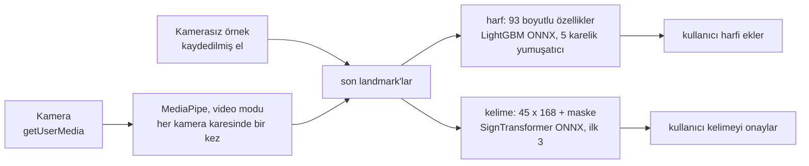

# ASL Assistant: Teknik Rapor

[English](technical-report.md)

ASL Assistant, Amerikan İşaret Dili'ni (ASL) web kamerasından tanır ve bunu tamamen tarayıcıda yapar. MediaPipe her kamera karesinde landmark'ları (eller, yüz ve vücut üzerindeki 3B noktalar) bulur, iki küçük ONNX modeli de bunları sınıflandırır. Hiçbir kamera karesi cihazdan çıkmaz. Ürün, [`asl-web/`](../asl-web/) klasöründeki statik web uygulamasıdır ve <https://asl-assistant.pages.dev/> adresinde yayında. Repoda ayrıca eğitimin ve kontrollerin ortak kullandığı Python özellik paketi [`asl-features/`](../asl-features/) ile daha önceki bir masaüstü prototipi, [`asl-desktop/`](../asl-desktop/), bulunur.

| Ölçüt | Değer | Kapsam |
|---|---|---|
| Harf modeli, rastgele ayrılmış test verisi | 8.245 satırda %99,35 | İşaretçiden bağımsız değil |
| Harf modeli, görmediği bir kaynaktan satırlar | 122 satırda %68,9 | Bir kaynak tümüyle dışarıda tutulunca %39,9 ile %79,6 arası |
| Harf modeli, görmediği işaretçilerde canlı landmark yolu | %76 | 164 görüntü, MediaPipe video modunda |
| Kelime modeli, 50 tekil işaret | %71,92 doğruluk, 0,714 makro-F1 | Eğitimde hiç görülmemiş 4 işaretçiden 3.918 kayıt |
| İndirme | Sayfayı açmak için 0,35 MB; ilk kamera açılışında yaklaşık 15 MB | İkinci ziyarette hiçbir şey |

## 1. Mimari

| Parça | Nedir |
|---|---|
| `asl-web/` | Ürün: HTML, CSS ve klasik `<script>` dosyaları; derleme adımı ve sunucu kodu yok. ONNX Runtime Web 1.22.0, MediaPipe Tasks Vision 0.10.18 ve kjua 0.9.0 (QR kodları) herkese açık CDN'lerden gelir. |
| `asl-features/` | Model girdisinin Python tanımı: el normalizasyonu, kare birimler, 93 boyutlu harf özellikleri ve 45 × 168 kelime özellikleri. Yalnızca NumPy. |
| `models/`, `notebooks/` | Her modelin kaynak kopyası ve kelime eğitimi notebook'ları. `asl-web/models/` ve `asl-web/data/` içindeki dosyalar bunların bayt bayt kopyalarıdır ve SHA-256 ile denetlenir. |
| `scripts/`, `tests/` | Veri hazırlama, harf eğitimi, fixture dışa aktarma, doğrulayıcılar; Python, Node ve headless Chrome testleri. |
| `asl-desktop/` | Aynı harf modelini ve daha eski bir 25 kelimelik modeli kullanan bir CustomTkinter prototipi. |

Tarayıcı hiçbir zaman Python çağırmaz. `asl-web/js/ml/` içindeki JavaScript, `asl-features`'in özellik kodunu yeniden uygular. Benzerlik (parity) kontrolleri ikisine aynı landmark'ları verir ve sonuçların 1e-4 içinde aynı çıkmasını ister.

**Yükleme sırası.** `index.html` bütün ekranları içerir ve kendi 32 klasik script'ini sabit bir sırayla yükler. Bu script'ler tek bir global kapsamı paylaştığı için sıra bir sözleşmedir:
- `core/theme-boot.js` ve `core/lang-boot.js`, ilk boyamada tema ve dil doğru olsun diye `<head>` içinde çalışır.
- `i18n/` metin dosyaları ve `core/i18n-boot.js`, sayfayı CDN script'lerinden önce çevirir.
- `core/config.js` ve `core/runtime.js`, ayarları ve paylaşılan durumu bir kez oluşturur.
- `ml/`, `media/`, `services/` ve `ui/` dosyaları yalnızca fonksiyon tanımlar.
- `core/app.js` en son gelir ve başlangıçta yan etkisi olan tek script'tir.

[`asl-web/js/README.md`](../asl-web/js/README.md) her modülü listeler. Script'ler öğeleri yalnızca `id` ya da bir `data-ui` kancasıyla bulur, hiçbir zaman bir stil sınıfıyla bulmaz. Render fonksiyonları dinleyici, zamanlayıcı, fetch ya da model oturumu başlatmaz.

**Ekranlar.** `#letter` (varsayılan ve ana mod), `#word` (deneysel), `#coach`, `#test` (Model Test: paketle gelen fixture'ları kamerasız çalıştıran bir geliştirici aracı), `#project` ve `#qr`. Kamera yoksa harf ekranındaki *Örneği izleyin*, FLY kelimesini heceleyen kaydedilmiş bir eli canlı işlem hattından geçirerek oynatır.

İki döngü yalnızca en son MediaPipe sonucunda buluşur. `media/camera.js` içindeki algılama döngüsü kamera açıkken çalışır. `core/app.js` içindeki render döngüsü ise kaplamayı çizer ve modelleri çağırır. Harf çıkarımı en fazla 120 ms'de bir çalışır, böylece beş tahminlik yumuşatıcı yaklaşık 600 ms'lik bir işareti kapsar. Kelime kaydı ise her kareyi okur. Bir model çağrısı sırasında gelen kare kuyruğa alınmaz, atılır. Kamerasız örnek, `media/demo-source.js`, ikinci bir kare kaynağıdır: kaydedilmiş bir eli saniyede yaklaşık 20 kez yayımlar; landmark adımından sonrası hiç değişmeden çalışır.

**Onay ve yaşam döngüsü.** Bir kelime sonucu metne yalnızca açık bir onaydan sonra, `appendWordResultToTranscript()` üzerinden girer. Bunun için sonucun en son kayda ait olması ve güveninin en az 0,15 olması gerekir. Harfleri de yalnızca kullanıcı ekler (Boşluk ya da *Ekle*, yumuşatılmış güven 0,60'tan başlayarak). Bir kamera ekranından `#test`, `#project` ya da `#qr`'ye geçmek her kamera akışını durdurur, kare geri çağrılarını iptal eder ve MediaPipe görevlerini kapatır. Kamera açılışı birkaç kez bekler (izin, ilk kare, MediaPipe, her model) ve her beklemeden sonra bir başlatma jetonunu yeniden denetler; böylece açılış sırasında yapılan bir durdurma açılışı iptal eder. Yeniden açmak tam olarak bir algılama döngüsü bırakır.

**Kelime kaydı.** `IDLE → COUNTDOWN → RECORDING → PROCESSING → RESULT`. Bir kare yalnızca bir el, yüz ve iki omuz birlikte göründüğünde sayılır. Dolamayan bir kayıt şu durumlarda biter: 6 saniye boyunca kullanılabilir kare yoksa, 4 saniye boyunca yeni kare gelmezse ya da toplam 15 saniye dolarsa. Her kaydın bir sıra numarası vardır; daha eski bir kayıt için geç gelen model sonucu atılır.

**Gecikmeli yükleme.** `init()` hiçbir model yüklemez. Bir model ilk gerektiğinde yüklenir: kendi modunda bir kamera açılışında, bir örnek başlangıcında (yalnızca harf modeli), bir kelime kaydında ya da bir Model Test çalıştırmasında.

| Adım | İndirilen |
|---|---|
| Sayfayı açmak | yaklaşık 0,35 MB |
| Harf modunda ilk kamera açılışı | yaklaşık 15 MB: MediaPipe el modeli 7,8 MB, MediaPipe WebAssembly 2,6 MB, ONNX Runtime WebAssembly 2,4 MB, harf modeli 2,2 MB |
| İlk örnek başlangıcı | yaklaşık 4,6 MB: ONNX Runtime ve harf modeli |
| Kelime modu da açılırsa | toplamda en fazla 24 MB |

`index.html`, ONNX Runtime'ın yalnızca WebAssembly içeren paketini (`ort.wasm.min.js`) yükler, çünkü tam paket iki modelin de kullanmadığı 4,2 MB'lık bir WebGPU derlemesini de indiriyordu. 13,2 MB'lık harf modeli gzip'lenmiş olarak 2,2 MB gelir ve `DecompressionStream` ile açılır; ham dosya yedek olarak durur.

**Gizlilik ve güvenlik.** Arka uç, hesap ya da analitik yok. `localStorage` temayı, dili, metni ve koç ilerlemesini tutar. ONNX Runtime ve kjua, Subresource Integrity ile yüklenir; dinamik import ile gelen MediaPipe tam bir sürüme sabitlenmiştir. [`asl-web/_headers`](../asl-web/_headers) güvenlik başlıklarını ve hâlâ yalnızca raporlama modunda olan bir İçerik Güvenliği Politikası'nı (CSP) ayarlar.

## 2. Veri

| Kaynak | Kullanım | Kullanılan miktar | Koşullar |
|---|---|---:|---|
| [ASL Alphabet](https://www.kaggle.com/datasets/grassknoted/asl-alphabet), Akash Nagaraj, 2018, [doi:10.34740/KAGGLE/DSV/29550](https://doi.org/10.34740/KAGGLE/DSV/29550) | Harfler, ana kaynak | 52.419 landmark satırı | Sağlayıcının etiketine göre GPL-2.0 |
| [American Sign Language Dataset](https://www.kaggle.com/datasets/ayuraj/asl-dataset), Ayush Thakur | Harfler; örneğin el pozları | 962 satır | CC0 1.0 |
| [ASL-Fingerspelling](https://github.com/Mohammed-Shoaib/ASL-Fingerspelling) ile ilişkili `ASL_SemCom` alt kümesi | Harfler; test satırları görülmemiş kaynak olarak kullanılır | 1.580 eğitim satırı; 122 test satırı birleştirilmedi | Kaydedilmemiş; görüntüler yeniden dağıtılmıyor |
| [Google - Isolated Sign Language Recognition](https://www.kaggle.com/competitions/asl-signs) (Kaggle, 2023), Deaf Professional Arts Network ve Georgia Institute of Technology | Kelimeler | 21 işaretçinin 250 işaretinden 94.477 kayıt; 19.299'u kullanıldı | Yarışma kurallarına bağlı olarak [CC BY 4.0](https://creativecommons.org/licenses/by/4.0/) |

Harf sayıları görüntü sayısı değil, MediaPipe'ın el bulduğu satır sayısıdır. MediaPipe Processed ASL (kullanılabilir el yok) ve MS-ASL (yalnızca indirme betikleri) incelendi, kullanılmadı. Yarışma kuralları verinin her türlü kullanımına izin veriyor (7.A) ama yeniden dağıtılmasını yasaklıyor (7.B). Bu yüzden repo yalnızca eğitilmiş modelleri ve toplu sonuçları yayımlar. Yarışma verisinden çıkarılan kelime fixture'ları git'in yok saydığı `asl-web/data/model-test-samples/local/` klasörüne gider; yayımlanan tek kelime fixture'ı sentetiktir. Ham veri hiçbir zaman git'e girmez; neyin yerelde kaldığını [Başlangıç kılavuzu](getting-started.md#training-and-data) listeler.

**Harfler.** [`extract_static_letter_landmarks.py`](../scripts/data_preparation/extract_static_letter_landmarks.py), MediaPipe'ın eski Hands API'sini durağan görüntü modunda çalıştırır ve her görüntünün ilk elini tutar. [`merge_static_letter_datasets.py`](../scripts/data_preparation/merge_static_letter_datasets.py) 24 statik harfi tutar; tekrarları, sonlu olmayan değerleri ve aykırı değerleri atar. Ardından seed 42 ile katmanlı bir 85/15 bölme yapar: 54.961 satır, eğitim için 46.716 ve dışarıda tutulan 8.245 satır olur. CSV'lerde işaretçi kimliği olmadığı için bölme satırlar üzerinden rastgeledir. Satırların %95,4'ünü oluşturan ASL Alphabet, her harfi birbirine çok benzeyen karelerden oluşan uzun seriler halinde fotoğraflar.

**Kelimeler.** Yarışma her kare için MediaPipe Holistic landmark'larını veriyor. [`word_50_training.ipynb`](../notebooks/word_50_training.ipynb):
- 543 noktanın 107'sini tutar;
- boşlukları ara değerle doldurur;
- 5 kareden kısa kayıtları atar;
- her kareyi omuzlara göre normalleştirir.

En az 300 kaydı olan işaretler seçilebilirdi. Elle seçilmiş 50 gündelik kelimelik bir listeden 34'ü bu koşulu sağladı; kalan 16'sı kayıt sayısına göre dolduruldu. 21 işaretçi seed 42 ile karıştırılıp üçe ayrıldı: eğitim için 14 (12.723 kayıt), doğrulama için 3 (2.658) ve test için 4 (3.918). Hiçbir işaretçinin iki bölmede birden bulunmadığını assert'ler denetler.

**Örnek kaydı.** [`demo-letters.json`](../asl-web/data/demo-letters.json), FLY'ın her harfi için bir sağ el tutar. [`export_demo_letters.py`](../scripts/evaluation/export_demo_letters.py), tarayıcının el modelini CC0 veri kümesi üzerinde video modunda çalıştırdı ve her harf için yayındaki modelin en emin okuduğu pozu tuttu. Bu fotoğraflar eğitim bölmesinde olduğu için model her pozu 1,0 ile okur. Yani örnek, uygulamanın nasıl çalıştığını gösterir, ne kadar doğru olduğunu değil.

## 3. Özellikler

**Kare birimler.** MediaPipe x'i karenin genişliğinin, y'yi yüksekliğinin bir oranı olarak verir. Eğitim fotoğrafları karedir, ama 1280 × 720 bir kamera eli yanlara doğru basık gösterir. Dışarıda tutulan fotoğraflar 16:9 bir kareye yerleştirildiğinde doğruluk %98,4'ten %88,6'ya düştü. Bu yüzden iki uygulama da özelliklerden önce x ve z'yi genişlik bölü yükseklik ile çarpar. Kare bir görüntü bundan etkilenmez.

**Normalizasyon.** Bileği (landmark 0) çıkar ve bilekle orta parmak eklemi (landmark 9) arasındaki uzaklığa böl: el başına 63 değer.

**93 boyutlu harf vektörü** ([`letter.py`](../asl-features/src/asl_features/letter.py), `ml/features.js`):

| Aralık | İçerik |
|---|---|
| 0..62 | Normalleştirilmiş landmark'lar |
| 63..71 | 5 parmak ucu-bilek ve 4 komşu parmak ucu uzaklığı |
| 72..85 | 14 eklem açısı |
| 86..87 | Sınırlayıcı kutunun en-boy oranı ve alanı |
| 88..92 | 5 "parmak açık" bayrağı |

Doğru uzunlukta ama yanlış sıralı bir vektör yine de çalışır ve saçma tahminler üretir. Bu yüzden sıra, altın değerler (golden) ve benzerlik kontrolleriyle sabitlenmiştir.

**321 boyutlu holistic kare** (kelime yolu): sağ el 0..62, sol el 63..125, 40 yüz noktası 126..245, 25 vücut noktası 246..320. Eksik bir parça sıfır kalır, böylece sonraki gruplar hiç kaymaz.

**Kare başına 168 boyutlu kelime özellikleri** ([`word.py`](../asl-features/src/asl_features/word.py); notebook'taki kodun bir kopyası, ona karşı test edilir): baskın elin 63 landmark'ı, 30 el şekli değeri, 12 el-yüz ilişkisi ve kareden kareye harekete ait 63 değer. Baskın el her kayıt için bir kez seçilir. Model `float32 [1, 45, 168]` girdisini ve gerçek kareleri `true` ile işaretleyen bir `bool [1, 45]` maskesini alır. Dışa aktarılan grafik maskeyi kendisi ters çevirir; bu yüzden tarayıcı çevirmemelidir.

## 4. Modeller

### Harf modeli

Veri çoğaltma yalnızca eğitim bölmesinde çalışır: her satırın gürültü eklenmiş, döndürülmüş ve ölçeklenmiş 5 kopyası üretilir. Sonuçlar [`letter_model_meta.json`](../models/letter/letter_model_meta.json) dosyasında kayıtlı:

| Model | Doğruluk |
|---|---:|
| Random Forest | 0,985 |
| XGBoost | 0,992 |
| LightGBM | 0,994 |

| Yapılandırma | Doğruluk |
|---|---:|
| 93 boyutlu özellikler, veri çoğaltma ile | 0,994 |
| 93 boyutlu özellikler, veri çoğaltma olmadan | 0,988 |
| Ham 63 boyutlu landmark'lar, veri çoğaltma ile | 0,332 |

Tasarlanmış el geometrisi, veri çoğaltmadan çok daha önemli çıktı. Seçilen LightGBM (300 ağaç), dışarıda tutulan 8.245 satırda 0,9935 alıyor. OnnxMLTools onu ZipMap olmadan tek bir ağaç topluluğu düğümü olarak dışa aktardı. ZipMap'in sözlük listesi biçimindeki çıktısını ONNX Runtime Web güvenilir biçimde okuyamıyor.

**%99,35 neden gerçeği abartıyor.** Dışarıda tutulan satırlar, eğitim satırlarıyla aynı, birbirine çok benzeyen fotoğraf serilerinden geliyor. Yani bu skor, modelin zaten gördüğü elleri ölçüyor. Görmediği kaynaklarda:

| Değerlendirme | Doğruluk |
|---|---:|
| Yayımlanan model, görülmemiş 122 `ASL_SemCom` test satırı | %68,9 |
| Yeniden eğitilmiş, American SL dışarıda | %79,6 |
| Yeniden eğitilmiş, ASL Alphabet dışarıda | %64,8 |
| Yeniden eğitilmiş, `ASL_SemCom` dışarıda | %39,9 |

Hatalar iki yerde toplanıyor: yalnızca başparmakla ayrılan yumruklar (M, N, T, S, E, A) ve R/U/V ile G/K gibi birbirine yakın çiftler. Yanlış cevapların %89,5'inin olasılığı en az 0,6'ydı; dolayısıyla daha yüksek bir eşik onları süzmezdi. Daha fazla işaretçi ve işaretçiye göre gruplanmış bir bölme süzerdi.

**Canlı landmark'lar.** Eğitimde durağan görüntüler üzerinde eski API kullanıldı; tarayıcı ise video modunda Tasks HandLandmarker kullanıyor. Dört işlem hattının da el bulduğu 164 `ASL_SemCom` test görüntüsünde:

| Landmark kaynağı | Doğruluk |
|---|---:|
| Eski API, durağan görüntüler (eğitim verisi böyle üretildi) | %70 |
| Eski API, takip ile | %80 |
| Tasks HandLandmarker, görüntü modu | %46 |
| Tasks HandLandmarker, takip oturduktan sonra video modu (tarayıcının yolu) | %76 |

El modelinin ağırlıkları hepsinde aynı; yalnızca kırpma ve takip farklı. Canlı yol, eğitim verisini üreten yoldan kötü değil, bu yüzden yeniden eğitime gerek olmadı.

### Kelime modeli

Bütün deneyler aynı tarifi paylaşıyor (etiket yumuşatmalı focal loss, AdamW, seed 42) ve doğrulama makro-F1'ine göre seçiliyor; test kümesi yalnızca raporlanıyor. Aşağıda her karşılaştırmanın test makro-F1 değerleri var; kaynak [`all_experiment_results.json`](../notebooks/word_50_results/all_experiment_results.json):

| Özellikler (BiGRU, 30 kare) | F1 | Dizi (168 boyut, BiGRU) | F1 | Model (168 boyut, 45 + maske) | Parametre | F1 |
|---|---:|---|---:|---|---:|---:|
| ham 321 boyut | 0,581 | sabit 30 kare | 0,699 | SmallGRU | 104.627 | 0,682 |
| ikili ilişkiler + baskın el, 444 boyut | 0,671 | **45 kare + maske** | **0,700** | BiGRU | 602.739 | 0,700 |
| el şekli, 72 boyut | 0,613 | en çok hareketli 30 kare | 0,694 | ConvGRU | 338.259 | 0,702 |
| şekil + hareket, 132 boyut | 0,621 | | | **SignTransformer** | **446.195** | **0,719** |
| **kompakt, 168 boyut** | **0,699** | | | iki modelin topluluğu | 1.048.934 | 0,733 |
| tam, 519 boyut | 0,639 | | | | | |

En büyük özellik kümesi en iyisi değildi. Maskeli 45 karelik girdi, ONNX sözleşmesine uyuyor. Topluluk daha yüksek skor aldı ama iki model yayımlamayı gerektirirdi. Bu yüzden SignTransformer seçildi: 128 boyutlu bir izdüşüm üzerinde 2 encoder katmanı ve gerçek kareler üzerinde dikkat havuzlaması (attention pooling).

Son uzun eğitim **%71,92 doğruluk, 0,714 makro-F1** ve 0,803 en iyi doğrulama F1'i veriyor. Sıcaklık ölçekleme (T = 0,9854) kalibrasyonu iyileştirmedi: ECE önce 0,0235, sonra 0,0252. Bu yüzden uygulama, ilk üç adaya ve kullanıcının onayına dayanıyor. ONNX dışa aktarımı (opset 17), PyTorch ile 6e-7 içinde aynı çıktı.

Kelime bazında 9 kelimenin F1'i en az 0,85 (water 0,912, sad 0,910); 3 kelime 0,50'nin altında (open, give, all). En sık karışanlar listen → hear, can → yes, open → book ve sleep → sleepy; koçun ipuçları bunlardan geliyor.

**Masaüstü 25 kelimelik model.** 30 × 321 kareler üzerinde bir BiGRU. Rastgele 70/15/15 bölmeyle 7.723 kayıtta eğitildi ve %86,7'ye ulaştı. Kelime listesi, özellikleri ve bölmesi farklı olduğu için web modeliyle karşılaştırılamaz.

## 5. Tarayıcı çalışma zamanı

- **Video modunda MediaPipe.** Üç landmark modelinin üçü de `runningMode: "VIDEO"` ile çalışır; bu mod eli kareler arasında takip eder. Vücut ve yüz yalnızca kelime bağlamlarında başlar. GPU başarısız olursa CPU'ya geçilir.
- **Kare temposu.** Algılama, videonun gösterdiği her kamera karesinde bir kez çalışır. Kareler `requestVideoFrameCallback` ile sayılır ve 200 ms'lik bir takılma sınırı vardır. Bu API'si olmayan tarayıcılar her animasyon karesinde algılama yapar. Chrome'un 20 fps sahte kamerasında bu, algılamayı saniyede 50 çağrıdan 20'ye indirdi.
- **İki el.** HandLandmarker en fazla iki el takip eder. İkisi de görünürken, bileği kare yüksekliğinin onda birinden fazla daha yukarıda olan el kazanır; yoksa sağ el kazanır. Sol el `x → 1 − x` ile aynalanır: aynalanmış sol ellerde model %79,1, aynalanmamışlarda %49,3 aldı. HandLandmarker, aynalanmamış bir karede sağ eli "Right" olarak etiketlediği için (146 fotoğrafın 141'inde) etiket değiştirme uygulanmaz.
- **Yumuşatma ve eşikler.** Landmark'lar yumuşatılır (geçerli kareye 0,6 ağırlık). Sonuç kartı son 5 tahminin en sık olanını gösterir: 0,45'in altında belirsiz, 0,65'ten itibaren emin. Bir kelime 0,15'in altında belirsiz, 0,20'den itibaren emindir; ilk iki aday 0,08 içindeyse kontrol ister.
- **Diller.** Her ekran Türkçe ve İngilizcedir. `core/lang-boot.js` ilk boyamadan önce dili seçer: önce kaydedilmiş tercih, yoksa tarayıcının tercih ettiği dil, o da yoksa İngilizce. İngilizce bir sayfa çevrilene kadar gizli kalır; 3 saniyelik bir güvenlik sınırı vardır. Başlıktaki düğme, sayfa yeniden yüklenmeden, kamera yeniden başlamadan ve metin kaybolmadan her metni, `<html lang>`'i ve başlığı değiştirir. Metinler alan alan `asl-web/js/i18n/` içinde tutulur.
- **Erişilebilirlik.**
  - Ekran başına, gezinmede odağı alan bir `h1`.
  - Bir içeriğe atlama bağlantısı ve kibar (polite) bir canlı bölge.
  - Azaltılmış hareket tercihine uyum.
  - İki temada da WCAG 2.2 AA metin kontrastı.
  - Tek tuşluk kısayol yok.

## 6. Test

| Katman | Nerede | Neyi denetler |
|---|---|---|
| Python birim testleri | `tests/asl_features`, `tests/asl_desktop` | Normalizasyon, özellikler, altın değerler, masaüstü algılayıcıları |
| Betikler | `tests/scripts` | Ağacın bozulmuş kopyalarına karşı çalıştırılan doğrulayıcılar, benzerlik kontrolleri ve make hedefleri |
| Tarayıcı kodu | `tests/web` | Gerçek script'ler ve `index.html`, sahte bir kamera ve sahte bir ONNX Runtime ile bir `node:vm` bağlamında |
| Gerçek tarayıcı | `tests/browser` | Gerçek başlıklar altında headless Chrome: cascade katmanları, telefon ve laptop boyutlarında yerleşim, kameranın bırakılması, örnek, iki dil |
| Benzerlik | `tests/validation` | Python'a karşı JavaScript özellikleri: harflerde en büyük fark 1,12e-5, kelimelerde 7,15e-7 |

Yalnızca sistem sınırları taklit edilir: ağ, saat, depolama, kamera, MediaPipe ve ONNX Runtime. En önemli kuralların her birinin, kasıtlı olarak bozulmuş bir kopyada başarısız olduğu görülmüş bir davranış testi var:
- onaysız kelime eklenmemesi;
- maske yönü;
- kare sırası;
- kameranın bırakılması;
- algılama temposu;
- kaldırılan elin seçilmesi;
- örnek pozlar.

Yayındaki ONNX harf modeli, dışarıda tutulan 8.245 satırın hepsinde pickle ile aynı ilk tahmini (top-1) verdi.

`make check` şunları çalıştırır: lint, biçim kontrolü, tip kontrolü, çalışma zamanı dosya kontrolü, Python ve JavaScript testleri ve benzerlik kontrolleri. `make browser-check` Chrome test takımını çalıştırır. Işık, izin pencereleri ya da gerçek bir işaretçi hiçbir otomatik kontrolün kapsamında değil.

## 7. Yayın

Site statiktir ve derleme adımı yoktur: `asl-web/` olduğu gibi yüklenir, canlı kopya Cloudflare Pages'te çalışır. Yüklemeden önce dağıtım dosya kontrolü (`check_runtime_assets.py --deploy`) gizli dosyalarda, git'in yok saydığı dosyalarda, bilinmeyen dosya türlerinde ve yarışma verisinden türetilmiş fixture'larda başarısız olur. Sunucu yanıt başlıklarını `asl-web/_headers` dosyasından okur; `asl-web/404.html` de bilinmeyen bir adresin gerçek bir 404 dönmesini sağlar.

## 8. Tasarım kararları

| Karar | Alternatifi | Neden |
|---|---|---|
| Bütün çıkarım tarayıcıda, statik site | Bir çıkarım sunucusu | Çalıştırılacak sunucu yok; hiçbir kamera karesi cihazdan çıkmaz |
| Model girdisi olarak landmark'lar | Ham video ya da bir görüntü CNN'i | İncelenebilir özelliklere sahip küçük modeller |
| Ayrı harf ve kelime modelleri, önce harfler | Tek ortak model | Durağan bir el şekli ile zamana yayılan bir işaret farklı problemler |
| 93 boyutlu tasarlanmış harf özellikleri | Ham 63 boyutlu landmark'lar | Ablasyonda 0,994'e karşı 0,332 |
| İşaretçiden bağımsız kelime bölmesi | Rastgele bölme | Rastgele bölme, modelin işaretçileri ezberlemesine izin verir |
| Tek SignTransformer | İki modelli topluluk | Yaklaşık 1,5 F1 puanı karşılığında yayımlanacak tek model |
| Her kelimeyi kullanıcı onaylar | En olası kelimeyi eklemek | Doğru kelimelerin güveni çoğu zaman düşük |
| Klasik script'ler, derleme adımı yok | ES modülleri ve bir bundler | Commit edilen klasör yayımlanan şeyin kendisi; herhangi bir statik sunucu çalıştırır |
| Modeller ilk gerektiğinde yüklenir | Önceden yükleme | Yalnızca bakan bir ziyaretçi hiç model indirmez |

## 9. Çıkarılan dersler

- **Şekil doğru, girdi yanlış.** Bir `[1, 45, 168]` tensörü özellik sırasında, normalizasyonda, el seçiminde, hareket durumunda ya da maske yönünde yanlış olup yine de çalışabilir. Benzerlik kontrolleri, altın değerler ve davranış testleri bunların her birini korur.
- **Baskın el kayda aittir.** Kare başına el seçmek, işaretin ortasında elin ve hareket değerlerinin değişmesine yol açardı. Bu yüzden tarayıcı, 168 boyutlu diziyi eğitimdeki gibi kayıt bittikten sonra oluşturur.
- **Rastgele bölme gerçek hatayı gizleyebilir.** Harf modelinin %99,35'i yeni bir kaynakta yaklaşık %70'e düştü.
- **Bir ölçüm vekili yanıltabilir.** Görüntü modundaki HandLandmarker %46 aldı ve yeniden eğitim gerektiğini düşündürdü; tarayıcının video modu ise %76 alıyor.
- **Belirsizlik ürünün parçası olmalı.** Kalibrasyon zayıf kelime tahminlerini güvenilir hale getirmedi. Bu yüzden uygulama üç aday gösteriyor ve kullanıcıyı bekliyor.

## 10. Sınırlamalar ve sonraki adımlar

- Harf modeli 24 statik harfi kapsıyor; J ve Z hareket gerektiriyor. İki modelde de "işaret yok" sınıfı bulunmuyor.
- Yeni işaretçilerde harf doğruluğu %99,35'in çok altında. Dışarıda tutulan veriyle yapılan değerlendirme ve pickle'dan ONNX'e dönüştürme komutu repoda yok; yereldeki dışarıda tutulan tablo yeniden puanlanınca 0,9930 çıkıyor.
- Kelime modeli yalnızca tekil işaretleri tanıyor; 4 test işaretçisi ve tek bir seed ile değerlendirildi. 50 kelimesinin 16'sı veri bulunabilirliğine göre seçildi. Tarayıcı ilk 45 kullanılabilir kareyi alıyor, eğitimdeki klipler (medyan 22 kare) ise dolduruldu ya da seyreltildi; bunun etkisi ölçülmedi.
- Uygulama masaüstü Chrome'da test edildi. İçerik Güvenliği Politikası hâlâ yalnızca raporlama modunda, ilk ziyaret CDN'lere ihtiyaç duyuyor ve kelime referans görselleri bir ASL sözlüğüyle karşılaştırılmadı.
- Model dosyaları PolyForm Noncommercial 1.0.0 lisansıyla yayımlanıyor. Bir veri kümesinin lisansının o veriyle eğitilmiş ağırlıklara geçip geçmediği açık bir soru olarak bırakıldı.

Sonraki adımlar:
- Harf modelini daha fazla işaretçiyle ve işaretçiye göre gruplanmış bir bölmeyle yeniden eğitmek; değerlendirmesini ve ONNX dışa aktarımını betik olarak tutmak.
- Telefonlarda test edip eşikleri buna göre ayarlamak.
- CSP'yi zorunlu kılmak.
- Kelime deneylerini daha fazla seed ve daha fazla kelimeyle tekrarlamak.
- Uygulamayı aşamalı web uygulaması (PWA) olarak çevrimdışı çalıştırmak.
