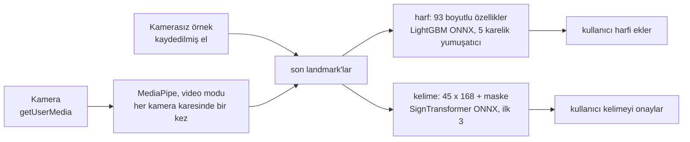

# ASL Assistant: Teknik Rapor

[English](technical-report.md)

ASL Assistant, Amerikan İşaret Dili'ni (ASL) web kamerasından tanır ve bunu tamamen tarayıcıda yapar. MediaPipe her kamera karesinde landmark'ları (eller, yüz ve vücut üzerindeki 3B noktalar) bulur, iki küçük ONNX modeli de bunları sınıflandırır. Hiçbir kamera karesi cihazdan çıkmaz. Ürün, [`asl-web/`](../asl-web/) klasöründeki statik web uygulamasıdır ve <https://asl-assistant.pages.dev/> adresinde yayında. Repoda ayrıca eğitimin ve kontrollerin ortak kullandığı Python özellik paketi [`asl-features/`](../asl-features/) ile daha önceki bir masaüstü prototipi, [`asl-desktop/`](../asl-desktop/), bulunur.

| Ölçüt | Değer | Kapsam |
|---|---|---|
| Harf modeli, rastgele ayrılmış test verisi | 8.245 satırda %99,35 | Test fotoğraflarının neredeyse aynı kopyaları eğitimde var |
| Harf modeli, ayrı `ASL_SemCom` test kümesi | 122 satırda %68,9 | Bu satırlar eğitime katılmadı, ama başka `ASL_SemCom` satırları katıldı |
| Harf modeli, bir kaynak tümüyle eğitim dışında | %39,9 ile %79,6 arası | Her kaynak için bir kez yeniden eğitim |
| Kelime modeli, 50 tekil işaret | %71,92 doğruluk, 0,714 makro-F1 | Eğitimde hiç görülmemiş 4 işaretçiden 3.918 kayıt |
| İndirme | Sayfayı açmak için 0,35 MB; ilk kamera açılışında yaklaşık 15 MB | İkinci ziyarette hiçbir şey |

## 1. Mimari

| Parça | Nedir |
|---|---|
| `asl-web/` | Ürün: HTML, CSS ve klasik `<script>` dosyaları; derleme adımı ve sunucu kodu yok. ONNX Runtime Web 1.22.0, MediaPipe Tasks Vision 0.10.18 ve kjua 0.9.0 (QR kodları) herkese açık CDN'lerden gelir. |
| `asl-features/` | Model girdisinin Python tanımı: el normalizasyonu, kare birimler, 93 boyutlu harf özellikleri ve 45 × 168 kelime özellikleri. Yalnızca NumPy. |
| `models/`, `notebooks/` | Her modelin kaynak kopyası ve kelime eğitimi notebook'ları. `asl-web/models/` ve `asl-web/data/` içindeki dosyalar bunların bayt bayt kopyalarıdır ve SHA-256 ile denetlenir. |
| `scripts/`, `tests/` | Veri hazırlama, harf eğitimi, test örneklerini (fixture) dışa aktarma, doğrulayıcılar; Python, Node ve headless Chrome testleri. |
| `asl-desktop/` | Aynı harf modelini ve daha eski bir 25 kelimelik modeli kullanan bir CustomTkinter prototipi. |

Cloudflare Pages'teki canlı site, repodaki `asl-web/` klasörünün olduğu gibi yüklenmiş hâlidir. Bir kopyayı nasıl yayımlayacağınızı [Başlangıç kılavuzu](getting-started.md#hosting-a-copy) anlatır.

Tarayıcıda Python çalışmaz. `asl-web/js/ml/` içindeki JavaScript, `asl-features`'in özellik kodunu yeniden uygular. Eşleşme (parity) kontrolleri ikisine aynı landmark'ları verir ve sonuçların en fazla 1e-4 farklı olmasını ister.

### Yükleme sırası

`index.html` bütün ekranları içerir ve kendi 32 düz `<script>` dosyasını yükler. Bu dosyalar tek bir global kapsamı paylaşır; her dosya yalnızca kendisinden önce yüklenenlerin tanımladıklarını kullanabilir, bu yüzden yükleme sırası önemlidir. `<head>` içindeki iki küçük script, ilk boyamadan önce temayı ve dili ayarlar. Metin dosyaları sayfayı CDN script'lerinden önce çevirir. En son `core/app.js` gelir ve uygulamayı başlatır; aradaki dosyalar yalnızca fonksiyon tanımlar. Her modülü [`asl-web/js/README.md`](../asl-web/js/README.md) anlatır.

### Ekranlar

`#letter` (varsayılan ve ana mod), `#word` (deneysel), `#coach`, `#test` (Model Test: paketle gelen test örneklerini kamerasız çalıştıran bir geliştirici aracı), `#project` ve `#qr`. Kamera yoksa harf ekranındaki *Örneği izleyin*, FLY kelimesini heceleyen kayıtlı bir eli canlı işlem hattından geçirerek oynatır.

İki döngü yalnızca en son MediaPipe sonucunda buluşur. `media/camera.js` içindeki algılama döngüsü kamera açıkken çalışır. `core/app.js` içindeki render döngüsü ise kaplamayı çizer ve modelleri çağırır. Harf çıkarımı en fazla 120 ms'de bir çalışır, böylece beş tahminlik yumuşatıcı yaklaşık 600 ms'lik bir işareti kapsar. Kelime kaydı ise her kareyi okur. Bir model çağrısı sürerken gelen kare atılır. Kamerasız örnek, `media/demo-source.js`, ikinci bir kare kaynağıdır. Kayıtlı eli saniyede yaklaşık 20 kez gönderir; landmark adımından sonrası kamerayla aynıdır.

### Metne ekleme

Metne hiçbir şey kendiliğinden eklenmez. Bir harf, yumuşatılmış güveni 0,60'a ulaştığında kullanıcı Boşluk'a ya da *Ekle*'ye basınca eklenir. Bir kelime yalnızca kullanıcı onu onayladıktan sonra eklenir; bunun için de en son kayda ait olması ve güveninin en az 0,15 olması gerekir. Kamera ekranından çıkınca kamera kapanır ve MediaPipe kapatılır. Kamera henüz açılırken durdur'a basmak açılışı iptal eder.

### Kelime kaydı

`IDLE → COUNTDOWN → RECORDING → PROCESSING → RESULT`. Bir kare yalnızca bir el, yüz ve iki omuz birlikte göründüğünde sayılır. 45 kare toplanamazsa kayıt şu durumlarda kendiliğinden biter: 6 saniye boyunca kullanılabilir kare yoksa, 4 saniye boyunca yeni kare gelmezse ya da toplam 15 saniye dolarsa. Her kaydın bir sıra numarası vardır; daha eski bir kayıt için geç gelen model sonucu atılır.

### Gecikmeli yükleme

`init()` hiçbir model yüklemez. Bir model ilk gerektiğinde yüklenir: kendi modunda bir kamera açılışında, bir örnek başlangıcında (yalnızca harf modeli), bir kelime kaydında ya da bir Model Test çalıştırmasında.

| Adım | İndirilen |
|---|---|
| Sayfayı açmak | yaklaşık 0,35 MB |
| Harf modunda ilk kamera açılışı | yaklaşık 15 MB: MediaPipe el modeli 7,8 MB, MediaPipe WebAssembly 2,6 MB, ONNX Runtime WebAssembly 2,4 MB, harf modeli 2,2 MB |
| İlk örnek başlangıcı | yaklaşık 4,6 MB: ONNX Runtime ve harf modeli |
| Kelime modu da açılırsa | toplamda en fazla 24 MB |

`index.html`, ONNX Runtime'ın yalnızca WebAssembly içeren paketini (`ort.wasm.min.js`) yükler, çünkü tam paket iki modelin de kullanmadığı 4,2 MB'lık bir WebGPU derlemesini de indiriyordu. 13,2 MB'lık harf modeli gzip'lenmiş olarak 2,2 MB gelir ve `DecompressionStream` ile açılır; ham dosya yedek olarak durur.

### Gizlilik ve güvenlik

Arka uç, hesap ya da analitik yok. `localStorage` temayı, dili, metni ve koç ilerlemesini tutar. ONNX Runtime ve kjua, Subresource Integrity ile yüklenir; dinamik import ile gelen MediaPipe tam bir sürüme sabitlenmiştir. [`asl-web/_headers`](../asl-web/_headers) güvenlik başlıklarını ve hâlâ yalnızca raporlama modunda olan bir İçerik Güvenliği Politikası'nı (CSP) ayarlar.

## 2. Veri

| Kaynak | Kullanım | Kullanılan miktar | Koşullar |
|---|---|---:|---|
| [ASL Alphabet](https://www.kaggle.com/datasets/grassknoted/asl-alphabet), Akash Nagaraj, 2018, [doi:10.34740/KAGGLE/DSV/29550](https://doi.org/10.34740/KAGGLE/DSV/29550) | Harfler, ana kaynak | 52.419 landmark satırı | Sağlayıcının etiketine göre GPL-2.0 |
| [American Sign Language Dataset](https://www.kaggle.com/datasets/ayuraj/asl-dataset), Ayush Thakur | Harfler; örneğin el pozları | 962 satır | CC0 1.0 |
| [ASL-Fingerspelling](https://github.com/Mohammed-Shoaib/ASL-Fingerspelling) ile ilişkili `ASL_SemCom` alt kümesi | Harfler; ayrı test kümesi değerlendirmede kullanılır | 1.580 eğitim satırı; 122 test satırı birleştirilmedi | Kaydedilmemiş; görüntüler yeniden dağıtılmıyor |
| [Google - Isolated Sign Language Recognition](https://www.kaggle.com/competitions/asl-signs) (Kaggle, 2023), Deaf Professional Arts Network ve Georgia Institute of Technology | Kelimeler | 21 işaretçinin 250 işaretinden 94.477 kayıt; 19.299'u kullanıldı | Yarışma kurallarına bağlı olarak [CC BY 4.0](https://creativecommons.org/licenses/by/4.0/) |

Harf sayıları, MediaPipe'ın el bulduğu satırları sayar; el bulunamayan görüntüler sayılmaz. MediaPipe Processed ASL (kullanılabilir el yok) ve MS-ASL (yalnızca indirme betikleri) veri kümelerine de baktım, ama kullanmadım. Yarışma kuralları verinin her türlü kullanımına izin veriyor (7.A) ama yeniden dağıtılmasını yasaklıyor (7.B). Bu yüzden repo yalnızca eğitilmiş modelleri ve toplu sonuçları yayımlar. Yarışma verisinden çıkarılan kelime test örnekleri git'in yok saydığı `asl-web/data/model-test-samples/local/` klasörüne gider; yayımlanan tek kelime örneği sentetiktir. Ham veri git'e girmez; neyin yerelde kaldığını [Başlangıç kılavuzu](getting-started.md#training-and-data) listeler.

**Harfler.** [`extract_static_letter_landmarks.py`](../scripts/data_preparation/extract_static_letter_landmarks.py), MediaPipe'ın eski Hands API'sini durağan görüntü modunda çalıştırır ve her görüntünün ilk elini tutar. [`merge_static_letter_datasets.py`](../scripts/data_preparation/merge_static_letter_datasets.py) 24 statik harfi tutar; tekrarları, sonlu olmayan değerleri ve aykırı değerleri atar. Ardından seed 42 ile katmanlı bir 85/15 bölme yapar: 54.961 satır, eğitim için 46.716 ve dışarıda tutulan 8.245 satır olur. CSV'lerde işaretçi kimliği olmadığı için bölme satırlar üzerinden rastgeledir. Satırların %95,4'ünü oluşturan ASL Alphabet, her harfi birbirine çok benzeyen karelerden oluşan uzun seriler halinde fotoğraflar.

**Kelimeler.** Yarışma her kare için MediaPipe Holistic landmark'larını veriyor. [`word_50_training.ipynb`](../notebooks/word_50_training.ipynb):
- 543 noktanın 107'sini tutar;
- boşlukları ara değerle doldurur;
- 5 kareden kısa kayıtları atar;
- her kareyi omuzlara göre normalleştirir.

En az 300 kaydı olan işaretler seçilebilirdi. Elle seçtiğim 50 gündelik kelimelik listeden 34'ü bu koşulu sağladı; kalan 16'yı kayıt sayısına göre doldurdum. 21 işaretçi seed 42 ile karıştırılıp üçe ayrıldı: eğitim için 14 (12.723 kayıt), doğrulama için 3 (2.658) ve test için 4 (3.918). Hiçbir işaretçinin iki bölmede birden bulunmadığını assert'ler denetler.

**Örnek kaydı.** [`demo-letters.json`](../asl-web/data/demo-letters.json), FLY'ın her harfi için bir sağ el tutar. [`export_demo_letters.py`](../scripts/evaluation/export_demo_letters.py), tarayıcının el modelini CC0 veri kümesi üzerinde video modunda çalıştırdı ve her harf için yayındaki modelin en emin okuduğu pozu tuttu. Bu fotoğraflar eğitim bölmesinde olduğu için model her pozu 1,0 ile okur. Yani örnek, uygulamanın nasıl çalıştığını gösterir, ne kadar doğru olduğunu değil.

## 3. Özellikler

**Kare birimler.** MediaPipe x'i karenin genişliğinin, y'yi yüksekliğinin bir oranı olarak verir. Eğitim fotoğrafları karedir, ama 1280 × 720 bir kamera eli yanlara doğru basık gösterir. Dışarıda tutulan fotoğrafları 16:9 bir kareye yerleştirdiğimde doğruluk %98,4'ten %88,6'ya düştü. Bu yüzden iki uygulama da özelliklerden önce x ve z'yi genişlik bölü yükseklik ile çarpar. Kare bir görüntü bundan etkilenmez.

**Normalizasyon.** Bileği (landmark 0) çıkar ve bilekle orta parmak eklemi (landmark 9) arasındaki uzaklığa böl: el başına 63 değer.

**93 boyutlu harf vektörü** ([`letter.py`](../asl-features/src/asl_features/letter.py), `ml/features.js`):

| Aralık | İçerik |
|---|---|
| 0..62 | Normalleştirilmiş landmark'lar |
| 63..71 | 5 parmak ucu-bilek ve 4 komşu parmak ucu uzaklığı |
| 72..85 | 14 eklem açısı |
| 86..87 | Sınırlayıcı kutunun en-boy oranı ve alanı |
| 88..92 | 5 "parmak açık" bayrağı |

Doğru uzunlukta ama yanlış sıralı bir vektör yine de çalışır ve saçma tahminler üretir. Sıra değişirse bunu kayıtlı referans çıktılar (golden) ve eşleşme kontrolleri yakalar.

**321 boyutlu holistic kare** (kelime yolu): sağ el 0..62, sol el 63..125, 40 yüz noktası 126..245, 25 vücut noktası 246..320. Eksik bir parça sıfır kalır, böylece sonraki gruplar yerinden kaymaz.

**Kare başına 168 boyutlu kelime özellikleri** ([`word.py`](../asl-features/src/asl_features/word.py); notebook'taki kodun bir kopyası, ona karşı test edilir): baskın elin 63 landmark'ı, 30 el şekli değeri, 12 el-yüz ilişkisi ve kareden kareye harekete ait 63 değer. Baskın el her kayıt için bir kez seçilir. Model `float32 [1, 45, 168]` girdisini ve gerçek kareleri `true` ile işaretleyen bir `bool [1, 45]` maskesini alır. Dışa aktarılan grafik maskeyi kendisi ters çevirir, bu yüzden tarayıcı maskeyi olduğu gibi verir.

## 4. Modeller

### Harf modeli

Eğitim betiği yalnızca 46.716 eğitim satırıyla çalışır. Her satırın gürültü eklenmiş 5 kopyasını üretir; kopyalar en fazla ±45° döndürülür ve en fazla ±%20 ölçeklenir. Böylece 280.296 satır olur. Modeli ve özellikleri seçmek için yapılandırmaları bu çoğaltılmış satırların rastgele %15'inde (42.045 satır) karşılaştırdım. Aynı fotoğrafın kopyaları bu bölmenin iki tarafına da düşebilir; bu yüzden bu sayılar yalnızca yapılandırmaları birbiriyle kıyaslamaya yarar. Sonuçlar [`letter_model_meta.json`](../models/letter/letter_model_meta.json) dosyasında kayıtlı:

| Model | Doğruluk |
|---|---:|
| Random Forest | 0,985 |
| XGBoost | 0,992 |
| LightGBM | 0,994 |

| Yapılandırma | Doğruluk |
|---|---:|
| 93 boyutlu özellikler, veri çoğaltma ile | 0,994 |
| 93 boyutlu özellikler, veri çoğaltma olmadan | 0,988 |
| Ham 63 boyutlu landmark'lar, veri çoğaltma ile | 0,332 |

Ham 63 boyutlu deneme, 0..62 numaralı özelliklerle aynı bilek-normalize koordinatları kullanır. Eli döndürmek bu koordinatları çok değiştirir, ama uzaklıkları, eklem açılarını ve parmak bayraklarını neredeyse hiç değiştirmez. Veri çoğaltma açıkken ham koordinatların 0,332, 93 özelliğin ise 0,994 almasının nedeni bu.

LightGBM'i 300 ağaçla seçtim. Birleştirme betiğinin ayırdığı, çoğaltılmamış 8.245 test satırında %99,35 alıyor. OnnxMLTools onu ZipMap olmadan tek bir ağaç topluluğu düğümü olarak dışa aktardı, çünkü ZipMap'in sözlük listesi biçimindeki çıktısını ONNX Runtime Web güvenilir biçimde okuyamıyor.

**%99,35 neden gerçeği abartıyor.** Dışarıda tutulan satırlar, eğitim satırlarıyla aynı uzun ve birbirine çok benzeyen fotoğraf serilerinden rastgele ayrıldı. Yani model bu satırların çoğunun neredeyse aynısını eğitimde görmüş oluyor. Modeli iki zor yoldan daha ölçtüm. Birincisi, yayımlanan modeli ayrı `ASL_SemCom` test kümesinde denedim: bu 122 satır eğitime katılmadı, ama 1.580 başka `ASL_SemCom` satırı katıldı ve işaretçi kimliği olmadığı için aynı kişiler iki tarafta da olabilir. İkincisi, her seferinde bir kaynağı tümüyle dışarıda bırakarak modeli üç kez yeniden eğittim:

| Değerlendirme | Doğruluk |
|---|---:|
| Yayımlanan model, `ASL_SemCom` test kümesi (122 satır) | %68,9 |
| Yeniden eğitilmiş, American SL dışarıda | %79,6 |
| Yeniden eğitilmiş, ASL Alphabet dışarıda | %64,8 |
| Yeniden eğitilmiş, `ASL_SemCom` dışarıda | %39,9 |

Hatalar iki yerde toplanıyor: yalnızca başparmakla ayrılan yumruklar (M, N, T, S, E, A) ve R/U/V ile G/K gibi birbirine yakın çiftler. Yanlış cevapların %89,5'inin olasılığı en az 0,6'ydı, yani eşiği yükseltmek bu hataları ayıklamazdı. Bu hataları azaltmanın yolu daha çok işaretçiyle eğitmek ve veriyi işaretçiye göre bölmek.

**Canlı landmark'lar.** Eğitimde durağan görüntüler üzerinde eski Hands API kullanıldı; tarayıcı ise video modunda Tasks HandLandmarker kullanıyor. Landmark almanın dört yolunu, dördünün de el bulduğu 164 `ASL_SemCom` test görüntüsünde karşılaştırdım:

| Landmark kaynağı | Doğruluk |
|---|---:|
| Eski API, durağan görüntüler (eğitim verisi böyle üretildi) | %70 |
| Eski API, takip ile | %80 |
| Tasks HandLandmarker, görüntü modu | %46 |
| Tasks HandLandmarker, takip oturduktan sonra video modu (tarayıcının yolu) | %76 |

El modelinin ağırlıkları dördünde de aynı; yalnızca kırpma ve takip farklı. Tarayıcının yolu, eğitim verisini üreten yol kadar iyi, hatta biraz daha iyi sonuç veriyor. Bu yüzden harf modelini yeniden eğitmedim.

### Kelime modeli

Bütün deneyler aynı tarifi kullanıyor (etiket yumuşatmalı focal loss, AdamW, seed 42, her biri tek çalıştırma) ve her adımda doğrulama makro-F1'ine göre seçim yaptım. Test F1 yalnızca bilgi için veriliyor. Sayılar [`all_experiment_results.json`](../notebooks/word_50_results/all_experiment_results.json) dosyasından.

Özellikler, 30 kare üzerinde bir BiGRU ile:

| Özellik kümesi | Doğrulama F1 | Test F1 |
|---|---:|---:|
| ham 321 boyut | 0,670 | 0,581 |
| ikili ilişkiler + baskın el, 444 boyut | 0,770 | 0,671 |
| el şekli, 72 boyut | 0,715 | 0,613 |
| şekil + hareket, 132 boyut | 0,714 | 0,621 |
| **kompakt, 168 boyut** | **0,788** | **0,699** |
| tam, 519 boyut | 0,740 | 0,639 |

Dizi, 168 boyutlu özellikler ve bir BiGRU ile:

| Dizi | Doğrulama F1 | Test F1 |
|---|---:|---:|
| sabit 30 kare | 0,788 | 0,699 |
| **45 kare + maske** | **0,791** | **0,700** |
| en çok hareketli 30 kare | 0,786 | 0,694 |

Mimari, 168 boyutlu özellikler, 45 kare ve maske ile:

| Model | Parametre | Doğrulama F1 | Test F1 |
|---|---:|---:|---:|
| SmallGRU | 104.627 | 0,765 | 0,682 |
| BiGRU | 602.739 | 0,791 | 0,700 |
| ConvGRU | 338.259 | 0,781 | 0,702 |
| **SignTransformer** | **446.195** | **0,792** | **0,719** |
| SignTransformer ve BiGRU topluluğu | 1.048.934 | yalnızca test | 0,733 |

En büyük özellik kümesi en iyisi değildi; doğrulamada kompakt 168 boyutlu küme kazandı. Maskeli 45 kare, sabit 30 kareyle hemen hemen aynı skoru aldı ve son model bunu kullanıyor. Doğrulamada SignTransformer ile BiGRU berabere kaldı (tek seed ile 0,7917'ye karşı 0,7911). Transformer'ı daha küçük olduğu için seçtim: 602.739'a karşı 446.195 parametre. İki modelli topluluk yalnızca test kümesinde puanlandı, bu yüzden aday değildi.

SignTransformer, 128 boyutlu bir izdüşüm üzerinde 2 encoder katmanından oluşur ve gerçek kareleri dikkat havuzlamasıyla (attention pooling) birleştirir. Son model için onu 25 yerine 63 epoch eğittim; test F1'inin karşılaştırmadaki 0,719'dan biraz farklı olması bundan. Son model 4 test işaretçisinde **%71,92 doğruluk ve 0,714 makro-F1** veriyor; en iyi doğrulama F1'i 0,803. Sıcaklık ölçekleme (T = 0,9854) kalibrasyonu iyileştirmedi: ECE önce 0,0235, sonra 0,0252. Bu yüzden uygulama ilk üç adaya ve kullanıcının onayına dayanıyor. ONNX modelinin (opset 17) çıktısı PyTorch'takinden en fazla 6e-7 farklı.

Kelime bazında 9 kelimenin F1'i en az 0,85 (water 0,912, sad 0,910); 3 kelime 0,50'nin altında (open, give, all). En sık karışanlar listen → hear, can → yes, open → book ve sleep → sleepy; koçun ipuçları bunlardan geliyor.

**Masaüstü 25 kelimelik model.** 30 × 321 kareler üzerinde bir BiGRU. Rastgele 70/15/15 bölmeyle 7.723 kayıtta eğitildi ve %86,7'ye ulaştı. Kelime listesi, özellikleri ve bölmesi farklı olduğu için web modeliyle karşılaştırılamaz.

## 5. Tarayıcı çalışma zamanı

- **Video modunda MediaPipe.** Üç landmark modeli de `runningMode: "VIDEO"` ile çalışır; bu mod eli kareler arasında takip eder. Vücut ve yüz yalnızca kelime bağlamlarında başlar. GPU başarısız olursa CPU'ya geçilir.
- **Kare temposu.** Algılama, videonun gösterdiği her kamera karesinde bir kez çalışır. Kareler `requestVideoFrameCallback` ile sayılır ve 200 ms'lik bir takılma sınırı vardır. Bu API'si olmayan tarayıcılar her animasyon karesinde algılama yapar.
- **İki el.** HandLandmarker en fazla iki el takip eder. İkisi de görünürken, bileği kare yüksekliğinin onda birinden fazla daha yukarıda olan el kazanır; yoksa sağ el kazanır. Sol el `x → 1 − x` ile aynalanır: aynalanmış sol ellerde model %79,1, aynalanmamışlarda %49,3 aldı.
- **Yumuşatma ve eşikler.** Landmark'lar yumuşatılır (geçerli kareye 0,6 ağırlık). Sonuç kartı son 5 tahminin en sık olanını gösterir: 0,45'in altında belirsiz, 0,65'ten itibaren emin. Bir kelime 0,15'in altında belirsiz, 0,20'den itibaren emindir; ilk iki aday arasındaki fark 0,08'den azsa uygulama kontrol ister.
- **Diller.** Her ekran Türkçe ve İngilizcedir. `core/lang-boot.js` ilk boyamadan önce dili seçer: önce kaydedilmiş tercih, yoksa tarayıcının tercih ettiği dil, o da yoksa İngilizce. İngilizce bir sayfa çevrilene kadar gizli kalır; 3 saniyelik bir güvenlik sınırı vardır. Başlıktaki düğme, sayfa yeniden yüklenmeden, kamera yeniden başlamadan ve metin kaybolmadan her metni, `<html lang>`'i ve başlığı değiştirir. Metinler alan alan `asl-web/js/i18n/` içinde tutulur.
- **Erişilebilirlik.**
  - Ekran başına, gezinmede odağı alan bir `h1`.
  - İçeriğe atlama bağlantısı ve ekran okuyucular için bir `aria-live="polite"` bölgesi.
  - Azaltılmış hareket tercihine uyum.
  - İki temada da WCAG 2.2 AA metin kontrastı.
  - Tek tuşluk kısayol yok.

## 6. Test

| Katman | Nerede | Neyi denetler |
|---|---|---|
| Python birim testleri | `tests/asl_features`, `tests/asl_desktop` | Normalizasyon, özellikler, referans çıktılar (golden), masaüstü algılayıcıları |
| Betikler | `tests/scripts` | Doğrulayıcılar, eşleşme komutları ve make hedefleri; bozuk dosyalarda nasıl hata verdikleri de dahil |
| Tarayıcı kodu | `tests/web` | Gerçek script'ler ve `index.html`, sahte bir kamera ve sahte bir ONNX Runtime ile bir `node:vm` bağlamında |
| Gerçek tarayıcı | `tests/browser` | Gerçek başlıklar altında headless Chrome: cascade katmanları, telefon ve laptop boyutlarında yerleşim, kameranın bırakılması, örnek, iki dil |
| Eşleşme | `tests/validation` | Python'a karşı JavaScript özellikleri: harflerde en büyük fark 1,12e-5, kelimelerde 7,15e-7 |

Testler yalnızca ağı, saati, depolamayı, kamerayı, MediaPipe'ı ve ONNX Runtime'ı taklit eder. En önemli davranışların her birinin kendi testi var: onaysız kelime eklenmemesi, maske yönü, kare sırası, kameranın bırakılması, algılama temposu, kaldırılan elin seçilmesi ve örnek pozlar.

Yayındaki ONNX harf modeli, dışarıda tutulan 8.245 satırın hepsinde pickle ile aynı ilk tahmini (top-1) verdi.

`make check` şunları çalıştırır: lint, biçim kontrolü, tip kontrolü, çalışma zamanı dosya kontrolü, Python ve JavaScript testleri ve eşleşme kontrolleri. `make browser-check` Chrome test takımını çalıştırır. Işık koşulları, izin pencereleri ve gerçek bir işaretçi otomatik kontrollerin kapsamı dışında kalıyor.

## 7. Tasarım kararları

| Karar | Alternatifi | Neden |
|---|---|---|
| Bütün çıkarım tarayıcıda, statik site | Bir çıkarım sunucusu | Çalıştırmam gereken bir sunucu olsun istemedim ve her kamera karesinin cihazda kalmasını istedim |
| Model girdisi olarak landmark'lar | Ham video ya da bir görüntü CNN'i | Modeller küçük kalıyor ve her özelliği inceleyebiliyorum |
| Ayrı harf ve kelime modelleri, önce harfler | Tek ortak model | Durağan bir el şekli ile zamana yayılan bir işaret farklı problemler; önce daha basit olanla başladım |
| 93 boyutlu el geometrisi özellikleri | Ham 63 boyutlu koordinatlar | El döndüğünde uzaklıklar ve açılar neredeyse hiç değişmiyor, ham koordinatlar ise çok değişiyor |
| İşaretçiden bağımsız kelime bölmesi | Rastgele bölme | Rastgele bölmede model işaretler yerine işaretçileri öğrenebilir |
| Tek SignTransformer | BiGRU | Doğrulamada BiGRU ile berabere kaldı ve yaklaşık dörtte bir daha az parametresi var |
| Her kelimeyi kullanıcı onaylar | En olası kelimeyi eklemek | Doğru kelimelerin güveni çoğu zaman düşük; bu yüzden üç aday gösterip seçimi kullanıcıya bıraktım |
| Klasik script'ler, derleme adımı yok | ES modülleri ve bir bundler | Repodaki klasör sitenin kendisi ve herhangi bir statik sunucu onu çalıştırabilir |
| Modeller ilk gerektiğinde yüklenir | Önceden yükleme | Yalnızca göz atan bir ziyaretçi hiç model indirmez |

## 8. Çıkarılan dersler

- Doğru boyutta bir kelime girdisi yine de yanlış olabilir. Bir `[1, 45, 168]` tensörü; özellikler yanlış sıradayken, normalizasyon yanlışken, öbür el seçilmişken, hareket değerleri eskiyken ya da maske ters çevrilmişken de sorunsuz çalışır. Bunların her biri için bir eşleşme kontrolü ya da bir test ekledim.
- Baskın el her kayıt için bir kez seçilmeli. Tarayıcı bunu kare başına seçseydi, işaretin ortasında el ve hareket değerleri değişebilirdi. Bu yüzden tarayıcı 168 boyutlu diziyi, eğitimdeki gibi, kayıt bittikten sonra oluşturuyor.
- Harf modelimin %99,35'i, birbirine çok benzeyen fotoğraflar üzerinde rastgele bir bölmeden geliyordu. Ayrı `ASL_SemCom` test kümesinde %68,9 aldı; bir kaynak tümüyle eğitim dışında bırakılınca %39,9 ile %79,6 arasında kaldı.
- Tarayıcının el modelini önce görüntü modunda ölçtüm, %46 aldım ve harf modelini neredeyse yeniden eğitiyordum. Oysa tarayıcı video modunda çalışıyor ve aynı görüntülerde %76 alıyor; yeniden eğitime gerek yoktu.
- Sıcaklık ölçekleme zayıf kelime tahminlerini daha güvenilir yapmadı. Bu yüzden belirsizliği arayüze taşıdım: uygulama üç aday gösteriyor ve kullanıcının birini onaylamasını bekliyor.

## 9. Sınırlamalar ve sonraki adımlar

- Harf modeli 24 statik harfi kapsıyor; J ve Z hareket gerektiriyor. İki modelde de "işaret yok" sınıfı bulunmuyor.
- Başka kaynaklardan gelen verilerde harf doğruluğu %99,35'in çok altında. ONNX dışa aktarımı ve dışarıda tutulan veriyle değerlendirme elle yapıldı; henüz betik olarak yazılmadı.
- Kelime modeli yalnızca tekil işaretleri tanıyor; 4 test işaretçisi ve tek bir seed ile değerlendirildi. 50 kelimesinin 16'sı veri bulunabilirliğine göre seçildi. Tarayıcı ilk 45 kullanılabilir kareyi alıyor, eğitimdeki klipler (medyan 22 kare) ise dolduruldu ya da seyreltildi; bunun etkisini ölçmedim.
- Uygulamayı şimdiye kadar yalnızca masaüstü Chrome'da test ettim. İçerik Güvenliği Politikası hâlâ yalnızca raporlama modunda, ilk ziyaret CDN'lere ihtiyaç duyuyor ve kelime referans görselleri bir ASL sözlüğüyle karşılaştırılmadı.

Sonraki adımlar:
- Harf modelini daha fazla işaretçiyle ve işaretçiye göre gruplanmış bir bölmeyle yeniden eğitmek; değerlendirmesini ve ONNX dışa aktarımını betik olarak tutmak.
- Telefonlarda test edip eşikleri buna göre ayarlamak.
- CSP'yi zorunlu kılmak.
- Kelime deneylerini daha fazla seed ve daha fazla kelimeyle tekrarlamak.
- Uygulamayı aşamalı web uygulaması (PWA) olarak çevrimdışı çalıştırmak.
